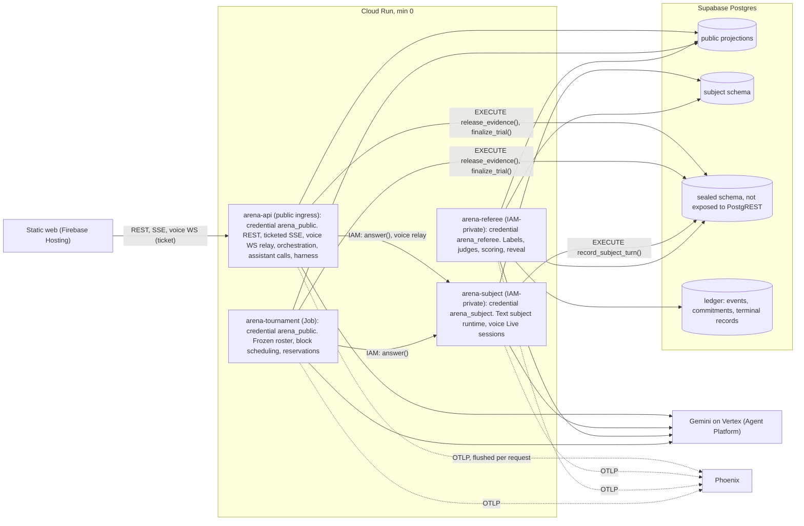

# Direction: Investigative AI Training Arena

Research synthesis and recommendation. **Version 5, 2026-10-08**, revised after Codex critique rounds 1-4 (YELLOW each: 24, 12, 6, then 5 majors). Dispositions: `critique-round-1.md` to `critique-round-4.md`. Every dollar figure comes from `cost_model.py`, every matrix total and sensitivity result from `decision_matrix.py`, every statistical bound from `stats_contracts.py`. Inputs: 18 route reports (`docs/research/internal/I1-I7`, `docs/research/external/X1-X11`) and the sponsor deck (`docs/challenge/REQUIREMENTS.md`). Confidence labels: H / M / L. Owner decisions D-001 to D-008 are hard constraints.

## 0. TL;DR

1. **Build the deck's protocol as a working instrument with real numbers, then the training experience on top.** We implement the protocol literally, publish every metric with its interval, and enforce its gates in code. (H)
2. **Isolation by credential boundary and narrow privileged operations.** One image, four Cloud Run deployables, all scaling to zero: `arena-api` (public-only credential; investigator routes, orchestration, assistant calls, voice proxy), `arena-subject` (IAM-private; the only runtime reader of subject-private packets), `arena-referee` (IAM-private; evaluator data, labels, scoring), `arena-tournament` (Job, public-only). Every privileged step (evidence release, subject turn recording, trial finalization, referee validity adjudication of subjects, reveal with a sealed inclusion snapshot) is one transactional SQL function that derives its inputs from committed server state. Canaries are supplementary evidence only. (M-H)
3. **Agents are stateless, schema-bound calls through a typed agent port lifted from TechnoMile.** The default coaching design is one complete card per turn (flags, follow-up, finding, confidence); the two-stage design competes as candidate A1, so the bake-off itself answers which is better. (M-H)
4. **The official leaderboard runs only arena-hosted, frozen Gemini-on-Vertex candidates.** An A2A v1.0 exhibition track for external endpoints is an owner call (P2). (H)
5. **Latency (KPI-4) is unmeasured and the top technical risk.** Gemini 2.5 retires on Vertex 2026-10-16 to 10-20; no remaining model fully disables thinking. KPI-4 is measured on the complete card at the client. A day-1 benchmark (~$3-5) sets the model. (H on risk, M on plan)
6. **Budget, in three buckets, all online (no batch).** Bake-off (D-007: $100), preparation (experiments, case generation, dev pilot: ~$37-55, needs approval) and hosted demo (needs approval). Inside the $100 bake-off cap: 80 hidden cases x 1 on a Flash-Lite-class lineup ($68 expected / $98 conservative). A simulation of the spend guard shows the expected case completes everything; the conservative case completes the whole replay track and 34 of 40 interactive blocks, with the rest reported as incomplete. The sponsor-sized 120 cases need a ~$145 bake-off ceiling ($103 / $148). The sponsor's gate is a point estimate and applies at any size; more cases buy tighter uncertainty (zero-false-positive one-sided bound 7.2% at 80 cases, 4.9% at 120). Owner decision. (M; assumptions until the dev pilot measures them)
7. **Voice: Gemini Live on Vertex through gokbase's proxy, on development cases only, proven in the October 18 slice.** Browser audio goes to `arena-api`, which relays to the IAM-private `arena-subject`. Probe `gemini-3.8-live` and `gemini-live-2.5-flash-native-audio` on day 1; prebuilt Live Avatar talking heads are a stretch. Push-to-talk or the Developer API each need an owner exception. (M)
8. **Fairness and isolation are headline features.** Style is independent of role; style-stratified false-positive audit; demeanor-based flags count as unsupported; demeanor-driven outputs are negative-control fixtures, never a ranked candidate. (H)
9. **Owner decisions needed:** budget, GCP project (never `kbg-production`), Supabase plan, DESIGN.md, repo destination, Phoenix hosting (local only, or hosted with a CPU sign-off for the Phoenix service), voice exception rule, A2A exhibition track, team roster and KPI-1 volunteers.

## 1. What the judges will score

- **The deck is a protocol.** Its notes fix denominators, abstention reporting, case-level clustering, commit-before-reveal, disjoint families and a false-positive gate before ranking. (H)
- **The sponsor.** Unissant (Herndon, VA) serves ICE, CBP, USCIS, DHS, TSA, US Marshals, DoS, DoD, NIH, VA, CMS and HHS; its founder is a founding member of GMU's AI-in-Gov Council; "Challenge X" has no public rubric. Expect fluency in NIST AI RMF and evidence-based interviewing (PEACE, the Mendez Principles, USCIS FDNS "Corroboration-Based Interviewing"). (H on facts, M on judge profile) [X6]
- **Formats (D-008).** Live demo, hosted link, video plus deck, repo review.
- **NIST anchors (primary source, fetched 2026-10-08).** MEASURE 1.3, 2.1, 2.3, 2.5, 2.7, 2.11; NIST AI 600-1. Every methodology page states, per EVL-12, that NIST has not validated these thresholds.

## 2. Winning thesis

| # | Pillar | What judges see | Requirements |
| --- | --- | --- | --- |
| P1 | Protocol fidelity | Every 9N metric under a written estimand; replay and interactive tracks; 2x3 count matrix; unresolved rates by role; cost and latency per candidate | BKO-1..10, EVL-1..11 |
| P2 | Isolation by construction | Four credentials, narrow privileged functions, an executable capability matrix, pgTAP and route tests, commit-reveal, hash-chained ledger; canaries supplementary | SCN-5, SCN-9, SCN-12, BKO-9, EVL-10, KPI-5 |
| P3 | Fairness by construction | Style factorial independent of role; style-stratified FPR with intervals; demeanor-based flags unsupported | PRB-3, PRB-4, SCN-3, SCN-11 |
| P4 | Science-grounded coaching | Strategic Use of Evidence with the Evidence Framing Matrix; unanticipated questions; question-type enum; ICD 203 confidence language; "insufficient evidence" names the corroboration to seek | CH-2, AST-1..10, EX-1..3 |
| P5 | Honest statistics | Family-clustered bootstrap; conservative zero-event bounds; bootstrap rank intervals; attrition and coverage published | BKO-10, EVL-10 |
| P6 | Training experience | Interrogation room (text and voice), coach companion, evidence board, debrief with five 0-4 cards, progress | CH-1, SOL-6, EVL-2, EVL-7, KPI-1 |
| P7 | Observability | Phoenix span per turn, agent and call; p95 latency panel; one cost ledger | EVL-5, KPI-4 |
| P8 | Ground rules visible | EX-4 statements in onboarding, the room, debriefs, leaderboards and methodology; NIST non-validation note | EX-4, EVL-12 |
| P9 | Engineering quality | TechnoMile and Pangea gates (strict mypy, 90% coverage, bandit, CodeQL, gitleaks), scale-to-zero audit, CI, docs | global gates |

## 3. Scope and delivery

### 3.1 Vertical slice first (gate: 2026-10-18)
One domain (facility access, the slide 8 case), four development families, end to end: generator and validators, text subject through `arena-subject`, one single-call assistant, harness, `finalize_trial`, referee scoring, a plain leaderboard, Phoenix traces. Plus a **minimal development-case voice session** if the Live probe passed: ticket auth, reconnect, transcript finalization and cost-cap acceptance tests. Rubric anchors are authored and calibrated on the slice. Nothing presentational starts before the slice passes.

### 3.2 Schedule (owners assigned once the roster is known; dates are targets until then)

| Window | Work | Exit gate |
| --- | --- | --- |
| Oct 8-12 | Owner inputs; GCP project; day-1 probes (latency, Live matrix, Supabase isolation smoke); repo with lifted gates; schemas, privileged functions, pgTAP; agent port | Probe report; `make check` green |
| Oct 13-18 | Vertical slice, including the minimal voice session | Slice passes; anchors calibrated on dev data; voice feasibility verdict |
| Oct 19-22 | 3 assistants, 3 subjects; dev pilot (measures cost, latency, fidelity, actual request maxima to tighten limits); freeze roster; generate and seal hidden families | Dev pilot report; sealed split hash; frozen trial roster |
| Oct 22-26 | Sealed run in the sponsor's order (BKO-2): produce and seal the replay corpus, replay scoring, then interactive blocks with the referee running online as each block finishes; meanwhile interrogation room, debrief and mode projections per DESIGN.md | One execution record per planned trial |
| Oct 22-29 | KPI-1 volunteer sessions (recruit now) | Counterbalanced sessions scored blind |
| Oct 27-30 | Subject validity adjudication; sealed inclusion snapshot; reveal; leaderboards; trust center; voice polish; pets, portraits, agents-at-work | Commitments and snapshot verified before reveal |
| Oct 31-Nov 2 | Hosted hardening, video, deck, rehearsal, Codex gates | Pre-push quality bar green |

**Owner decision points:** (1) model-access failure (neither Vertex Live model usable by Oct 15); (2) voice integration failure at the Oct 18 gate. At either point the owner chooses: keep working voice in a parallel lane, downgrade to push-to-talk (D-006 exception), use the Developer API (D-001 exception), or drop voice.

### 3.3 Cut order and never-cut list
Cut first: A2A exhibition track, Live Avatar, extra domains, agents-at-work animation, pets. Never cut: the 9N metrics, the isolation gate, the fairness audit, the EX-4 statements, assessment-mode projections.

## 4. Architecture

### 4.1 Credentials and secrecy tiers

| Tier | Contents | Readers | Notes |
| --- | --- | --- | --- |
| Public | Case ID, objective, known timeline, initial documents, released evidence, transcript, coaching (subject to mode projection) | `arena_public`, `arena_subject`, `arena_referee` | Served only through explicit typed projections |
| Subject-private | Role, actions, knowledge, what may be disclosed, uncertainty limits, objective, permitted behaviors, disclosure gates, style | `arena_subject` (runtime), `arena_referee` (labeling) | `arena-api` and the job never hold it |
| Evaluator-only | Canonical facts, role label, contradictions, release predicates, resolution criteria, rubric, subject tag proposals, independent labels, hidden-family contents, commitment nonces | `arena_referee` | Not exposed to PostgREST; reachable by other roles only through the privileged functions below |

`service_role` is never used at runtime (TechnoMile grants pattern). Hidden-case debriefs, exports and Phoenix spans stay locked until reveal.

### 4.2 Privileged operations (each a SECURITY DEFINER function: EXECUTE revoked from PUBLIC and granted to exactly one role, `search_path=''`, trial row locked `FOR UPDATE`, state derived from committed rows, never from caller-supplied turn numbers or hashes)

Every write that changes trial execution state carries a server-created **work item ID** and the **expected transcript version** it was computed against (F07). A retry with the same work item returns the original result; a write against a stale version is rejected. Finalization freezes the execution artifacts (transcript, released evidence, coaching, findings, commitment); validity adjudication and reveal follow their own lifecycle below. Work item IDs correlate work; they never let a caller advance a turn.

| Function | Granted to | Caller supplies | Function derives and enforces | Returns |
| --- | --- | --- | --- | --- |
| `release_evidence(trial, work_item, requested_record_ids)` | `arena_public` | Record IDs from the public list of requestable records | Current turn from the committed transcript; trial `running`; predicates (scheduled turn, request after a minimum turn); one release per record; at most `MAX_RELEASES` per case (generator-enforced) | Newly authorized public evidence only; appends a ledger event |
| `record_subject_turn(trial, work_item, utterance, tag_proposal, guard_result)` | `arena_subject` | Utterance, tag proposal, guard result | The open question it answers; trial `running`; on a guard rejection, atomically stores the offending artifact in the sealed schema and sets the execution record to `subject_quarantined` | Turn ID or quarantine record |
| `finalize_trial(trial, work_item, final_finding)` | `arena_public` | The committed finding | Transcript and released-evidence hashes from stored rows; manifest hash; server-generated nonce in the sealed schema; commitment; execution record `completed`; trial frozen | Commitment hash |
| `record_execution_failure(trial, work_item, state, reason)` | `arena_public` | `assistant_failed`, `infra_failed` or `budget_skipped` with a reason | One execution record per planned trial; allowed transitions only | Execution record ID |
| `adjudicate_validity(trial, verdict, reason, evidence_ref)` | `arena_referee` | Subject verdict (`valid`, `subject_invalid`) after blinded review; assistants are scored, never invalidated | Append-only; never edits transcripts, findings or commitments | Adjudication ID |
| `reveal(tournament)` | `arena_referee` | Tournament ID | Roster frozen; one execution record per planned trial; replay corpus sealed; commitments verify; seals the **inclusion manifest** (the adjudication IDs in force, hashed) | Unlocks scoring; every leaderboard version names its manifest hash |

Tests per function: forged turn, cross-trial call, duplicate and replayed work items, stale transcript version, concurrent calls, wrong role, wrong state.

### 4.3 Capability matrix (becomes a test fixture)

| Surface | Caller | Credential | Can read | Can write |
| --- | --- | --- | --- | --- |
| Investigator REST, debrief, export | Browser with Supabase JWT | `arena_public` | Public projections; own sessions; hidden-case material never before reveal | Questions, session state |
| Ticketed SSE | Browser | `arena_public` | Coaching and ledger events by sequence (projection) | None |
| Voice WebSocket | Browser to `arena-api`, relayed with an IAM ID token to `arena-subject` | `arena_public` at the edge | Audio and transcript of a development-case session | Session ledger rows |
| `answer()` | `arena-api`, `arena-tournament` (IAM) | `arena_subject` behind it | Private packet | Through `record_subject_turn()` only |
| Scoring, adjudication, reveal, leaderboards | Admin through `arena-referee` (IAM) | `arena_referee` | All tiers | Scores, leaderboards, validity adjudications |
| Phoenix UI | Judges with Phoenix accounts | Phoenix auth | Redacted spans for development and revealed work only; unrevealed hidden-tournament spans stay in the restricted `ops.trace_mirror` and are exported to the judge-visible Phoenix only after reveal | None |

Voice tickets are single-use and bound to user, trial, split (development only) and mode; resumes re-check all four, and `arena-subject` re-checks them on its side. Only a small application protocol crosses the relay: bounded audio frames and approved controls (start, stop, interrupt). Live setup, private prompts, tool calls and results, and provider resume handles stay server-owned inside `arena-subject` (R3-02).

### 4.4 Threat model (abridged)

| Actor | Wants | Control | Test |
| --- | --- | --- | --- |
| Investigator or judge | Role labels, answers | No secret-reader credential behind any public surface; projections; assessment projection | Direct requests to every route, SSE, reconnect, export with an investigator account; direct calls to the IAM-private services must fail |
| Assistant candidate (a model) | Hidden facts | Prompts built only from the public projection in a process holding `arena_public` | Projection tests; supplementary canary audit |
| Deceptive subject (a model) | Manipulate the assistant or the platform (SUB-7) | Untrusted-data boundary; deterministic detectors plus optional Model Armor; detection quarantines the trial; harness relays only one neutral question | Persistent-injection fixtures (attack at turn 2; check later turns, finding, judges) |
| Operator (us) | Alter findings after labels | `finalize_trial`, frozen roster, terminal records, `reveal` preconditions, hash-chained ledger | Commitment verification; tamper fixture |
| Internet attacker | Spend, data | Invite-only judges, one atomic spend ledger, concurrency caps, kill switch | Abuse tests on the hosted link |

### 4.5 One interactive turn
1. Question Q(t) reaches `arena-api` (investigator, or the harness in the bake-off).
2. `release_evidence()` may release evidence (SCN-4, SCN-10); clarifications, difficulty changes and predeclared context changes go through the same function and ledger.
3. `arena-api` calls `arena-subject.answer()` with a work item; the subject service loads the private packet, makes one structured call, runs the guard, and calls `record_subject_turn()`, which records a quarantine atomically on a guard rejection.
4. The coaching call runs in `arena-api` inside one open request, bound to a work item and the transcript version it read: the complete card (section 6.1) is validated and sent; candidate A1's deeper update runs in the same request when due; a result whose version is stale is discarded. No work outlives a request. Coaching events are written to Postgres; the browser's SSE stream reads them by sequence number, so no instance pinning is needed. In assessment mode nothing reaches the investigator until the assessment ends.
5. At 12 exchanges or a committed finding, `finalize_trial()` runs. The referee's later blinded review may append a validity adjudication; it never changes the committed record.

### 4.6 Data model sketch
`arena.case_families`, `arena.case_variants` (style, difficulty; no role), `arena.public_packets`, `arena.requestable_records`; `subject.private_packets`; `sealed.evaluator_packets`, `sealed.release_predicates`, `sealed.subject_tag_proposals`, `sealed.independent_labels`, `sealed.hidden_split_seals`, `sealed.commitment_nonces`; `arena.candidates` (manifest JSON, sha256, frozen_at); `arena.tournaments` (draft, frozen, running, sealed, scoring, revealed; seed; budget); `arena.planned_trials` (frozen roster), `arena.blocks`, `arena.trials`, `arena.turns`, `arena.coaching_events`; `ledger.events`, `ledger.finding_commitments`, `ledger.terminal_records`, `ledger.corpus_seals`; `arena.scores`, `arena.leaderboards`, `arena.isolation_checks`; `training.sessions`, `training.rubric_scores`, `training.progress`; `ops.model_calls`, `ops.budget_reservations`, `ops.trace_mirror`.

## 5. Decisions

Method: (1) a constraint gate removes options that break D-001, D-003, D-006 or D-007 unless the owner grants an exception; (2) surviving options are scored 1-5 against anchors; unmeasured quantities are ranges, and options that do not change coaching latency get identical latency scores; (3) `decision_matrix.py` reports totals, a midpoint weight-shift check (10 points between any two criteria) and a score-range check (robust only if the leader's lowest total beats every other option's highest).

| Criterion | Weight | 5 means | 3 means | 1 means |
| --- | --- | --- | --- | --- |
| Protocol fidelity | 30% | Meets the relevant requirement IDs exactly, testably | Meets them with documented deviations | Misses IDs |
| Delivery risk and simplicity | 30% | Proven lift, few moving parts | Moderate new code | New infrastructure, many parts |
| Demo impact | 15% | Distinctive in a 5-minute demo | Neutral | Invisible or confusing |
| Latency and UX | 15% | Measured, meets target | Unmeasured, plausible | Known to miss |
| Security and observability | 10% | Shrinks attack surface, fully traced | Neutral | Adds unmitigated surface |

| Decision | Leader (total) | Runner-up (total) | Weight shift | Score ranges | Recommendation |
| --- | --- | --- | --- | --- | --- |
| DM-1 Agent runtime | Typed port, stateless calls (4.30-4.60) | ADK LlmAgent (3.50-3.80); LangGraph + ADK, Pydantic AI + DBOS (3.10-3.40) | No flip | Robust | Typed port (M-H) |
| DM-2 Candidate transport | In-process, official only (3.95-4.25) | Plus A2A exhibition track (3.75-4.05); every candidate an A2A service (3.00-3.30) | Flips to the exhibition option if 10 points move to demo impact | Depends on unmeasured scores | In-process for P0; exhibition track is an owner call for P2 |
| DM-3 Coaching design | One complete call per turn (4.15-4.45) | Complete card plus deeper update (4.00-4.30); plus Priority tier (3.85-4.15); one Pro call (3.70) | Flips to two-stage if 10 points move to demo impact | Depends on unmeasured scores | Single call as the practice default; two-stage competes as A1; the benchmark and the bake-off decide |
| DM-4 Voice engine (gate-passing options) | Vertex `gemini-3.8-live` (3.60-3.90) | Vertex `gemini-live-2.5-flash-native-audio` (3.45-3.75); plus prebuilt Live Avatar (2.85-3.15) | No flip | Depends on unmeasured scores | 3.8 Live primary, 2.5 native audio fallback, Live Avatar stretch; probe decides |
| DM-5 Phoenix hosting (gate-passing options) | Local only (3.95) | Hosted, trace mirror as the store, request-based CPU (3.70) | Flips to hosted if 10 points move to demo impact | Robust at base weights | Local during the build; hosted for the judge link (CPU allocation optional, separately approved) |
| DM-6 Frontend hosting | Static build on Firebase Hosting (4.30-4.45) | Next.js server on Cloud Run (3.70-4.00); Firebase App Hosting (3.40-3.70) | No flip | Robust | Static build (H) |

Gate-failing options, listed for the owner: Developer API Live (needs a D-001 exception); push-to-talk STT-LLM-TTS (D-006 exception); Arize AX instead of Phoenix (substitution approval). CPU allocated for the Phoenix service's lifetime is an optional latency improvement needing its own sign-off.

A2A exhibition details, if approved: pin a2a-sdk 1.2.2 and spec v1.0 separately; v1.0 `supportedInterfaces`; one conformance fixture; manually approved HTTPS endpoints only; resolved addresses checked (no private or link-local); no redirects; byte and total-time caps; no credentials sent; client runs in a public-only process; results labeled "exhibition: model, prompt and budget unverified".

## 6. Agent design

### 6.1 Coach (assistant candidates)
- **Common required card, every turn, all candidates (AST-1..8):** question type (open, probing, closed, leading, suggestive, compound, forced-choice, opinion) and neutrality issues; answer category (responsive, non-responsive, contradiction, explicit uncertainty, possible evasion); flags, each with turn ID, quoted span and the missing fact or both conflicting statements; one neutral follow-up with its tactic; running finding (deceptive, truthful, insufficient evidence) with ICD 203 wording and confidence, plus the turn it was last revised.
- **Optional deeper update** (candidate A1): refreshes the finding and evidence coverage every third exchange and on each evidence release, inside the same request.
- **Grounding:** Strategic Use of Evidence and the Evidence Framing Matrix; unanticipated questions; the Mendez Principles; demeanor is never evidence.
- **Safety:** untrusted-data boundary (gokbase `injection_defense`); no containment guarantee; detection quarantines the trial, which never enters rankings.
- **Manifest (AST-5, BKO-5):** model, prompt, tools, coaching policy, max input tokens, max output tokens, thinking level, timeout; identical tool set; hashed and frozen before a tournament.

### 6.2 Subject (`arena-subject`)
- **Private packet as a ledger:** atomic fact IDs known; disclosable facts; concealed facts (deceptive); uncertainty limits (truthful); permitted behaviors (omission, deflection, minimization; contradicting a canonical fact is a fidelity failure); disclosure gates on evidence strength (Evidence Framing Matrix; gating cut deep-secret leakage from 19-37% to 3-8%, arXiv 2609.00982); style.
- **Per turn:** one structured call returning the utterance and a tag proposal; packet re-injected every turn (drift reduced 35-38%, not eliminated); deterministic guard before `record_subject_turn()`.
- **Tags are proposals, not ground truth:** the referee labels every turn independently (section 7).

### 6.3 Interviewer harness (BKO-7)
Fixed opening question; relays the assistant's follow-up only if it is one question (ends with "?", at most 40 words, no instructions, passes a neutrality lexicon); otherwise a fixed neutral fallback; stops at 12 exchanges or a committed finding. No model calls.

**Replay corpus (BKO-6):** before any assistant sees it, the same harness asks a predeclared neutral question script (no assistant input) to one subject per hidden case, subjects rotating by case; the referee labels its turns; the corpus is sealed by hash. Every assistant then scores the identical transcripts and released evidence.

### 6.4 Scenario engine and generator
- **Generator:** `gemini-3.1-pro-preview` for hidden families, `gemini-3.8-flash` for development families. Canonical event graph with atomic fact IDs; evidence artifacts with deterministic release predicates; matched variants; misleading but innocent circumstances in truthful variants; difficulty knobs; style by factorial design independent of role.
- **Validators:** schema; consistency; AR-Bench-style solvability gate; role-leak check (a role-guessing model on the public packet near chance); diversity check; pilot difficulty runs.
- **Domains:** facility access first; others only after the instrument passes. Fictional organizations only.
- **Splits:** disjoint dev and hidden families; hidden list and contents sealed by hash before candidates freeze; tuning on dev only; no retrieval index exists for candidates, and hidden families never enter prompts or few-shot examples (SCN-12).

## 7. Metric contracts (implemented in the scorer; written before data exists)

### 7.1 Execution records, validity adjudications and inclusion

Two layers, kept separate (F15):
- **Execution record** (immutable, exactly one per planned trial): `completed` (committed finding), `subject_quarantined` (guard rejection, recorded atomically with the offending artifact), `assistant_failed` (no valid final finding after the allowed repair), `infra_failed` (retried twice with the same seed regardless of outcome, still failing), `budget_skipped` (block never started).
- **Subject validity adjudication** (append-only, referee only, blinded): `valid` or `subject_invalid` (semantic fidelity failure or platform attack found on review). Assistants are never invalidated (R4-01): every schema-valid committed classification counts in the role metrics as committed, including unsupported or demeanor-based accusations, which are additionally reported as unsupported-flag and fairness-audit violations.

| Combined status | Assistant role metrics | Subject metrics | Disclosure |
| --- | --- | --- | --- |
| `completed` with subject `valid` | Counted as committed | Counted | |
| `assistant_failed` | Counted as "insufficient evidence" in both denominators (the only synthetic outcome) | Counted | Assistant failure rate |
| `subject_quarantined`, or `completed` with `subject_invalid` | Excluded for that candidate | Counts against the subject (all-turn fidelity, invalid-session rate) | Exclusions per candidate |
| `infra_failed` | Excluded from all | Excluded | Rate; a block with more than 5% infra failures is invalid |
| `budget_skipped` | Excluded | Excluded | Rate; incomplete blocks reported |

**Eligibility uses each candidate's own included trials (F14).** Another candidate's failures never remove a candidate's valid false positives. Common (family, subject) cells serve paired comparisons only.

**Attrition rules (`stats_contracts.py`):** FPR is recomputed with the candidate's excluded truthful trials imputed as false positives and as clears; if the eligibility decision differs, it is provisional. Recall ranks are recomputed with excluded deceptive trials imputed as misses and as detections; a rank is provisional when a lower-ranked candidate's best case beats a higher-ranked candidate's worst case, or when any candidate's own deceptive coverage is below 90%. With no included truthful trials, eligibility is "insufficient". Coverage and attrition are published per candidate and role.

**Sealed result (F15):** `reveal()` seals the inclusion manifest. The published leaderboard is bound to that manifest hash. A later adjudication creates a new manifest and a separately labeled corrected leaderboard; the original result is never silently changed.

### 7.2 Metrics

| Metric | Estimand | Unit | Interval | Notes |
| --- | --- | --- | --- | --- |
| Deceptive-role recall | Share of included deceptive trials whose committed finding is "deceptive" | Family | Family cluster bootstrap, two-sided 95% | Insufficient counts as a miss |
| FPR (eligibility) | Share of the candidate's own included truthful trials whose committed finding is "deceptive" | Family | Family cluster bootstrap two-sided 95%; with zero events, the complete-family bound below | Insufficient stays in the denominator; sponsor's point-estimate gate (<= 5%) decides eligibility; attrition sensitivity can mark it provisional |
| PPV, 2x3 matrix, unresolved by role | REQUIREMENTS section 11 | Family | Bootstrap | Raw counts published |
| Evasion-event precision and recall | Event = a subject turn the referee labels evasive; an evasion flag matches at most one event; the first match is the true positive, duplicates are false positives | Family | Bootstrap | Zero denominators reported as undefined |
| Unsupported flags | Flags failing citation existence (code) or claim support (semantic check) over all flags | Family | Bootstrap | Fixtures with real quotes and false claims must fail |
| Questioning quality | 0-4 anchors on the assistant's follow-ups | Family | Bootstrap | Proxy blinded to candidate and outcome |
| Subject fidelity (primary, N02) | Compliant turns over **all evaluated subject turns**, including offending turns from invalid sessions | Family | Bootstrap | Valid-session fidelity reported as secondary; invalid-session rate; deceptive success split into misleading clearance and unresolved; truthful consistency, appropriate uncertainty, correct recognition as an interaction outcome |
| KPI-4 coaching latency | Time from the subject's answer being committed to the complete card (6.1) validated and received by the client; timeouts and failed repairs count as misses | Session | Session-cluster bootstrap of p95 | Cold starts and late-interview contexts included |
| Investigator score, KPI-1 | 5 x sum of five 0-4 dimensions; improvement = (post - pre) / pre per participant | Participant | Bootstrap over participants | Pre = 0 makes relative change undefined; absolute change always reported |

- **Zero-event bound (F13, `stats_contracts.py`):** a family "fails" when any of its included truthful trials is classified deceptive. With zero failing families out of n, the exact one-sided 95% bound on the family failure probability is 1 - 0.05^(1/n): 13.9% (n=20), 9.5% (30), 7.2% (40), 4.9% (60). It bounds the trial-weighted FPR only when every counted family contributes the same number of trials, so it is computed on the complete-family subset (all cells included); over all retained families it is reported as a family-level statistic, not an FPR guarantee (the script includes the unequal-size counterexample: 4.87% family bound, 5.22% trial FPR). The sponsor's gate is a point estimate and applies at any size; the bound only describes precision. 59 equal-size families are needed for a zero-event bound at or below 5%.
- **Ranking (EVL-10):** a function that requires `fpr_point <= 0.05` on the candidate's own included trials and `isolation_pass` as preconditions, and shows provisional status from both attrition rules; rank intervals come from the bootstrap distribution of ranks; pairwise differences use a paired family bootstrap.
- **Scheduling (BKO-7, BKO-10):** the roster of planned trials is frozen before the run. A block is one family (both variants) x nine pairings x one repeat; order within a block comes from a recorded seed; a block starts only after its worst-case cost is reserved; extra repeats are drawn by seed before any outcome is seen.
- **Commitment (BKO-9):** `finalize_trial()` (section 4.2). Reveal requires a frozen roster, one execution record per planned trial, a sealed replay corpus and verified commitments, and seals the inclusion manifest. Hidden-case debriefs and spans stay locked until reveal.
- **Independent labels (F16):** the referee labels every subject turn (evasion, genuine uncertainty, legitimate non-disclosure, poorly framed question, responsive) with the private packet and canonical facts, in a separate blinded invocation with a frozen prompt. In the power-first lineup the referee checkpoint (`gemini-3.8-flash`) differs from every subject checkpoint; in the full lineup S3 shares it, which is disclosed. A blinded human sample calibrates labels and fidelity judgments.
- **Judge calibration:** anchors for all five 0-4 dimensions authored and frozen on dev data; 2-3 blinded human raters on ~30 dev transcripts; predeclared thresholds per dimension (quadratic-weighted kappa >= 0.60 and Gwet's AC2 >= 0.70 against human consensus), otherwise revise on dev data only; sub-checks map to 0-4 as round(4 x pass fraction); 0 and 100 tested; same-family judging disclosed.
- **Isolation gate (all must pass):** pgTAP privilege tests per role and per privileged function; capability-matrix route tests, including direct calls to IAM-private services; assistant-context type test; hidden-split seal and no hidden family in dev artifacts; commitment verification; supplementary canary audit with zero hits.
- **Fairness audit:** FPR and flag rates by style with intervals; unsupported style-based flags per assistant; permutation test for order and pairing effects; demeanor-driven negative-control fixtures prove the audit catches them.
- **KPI-1 protocol:** 6-10 volunteers; two matched case sets, counterbalanced; practice on dev cases between; pre and post transcripts shuffled and scored blind by the calibrated proxy plus a human; participant-level relative and absolute change with intervals; a demonstration of the instrument, not a causal claim. The 2026 Law and Human Behavior RCT (Li, Granhag, ... Santtila; n=156) supports the premise.

## 8. Lineup and budget (`cost_model.py`; assumptions until the dev pilot measures them)

### 8.1 Lineups
- **Power-first (recommended):** A1 two-stage (`gemini-3.5-flash-lite` card every turn; deeper update every third exchange and on each release; final on `gemini-3.5-flash-lite`); A2 single call on `gemini-3.5-flash-lite`; A3 Conservative Corroborator, single call on `gemini-3.1-flash-lite`. Subjects S1 `gemini-3.1-flash-lite`, S2 `gemini-3.5-flash-lite`, S3 skilled-deceiver policy on `gemini-3.5-flash-lite`. Referee on `gemini-3.8-flash`, online, as each block finishes.
- **Full:** as above, but A1's deeper update and final use `gemini-3.8-flash` (LOW) and S3 runs on `gemini-3.8-flash` (LOW).
- Prices per 1M input/output tokens (verified 2026-10-08): 3.1-flash-lite $0.25/$1.50; 3.5-flash-lite $0.30/$2.50; 3.8-flash $0.75/$3.75 (promotional to 2026-12-31); 3.1-pro-preview $2.00/$12.00. Thinking bills as output. No cache discount assumed.

### 8.2 Options (all online; each part includes a 15% retry reserve; expected / conservative)

Three buckets: **bake-off** (replay corpus and scoring, sealed interactive run, online referee; D-007 caps it at $100), **preparation** (day-1 experiments, case generation, dev pilot; needs approval), **hosted demo** (judge sessions and voice; needs approval, small). No batch pricing is used anywhere: batch has no SLA, finished batch work stays billable after cancellation, and queued work holds reservations.

| Option | Preparation | Bake-off | Zero-FP bound (equal-size families) |
| --- | --- | --- | --- |
| Sponsor full workload: 120 x 2, full lineup, dev 40 | $68 / $105 | $243 / $384 | 4.9% |
| 120 x 1, full lineup, dev 20 | $49 / $74 | $134 / $212 | 4.9% |
| **A. Sponsor-sized: 120 x 1, power-first, dev 20** | **$45 / $66** | **$103 / $148** | **4.9%** |
| **B. Inside the $100 bake-off cap: 80 x 1, power-first, dev 20** | **$37 / $55** | **$68 / $98** | **7.2%** |
| 60 x 1, power-first, dev 20 | $34 / $50 | $51 / $74 | 9.5% |
| 40 x 1, power-first, dev 20 | $30 / $45 | $34 / $49 | 13.9% |

**Spend-guard simulation** (`simulate_admission`: replay first, then sequential blocks; each unit admitted only if the remaining cap covers its worst-case reservation):

| Plan | Expected usage | Conservative usage |
| --- | --- | --- |
| B: 80 cases, $100 cap | Replay 16/16 chunks, interactive 40/40 blocks, $68 settled | Replay 16/16, interactive 34/40 blocks, $86 settled |
| A: 120 cases, $145 cap | Replay 24/24, interactive 60/60, $103 settled | Replay 24/24, interactive 52/60, $132 settled |

The conservative shortfall comes from holding a full worst-case block reservation ($15.30) as headroom. Tightening per-call limits to the maxima measured in the dev pilot shrinks that reservation and recovers blocks; any blocks still not admitted are reported as `budget_skipped` under the protocol.

**Recommendation:** B keeps D-007 as locked; approve preparation (~$37-55) separately. Choose A if the owner raises the bake-off ceiling to ~$145 for the sponsor's full 120-case sample and tighter uncertainty reporting.

### 8.3 Spend guard
Every model call (hosted sessions, voice, tournament, generation, scoring) reserves its worst case in `ops.budget_reservations` inside a transaction before calling Vertex and settles from usage metadata; missing usage keeps the reservation. Units of work run in the sponsor's order: replay first, then interactive blocks one at a time, with the referee online as each block finishes, so no reservation is outstanding when the next unit is admitted. Reservations come from enforceable request limits: per-call-type input and total output limits (`max_output_tokens` bounds thinking plus visible output; thinking levels are qualitative), four attempts per call (first try, one repair, two transient retries) and the generator-enforced release maximum. A block starts only if its worst case fits the remaining bucket: $15.30 per 18-trial block on the power-first lineup, $18.47 on the full lineup, so running k blocks in parallel needs k times that headroom. Separate ceilings per bucket (bake-off, preparation, hosted demo per day); aggregate concurrency caps; invite-only judge accounts; reconnect-safe voice caps in Postgres (replacing gokbase's Redis counter); a kill switch read on every call. Billing budget alerts are a secondary alarm.

## 9. Voice plan
- **Path:** browser to `arena-api` over a ticketed WebSocket; `arena-api` relays to the IAM-private `arena-subject` with an ID token; `arena-subject` holds the Live session on Vertex with ADC. The subject service never accepts browser traffic.
- **Lift from gokbase:** proxy, single-use tickets and resume tokens, 2-second safety loop with distinct close codes, per-fragment ledger, cost from usage metadata, salted data boundary, `voiceMachine.ts`, 16 kHz capture and 24 kHz playback worklets. Replace Redis primitives with Supabase transactions; rewrite prompts and tools; `vertexai=True`.
- **Scope:** development cases only, because audio reaches the investigator before any text guard can act; leaked sessions are invalidated.
- **Playback-grounded transcripts (F10):** live output transcription has no word-to-audio offsets and no guaranteed ordering, so an interrupted utterance cannot be cut at the word the investigator heard. Interrupted utterances are marked partial and excluded from scored citations; where a scored transcript is needed, the acknowledged played audio (the playback worklet reports played sample counts) is transcribed afterwards. Voice sessions stay outside scored training results until delayed-transcription, buffered-unplayed-audio, reconnect and mid-word-interruption tests pass.
- **Cost:** Live rebills accumulated context every turn; measure a complete 12-exchange session in the slice; per-session caps enforced with conservative reservations.
- **Fairness (N03):** the coach receives no acoustic features, but transcription errors and dialect wording can still shift what it sees. Matched-content fixtures (same content, different voices) test this before any voice fairness claim.

## 10. Observability plan
- OpenInference for google-genai plus manual spans (session, trial, turn, agent, model call); one parent span per turn across retries (Pangea). Producers call `force_flush()` before each request or job task ends (request-based CPU).
- **Durability barrier (F11):** a span counts as durable when its row in `ops.trace_mirror` (TechnoMile pattern) is committed in Postgres before the request or job task ends; spans are ended before flushing, `force_flush()` results are checked, and Phoenix export is retried from the mirror. Phoenix's own ingestion queue lives in memory, so Phoenix is a viewer, not the store. CPU allocated for the Phoenix service's lifetime (min-instances 0) is optional and needs owner sign-off; it reduces delay, it does not provide durability. Read-back after a run verifies; it does not flush.
- Unrevealed hidden-tournament spans stay in the restricted mirror and reach the judge-visible Phoenix only after reveal (R3-03).
- `ops.model_calls` is the only cost source; Phoenix token-price attributes are renamed away; default-deny export policy and a redact-before-export processor keep private and evaluator data out of spans; role labels never appear on spans.
- KPI-4, cost and every leaderboard number come from Postgres, so they hold even if Phoenix loses spans.

## 11. Lift plan

| Need | Source (read-only) | Verdict |
| --- | --- | --- |
| Vertex-only boot check, retry, budget, per-attempt span | TechnoMile `packages/core/src/bh_core/providers/{policy,retry,budget,telemetry}.py` | Lift |
| Typed turn with one repair | TechnoMile `services/run/src/bh_run/tail/a2a.py` | Adapt |
| Persona slice, cite-or-drop, self-framing prompt | TechnoMile `tail/roleplay.py`, `tail/swarm.py` | Adapt |
| Sealed split, grants, append-only trigger, pgTAP | TechnoMile `supabase/migrations/20260928001100_holdout_scoring.sql`, `20260927000700_grants.sql`, `supabase/tests/011_holdout_scoring.sql` | Adapt into the section 4.2 functions |
| Trace mirror | TechnoMile `supabase/migrations/20260927001000_trace_mirror.sql` | Adapt |
| Default-deny span export, span hierarchy, Phoenix read-back | TechnoMile `bh_core/observability/{export_policy,spans,phoenix}.py` | Lift |
| Per-turn span, cost-attribute rename, redaction processor | Pangea `adapi-av2/app/assistant/otel_tracing.py`, `service.py` | Adapt |
| Golden dataset with deliberate fabrications | Pangea `adapi-av2/tests/test_assistant_eval_golden.py` | Adapt for citation-support and evasion fixtures |
| CI workflows | Pangea `.github/workflows/*` | Adapt (strict mypy) |
| `make check`, `ratchet.toml`, anti-rigging linters, scale-to-zero audit | TechnoMile `Makefile`, `tools/gates`, `tools/check_*.py`, `scripts/audit_gcp_cost.{py,sh}` | Lift |
| Ticketed SSE | TechnoMile `web/src/lib/sse/ticketed-stream.ts` | Lift |
| Agents-at-work motion | TechnoMile `web/src/components/war-room/agent-office.tsx`, `docs/design/motion.md` | Adapt |
| Companion pets | gokbase `recruiter-frontend/src/sections/knowledge-base/public/voice/kin/` | Adapt |
| Live voice proxy, safety loop, ledger, reducer | gokbase `backend/app/rag/live/session.py`, `api/api_v1/endpoints/voice.py`, `voiceMachine.ts` | Adapt (Vertex, Supabase instead of Redis, relay placement) |
| Rubric hashing with lineage | gokbase `recruiter-backend/app/matching/rubrics.py` | Adapt |
| PII redaction, MAD-z anomaly detectors | cloudforce `observability/{redaction,anomaly_detectors}.py` | Lift |

## 12. Risks

| Risk | L | I | Mitigation | Trigger |
| --- | --- | --- | --- | --- |
| Complete-card coaching misses 3 s p95 on every 3.x model | M | H | Benchmark, compact prompts, Priority tier, disclosed definition | Day-1 benchmark, dev pilot |
| Bake-off cap below the sponsor-sized run | H | M | Option B (80 cases) inside $100; option A needs ~$145 | Owner answer |
| Conservative usage leaves interactive blocks unadmitted | M | M | Replay first; tighten request limits from pilot maxima; report `budget_skipped` blocks | Dev pilot, sealed run |
| Vertex Live unusable or voice integration fails | M | M | Probe matrix; slice gate; predeclared owner branches | Oct 15, Oct 18 |
| Deceptive variants too hard or too easy | M | H | Solvability gate, pilot calibration | Dev pilot |
| Subject drift below 95% fidelity (all-turn denominator) | M | H | Ledger, re-injection, disclosure gates, guard | Dev pilot |
| Judge calibration fails thresholds | M | H | Revise anchors on dev data; report provisional | Calibration round |
| Attrition distorts eligibility or comparisons | M | M | Own-valid eligibility, attrition sensitivity, execution and validity layers, outcome-independent retries | Sealed run |
| Injection corrupts trials | M | M | Quarantine and exclusion; persistent-attack fixtures | Fixture suite |
| Phoenix span loss | M | L | CPU sign-off for the Phoenix service, trace mirror, Postgres as truth | First hosted run |
| Supabase pause near demo day | M | H | Pro plan or keep-alive job | Owner answer |
| Model or price change before Nov 2 | M | M | Re-verify weekly; pin in manifests | Weekly |
| Scope exceeds capacity | M | H | Slice first, gates, cut order | Weekly review |

## 13. Next steps

### 13.1 Day-1 to day-3 experiments (~$7-11 before the 15% reserve; inside the preparation budget)
1. **Latency benchmark (~$3-5):** the complete card on `gemini-3.1-flash-lite`, `gemini-3.5-flash-lite` (MINIMAL) and `gemini-3.8-flash` (LOW); early and late-interview contexts; 200 calls per configuration; cold and warm Cloud Run; Priority tier on the best.
2. **Vertex Live probe matrix:** model (`gemini-3.8-live`, `gemini-live-2.5-flash-native-audio`) x documented US regions and global x client (`aio.live.connect` with ADC, raw WebSocket) x config (audio-only base, transcription, tools), each failure classified as IAM, region, SDK, feature or allowlist; prebuilt Live Avatar access.
3. **Case-generation pilot:** three families through every validator.
4. **Fidelity pilot:** 3 subjects x 2 roles x 3 cases x 12 turns.
5. **Isolation smoke:** four roles, sealed schema, the section 4.2 functions, pgTAP on the owner's Supabase project.

### 13.2 Owner decisions
1. Budget: keep the $100 bake-off cap (option B, 80 hidden cases) or raise it to ~$145 (option A, 120); approve preparation (~$37-55) and a small hosted-demo bucket.
2. Dedicated GCP project with billing and a budget alert (never `kbg-production`).
3. Supabase project and plan (Pro, or free with a keep-alive job).
4. DESIGN.md.
5. Repo destination (private GitHub).
6. Phoenix: local only during the build; hosted for judges with the trace mirror as the store (CPU allocation for the Phoenix service optional, needs sign-off).
7. Voice exception rule for the Oct 15 and Oct 18 decision points.
8. A2A exhibition track (P2) yes or no.
9. Team roster; KPI-1 volunteers (6-10).

## 14. Sources and critique history
- Internal: I1-I7. External: X1-X11. Synthesis: `01-interim-after-batch1.md`, `cost_model.py`, `decision_matrix.py`, `stats_contracts.py`, `critique-round-1.md` to `critique-round-4.md`.
- Tally: 143 Google web, 64 GDK, 34 Context7, 198 internal files (research-harness floors met), plus Codex verification searches (19 in round 1, 15 web plus GDK and Context7 checks in round 2).
- Critique: round 1 YELLOW (0 blockers, 24 majors, 2 minors); round 2 YELLOW (12 majors, 3 minors; 14 round-1 findings confirmed fixed); round 3 YELLOW (6 majors, 4 minors; 9 round-2 findings confirmed fixed); round 4 YELLOW (5 majors, 3 minors; 5 round-3 findings confirmed fixed). All applied in this version.
