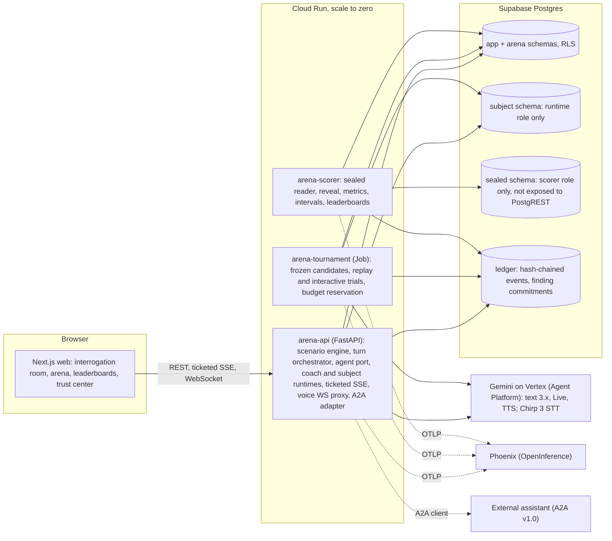

# Direction: Investigative AI Training Arena

Research synthesis and recommendation. Version 1, 2026-10-08, before adversarial critique. Inputs: 18 route reports (`docs/research/internal/I1-I7`, `docs/research/external/X1-X11`), the interim synthesis, and the sponsor deck (`docs/challenge/REQUIREMENTS.md`). Sources: 143 Google web, 64 Google Developer Knowledge MCP, 34 Context7, 198 internal files. Everything below is a recommendation with a confidence label (H / M / L), not a locked decision; owner decisions D-001 to D-008 are treated as constraints.

## 0. TL;DR

1. **Build the deck's protocol as a working, provable instrument, then put a great training experience on top.** The deck is a written evaluation protocol (denominators, abstention handling, clustering, commit-before-reveal, disjoint families, eligibility gating). Most teams will ship a chat demo with a score. We ship the measuring instrument with real numbers, plus the interrogation room. (H)
2. **Architecture: one image, three Cloud Run deployables, all at zero idle cost.** `arena-api` (FastAPI: scenario engine, turn orchestrator, agent runtimes, ticketed SSE, voice WebSocket proxy, A2A adapter), `arena-scorer` (the only process that can read sealed data), `arena-tournament` (Cloud Run Job). Next.js web on Cloud Run. Supabase with a sealed schema. Phoenix through OpenInference. (M-H)
3. **Agents are stateless, schema-bound, single-turn calls through a typed agent port lifted from TechnoMile.** The interview is a deterministic turn protocol, not an open-ended tool loop, so no ADK or LangGraph orchestration is needed. Rendering the transcript into each call avoids Gemini 3 thought-signature state. (M-H)
4. **Candidates are versioned manifests with content hashes, published as A2A v1.0 Agent Cards, and an A2A client adapter lets external assistants enter under the same gates.** This makes it an open arena (Berkeley's AgentBeats is a precedent) without paying A2A latency for our own candidates. (M)
5. **Latency is the top technical risk.** Gemini 2.5 retires on Vertex on 2026-10-16 to 10-20, before the deadline; every remaining Gemini model keeps some thinking. Plan: two-stage coaching (fast flag and follow-up streamed within 3 s; deeper finding update asynchronously), cached case packet, and a day-1 latency benchmark (< $3). Priority inference tier is the reserve lever. (H on the risk, M on the plan)
6. **Voice: lift gokbase's server-side Live proxy, safety loop and voice state machine; target Vertex `gemini-3.8-live`.** Vertex lists it GA, but 2026 forum reports show a per-project allowlist gate, so we probe on day 1 and file the allowlist request the same day. If blocked by 2026-10-15, the owner chooses between a Developer-API exception and a Vertex-clean push-to-talk path (Chirp 3 + Gemini TTS). Scoring stays on text transcripts (SOL-1). (M)
7. **Budget: the bake-off fits under $100.** On a Flash-Lite-centred mix, 3x3x120x1 is about $37-48 and the full 2,160-trial protocol about $73 (X8, low-medium confidence). A 40-case dev pilot measures real cost per trial before we size the sealed run. (M)
8. **Fairness and isolation are headline features, not footnotes.** Style is assigned independently of role, every assistant gets a style-stratified false-positive audit, and a demeanor linter marks style-based flags unsupported (PRB-4). Isolation is proven with a scorer-only database role, pgTAP privilege tests, canary audits, commit-reveal findings and a hash-chained event log (KPI-5). (H)
9. **Owner decisions needed now:** a dedicated GCP project (never `kbg-production`), the Supabase plan, DESIGN.md, the repo destination, Phoenix hosting, the voice fallback rule, and the third assistant candidate (section 8).

## 1. What the judges will score

- **The deck is a protocol.** Its speaker notes specify exact denominators (unresolved truthful cases stay in the FPR denominator), abstention reporting, case-level clustering, commit-before-reveal, disjoint case families, and a false-positive gate before ranking. A team that implements this literally, with honest intervals, signals the methodological seriousness the sponsor wrote into it. (H)
- **The sponsor.** Unissant (Herndon, VA) serves ICE, CBP, USCIS, DHS, TSA, US Marshals, DoS, DoD, NIH, VA, CMS and HHS, and markets an investigative case-management product (iExamen, unverified). Its founder is a founding member of GMU's AI-in-Gov Council. "Challenge X" has no public rubric. Expect judges fluent in NIST AI RMF and federal AI governance, and in evidence-based interviewing vocabulary: PEACE, the Mendez Principles, and USCIS FDNS's "Corroboration-Based Interviewing". (H on sponsor facts, M on judge profile) [X6]
- **Four judging formats (D-008).** Live demo: the demo path must be flawless. Hosted link: auth, spend guards, acceptable cold starts. Video plus deck: a recorded tournament and debrief. Repo review: gates, docs, tests.
- **NIST anchors, primary-source verified.** MEASURE 1.3 (independent assessors), 2.1 (TEVV test sets and metrics documented), 2.3 (performance demonstrated in deployment-like conditions), 2.5 (valid and reliable), 2.7 (security and resilience), 2.11 (fairness and bias). Add NIST AI 600-1 for generative-AI risks such as confabulation. (H; airc.nist.gov playbook fetched 2026-10-08)

## 2. Winning thesis: nine pillars

| # | Pillar | What judges see | Requirements |
| --- | --- | --- | --- |
| P1 | Protocol fidelity | Every 9N metric computed exactly; replay and interactive tracks; 2x3 count matrix; unresolved rates by role; cost and latency per candidate | BKO-1..10, EVL-1..11 |
| P2 | Provable isolation | Sealed schema only the scorer can read; pgTAP privilege tests; canary audit; commit-reveal; hash-chained ledger; an "Isolation: PASS (n checks)" badge that links to the evidence | SCN-5, SCN-12, BKO-9, EVL-10, KPI-5 |
| P3 | Fairness by construction | Style factorial independent of role; style-stratified FPR with intervals; demeanor linter; avatar demeanor independent of role; permutation test for pairing bias | PRB-3, PRB-4, SCN-3, SCN-11 |
| P4 | Science-grounded coaching | Strategic Use of Evidence with the Evidence Framing Matrix; unanticipated questions; question-type enum; ICD 203 confidence language; "insufficient evidence" as a first-class finding that names the corroboration to seek | CH-2, AST-1..10, EX-1..3 |
| P5 | Honest statistics | Case-clustered bootstrap intervals; Wilson and Clopper-Pearson; rank shown as an interval when intervals overlap; role prevalence and intra-case correlation disclosed | BKO-10, EVL-10 |
| P6 | Training experience | Interrogation room in text and voice; coach companion; evidence board; debrief with five rubric cards; progress over sessions | CH-1, SOL-6, EVL-2, EVL-7, KPI-1 |
| P7 | Observability | Phoenix trace per turn, agent and model call; p95 coaching latency panel; one cost ledger | EVL-5, KPI-4 |
| P8 | Open arena | Candidates published as A2A Agent Cards; external assistants enter under identical gates | CH-4, AST-5 |
| P9 | Engineering quality | TechnoMile and Pangea gates (strict mypy, 90% coverage, bandit, CodeQL, gitleaks), scale-to-zero audit, CI, docs | global gates |

## 3. Product surfaces and priority

- **P0, by 2026-10-21:** scenario engine with case generator and validators; interrogation room in text with practice and assessment modes; coach (both stages); subject runtime; scorer with every metric; tournament runner for both tracks; assistant and subject leaderboards; isolation tests; Phoenix tracing; deploy to Cloud Run and Supabase.
- **P1, by 2026-10-28:** real-time voice; debrief; trainer console (blinded review queue, agreement statistics); fairness audit view; trust center (isolation, commit-reveal and ledger verification, methodology, limitations); agents-at-work arena view; companion pets and subject portraits per DESIGN.md; A2A open arena; investigator progress pipeline (KPI-1).
- **P2, if time remains:** simulated-trainee study; Priority tier; more case domains; spectator mode.

## 4. Architecture

### 4.1 Components

| Component | Responsibility | Lifted from |
| --- | --- | --- |
| `arena-api` | REST, ticketed SSE, voice WebSocket proxy; scenario engine; turn orchestrator; agent port; coach and subject runtimes; A2A adapter | TechnoMile `bh_core/providers` (policy, retry, budget, telemetry, structured), `tail/a2a.py` shapes, `ticketed-stream.ts`; gokbase live session, safety loop, voice ledger; Pangea per-turn span |
| `arena-scorer` | Sole holder of the sealed-role credential; reveals commitments; computes metrics and intervals; writes leaderboards | TechnoMile `holdout_scoring` migration and its 32-assertion pgTAP suite |
| `arena-tournament` | Freezes candidates; runs trials with per-trial budget reservation; writes commitments; respects a global spend stop | TechnoMile run budget (reserve, settle, fail closed); Cloud Run Job pattern |
| `web` | Next.js 16, React 19, Tailwind 4 | TechnoMile web stack and agent office; gokbase `kin` pets |
| Supabase | Schemas, roles, RLS, pgTAP tests, append-only triggers | TechnoMile foundation, grants and holdout migrations |
| Phoenix | Traces, sessions, human annotations | Pangea `otel_tracing.py` (cost attributes renamed, redact before export); TechnoMile `export_policy.py` (default deny) |

### 4.2 Three secrecy tiers

| Tier | Contents | Readers | Enforcement |
| --- | --- | --- | --- |
| Public | Case ID, objective, known timeline, initial documents, released evidence, transcript | Investigator, assistants, subjects, scorer | RLS |
| Subject-private | Role, actions, knowledge, what may be disclosed, uncertainty limits, objective, permitted behaviors, disclosure gates, style | Subject runtime only | Separate schema; RPC callable only by the runtime role; typed `SubjectContext` |
| Evaluator-only | Canonical facts, role label, material contradictions, release conditions, resolution criteria, rubric; sealed per-turn subject tags; hidden case families | Scorer only | Sealed schema off the PostgREST exposed list; scorer-only role with its own service account; `search_path=''` on every SECURITY DEFINER function; pgTAP; canary audit |

The assistant code path never receives a subject-private or evaluator-only field: its context type has no such field, the agent port refuses to send any assistant prompt that contains a registered canary, and a post-hoc audit scans every stored assistant prompt and output. (H on the pattern, from TechnoMile and X2b)

### 4.3 One interactive turn

1. The investigator (a human, or the fixed harness in the bake-off) submits question Q(t).
2. The scenario engine checks release triggers and may release evidence, appending a versioned, timestamped, hash-chained ledger event (SCN-10).
3. The subject runtime makes one structured call returning `{utterance, sealed_tag}`. A deterministic guard checks for role-label leaks, packet leaks and injection patterns. The utterance joins the transcript; the tag is inserted into the sealed schema, insert-only.
4. The coach makes its stage-1 call (target: first card within 3 s): question type, answer category, top flag with a turn citation, neutral follow-up. It streams to the UI as partial JSON over SSE. Stage 2 runs asynchronously: running finding, confidence, evidence coverage.
5. Code checks that every flag's quoted span appears in the cited turn; failures count as unsupported flags (AST-7, EVL-5). The demeanor linter marks flags that rest on style.
6. The trial ends at 12 exchanges or a committed finding. The commitment hash is recorded. After the tournament is sealed, the scorer reveals and scores.

### 4.4 Data model sketch

`arena.case_families`, `arena.case_variants` (style, difficulty; no role), `arena.public_packets`; `subject.private_packets`; `sealed.evaluator_packets`, `sealed.subject_turn_tags`, `sealed.hidden_split_seals`; `arena.candidates` (manifest JSON, sha256, version, frozen_at); `arena.tournaments` (state machine: draft, frozen, running, sealed, scoring, revealed; seed; budget); `arena.trials`, `arena.turns`, `arena.coaching_events`; `ledger.events` (prev_hash, hash, payload); `ledger.finding_commitments` and `ledger.finding_reveals`; `arena.scores`, `arena.leaderboards`, `arena.isolation_checks`; `training.sessions`, `training.rubric_scores` (proxy and human), `training.progress`; `ops.model_calls` (single cost source).

## 5. Decisions

### 5.1 Weights (the owner's scorecard as inferred from the brief and this session)

| Criterion | Weight | Why |
| --- | --- | --- |
| Judge impact (rigor and wow) | 25% | The goal is to win |
| Protocol fidelity | 20% | The deck is a protocol |
| Simplicity and 25-day delivery risk | 20% | Owner: simple, clean, no over-engineering |
| Constraint compliance (Vertex only, scale to zero, $100) | 15% | Locked decisions D-001, D-003, D-007 |
| Latency and UX (KPI-4, voice) | 10% | KPI-4, D-006 |
| Security and observability | 10% | Owner: safe, maximum observability |

Scores are 1-5. Weighted totals are out of 5.

### 5.2 DM-1 Agent runtime

| Option | Impact | Fidelity | Simplicity | Compliance | Latency | Sec/Obs | Total |
| --- | --- | --- | --- | --- | --- | --- | --- |
| A. Typed agent port on google-genai; stateless single-turn structured calls | 3 | 5 | 5 | 5 | 5 | 4 | **4.40** |
| B. ADK LlmAgent per candidate behind an adapter (Pangea pattern) | 4 | 4 | 3 | 5 | 4 | 5 | 4.05 |
| C. LangGraph spine plus ADK loops (TechnoMile hybrid) | 3 | 4 | 2 | 5 | 4 | 4 | 3.50 |
| D. Pydantic AI plus DBOS (TechnoMile brief, never measured) | 3 | 4 | 2 | 5 | 4 | 4 | 3.50 |

**Recommendation: A (M-H).** Each agent turn is one structured call with the transcript rendered into the prompt, which removes session state and thought-signature persistence, keeps prompts cache-friendly (static packet first), and lifts TechnoMile's proven port (Vertex-only boot check, retry with jitter, reserve-and-settle budget, one span per attempt, schema validation with one repair). **What would change it:** if we need ADK's multi-turn user-simulator evaluation criteria, or tool loops for the coach, wrap the same port in ADK behind one adapter (TechnoMile's `check_adk_scope.py` enforces that boundary).

### 5.3 DM-2 Candidate transport

| Option | Impact | Fidelity | Simplicity | Compliance | Latency | Sec/Obs | Total |
| --- | --- | --- | --- | --- | --- | --- | --- |
| A. In-process only | 2 | 4 | 5 | 5 | 5 | 4 | 3.95 |
| B. In-process candidates with A2A-shaped manifests, Agent Cards, plus an A2A v1.0 client adapter for external entrants | 5 | 5 | 4 | 5 | 5 | 4 | **4.70** |
| C. Every candidate as its own A2A service | 4 | 5 | 2 | 4 | 3 | 4 | 3.70 |

**Recommendation: B (M).** A2A v1.0 (Linux Foundation, a2a-sdk 1.2.2) carries the coaching schema as a JSON DataPart; the host sets a strict httpx timeout and validates the payload, since A2A has no notion of budgets or fairness (X11). External entrants pay their own model costs, so their cost is reported as unverified. A2A hops are traced by propagating W3C `traceparent` with manual spans (no OpenInference A2A instrumentor exists). TechnoMile reached the same in-process conclusion for its own agents; the adapter adds the cross-organization entry point TechnoMile did not need. **What would change it:** if judges or the owner want process-level isolation per candidate, move candidates out of process later; the manifest and card contracts do not change.

### 5.4 DM-3 Coaching latency (KPI-4)

| Option | Impact | Fidelity | Simplicity | Compliance | Latency | Sec/Obs | Total |
| --- | --- | --- | --- | --- | --- | --- | --- |
| A. One call per turn on a 3.x Flash-Lite at MINIMAL thinking, streamed | 3 | 4 | 5 | 5 | 3 | 4 | 4.00 |
| B. Two stages: fast flag and follow-up (small schema, streamed) then asynchronous finding update | 4 | 5 | 4 | 5 | 5 | 4 | **4.45** |
| C. B plus Priority inference tier on stage 1 (75-100% premium) | 4 | 5 | 3 | 4 | 5 | 4 | 4.10 |
| D. One Pro call per turn | 3 | 4 | 4 | 5 | 1 | 4 | 3.60 |

**Recommendation: B, with C held in reserve (M).** Facts: 2.5 models (the only ones with thinking fully off) retire on Vertex 2026-10-16 to 10-20; `gemini-3.5-flash-lite` defaults to MINIMAL; `gemini-3.7/3.8-flash` have no MINIMAL tier; published TTFT figures come from open-ended prompts and do not transfer to a short schema-bound call (X7, X8). We define KPI-4 precisely and disclose it: time from the subject's answer being committed to the stage-1 coaching card reaching the client, measured per turn and reported as p50/p95 per candidate. **What would change it:** the day-1 benchmark. If no 3.x model meets 3 s p95 for stage 1 even with caching and Priority tier, stage 1 becomes a smaller classifier-style call and the gap is disclosed.

### 5.5 DM-4 Voice engine (D-006 fixes that voice ships; this decides how)

| Option | Impact | Fidelity | Simplicity | Compliance | Latency | Sec/Obs | Total |
| --- | --- | --- | --- | --- | --- | --- | --- |
| A. Vertex `gemini-3.8-live` through the lifted gokbase server-side proxy | 5 | 3 | 4 | 4 | 5 | 4 | **4.15** |
| B. Vertex-clean push-to-talk: Chirp 3 STT, text subject candidate, Gemini TTS | 3 | 5 | 3 | 5 | 3 | 4 | 3.80 |
| C. Gemini Developer API Live (owner exception to D-001) | 5 | 3 | 5 | 1 | 5 | 3 | 3.80 |

**Recommendation: A, probe-gated (M).** Vertex lists `gemini-3.8-live` and `gemini-live-2.5-flash-native-audio` as GA; ADC auth works; no ephemeral tokens exist on Vertex, so a backend proxy is required, which gokbase already has. `gemini-3.1-flash-live-preview`, the model gokbase uses, is not on Vertex and shuts down on the Developer API on 2026-11-17. The risk is the allowlist gate reported on 2026 forums. Plan: connect probe on day 1; file the allowlist ticket the same day if refused; decision point 2026-10-15. Option C needs an explicit owner exception because it breaks D-001; option B keeps D-001 and is the fallback. In voice sessions the Live model plays the subject from the same private packet; sealed tags are produced afterwards by a labeler over the transcribed turns. Voice sessions are practice mode and sit outside the bake-off, which stays text (SOL-1).

### 5.6 DM-5 Phoenix hosting

| Option | Impact | Fidelity | Simplicity | Compliance | Latency | Sec/Obs | Total |
| --- | --- | --- | --- | --- | --- | --- | --- |
| A. Local Phoenix for development and tournament runs; Phoenix Cloud free tier for hosted judge sessions | 4 | 4 | 5 | 5 | 5 | 4 | **4.45** |
| B. Self-hosted Phoenix on Cloud Run (request-based billing) with Supabase Postgres | 4 | 4 | 3 | 5 | 5 | 3 | 3.95 |
| C. Self-hosted Phoenix on Cloud Run with CPU always allocated, min 0 | 4 | 4 | 3 | 3 | 5 | 5 | 3.85 |
| D. Cloud Trace only | 2 | 3 | 4 | 5 | 5 | 4 | 3.55 |

**Recommendation: A, owner to confirm (M).** Phoenix Cloud's free tier allows about 25,000 spans a month with 15-day retention (X10, medium confidence), enough for judge sessions but not for a full tournament, so tournament runs trace locally and Supabase holds every metric regardless. B risks dropping spans because Phoenix's background flush is CPU-throttled between requests (reasoned from source, never measured); C needs written approval under the CPU-always-allocated gate. Phoenix on Supabase requires the session pooler (5432), never the transaction pooler. Phoenix Cloud is a third-party service receiving synthetic traces; that needs the owner's yes.

### 5.7 DM-6 Tournament size under $100

| Plan | Trials | Estimated cost (X8, 12-exchange cap, no caching) | Verdict |
| --- | --- | --- | --- |
| 3x3x120x2, all Flash-Lite | 2,160 | ~$73 | Fits with margin only with this cheapest mix |
| 3x3x120x2, Flash assistants + Flash-Lite subjects | 2,160 | ~$97 (~$60-70 with caching) | Fails the 25% margin uncached |
| **3x3x120x1, Flash assistants + Flash-Lite subjects** | **1,080** | **~$48** | **Recommended sealed run, plus a second repeat on as many cases as the margin allows** |
| 3x3x40x1 dev pilot | 360 | ~$16 | Run first; measures real cost, latency and fidelity |

**Recommendation (M):** more cases beat more repeats, because the case is the independent unit (X2b). Fold the sealed disclosure tag into the subject's own structured output (saves ~$25-30 at full scale, X8) and make the interviewer harness's neutrality check rule-based (zero model cost). Replay-track scoring runs on batch pricing (50% off). Case generation (~$5-15 on `gemini-3.1-pro-preview`) is tracked separately in the same ledger. A hard spend stop in code reserves budget per trial and halts at $80 of bake-off spend.

### 5.8 DM-7 Judging

Deterministic first, LLM second, humans to calibrate (H on the design, from X2b, I3):
- Role classification is scored deterministically against the sealed role.
- Evasion events are scored against the sealed subject tags, validated by a labeler that also separates genuine uncertainty, legitimate non-disclosure and poorly framed questions (the last routes to the investigator's clarity score, not to a subject flag).
- Citations are verified by code.
- The investigator rubric and questioning quality use an LLM trainer-proxy with binary sub-checks mapped to anchors (CheckEval: +0.45 agreement over raw Likert), on Flash, with a calibration subset on `gemini-3.1-pro-preview`; position shuffling where pairwise.
- A blinded human review sample reports weighted kappa and Gwet's AC2 (better on skewed base rates).
- Same-family judging (Gemini judging Gemini) is disclosed as a limitation; it cannot be removed under D-001.

### 5.9 Smaller decisions

- **Frontend hosting:** Next.js on Cloud Run. Firebase Hosting caps requests at 60 s, which breaks SSE and WebSockets; browser SSE and WebSocket traffic goes straight to `arena-api`. (H) [X10]
- **Supabase plan:** free projects pause after 7 days without a database request; on demo day that would break the hosted link. Either Pro ($25/month) or a daily keep-alive job. Owner decision. (H) [X10]
- **Spend guard for the public link:** per-user rate limits, per-session cost caps (gokbase default $0.50 for voice), a global kill switch fed by a budget Pub/Sub topic (budget emails lag by hours). (H) [X10]

## 6. Agent design

### 6.1 Coach (assistant candidates)
- **Stage 1 schema:** question type (open, probing, closed, leading, suggestive, compound, forced-choice, opinion) and neutrality issues (AST-6); answer category (responsive, non-responsive, contradiction, explicit uncertainty, possible evasion) (AST-8); top flag with `turn_id`, quoted span, and the missing fact or conflicting statement (AST-7); one neutral follow-up with the tactic used (SUE timing, unanticipated question, corroboration request).
- **Stage 2 schema:** running finding (deceptive, truthful, insufficient evidence) with ICD 203 likelihood wording and confidence; evidence coverage; the corroboration still needed (EX-3).
- **Grounding:** Strategic Use of Evidence and the Evidence Framing Matrix (disclose evidence stepwise from weak to strong after the subject commits), unanticipated questions, the Mendez Principles, and the rule that demeanor is never evidence.
- **Safety:** the transcript is untrusted data inside a salted data boundary (gokbase `injection_defense` pattern). The coach holds no private data and no state-changing tool, so an injected subject can at most spoil one coaching turn, and the guard marks the session invalid (SUB-7).
- **Policy variants** come from the candidate manifest (AST-5): model, prompt, tool configuration and coaching policy, hashed.

### 6.2 Subject
- **Private packet as a ledger:** atomic fact IDs known to the subject; disclosable facts; concealed facts (deceptive role); uncertainty limits (truthful role); permitted behaviors (omission, deflection, minimization, never fabrication that contradicts a canonical fact); disclosure gates that concede a fact when confronted with evidence of enough strength (Evidence Framing Matrix ladder; disclosure gating cut deep-secret leakage from 19-37% to 3-8% in arXiv 2609.00982); communication style.
- **Per turn:** one structured call returns the utterance and the sealed tag (act, facts disclosed, facts concealed, evidence confronted). The packet and permitted behaviors are re-injected every turn (cuts persona drift 35-38%). A deterministic guard runs before the utterance is accepted.
- **Fidelity** is scored offline: a turn is compliant when the utterance agrees with the packet, the tag and the permitted behaviors (binary sub-checks).

### 6.3 Interviewer harness (interactive track, BKO-7)
Fixed common opening question; relays the assistant's top follow-up verbatim when it passes a rule-based neutrality check, otherwise a fixed neutral fallback; stops at 12 exchanges or when the assistant commits a finding. No model calls.

### 6.4 Scenario engine and generator
- **Generator** (`gemini-3.1-pro-preview`, offline): canonical event graph with atomic fact IDs; evidence artifacts with discoverability conditions (badge logs, work orders, timesheets, access-control exports); matched truthful and deceptive variants from one event; misleading but innocent circumstances in truthful variants; difficulty knobs; style assigned by factorial design independent of role.
- **Validators:** schema; fact-graph consistency; a solvability gate adapted from AR-Bench (exactly one violation with means, motive and opportunity evidenced in the deceptive variant; a corroborable innocent explanation in the truthful one); a role-leak check (a role-guessing model reading only the public packet should score near chance); pilot runs for difficulty.
- **Domains:** facility access (the slide 8 case), timekeeping, procurement, records access, benefits documentation, lab safety. Fictional organizations only.
- **Splits:** 40 development cases and 120 hidden cases in disjoint families; the hidden list is sealed by hash before any candidate sees it (TechnoMile holdout pattern).

## 7. Scoring, statistics and gates

- **Formulas** exactly as REQUIREMENTS.md section 11.
- **Eligibility in code:** the ranking function requires `fpr_point <= 0.05` and `isolation_pass` as preconditions and refuses to rank otherwise (TechnoMile lesson: a gate written in prose is not enforced).
- **Intervals:** case-clustered bootstrap (resample case IDs, 9,999 resamples; scipy has no clustered mode, so we write the resampler), Wilson and Clopper-Pearson for headline proportions, paired cluster bootstrap for assistant-versus-assistant differences, rank as an interval when intervals overlap (LMArena), role prevalence and intra-case correlation disclosed. With 60 truthful hidden cases, zero false positives bounds the true rate at about 5% (rule of three), so every gate is shown with its interval.
- **Isolation gate:** pgTAP privilege tests; zero canary hits in any assistant prompt or output; context-type test; hidden-split seal verified; every finding committed before the reveal timestamp and every hash verified.
- **Fairness audit:** FPR and flag rates by style with intervals; unsupported style-based flags per assistant; permutation test for order and pairing effects (TechnoMile lesson: balanced counts do not prove unbiased results).
- **Subject board:** fidelity, invalid sessions, deceptive success, misleading clearance, unresolved, truthful consistency and appropriate uncertainty.
- **Investigator board:** baseline assessment on an unseen case, coached practice on development cases, post-assessment on a matched unseen case, improvement against the investigator's own baseline (KPI-1). The 2026 Law and Human Behavior RCT (Li, Granhag, ... Santtila; n=156; three arms) found that practice against SUE-based AI suspects transferred to real mock-suspect interviews, which supports the premise; our own small pilot is a demonstration, not a powered study.

## 8. Candidate lineup and run plan (Gemini only)

- **Assistants (policy-diverse):** A1 "Evidence Strategist" (SUE and Evidence Framing Matrix; `gemini-3.8-flash`, stage 1 possibly on a Flash-Lite); A2 "Cognitive-Load Prober" (unanticipated and detail questions; `gemini-3.5-flash-lite` at MINIMAL); A3, owner choice: either an "Untrained Baseline" that attends to demeanor (a control that should fail the false-positive gate and the style audit, demonstrating that the gates work) or a "Conservative Analyst" that abstains often (demonstrating abstention reporting).
- **Subjects (tier-diverse, each plays both roles):** S1 `gemini-3.1-flash-lite` (GA to 2027-05-07, cheapest), S2 `gemini-3.5-flash-lite`, S3 `gemini-3.8-flash`. Same disclosure engine; different model and persona-rendering policy.
- **Labeler and trainer-proxy:** `gemini-3.8-flash`; calibration subset on `gemini-3.1-pro-preview`.
- **Run plan:** dev pilot (360 trials) to measure, then the sealed run (1,080 trials plus extra repeats within margin), then the replay track on frozen transcripts. Prices: `gemini-3.1-flash-lite` $0.25/$1.50, `gemini-3.5-flash-lite` $0.30/$2.50, `gemini-3.8-flash` $0.75/$3.75 (promotional through 2026-12-31), `gemini-3.1-pro-preview` $2.00/$12.00 per 1M input/output tokens (X8; verify against the Vertex billing console).

## 9. Voice plan

- **Lift from gokbase:** server-side WebSocket proxy with single-use tickets and resume tokens; 2-second safety loop with distinct close codes (duration, idle, cost); per-fragment append-only session ledger; cost metered from `usage_metadata`; salted data boundary for tool payloads; the pure `voiceMachine.ts` reducer; 16 kHz capture and 24 kHz playback worklets.
- **Rewrite:** the knowledge-base tools and prompts (domain-specific), and the client constructor (`vertexai=True` with ADC instead of an API key).
- **Vertex Live limits:** 10-minute connection limit with session resumption (handle valid ~2 h); compression for sessions past ~15 minutes; input and output transcription; barge-in through `interrupted` messages.
- **Turn reconstruction:** output transcription arrives as many fragments; the scorer rebuilds a turn as the maximal run between input, tool call and tool response boundaries (I6).
- **Cost:** ~$0.10-0.20 of audio per 10-minute session (X7, low confidence); Cloud Run bills instance time while a socket is open; per-session cap $0.50.

## 10. Observability plan

- OpenInference instrumentation for google-genai plus manual spans: session, trial, turn, agent (coach, subject, scorer, harness), model call. One parent span per turn across retries (Pangea).
- `ops.model_calls` in Postgres is the only cost source; Phoenix's token-price attributes are renamed away (Pangea).
- Default-deny export policy and a redact-before-export processor keep private and evaluator data out of spans (TechnoMile, Pangea). Role labels never appear on exported spans (SCN-5).
- KPI-4 panel (p50/p95 per candidate) and cost per trial come from our own tables, so they work even if Phoenix is down.

## 11. Lift plan

| Need | Source (read-only) | Verdict |
| --- | --- | --- |
| Vertex-only boot check, retry, budget, per-attempt span | TechnoMile `packages/core/src/bh_core/providers/{policy,retry,budget,telemetry}.py` | Lift verbatim |
| Typed turn with one repair | TechnoMile `services/run/src/bh_run/tail/a2a.py` (`typed_turn`) | Adapt |
| Persona slice, cite-or-drop, self-framing prompt | TechnoMile `tail/roleplay.py`, `tail/swarm.py` | Adapt (add truthful/deceptive, disclosure gates, sealed tags) |
| A2A-shaped manifests and task states | TechnoMile `tail/a2a.py` | Adapt |
| Sealed hidden split, commit before reveal | TechnoMile `supabase/migrations/20260928001100_holdout_scoring.sql` + `supabase/tests/011_holdout_scoring.sql` | Adapt |
| Roles and grants lockdown | TechnoMile `20260927000700_grants.sql` | Adapt |
| Default-deny span export; span hierarchy; Phoenix read-back | TechnoMile `bh_core/observability/{export_policy,spans,phoenix}.py` | Lift |
| Per-turn span, cost attribute rename, redaction processor | Pangea `adapi-av2/app/assistant/otel_tracing.py`, `service.py` | Adapt |
| Golden dataset with deliberate fabrications | Pangea `adapi-av2/tests/test_assistant_eval_golden.py` | Adapt for citation and evasion checks |
| CI workflows (tests, bandit two-pass, fail-closed CodeQL, TruffleHog) | Pangea `.github/workflows/*` | Adapt (mypy strict) |
| `make check`, `ratchet.toml`, anti-rigging linters | TechnoMile `Makefile`, `tools/gates`, `tools/check_*.py` | Lift |
| Scale-to-zero audit | TechnoMile `scripts/audit_gcp_cost.{py,sh}` | Lift near verbatim |
| Ticketed SSE | TechnoMile `web/src/lib/sse/ticketed-stream.ts` (a gokbase lift) | Lift |
| Agents-at-work motion | TechnoMile `web/src/components/war-room/agent-office.tsx`, `docs/design/motion.md` | Adapt (event-bound, measured frame pacing, reduced-motion captions) |
| Companion pets | gokbase `recruiter-frontend/src/sections/knowledge-base/public/voice/kin/` | Adapt (FSM states for interview events; server-side state) |
| Live voice proxy, safety loop, ledger, voice reducer | gokbase `backend/app/rag/live/session.py`, `api/api_v1/endpoints/voice.py`, `voiceMachine.ts` | Adapt (Vertex client; new prompts and tools) |
| Rubric hashing with lineage log | gokbase `recruiter-backend/app/matching/rubrics.py` | Adapt for manifests and scorer versions |
| PII redaction, MAD-z anomaly detectors | cloudforce `observability/{redaction,anomaly_detectors}.py` | Lift |
| Vertex-only TTS pipeline | cloudforce `agents/audio_overview.py` | Reference for the push-to-talk fallback |

## 12. Risks and what would change the answer

| Risk | Likelihood | Impact | Mitigation | Trigger to revisit |
| --- | --- | --- | --- | --- |
| Stage-1 coaching misses 3 s p95 on every 3.x model | M | H | Two stages, caching, smaller schema, Priority tier, disclosed definition | Day-1 benchmark |
| Vertex Live allowlist not granted in time | M | M | Ticket on day 1; Developer-API exception or push-to-talk fallback | 2026-10-15 |
| Detection target (KPI-2) unmet because deceptive variants are too hard or too easy | M | H | Solvability gate, pilot calibration, difficulty knobs | Dev pilot |
| Subject drift breaks 95% fidelity | M | H | Ledger state, re-injection, disclosure gates, guard | Fidelity pilot |
| Wide intervals make gates look arbitrary | H | M | Intervals everywhere, honest copy, more cases over repeats | Always |
| Same-family judge bias | H | M | Deterministic scoring first, human calibration, disclosure | Calibration sample |
| Phoenix span loss or free-tier limits | M | L | Local tracing for tournaments; metrics in Supabase | Hosting test |
| Supabase pause near demo day | M | H | Pro plan or keep-alive job | Owner choice |
| Gemini model or price changes before 2026-11-02 | M | M | Re-verify IDs and prices the week of the run; pin in manifests | Weekly |
| Scope exceeds 25 days | M | H | P0/P1/P2 cut lines; parallel agents with Codex gates | Weekly review |

## 13. Next steps

### 13.1 De-risking experiments (days 1-3, under ~$25 total)
1. **Latency benchmark (< $3):** stage-1 schema on `gemini-3.1-flash-lite`, `gemini-3.5-flash-lite` (MINIMAL) and `gemini-3.8-flash` (lowest level), 50 calls each, streamed TTFT and total, p50/p95, with and without the cached packet; Priority tier on the best candidate.
2. **Vertex Live probe:** `connect()` to `gemini-3.8-live` and `gemini-live-2.5-flash-native-audio` with ADC on the arena project; allowlist ticket the same day if refused.
3. **Case-generation pilot:** three families end to end through every validator; tokens and cost measured.
4. **Fidelity pilot:** 3 subjects x 2 roles x 3 cases x 12 turns; fidelity and leakage measured; disclosure gates tuned.
5. **Isolation smoke:** sealed schema, roles and five pgTAP tests on the owner's Supabase project.

### 13.2 Owner decisions needed
1. A dedicated GCP project with billing and a budget alert (never `kbg-production`).
2. Supabase project and plan (free with keep-alive, or Pro).
3. DESIGN.md.
4. Repo destination (private GitHub repo).
5. Phoenix hosting: Phoenix Cloud for judge sessions (third-party, synthetic traces) or self-hosted.
6. Voice fallback rule if Vertex Live is not granted by 2026-10-15: Developer-API exception or Vertex-clean push-to-talk.
7. Third assistant candidate: demeanor-sensitive baseline or conservative analyst.
8. Team roster and any Challenge X submission rules.

## 14. Sources
- Internal: I1 TechnoMile code reuse map; I2 TechnoMile corpus (stack); I3 TechnoMile corpus (role-play, UI, security, lessons); I4 PangeaChat adapi-av2 observability; I5 gokbase and cloudforce delta; I6 gokbase live voice lift map; I7 UI lift map.
- External: X1 interviewing science; X2a deception arenas and role-play fidelity; X2b evaluation statistics, judges, isolation; X3 Gemini on Vertex delta; X4 A2A, ADK, Phoenix delta; X5 interrogation UI, avatars, voice, pets; X6 sponsor and Challenge X; X7 Gemini Live and TTS on Vertex; X8 latency and cost; X9 scenario generation, annotation, rubric anchors; X10 judge hosting; X11 A2A v1.0 for BYO agents.
- Synthesis: `01-interim-after-batch1.md`.
- Tally: 143 Google web (142 agents + 1 orchestrator fetch of the NIST playbook), 64 GDK, 34 Context7, 198 internal files. Research-harness floors (10 / 10 / 10) met.
