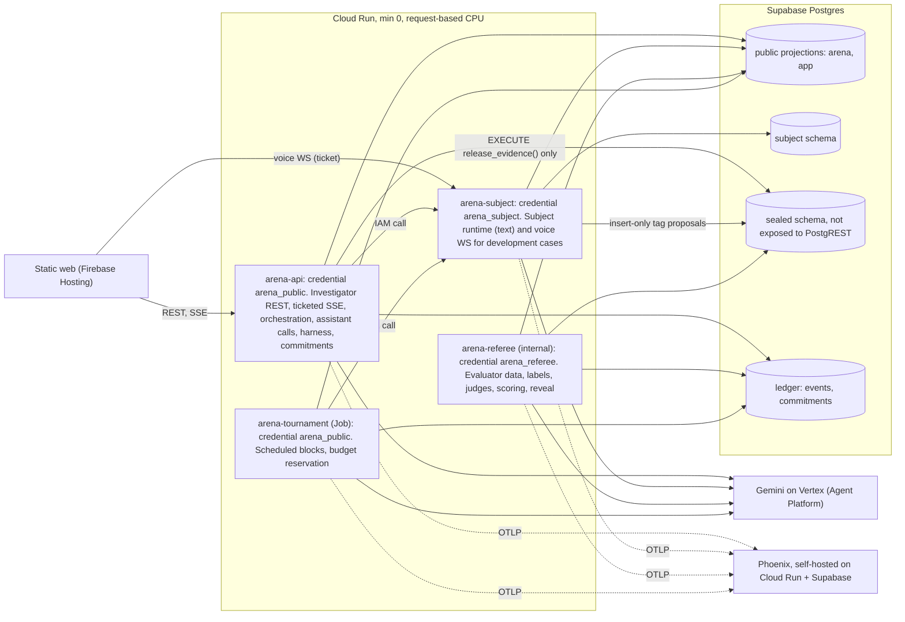

# Direction: Investigative AI Training Arena

Research synthesis and recommendation. **Version 2, 2026-10-08**, revised after Codex critique round 1 (YELLOW, 24 majors; dispositions in `critique-round-1.md`). Inputs: 18 route reports (`docs/research/internal/I1-I7`, `docs/research/external/X1-X11`), `01-interim-after-batch1.md`, the sponsor deck (`docs/challenge/REQUIREMENTS.md`), and `cost_model.py` (every dollar figure here comes from it). Sources: 143 Google web, 64 GDK, 34 Context7, 198 internal files, plus Codex's 19 verification searches. Confidence labels: H / M / L. Owner decisions D-001 to D-008 are hard constraints.

## 0. TL;DR

1. **Build the deck's protocol as a working instrument with real numbers, then the training experience on top.** The deck is a written evaluation protocol. We implement it literally, publish every metric with its interval, and enforce its gates in code. (H)
2. **Isolation by credential boundary.** One container image, four Cloud Run deployables, all scaling to zero: `arena-api` (public-only credential; investigator API, orchestration, assistant calls), `arena-subject` (the only reader of subject-private packets), `arena-referee` (the only reader of evaluator-only data; scoring), `arena-tournament` (Job, public-only). Static web on Firebase Hosting. Detectors such as canaries are supplementary evidence, never the proof. (M-H)
3. **Agents are stateless, schema-bound calls through a typed agent port lifted from TechnoMile.** No orchestration framework is needed for a deterministic turn protocol. (M-H)
4. **The official leaderboard runs only arena-hosted, frozen Gemini-on-Vertex candidates.** External assistants over A2A v1.0 would be a separately labeled exhibition track (owner call, P2), because an opaque endpoint cannot prove D-001 compliance or equal budgets. (H)
5. **Latency (KPI-4) is unmeasured and is the top technical risk.** Gemini 2.5 retires on Vertex 2026-10-16 to 10-20; no remaining model fully disables thinking. KPI-4 is defined as a complete, validated coaching card reaching the client. The bake-off itself compares a two-stage candidate with single-call candidates; a day-1 benchmark sets the practice-mode default. (H on risk, M on plan)
6. **Budget: the sponsor's full workload does not fit $100.** With complete accounting, 120 hidden cases x 2 repeats costs ~$223-385. Recommended: keep 120 hidden cases x 1 on a Flash-Lite-class lineup (bake-off ~$68 expected / ~$94 conservative) and approve ~$35-50 more for case generation and the dev pilot. The all-in-$100 alternative is 60 hidden cases (~$72 / ~$103), which cannot statistically support a 5% false-positive claim. Owner decision. (M; assumptions until the dev pilot measures them)
7. **Voice: Gemini Live on Vertex, lifted from gokbase's server-side proxy, development cases only.** Probe `gemini-3.8-live` and `gemini-live-2.5-flash-native-audio` on day 1 across documented regions. Prebuilt Live Avatar talking heads (GA since 2026-09-24) are a stretch upgrade. Push-to-talk or the Developer API each need an owner exception. (M)
8. **Fairness and isolation are headline features.** Style is independent of role; style-stratified false-positive audit; demeanor-based flags count as unsupported; a privilege-tested isolation gate. Demeanor-driven outputs are negative-control fixtures, never a ranked candidate. (H)
9. **Owner decisions needed:** budget option, GCP project (never `kbg-production`), Supabase plan, DESIGN.md, repo destination, self-hosted Phoenix, voice exception rule, A2A exhibition track, team roster and volunteers.

## 1. What the judges will score

- **The deck is a protocol.** Its notes fix denominators (unresolved truthful cases stay in the FPR denominator), abstention reporting, case-level clustering, commit-before-reveal, disjoint families and a false-positive gate before ranking. Implementing that literally, with honest intervals, is the core of the entry. (H)
- **The sponsor.** Unissant (Herndon, VA) serves ICE, CBP, USCIS, DHS, TSA, US Marshals, DoS, DoD, NIH, VA, CMS and HHS; its founder is a founding member of GMU's AI-in-Gov Council; "Challenge X" has no public rubric. Expect fluency in NIST AI RMF and in evidence-based interviewing (PEACE, the Mendez Principles, USCIS FDNS "Corroboration-Based Interviewing"). (H on facts, M on judge profile) [X6]
- **Formats (D-008).** Live demo, hosted link, video plus deck, repo review.
- **NIST anchors (primary source, fetched 2026-10-08).** MEASURE 1.3 independent assessors; 2.1 TEVV documented; 2.3 deployment-like conditions; 2.5 validity and reliability; 2.7 security and resilience; 2.11 fairness and bias; NIST AI 600-1 for generative-AI risks. Every methodology page also states, per EVL-12, that NIST has not validated these thresholds.

## 2. Winning thesis

| # | Pillar | What judges see | Requirements |
| --- | --- | --- | --- |
| P1 | Protocol fidelity | Every 9N metric under a written estimand; replay and interactive tracks; 2x3 count matrix; unresolved rates by role; cost and latency per candidate | BKO-1..10, EVL-1..11 |
| P2 | Isolation by construction | Four credentials, one per secrecy tier; pgTAP privilege tests; explicit public projections; commit-reveal; hash-chained ledger; canaries as supplementary audit | SCN-5, SCN-9, SCN-12, BKO-9, EVL-10, KPI-5 |
| P3 | Fairness by construction | Style factorial independent of role; style-stratified FPR with intervals; demeanor-based flags unsupported; avatar demeanor independent of role | PRB-3, PRB-4, SCN-3, SCN-11 |
| P4 | Science-grounded coaching | Strategic Use of Evidence with the Evidence Framing Matrix; unanticipated questions; question-type enum; ICD 203 confidence language; "insufficient evidence" names the corroboration to seek | CH-2, AST-1..10, EX-1..3 |
| P5 | Honest statistics | Family-clustered bootstrap; zero-event bounds; bootstrap rank intervals; role prevalence disclosed | BKO-10, EVL-10 |
| P6 | Training experience | Interrogation room (text, then voice), coach companion, evidence board, debrief with five 0-4 cards, progress | CH-1, SOL-6, EVL-2, EVL-7, KPI-1 |
| P7 | Observability | Self-hosted Phoenix; span per turn, agent and call; p95 latency panel; one cost ledger | EVL-5, KPI-4 |
| P8 | Ground rules visible | EX-4 statements in onboarding, the room, debriefs, leaderboards and methodology; NIST non-validation note (EVL-12) | EX-4, EVL-12 |
| P9 | Engineering quality | TechnoMile and Pangea gates (strict mypy, 90% coverage, bandit, CodeQL, gitleaks), scale-to-zero audit, CI, docs | global gates |

## 3. Scope and delivery

### 3.1 Vertical slice first (target 2026-10-18)
One domain (facility access, the slide 8 case), four development families, the whole pipeline end to end: generator and validators, text subject via `arena-subject`, one single-call assistant, harness, commitment, referee scoring, a plain leaderboard table, Phoenix traces. Rubric anchors are authored and calibrated on this slice. Nothing presentational starts before the slice passes.

### 3.2 Schedule with dependency gates (team capacity unknown; dates move once the roster is known)

| Window | Work | Gate to exit |
| --- | --- | --- |
| Oct 8-12 | Owner inputs; GCP project; day-1 probes (latency, Live, Supabase isolation smoke); repo with lifted gates; schemas and pgTAP; agent port | Probes reported; `make check` green |
| Oct 13-18 | Vertical slice | Slice runs end to end; anchors calibrated on dev data |
| Oct 19-24 | 3 assistants and 3 subjects; dev pilot (measures cost, latency, fidelity); size the sealed run; generate and seal hidden families; interrogation room and debrief per DESIGN.md; practice and assessment projections | Dev pilot report; sealed split hash recorded |
| Oct 22-29 | KPI-1 volunteer sessions (recruit now) | Counterbalanced sessions scored blind |
| Oct 25-30 | Sealed interactive and replay runs; reveal; leaderboards; trust center; voice if the probe passed; pets, portraits, agents-at-work | All commitments verified before reveal |
| Oct 31-Nov 2 | Hosted hardening, video, deck, rehearsal, Codex gates | Pre-push quality bar green |

### 3.3 Cut order (first to go) and never-cut list
Cut first: A2A exhibition track, then Live Avatar, then extra domains, then agents-at-work animation, then pets. Voice is cut only if both Vertex Live models fail the probe and the owner declines the exceptions. Never cut: the 9N metrics, the isolation gate, the fairness audit, the EX-4 statements, assessment-mode projections.

## 4. Architecture

### 4.1 Credentials and secrecy tiers (the isolation boundary)

| Tier | Contents | Only credential that can read it | Notes |
| --- | --- | --- | --- |
| Public | Case ID, objective, known timeline, initial documents, released evidence, transcript, coaching (subject to mode projection) | `arena_public`, `arena_subject`, `arena_referee` | Served through explicit typed projections |
| Subject-private | Role, actions, knowledge, what may be disclosed, uncertainty limits, objective, permitted behaviors, disclosure gates, style | `arena_subject` | `arena-api` and the tournament job never hold it; they call `arena-subject` and receive only the utterance |
| Evaluator-only | Canonical facts, role label, contradictions, release predicates, resolution criteria, rubric, subject tag proposals, independent labels, hidden-family contents, commitment nonces | `arena_referee` | Not exposed to PostgREST; `search_path=''` on every SECURITY DEFINER function; `arena_public` holds EXECUTE on `release_evidence()` only, which returns newly authorized public evidence and nothing else |

`service_role` is never used at runtime (TechnoMile grants pattern). Hidden-case debriefs, exports and Phoenix spans for hidden cases stay locked until reveal.

### 4.2 Threat model (abridged)

| Actor | Wants | Control | Test |
| --- | --- | --- | --- |
| Investigator or judge | Role labels, answers | No secret-reader credential behind any investigator route; typed projections; assessment projection | Route, SSE, reconnect and export tests with an investigator account |
| Assistant candidate (a model) | Hidden facts, a shortcut to the role | Assistant prompts built only from the public projection by the process holding `arena_public`; outputs are coaching JSON with no tools that act | Projection tests; supplementary canary audit on every assistant prompt and output |
| Deceptive subject (a model) | To manipulate the assistant or the platform (SUB-7) | Transcript is untrusted data in a salted boundary; deterministic detectors plus optional Model Armor; detection stops and quarantines the trial; the harness only relays one neutral question | Persistent-injection fixtures (attack in turn 2, check later turns, finding and judges) |
| Operator (us) | To alter findings after seeing labels | Canonical commitments, atomic finalization, reveal only after both tracks commit, hash-chained ledger | Commitment verification job; tamper fixture |
| Internet attacker | Spend, data | Invite-only judge accounts, one atomic spend ledger, aggregate concurrency caps, kill switch | Load and abuse tests on the hosted link |

### 4.3 One interactive turn
1. Question Q(t) reaches `arena-api` (from the investigator, or from the harness in the bake-off).
2. `arena-api` calls `release_evidence(trial, t, requested_record_ids)`. Predicates are deterministic: scheduled turns and explicit requests for records listed in the public packet. The function appends a hash-chained ledger event and returns only newly released public evidence (SCN-4, SCN-10). Clarifications, difficulty changes and predeclared context changes use the same function and ledger.
3. `arena-api` calls `arena-subject.answer(trial, t, Q)`. The subject service loads the private packet, makes one structured call, runs the guard, writes the utterance to the public transcript and the tag proposal to the sealed schema (insert-only), and returns the utterance. A guard hit stops and quarantines the trial.
4. The coach call runs in `arena-api` inside one open streaming request: the stage-1 card is validated (schema, citation existence) and sent; a two-stage candidate's stage 2 runs in the same request and is sent as an update; the request then closes. No work outlives a request (request-based billing). Results bind to (trial, turn, transcript hash). In assessment mode the server stores the coaching and sends nothing to the investigator.
5. The trial ends at 12 exchanges or a committed finding. Finalization is one transaction: the canonical commitment is written, the trial becomes immutable (a trigger rejects any later coaching or finding update).

### 4.4 Data model sketch
`arena.case_families`, `arena.case_variants` (style, difficulty; no role), `arena.public_packets`; `subject.private_packets`; `sealed.evaluator_packets`, `sealed.release_predicates`, `sealed.subject_tag_proposals`, `sealed.independent_labels`, `sealed.hidden_split_seals`, `sealed.commitment_nonces`; `arena.candidates` (manifest JSON, sha256, frozen_at); `arena.tournaments` (draft, frozen, running, sealed, scoring, revealed; seed; budget); `arena.blocks`, `arena.trials`, `arena.turns`, `arena.coaching_events`; `ledger.events` (prev_hash, hash, payload); `ledger.finding_commitments`; `arena.scores`, `arena.leaderboards`, `arena.isolation_checks`; `training.sessions`, `training.rubric_scores`, `training.progress`; `ops.model_calls`, `ops.budget_reservations`.

## 5. Decisions

Method (fixes F20; totals and sensitivity computed by `decision_matrix.py`): (1) a constraint gate removes any option that breaks D-001, D-003, D-006 or D-007 unless the owner grants an exception; (2) surviving options are scored 1-5 against anchored criteria; unmeasured quantities are ranges; (3) a sensitivity check shifts weights by 10 points.

| Criterion | Weight | 5 means | 3 means | 1 means |
| --- | --- | --- | --- | --- |
| Protocol fidelity | 30% | Meets the relevant requirement IDs exactly, testably | Meets them with documented deviations | Misses IDs |
| Delivery risk and simplicity | 30% | Proven lift, few moving parts | Moderate new code | New infrastructure, many parts |
| Demo impact | 15% | Distinctive in a 5-minute demo | Neutral | Invisible or confusing |
| Latency and UX | 15% | Measured, meets target | Unmeasured, plausible | Known to miss |
| Security and observability | 10% | Shrinks attack surface, fully traced | Neutral | Adds unmitigated surface |

### 5.1 DM-1 Agent runtime (all pass the gate)

| Option | Fid | Del | Demo | Lat | Sec | Total |
| --- | --- | --- | --- | --- | --- | --- |
| **A. Typed agent port on google-genai; stateless single-turn structured calls** | 5 | 5 | 3 | 3-5 | 4 | **4.30-4.60** |
| B. ADK LlmAgent per candidate behind an adapter | 4 | 3 | 3 | 3-5 | 5 | 3.50-3.80 |
| C. LangGraph spine plus ADK loops | 4 | 2 | 3 | 3-5 | 4 | 3.10-3.40 |
| D. Pydantic AI plus DBOS | 4 | 2 | 3 | 3-5 | 4 | 3.10-3.40 |

A wins under every 10-point weight shift (script output). Rendering the transcript into each call avoids Gemini 3 thought-signature state; the static packet goes first. If we later need ADK's multi-turn evaluation, wrap the port behind one adapter (`check_adk_scope.py` enforces it). (M-H)

### 5.2 DM-2 Candidate transport (all pass the gate)

| Option | Fid | Del | Demo | Lat | Sec | Total |
| --- | --- | --- | --- | --- | --- | --- |
| **A. In-process candidates, official leaderboard only** | 4 | 5 | 2 | 5 | 5 | **4.25** |
| B. A plus an A2A v1.0 exhibition track for allowlisted external endpoints | 4 | 4 | 4 | 5 | 3 | 4.05 |
| C. Every candidate as its own A2A service | 4 | 2 | 4 | 2-4 | 3 | 3.00-3.30 |

The ranking between A and B flips when 10 weight points move from delivery or security to demo impact, so this is an owner call. Recommendation: A for P0; B as a P2 add-on. If B ships: pin a2a-sdk 1.2.2 and spec v1.0 separately, use v1.0 `supportedInterfaces`, require one conformance fixture, accept only manually approved HTTPS endpoints, check resolved addresses (no private or link-local), follow no redirects, cap bytes and total time, send no credentials, run the client from a public-only process, label results "exhibition: model, prompt and budget unverified". (M)

### 5.3 DM-3 Coaching latency design (all pass the gate)

| Option | Fid | Del | Demo | Lat | Sec | Total |
| --- | --- | --- | --- | --- | --- | --- |
| A. One call per turn on a 3.x Flash-Lite at MINIMAL | 4 | 5 | 3 | 2-4 | 4 | 3.85-4.15 |
| B. Two stages (fast card, then deeper update in the same request) | 5 | 4 | 4 | 2-4 | 4 | 4.00-4.30 |
| C. B plus Priority tier on stage 1 | 5 | 3 | 4 | 3-5 | 4 | 3.85-4.15 |
| D. One Pro call per turn | 5 | 4 | 3 | 1 | 4 | 3.70 |

The ranges overlap and a 10-point weight shift can make A or C the winner, so we do not choose blind: the lineup includes both designs (A1 two-stage, A2 and A3 single-call), and the day-1 benchmark picks the practice-mode default. KPI-4 is measured as defined in section 7. (M)

### 5.4 DM-4 Voice engine (gate: D-001 Vertex and D-006 Gemini Live)

| Option | Gate | Fid | Del | Demo | Lat | Sec | Total |
| --- | --- | --- | --- | --- | --- | --- | --- |
| **A. Vertex `gemini-3.8-live` (US endpoint), lifted gokbase proxy** | pass | 3 | 4 | 5 | 3-5 | 3 | **3.60-3.90** |
| B. Vertex `gemini-live-2.5-flash-native-audio` | pass | 3 | 4 | 4 | 3-5 | 3 | 3.45-3.75 |
| C. A plus prebuilt Live Avatar video (GA 2026-09-24) | pass | 3 | 2 | 5 | 2-4 | 3 | 2.85-3.15 |
| D. Gemini Developer API Live | needs D-001 exception | | | | | | |
| E. Push-to-talk: Chirp 3 STT, text subject, Gemini TTS | needs D-006 exception | | | | | | |

No 10-point shift changes the order. Recommendation: A, with B as the compliant fallback and C as a stretch. Day-1 probe matrix: model (A, B) x location (documented US regions and global) x client (google-genai `aio.live.connect` with ADC, raw WebSocket) x config (audio-only base Live, then transcription, then tools). Each failure is classified as IAM, region, SDK, feature or allowlist before we file an allowlist ticket. Decision point 2026-10-15; D or E only with an owner exception. (M)

### 5.5 DM-5 Phoenix hosting (gate: Phoenix per D-003; no CPU always allocated without sign-off)

| Option | Gate | Fid | Del | Demo | Lat | Sec | Total |
| --- | --- | --- | --- | --- | --- | --- | --- |
| **A. Self-hosted Phoenix on Cloud Run (request-based) + Supabase session pooler, auth on, read-back verification after runs** | pass | 4 | 3 | 5 | 5 | 4 | **4.00** |
| B. Local Phoenix only | pass | 4 | 5 | 2 | 5 | 5 | 4.25 |
| C. Self-hosted with CPU always allocated (min 0) | needs sign-off | | | | | | |
| D. Arize AX Free (a different product) | needs substitution approval | | | | | | |

B scores higher at base weights; any 10-point shift toward demo impact makes A the winner, and the hosted judge link (D-008) is exactly that case. Recommendation: B during the build, A for the hosted demo and the tournament (the job exports over OTLP/HTTP to the Phoenix URL with an API key). Read-back verification after each run doubles as the flush trigger and the proof that spans landed (TechnoMile `phoenix.py`); if spans still go missing, ask for C. Hosted "Phoenix Cloud" status is contradictory across sources, so nothing depends on it. (M)

### 5.6 DM-6 Frontend hosting (all pass the gate)

| Option | Fid | Del | Demo | Lat | Sec | Total |
| --- | --- | --- | --- | --- | --- | --- |
| **A. Static build on Firebase Hosting; browser calls `arena-api` and `arena-subject` directly for SSE and WebSockets** | 4 | 5 | 4 | 5 | 4 | **4.45** |
| B. Next.js server on Cloud Run | 4 | 4 | 4 | 3 | 4 | 3.85 |
| C. Firebase App Hosting | 4 | 3 | 4 | 3 | 4 | 3.55 |

No 10-point shift changes the order. Static export keeps TechnoMile's React components liftable with no UI cold start; Firebase Hosting's 60-second proxy cap never applies because long-lived connections go straight to Cloud Run. (H)

## 6. Agent design

### 6.1 Coach (assistant candidates)
- **Stage-1 card:** question type (open, probing, closed, leading, suggestive, compound, forced-choice, opinion) and neutrality issues (AST-6); answer category (responsive, non-responsive, contradiction, explicit uncertainty, possible evasion) (AST-8); top flag with turn ID, quoted span, and the missing fact or both conflicting statements (AST-7); one neutral follow-up with its tactic.
- **Stage 2 (two-stage candidates):** running finding (deceptive, truthful, insufficient evidence) with ICD 203 wording and confidence; evidence coverage; corroboration still needed (EX-3).
- **Grounding:** Strategic Use of Evidence and the Evidence Framing Matrix (disclose stepwise, weak to strong, after the subject commits); unanticipated questions; the Mendez Principles; demeanor is never evidence.
- **Safety:** the transcript is untrusted data in a salted boundary (gokbase `injection_defense`). Nothing guarantees containment: detection quarantines the trial, and quarantined trials never enter rankings.
- **Manifest (AST-5, BKO-5):** model, prompt, tool configuration, coaching policy, max input tokens (context limit), max output tokens, timeout, identical tool set across candidates; hashed and frozen before a tournament.

### 6.2 Subject (`arena-subject`)
- **Private packet as a ledger:** atomic fact IDs known; disclosable facts; concealed facts (deceptive role); uncertainty limits (truthful role); permitted behaviors (omission, deflection, minimization; fabrication that contradicts a canonical fact is a fidelity failure); disclosure gates that concede a fact when confronted with evidence of enough strength (Evidence Framing Matrix; gating cut deep-secret leakage from 19-37% to 3-8% in arXiv 2609.00982); style.
- **Per turn:** one structured call returning the utterance and a tag proposal; packet and permitted behaviors re-injected every turn (drift reduced 35-38%, not eliminated); deterministic guard before the utterance is accepted (role-label strings, packet n-gram overlap, instruction patterns).
- **Tags are proposals, not ground truth** (F16): the referee labels every turn independently (section 7).

### 6.3 Interviewer harness (BKO-7)
Fixed common opening question. Relays the assistant's top follow-up only if it is one question (ends with "?", at most 40 words, no instructions to the subject, passes a neutrality lexicon); otherwise a fixed neutral fallback. Stops at 12 exchanges or a committed finding. No model calls.

### 6.4 Scenario engine and generator
- **Generator** (`gemini-3.1-pro-preview` for hidden families, `gemini-3.8-flash` for dev families, offline): canonical event graph with atomic fact IDs; evidence artifacts with release predicates; matched truthful and deceptive variants from one event; misleading but innocent circumstances in truthful variants; difficulty knobs; style by factorial design independent of role.
- **Validators:** schema; fact-graph consistency; a solvability gate adapted from AR-Bench (one violation with means, motive and opportunity evidenced in the deceptive variant; a corroborable innocent explanation in the truthful one); a role-leak check (a role-guessing model reading only the public packet should score near chance); a diversity check (near-duplicate and distribution checks across families); pilot runs for difficulty.
- **Domains:** start with facility access; add timekeeping, procurement, records access, benefits documentation and lab safety only after the instrument passes. Fictional organizations only.
- **Splits:** dev and hidden families are disjoint; the hidden list and contents are sealed by hash before any candidate is frozen; tuning only on dev; hidden families never enter prompts, few-shot examples or indexes (SCN-12).

## 7. Metric contracts (written before any data exists)

| Metric | Estimand | Independent unit | Interval | Edge cases |
| --- | --- | --- | --- | --- |
| Deceptive-role recall | Share of valid deceptive trials whose committed finding is "deceptive" | Case family | Family cluster bootstrap, two-sided 95% | Insufficient counts as a miss |
| FPR (eligibility) | Share of valid truthful trials whose committed finding is "deceptive" | Case family | Family cluster bootstrap two-sided 95%; if zero events, exact one-sided 95% Clopper-Pearson bound over families, labeled one-sided | Insufficient truthful stays in the denominator; the sponsor's point-estimate gate (<= 5%) decides eligibility |
| PPV, 2x3 matrix, unresolved by role | As REQUIREMENTS section 11 | Case family | Bootstrap | Raw counts always published |
| Evasion-event precision and recall | Event = a subject turn the independent labeler marks evasive; an evasion flag matches at most one event; the first matching flag is the true positive, duplicates are false positives | Case family | Bootstrap | Zero denominators reported as undefined; quarantined trials excluded from both and counted separately |
| Unsupported flags | Flags failing citation existence (code) or claim support (semantic judge) over all flags | Case family | Bootstrap | Adversarial fixtures: real quotes paired with false claims must fail |
| Questioning quality | 0-4 anchors on the assistant's follow-ups (dimensions 1-4) | Case family | Bootstrap | Proxy judge blinded to candidate and outcome |
| Subject fidelity | Compliant turns over all turns of valid sessions | Case family | Bootstrap | Invalid sessions reported separately; deceptive success split into misleading clearance and unresolved; truthful consistency, appropriate uncertainty, and correct recognition reported as an interaction outcome |
| KPI-4 coaching latency | Time from the subject's answer being committed to a complete, validated stage-1 card received by the client; timeouts and failed repairs count as misses | Session | Session-cluster bootstrap of p95 | Includes cold starts and late-interview context lengths |
| Investigator score and KPI-1 | 5 x sum of five 0-4 dimensions; improvement = (post - pre) / pre per participant | Participant | Bootstrap over participants | Pre = 0 makes relative change undefined; absolute change always reported |
| Cost per trial | Sum of settled `ops.model_calls` | Trial | None | Missing usage keeps the conservative reservation |

- **Ranking** (EVL-10): a function that requires `fpr_point <= 0.05` and `isolation_pass` as preconditions and refuses to rank otherwise. Rank intervals come from the bootstrap distribution of ranks (resample families, re-rank), not from overlapping marginal intervals. Pairwise differences use a paired family bootstrap.
- **Statistical honesty:** with 60 truthful families and zero false positives, the one-sided 95% upper bound on FPR is 4.9%; with 30 families it is 9.5%. Only the 120-case design can support the 5% claim, which drives the budget recommendation.
- **Scheduling (BKO-7, BKO-10):** a block is one family (both variants) x all nine assistant-subject pairings x one repeat. Order within a block is randomized from a recorded seed. A block starts only after its worst-case cost is reserved; runs stop only at block boundaries. Extra repeats are drawn by seed before any outcome is seen. Incomplete blocks are reported and excluded.
- **Commitment (BKO-9):** commitment = sha256(canonical JSON of trial ID, track, assistant manifest hash, final finding, confidence, transcript hash, released-evidence hash, nonce). Finalization is atomic; triggers reject later updates. Nonces sit in the sealed schema. Reveal happens only after every trial in both tracks is finalized and the replay corpus hash is recorded; hidden-case debriefs stay locked until then.
- **Independent labels (F16):** the referee labels every subject turn (evasion, genuine uncertainty, legitimate non-disclosure, poorly framed question, responsive) using the private packet and canonical facts, with a model and prompt separate from the subject's; subject tags are only proposals; a blinded human sample calibrates it. Poorly framed questions route to the investigator's clarity score.
- **Judge calibration (F18):** anchors for all five 0-4 dimensions are authored and frozen on dev data; 2-3 blinded human raters score about 30 dev transcripts; predeclared thresholds per dimension (quadratic-weighted kappa >= 0.60 and Gwet's AC2 >= 0.70 against human consensus); otherwise revise on dev data only. Binary sub-checks map to 0-4 as round(4 x pass fraction); scores of 0 and 100 are tested. Same-family judging is disclosed.
- **Isolation gate (all six must pass):** pgTAP privilege tests for every role; projection tests on every route, SSE event, export, log and RPC; assistant-context type test; hidden-split seal verified and no hidden family in dev artifacts; commitment verification; supplementary canary audit with zero hits.
- **Fairness audit:** FPR and flag rates by style with intervals; unsupported style-based flags per assistant; permutation test for order and pairing effects. Demeanor-driven outputs are negative-control fixtures used to prove the audit catches them, outside the leaderboard.
- **KPI-1 protocol (F22):** 6-10 volunteers; two matched case sets counterbalanced (half do set A as baseline and B as post-test, half the reverse); practice on dev cases between; pre and post transcripts shuffled and scored blind by the calibrated proxy plus a human; participant-level relative and absolute change with intervals; presented as a demonstration of the instrument, not a causal efficacy claim. The 2026 Law and Human Behavior RCT (Li, Granhag, ... Santtila; n=156) supports the premise.

## 8. Lineup and budget (all figures from `cost_model.py`; assumptions until the dev pilot measures them)

### 8.1 Lineup (Gemini on Vertex only; every candidate is credible and compliant)
- **A1 Evidence Strategist:** two-stage; stage 1 `gemini-3.5-flash-lite` (MINIMAL), stage 2 every third exchange and on new evidence.
- **A2 Cognitive-Load Prober:** single call, `gemini-3.5-flash-lite` (MINIMAL), unanticipated and detail questions.
- **A3 Conservative Corroborator:** single call, `gemini-3.1-flash-lite`, abstains until corroboration exists (tests abstention reporting honestly).
- **Subjects (each plays both roles):** S1 `gemini-3.1-flash-lite`; S2 `gemini-3.5-flash-lite`; S3 either `gemini-3.8-flash` (full lineup) or a skilled-deceiver policy on `gemini-3.5-flash-lite` (lean lineup).
- **Referee:** labels and judges batch-priced (50% off) on `gemini-3.8-flash` (full) or `gemini-3.5-flash-lite` (power-first), with a human calibration sample.
- Prices per 1M input/output tokens (verified 2026-10-08): 3.1-flash-lite $0.25/$1.50; 3.5-flash-lite $0.30/$2.50; 3.8-flash $0.75/$3.75 (promotional to 2026-12-31); 3.1-pro-preview $2.00/$12.00. No context-cache discount assumed.

### 8.2 Budget options (each part includes a 15% retry reserve; expected / conservative)

| Option | Preparation (generation + dev pilot) | Bake-off (sealed interactive + replay) | Total | FPR bound if zero false positives |
| --- | --- | --- | --- | --- |
| Sponsor's full workload: 120 x 2, full lineup | $56 / $82 | $203 / $303 | $259 / $385 | 4.9% |
| 120 x 1, full lineup | $56 / $82 | $107 / $160 | $163 / $242 | 4.9% |
| **Recommended: 120 x 1, power-first lineup, dev 20** | **$33 / $47** | **$68 / $94** | **$101 / $140** | **4.9%** |
| All-in $100: 60 x 1, lean lineup, dev 20 | $25 / $36 | $46 / $67 | $72 / $103 | 9.5% |
| 40 x 1, lean lineup, dev 20 | $22 / $31 | $31 / $45 | $53 / $76 | 13.9% |

**Recommendation:** the bake-off stays under the $100 cap with the full 120-case sample, which is what makes the 5% gate meaningful; the owner approves ~$35-50 more for generation and the dev pilot. If the cap must cover everything, run 60 x 1 and state plainly that the FPR gate cannot be statistically confirmed. The dev pilot's measured cost per trial replaces these assumptions before any sealed block starts.

### 8.3 Spend guard
Every model call (hosted sessions, voice, tournament, generation, scoring) reserves its worst-case cost in `ops.budget_reservations` inside a transaction before calling Vertex and settles from usage metadata afterwards; missing usage keeps the reservation. Separate ceilings per bucket (bake-off, preparation, hosted demo per day). Aggregate concurrency caps, invite-only judge accounts, reconnect-safe voice caps held in Postgres (replacing gokbase's Redis counter), a kill switch read on every call. Billing budget alerts over Pub/Sub are a secondary alarm only; they lag by hours.

## 9. Voice plan
- **Lift from gokbase:** server-side WebSocket proxy with single-use tickets and resume tokens; 2-second safety loop with distinct close codes; append-only per-fragment session ledger; cost from usage metadata; salted data boundary; the pure `voiceMachine.ts` reducer; 16 kHz capture and 24 kHz playback worklets. Replace Redis tickets, resume state and counters with Supabase transactions. Rewrite prompts and tools; construct the client with `vertexai=True` and ADC.
- **Placement:** the voice WebSocket terminates in `arena-subject`, the only service allowed to hold the private packet.
- **Scope:** development cases only until a voice leakage policy passes, because audio reaches the investigator before any text guard can act. Leaked sessions are invalidated.
- **Transcript finalization:** a turn is rebuilt from output-transcription fragments between input, tool-call and tool-response boundaries; interrupted speech is marked by what was actually played (barge-in events), and citations bind to the played text.
- **Tests:** spoken prompt injection, reconnect duplication, evidence-release timing.
- **Limits and cost:** 10-minute connections with session resumption; compression past ~15 minutes. Live rebills accumulated context on every turn, so cost is measured on a complete 12-exchange session before any judge-facing use; per-session caps are enforced with conservative reservations.
- **Accent and demeanor:** the coach reads text only, so voice accent cannot reach an AI flag; avatar and voice are assigned independently of role.

## 10. Observability plan
- OpenInference for google-genai plus manual spans: session, trial, turn, agent, model call; one parent span per turn across retries (Pangea).
- `ops.model_calls` is the only cost source; Phoenix's token-price attributes are renamed away (Pangea).
- Default-deny export policy and a redact-before-export processor keep private and evaluator data out of spans (TechnoMile, Pangea); role labels never appear on spans; hidden-case spans stay locked until reveal.
- KPI-4 and cost panels come from our own tables, so they work if Phoenix is down.

## 11. Lift plan

| Need | Source (read-only) | Verdict |
| --- | --- | --- |
| Vertex-only boot check, retry, budget, per-attempt span | TechnoMile `packages/core/src/bh_core/providers/{policy,retry,budget,telemetry}.py` | Lift |
| Typed turn with one repair | TechnoMile `services/run/src/bh_run/tail/a2a.py` | Adapt |
| Persona slice, cite-or-drop, self-framing prompt | TechnoMile `tail/roleplay.py`, `tail/swarm.py` | Adapt (truthful/deceptive, disclosure gates, tag proposals) |
| Sealed split, roles and grants, append-only trigger, pgTAP | TechnoMile `supabase/migrations/20260928001100_holdout_scoring.sql`, `20260927000700_grants.sql`, `supabase/tests/011_holdout_scoring.sql` | Adapt |
| Default-deny span export, span hierarchy, Phoenix read-back | TechnoMile `bh_core/observability/{export_policy,spans,phoenix}.py` | Lift |
| Per-turn span, cost-attribute rename, redaction processor | Pangea `adapi-av2/app/assistant/otel_tracing.py`, `service.py` | Adapt |
| Golden dataset with deliberate fabrications | Pangea `adapi-av2/tests/test_assistant_eval_golden.py` | Adapt for citation-support and evasion fixtures |
| CI workflows | Pangea `.github/workflows/*` | Adapt (strict mypy) |
| `make check`, `ratchet.toml`, anti-rigging linters, scale-to-zero audit | TechnoMile `Makefile`, `tools/gates`, `tools/check_*.py`, `scripts/audit_gcp_cost.{py,sh}` | Lift |
| Ticketed SSE | TechnoMile `web/src/lib/sse/ticketed-stream.ts` | Lift |
| Agents-at-work motion | TechnoMile `web/src/components/war-room/agent-office.tsx`, `docs/design/motion.md` | Adapt |
| Companion pets | gokbase `recruiter-frontend/src/sections/knowledge-base/public/voice/kin/` | Adapt (interview FSM states, server-side state) |
| Live voice proxy, safety loop, ledger, reducer | gokbase `backend/app/rag/live/session.py`, `api/api_v1/endpoints/voice.py`, `voiceMachine.ts` | Adapt (Vertex client, Supabase instead of Redis, new prompts) |
| Rubric hashing with lineage | gokbase `recruiter-backend/app/matching/rubrics.py` | Adapt for manifests and referee versions |
| PII redaction, MAD-z anomaly detectors | cloudforce `observability/{redaction,anomaly_detectors}.py` | Lift |

## 12. Risks

| Risk | L | I | Mitigation | Trigger |
| --- | --- | --- | --- | --- |
| Stage-1 coaching misses 3 s p95 on every 3.x model | M | H | Benchmark, smaller schema, Priority tier, disclosed definition | Day-1 benchmark, dev pilot |
| Budget too small for a meaningful FPR gate | H | H | Power-first lineup; owner decision on preparation budget | Owner answer |
| Vertex Live not usable by Oct 15 | M | M | Probe matrix, allowlist ticket, B fallback, owner exception | Oct 15 |
| Deceptive variants too hard or too easy for KPI-2 | M | H | Solvability gate, pilot calibration | Dev pilot |
| Subject drift below 95% fidelity | M | H | Ledger, re-injection, disclosure gates, guard | Dev pilot |
| Judge calibration fails thresholds | M | H | Revise anchors on dev data; report provisional | Calibration round |
| Injection corrupts trials | M | M | Quarantine and exclusion; persistent-attack fixtures | Fixture suite |
| Phoenix span loss on request billing | M | L | Read-back flush; owner sign-off for CPU allocation if needed | First hosted run |
| Supabase pause near demo day | M | H | Pro plan or keep-alive job | Owner answer |
| Model or price change before Nov 2 | M | M | Re-verify weekly; pin in manifests | Weekly |
| Scope exceeds capacity | M | H | Vertical slice, dependency gates, cut order | Weekly review |

## 13. Next steps

### 13.1 Day-1 to day-3 experiments (under ~$20, inside the preparation budget)
1. **Latency benchmark:** stage-1 schema on `gemini-3.1-flash-lite`, `gemini-3.5-flash-lite` (MINIMAL) and `gemini-3.8-flash` (LOW); one-call vs two-stage; with early and late-interview contexts; cold and warm Cloud Run; at least 200 calls per configuration for a usable p95; Priority tier on the best.
2. **Vertex Live probe matrix** (section 5.4), including prebuilt Live Avatar access.
3. **Case-generation pilot:** three families through every validator; tokens and cost measured.
4. **Fidelity pilot:** 3 subjects x 2 roles x 3 cases x 12 turns.
5. **Isolation smoke:** four roles, sealed schema, `release_evidence()`, five pgTAP tests on the owner's Supabase project.

### 13.2 Owner decisions
1. Budget option (section 8.2).
2. Dedicated GCP project with billing and a budget alert (never `kbg-production`).
3. Supabase project and plan (Pro, or free with a keep-alive job).
4. DESIGN.md.
5. Repo destination (private GitHub).
6. Self-hosted Phoenix on Cloud Run (request-based) for the hosted demo.
7. Voice exceptions if both Vertex Live models fail by Oct 15: Developer API (breaks D-001), push-to-talk (breaks D-006), or no voice.
8. A2A exhibition track (P2) yes or no.
9. Team roster; KPI-1 volunteers (6-10).

## 14. Sources and critique history
- Internal: I1-I7. External: X1-X11. Synthesis: `01-interim-after-batch1.md`, `cost_model.py`, `decision_matrix.py`, `critique-round-1.md`.
- Tally: 143 Google web, 64 GDK, 34 Context7, 198 internal files (research-harness floors met).
- Critique: round 1 YELLOW (0 blockers, 24 majors, 2 minors), all applied in this version.
