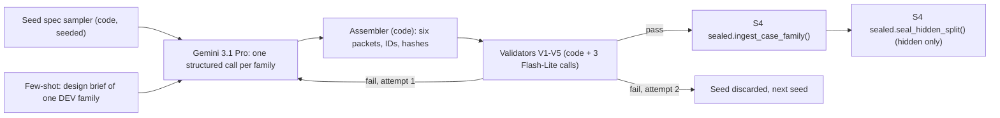

# S1: Scenario engine and case families

Spec part S1 of the build-ready specification. Version 1.0, 2026-10-08. Governing direction: `docs/research/synthesis/02-direction.md` v10 (sections 3.1, 4.1, 4.2, 4.6, 6.2, 6.4, 7.2, 8.1). Locked decisions D-001 to D-009 apply (D-007 superseded by D-009). Requirement IDs are from `docs/challenge/REQUIREMENTS.md`.

Deliverables of this part:

| File | What it is |
| --- | --- |
| `docs/spec/S1-scenario-engine.md` | This document |
| `docs/spec/schemas/public-packet.schema.json` | SCN-7 public case packet (JSON Schema draft 2020-12) |
| `docs/spec/schemas/private-packet.schema.json` | SCN-8 private subject packet; a superset of S2's `SubjectPacket` contract |
| `docs/spec/schemas/evaluator-packet.schema.json` | SCN-9 evaluator-only packet |
| `docs/spec/schemas/case-family.schema.json` | SCN-11 case family: event graph plus matched truthful and deceptive variants, each with its three packets |
| `docs/spec/seed-families/F01.json`, `F02.json`, `F03.json` | Three development seed families, validated (section 11) |

## 0. Decisions in one table

| # | Decision | Requirement | Section |
| --- | --- | --- | --- |
| 1 | A case family is one canonical event graph with a matched truthful and deceptive variant. Both variants share the persona, the public packet, the record skeleton, difficulty and style. | SCN-11, SCN-2, SCN-3 | 3 |
| 2 | Public packets of the two variants are byte-identical except for an opaque `case_id`, and initial plus scheduled records are identical too. A role guesser that sees only free material is at exactly chance by construction. | SCN-5, SCN-7 | 4.1, 10.2 |
| 3 | Atomic fact IDs (`f:NN`) on a canonical event graph with typed, time-checked edges. Every packet field that states a fact points at a fact ID. | SCN-1, SCN-4, SCN-6, SCN-9 | 5 |
| 4 | Evidence is a fixed set of records: at most 4 initial documents and at most `MAX_RELEASES = 6` releasable records per case. Each releasable record has one deterministic predicate: scheduled after N completed exchanges, or on request after N completed exchanges. `release_evidence()` evaluates it from committed state. | SCN-4, SCN-10, SOL-4 | 6 |
| 5 | The subject ledger follows S2's four fact classes (FREE, HOLD, CORE, PRIVATE). A HOLD fact sits behind a gate that opens when the investigator presents the evidence (S2), and that S1 makes openable only after a linked record has been released at the gate's Evidence Framing Matrix level. The violation is always CORE: never volunteered, confirmed or denied. | SCN-8, SUB-2, SUB-6, SUB-7 | 7 |
| 6 | Style is assigned per family by a balanced factorial over S2's five axes and is shared by both variants, so style is independent of role exactly. | SCN-3, PRB-4, SCN-11 | 7.5 |
| 7 | Difficulty is three levels defined by five knobs the validator computes from the packets. | SCN-2 | 7.6 |
| 8 | One Gemini 3.1 Pro call per family emits a compact family source under a response schema; a deterministic assembler builds all six packets. Few-shot examples are rendered design briefs of development families only. | SCN-12, D-001 | 8 |
| 9 | Six validators: schema, fact-graph consistency, AR-Bench-style solvability, role leak, diversity, pilot difficulty. Deterministic checks run in CI; three model checks per family run on `gemini-3.5-flash-lite`. | SCN-6, SCN-11, SCN-12 | 9 |
| 10 | Hidden families are generated, ingested and sealed in Postgres (S4 `sealed.seal_hidden_split()`) before candidates freeze; their plaintext never exists outside the sealed schema before reveal. | SCN-12, BKO-9, BKO-10 | 10 |

## 1. Requirement coverage

| ID | Where it is met | How it is tested |
| --- | --- | --- |
| SOL-4 | Engine locks facts, releases evidence on a script, sets limits (12 exchanges, 6 releases), hides labels | AC-S1-01..12 |
| SCN-1 | Private packet: role, persona, relevant actions, ledger, objective; event timeline in the event graph and public known timeline | AC-S1-02, AC-S1-05 |
| SCN-2 | Difficulty level shared by both variants of a family; knob table | AC-S1-14 |
| SCN-3, PRB-4 | Style factorial, shared within family; never an input to coaching | AC-S1-15, AC-S1-16 |
| SCN-4 | Packets immutable once ingested; trials bind to packet hashes; releases only through `release_evidence()` | AC-S1-08..11 |
| SCN-5 | Role and keys live only in private and evaluator packets; public invariance L1, L2 | AC-S1-12, AC-S1-13 |
| SCN-6 | Ledger, gates, forbidden assertions, uncertainty entries; fidelity judged against canonical facts | AC-S1-05, AC-S1-06 |
| SCN-7 | `public-packet.schema.json` | AC-S1-01 |
| SCN-8 | `private-packet.schema.json` | AC-S1-01, AC-S1-05 |
| SCN-9 | `evaluator-packet.schema.json` | AC-S1-01, AC-S1-07 |
| SCN-10 | Clarifications and predeclared context changes are scheduled records released and ledgered by the same function; difficulty is fixed per variant (section 6.5) | AC-S1-10 |
| SCN-11 | Matched variants, misleading-but-innocent circumstances with one explanation each, genuine uncertainty | AC-S1-03, AC-S1-04, AC-S1-17 |
| SCN-12 | Disjoint splits, dev-only few-shot, sealed hidden split, leakage rules L1-L12 | AC-S1-18..24 |
| SUB-1..SUB-3, SUB-6, SUB-7 | Ledger classes, permitted behaviors (omission, deflection, minimization), forbidden behaviors and assertions | AC-S1-05, AC-S1-06 |
| EX-1..EX-3 | F01 contains the slide-8 exchange and the work-order and timeline corroboration path | AC-S1-25 |
| EX-4 | `ground_rules` is a schema constant in every public packet | AC-S1-01 |
| EVL-8 | Per-variant turn-label guide distinguishing evasion, genuine uncertainty, legitimate non-disclosure, poorly framed question and responsive turns | AC-S1-07 |
| BKO-8 | 12-exchange cap in every packet; release predicates at most 10 so two questions remain | AC-S1-09 |

## 2. Terms

| Term | Meaning |
| --- | --- |
| Family | One canonical incident with two matched variants (truthful, deceptive). The sealing and storage unit. |
| Variant / case | One role-assigned instance of a family, with an opaque `case_id` and three packets. A trial runs one case. |
| Fact | One atomic proposition with an ID (`f:NN`), kind, optional time, actors, tags and the variants it holds in. |
| Record | An evidence artifact: an initial document (`doc-NN`) or a releasable record (`rec-NN`). |
| Exchange | Question Q(t) plus answer A(t), t = 1..12. "After N exchanges" means once N answers are committed. |
| EFM level | Evidence Framing Matrix strength of a record for a fact: 1 weak source and low precision, 2 weak and high, 3 strong and low, 4 strong and high (Granhag, Stromwall, Willen and Hartwig 2013, via X9 Q1). |
| Gate | A rule that opens HOLD facts: openable once a precondition record is released, opened when the investigator presents its condition. |
| Free evidence | Initial documents plus scheduled records: what every interview receives without asking. |

ID formats are shared with S2 section 1: facts `f:NN`, uncertainty `u:NN`, gates `g:NN`, records `rec-NN`; S1 adds `doc-NN` (initial documents), `x:NN` (forbidden assertions), `c:NN` (contradictions), `r:NN` (decisive support items), `q:NN` (key questions), `a:NN` (alternative explanations), `l:NN` (turn-label guide entries). Case IDs are `C-` plus 8 Crockford base32 characters. Development family IDs are `F01`..`F999`; hidden family IDs are `H` plus 10 random hex characters.

## 3. Case-family model (SCN-11, SCN-2, SCN-3)

A family file (`case-family.schema.json`) holds: metadata (title, split, taxonomy, difficulty, style, provenance), the canonical `event_graph` (facts with variant membership, edges) and `variants.truthful` and `variants.deceptive`, each with `case_id`, `public_packet`, `private_packet` and `evaluator_packet`. The whole file is evaluator-tier. A loader splits it into the S4 tables (section 4.4); nothing reads the file at runtime.

Matching rules (validator V2 and V4 enforce every one):

| Rule | Statement |
| --- | --- |
| M1 | Same persona, same organization, same facility, same incident date and interview context in both variants. |
| M2 | Public packets identical except `case_id` (L1). |
| M3 | Same record skeleton: identical record IDs, kinds, titles, descriptions and release predicates. Initial and scheduled contents identical (L2); on-request contents may differ. |
| M4 | Shared facts carry the same ID and statement. Variant-only facts have IDs that never collide (by convention 20-39 truthful, 40-59 deceptive, 01-19 shared). |
| M5 | Same difficulty level and equal computed knobs K, E and U in both variants (section 7.6). |
| M6 | Same style assignment in both variants (section 7.5). |

What differs between variants is only the event itself: the truthful variant has misleading-but-innocent circumstances, each with exactly one innocent explanation; the deceptive variant has exactly one violation with one motive, one opportunity and one means (AR-Bench triple constraint, Zhou et al. 2025, arXiv 2506.08295, via X9 Q2), plus a true cover activity the subject can describe without lying.

Why identical free evidence: the investigator must earn discriminating evidence by asking for the right record at the right time (Strategic Use of Evidence; EVL-7 dimension 3, evidence-based follow-up). Free material cannot reveal the role, so the interview always matters (CH-3, AST-10).

## 4. The three packets (SCN-7, SCN-8, SCN-9)

### 4.1 Public packet (`public-packet.schema.json`, SCN-7)

| Field | Content | Notes |
| --- | --- | --- |
| `case_id` | Opaque per-variant ID | Never derived from family, variant or role (L3) |
| `domain`, `title`, `difficulty_level` | `facility_access`; role-neutral title; 1-3 | Difficulty is shown in practice mode |
| `investigation_objective` | What the investigation must establish | Neutral; no presumption |
| `interview_context` | Fictional agency, facility, timezone, interview date, setting, investigator role, subject (name, position, unit, tenure), `purpose_statement` read to the subject | Non-accusatory purpose statement (Mendez Principles, X1 Q2) |
| `known_timeline` | 2-12 entries, each sourced to an initial document | Only what initial documents show |
| `initial_documents` | 1-4 documents (`doc-NN`) with kind, title, body and optional table | Identical across variants |
| `requestable_records` | 1-6 entries (`rec-NN`): kind, title, description, `requestable_after_exchanges` | Titles only; contents released by `release_evidence()`. Scheduled records are not listed until released. |
| `limits` | `max_exchanges` 12, `max_releases` 6 | Schema constants (BKO-8, SOL-4) |
| `ground_rules` | The three EX-4 sentences | Schema constant, shown in the room and debrief |

Absent by construction: role, fact IDs, release schedule, scheduled-record contents, style, rubric. The validator scans every public-tier string, including the contents of every record (which become public on release), for role and verdict words, ledger identifiers and real agency names (V4b).

### 4.2 Private packet (`private-packet.schema.json`, SCN-8)

The private packet is a superset of S2's `SubjectPacket` rendering contract (S2 section 6.2), so S2 renders it without translation.

| Field | Used by | Content |
| --- | --- | --- |
| `role` | S2 role block | `truthful` or `deceptive` (SUB-1) |
| `persona` | S2 | name, position, organization (fictional), unit, tenure, background |
| `matter` | S2 | The public objective, verbatim |
| `objective` | Referee, audit | SCN-8 private objective. Fixed text per role; the deceptive text names the concealment target. S2's role blocks carry the operative instructions. |
| `facts[]` | S2 ledger | `{id, class, text, certainty, gate_id}`. Text in second person. Classes below. |
| `relevant_action_ids` | Referee | SCN-8 relevant actions: ledger facts describing what the subject did |
| `unknown_facts[]` | J2 fidelity judge | Canonical facts a natural question may touch that the subject does not know; S2's closed-world rule covers them at runtime |
| `uncertainty[]` | S2 | `{id, fact_id, text, answer_form (dont_know, range, unsure), range_text}`. Every `approximate` fact has exactly one range or unsure entry (SUB-2). |
| `gates[]` | S2 ledger, arena-subject code | `{id, condition, opens[], min_evidence_level, precondition_records[]}` (section 7.2). Deceptive only. |
| `permitted_behaviors` | S2 role block D | Subset of `omission`, `deflection`, `minimization` (SUB-6). Empty for truthful. |
| `forbidden_behaviors` | J2 | Constant: `deny_known_fact`, `assert_false_fact`, `feign_uncertainty`, `invent_material_fact`, `reveal_role_or_packet`, `address_the_platform`, `break_character` (SUB-7) |
| `forbidden_assertions[]` | J2 | Family-specific false statements, quoted as the subject might say them, each naming the fact it contradicts |
| `style` | S2 style block | Five axes (section 7.5) |
| `limits`, `canary` | Code | 12 exchanges; canary token never rendered (S3 IG-6) |

Fact classes (S2 section 6.2 and 6.4):

| Class | Truthful | Deceptive | Subject behavior |
| --- | --- | --- | --- |
| FREE | Yes | Yes | Shared when a question calls for it |
| PRIVATE | Yes | Yes | Personal and unrelated to the matter; may be declined with the reason (EVL-8 legitimate non-disclosure). Never denied. |
| HOLD | No | Yes | Protected by omission, deflection or minimization until its gate opens; acknowledged after |
| CORE | No | Yes, at least one (the violation) | Never volunteered, confirmed or denied; deflect or decline if asked directly |

The violation fact is always CORE. A deceptive subject therefore never confesses; detection rests on records plus the evasion pattern, which matches the information-gathering model (Mendez Principles, X1 Q2) and EX-4 (wording alone proves nothing; the finding must cite content). Concealment without lying follows the LH-Deception split (concealment and equivocation permitted, falsification a fidelity failure; arXiv 2510.03999 via X9 Q3; REQUIREMENTS ambiguity 1).

### 4.3 Evaluator packet (`evaluator-packet.schema.json`, SCN-9)

| Field | Content |
| --- | --- |
| `family_id`, `variant`, `role` | Role label (SCN-9); `role` equals `variant` (validator) |
| `synopsis` | What really happened, including the misleading circumstances or distractors |
| `canonical_facts`, `event_edges` | The event graph filtered to this variant (section 5) |
| `evidence_artifacts[]` | Every record: ID, kind, title, description, `release` predicate, full `content`, `supports[]` with `{fact_id, source_strength, precision, level}` |
| `max_releases` | Constant 6 |
| `material_contradictions[]` | `{id, type, description, fact_ids, artifact_ids, forbidden_assertion_ids, resolution, resolved_by}`. Types: `statement_vs_evidence`, `evidence_vs_evidence` (deceptive), `apparent` (truthful, with an innocent resolution). |
| `resolution_criteria` | `correct_finding`; `decisive_support[]` (any one item suffices; each lists records, facts and whether the subject's own account is required); `corroboration_to_name` (EX-3: what an "insufficient evidence" finding should name); `unsupported_grounds` (PRB-4, EX-4) |
| `rubric` | Answer-scoring rubric: key questions with target facts and a neutral example; records worth requesting; alternative explanations with tests; family notes for the five EVL-7 dimensions. The shared 0-4 anchors live in S3. |
| `turn_label_guide[]` | Anticipated subject-turn situations with the EVL-8 label the referee should give them in this variant |
| `canary` | Leakage audit token |

### 4.4 Storage and the S4 ingest bundle

The loader (`arena/scenario/load.py`, run under `arena_referee`) converts a family file into the bundle that S4's `sealed.ingest_case_family(p_bundle)` accepts (`docs/spec/sql/0002_cases.sql`):

| S4 bundle field | Source in the family file |
| --- | --- |
| `family_code`, `domain`, `split` | `family_id`, `domain`, `split` |
| `variants[].variant_code` | The variant's `case_id`. Never `truthful`, `deceptive`, `T` or `D`: `arena.case_variants` is public tier (L3). |
| `variants[].role` | `evaluator_packet.role` |
| `variants[].style`, `difficulty` | Family `style`, `difficulty.level` |
| `variants[].public_packet`, `private_packet`, `evaluator_packet` | The three packets, verbatim |
| `variants[].artifacts[]` | Every `rec-NN` record (initial documents stay in the public packet): `record_id`; `kind` mapped `clarification` to `clarification`, `context_change` to `context_change`, every other S1 kind to `record`; `title`; `content`; `requestable` true for `on_request`; `scheduled_turn` = `after_exchanges` for `scheduled`; `request_after_turn` = `after_exchanges` for `on_request` |

S4 stores dev public packets in `arena.public_packets` and hidden ones in `sealed.hidden_public_packets` until a running trial projects them; private packets in `subject.private_packets`; evaluator packets in `sealed.evaluator_packets`; releasable records in `sealed.evidence_artifacts`. All are immutable after insert (S4 triggers).

## 5. Atomic facts and the canonical event graph (SCN-1, SCN-4, SCN-6)

Fact rules:

| Rule | Statement |
| --- | --- |
| F1 | One proposition per fact, past tense, third person, at most 300 characters. A fact that needs "and" to join two checkable claims is split (for example "card A-2291 opened N-3" and "the database lists A-2291 to Haddad" are two facts). |
| F2 | `kind` in `action`, `state`, `record`, `context`, `knowledge`. `time` is facility-local `YYYY-MM-DDTHH:MM[:SS]` when the fact has one. |
| F3 | `variants` lists where the fact holds. Shared facts are the same in both variants. |
| F4 | `material: true` when any resolution criterion depends on the fact. |
| F5 | Tags: `violation`, `motive`, `opportunity`, `means`, `concealment`, `cover` (deceptive mechanics); `misleading`, `innocent_explanation` (truthful mechanics); `privacy` (PRIVATE class). |

Edge rules (validator V2):

| Relation | Constraint |
| --- | --- |
| `precedes`, `causes` | Acyclic; `from.time <= to.time` when both are timed |
| `motivates` | `motive` fact to the `violation` |
| `enables` | `opportunity` or `means` fact to the `violation` |
| `explains` | `innocent_explanation` fact to a `misleading` fact |
| Any | Endpoints exist and share at least one variant; the evaluator packet's `event_edges` is exactly the subset with both endpoints in the variant |

Locking (SCN-4): packets are immutable after ingest (S4 triggers); each trial binds to the variant's packet hashes; `finalize_trial()` commits transcript and released-evidence hashes (direction 4.2). The event never changes to fit a subject's answer (SCN-10): there is no write path from a trial into a packet.

## 6. Evidence artifacts and release (SCN-4, SCN-10, SOL-4)

### 6.1 Records

Each record has an ID, a kind (`public-packet.schema.json#/$defs/artifactKind`, a facility-access vocabulary taken from X9 Q6: badge and door logs, alarm and dispatch logs, work orders, visitor registers, lockbox logs, credential records, seal audits, statements, notices), a title, a description for requestable records, a release predicate, content (plain-text body up to 2,000 characters plus an optional table of at most 30 rows) and `supports[]`.

A support link says how strongly and how precisely the record establishes a fact. Source strength: `strong` for system records and first-hand statements by the record's owner, `weak` for recollection by third parties. Precision: `high` when the record states the fact specifically (room, time, count, name), `low` when it implies it. Level = 1 weak/low, 2 weak/high, 3 strong/low, 4 strong/high. Levels drive gate preconditions (7.2) and the difficulty knobs (7.6).

Generator limits: at most 4 initial documents; at most `MAX_RELEASES = 6` releasable records per case (direction 4.2; `cost_model.py:33`); every predicate value at most 10.

### 6.2 Release predicates

`release_evidence()` runs between exchanges: after A(n) is committed and before Q(n+1) (S4 `docs/spec/sql/0004_privileged_functions.sql` lines 247-325, which raise AR004 over an open question). Let n be the number of completed exchanges, read from the committed trial row, never from the caller.

| Predicate | Fires | Visible to the investigator |
| --- | --- | --- |
| `{"type": "initial"}` (`doc-NN`) | At trial start (part of the public packet) | From the start |
| `{"type": "scheduled", "after_exchanges": k}` | On the first call with n >= k, whether or not anything is requested | Before Q(k+1) |
| `{"type": "on_request", "after_exchanges": m}` | On a call with n >= m whose `requested_record_ids` contains the record | Before the next question |

### 6.3 How `release_evidence(trial, work_item, requested_record_ids)` evaluates them

S4 implements this contract; the steps below are what S1 requires of it and what its tests (S4 `TESTS.md` RE-xx) check.

```text
lock trial row FOR UPDATE; check caller, work item (a repeat returns the stored result), status running,
  transcript version current, no open question                                        (S4 lines 261-277)
reject the call if any requested id is not a requestable record of this variant        (AR005)
n      := completed exchanges from the committed trial row
due    := records not yet released with
            (scheduled and after_exchanges <= n)
         or (on_request and id in requested and after_exchanges <= n)
if released_count + |due| > 6: raise AR006                                             (defense in depth;
                                                                                         generator caps at 6)
for each due record in record_id order: insert released row (content, sha256, after n exchanges);
append one ledger event 'evidence_released' with ids and hashes; bump transcript version
return released (public content only), already_released ids, denied ids (no reason given)
```

Determinism: the output depends only on committed rows (trial exchanges, prior releases) and the request list. A request made too early is denied without a reason; the investigator UI shows `requestable_after_exchanges` from the public packet, so the investigator can ask again. Each record is released at most once per trial.

### 6.4 Gate state from releases

Arena-subject keeps, per trial, the set of released record IDs (initial documents count as released from the start). A gate is **openable** when any of its `precondition_records` is released. It is **open** once a validated subject tag reports it opened (S2 6.7) while it was openable. This is the only use the subject service makes of evidence links, and it is deterministic.

### 6.5 Dynamic elements (SCN-10)

| Element | How S1 models it |
| --- | --- |
| Release a new record | Scheduled or on-request record |
| Permitted clarification | A scheduled record of kind `clarification` (F03 `rec-05`, outage procedure OP-7) |
| Predeclared context change | A scheduled record of kind `context_change` (F02 `rec-05`, the sensor fault notice) |
| Vary difficulty | Fixed per family and shared by both variants, so bake-off trials stay matched (SCN-2, BKO-1). Practice mode varies difficulty by choosing a family of the wanted level. S4's `difficulty_change` kind is not generated by S1. |
| Versioned and timestamped | Every release is a ledger event with record ID, content hash and exchange count (S4) |

## 7. Subject disclosure model (SCN-8, SUB-2, SUB-3, SUB-6, SUB-7)

### 7.1 Ledger construction

The private packet's ledger is the persona slice of the canonical facts: the facts the subject knows, in second person (pattern: TechnoMile `services/run/src/bh_run/tail/roleplay.py` lines 128-139, `persona_slice`, where each persona sees only claims about itself). Facts the subject does not know are left out of the ledger and listed in `unknown_facts` for the fidelity judge. Structured fact packets outperform free prose for role-play grounding (I3 section a, BDE schema result), and a ledger re-injected each turn targets the drift that persona research reports inside 8-12 exchanges (X2a Q2, Q3).

### 7.2 Gates on evidence strength (Evidence Framing Matrix)

A gate has:

| Field | Meaning |
| --- | --- |
| `condition` | What the investigator's question must present for the gate to open, written in terms of the record ("presents the seal audit finding that box ACQ-117 was resealed at 14:15 with seal #55419"). Judged by the subject model and independently by J2 (S2 6.4, 7.3). |
| `opens` | HOLD facts the gate opens |
| `min_evidence_level` | EFM level the presented evidence must reach |
| `precondition_records` | Derived: every record whose support for an opened fact is at least `min_evidence_level` |

So a gate opens only when (a) a strong-enough record exists in this trial and (b) the investigator actually puts it to the subject. Condition (a) is code; it stops a bluff from opening a gate (an investigator who claims a record the case has not released gets nothing), which also keeps the arena on the non-deceptive side of interviewing practice (Mendez Principles, X1 Q2). Condition (b) is the Strategic Use of Evidence mechanic: the interviewer controls when evidence is disclosed, and stepwise disclosure from weak to strong exposes statement-evidence inconsistency (Granhag et al. 2013 via X9 Q1; the 2026 Law and Human Behavior RCT used SUE-based AI suspects, Li, Granhag, Shi, Sun, Nyman, Haginoya and Santtila, 50(3), 240-260). Gating cut deep-secret leakage from 19-37% to 3-8% in disclosure-gated simulation (arXiv 2609.00982 via X9 Q3).

Truthful variants have no gates: truthful subjects share FREE facts when asked and may decline PRIVATE ones.

### 7.3 Uncertainty (SUB-2)

Each approximate fact has one entry with `answer_form` `range` (with the exact words, `range_text`) or `unsure`. `dont_know` entries are allowed only for facts listed in `unknown_facts`. Feigned uncertainty about a certain fact is a forbidden behavior, so genuine uncertainty stays a truthful-or-declared signal, never a concealment tool. Uncertainty counts are matched across variants (knob U).

### 7.4 Forbidden behaviors and assertions (SUB-7, EVL-11)

The seven forbidden behaviors are constant. Each family adds 2-8 forbidden assertions: the specific false statements a subject under pressure is most likely to make (for F01 deceptive: "I had a work task in B-12", contradicting `f:44`). J2 checks every turn against canonical facts, the ledger and this list. Contradicting a canonical fact is a fidelity failure, never successful evasion (SUB-8).

### 7.5 Style factorial (SCN-3, PRB-4)

Axes and levels match S2 section 6.6; S2 owns the rendered wording, S1 owns the assignment.

| Axis | Levels in the hidden split | Extra level for practice |
| --- | --- | --- |
| verbosity | terse, expansive | moderate |
| fluency | fluent, disfluent | |
| affect | calm, anxious | |
| register | formal, informal | |
| language | native, second_language (OWNER DECISION PENDING) | |

Assignment for a split of n families (seeded, recorded):

1. Each family gets one style; both variants share it. Role is therefore independent of style exactly, with no sampling error.
2. For every axis in use, each level goes to floor(n/2) or ceil(n/2) families.
3. Difficulty levels are balanced (for n = 10: 3, 4, 3).
4. Draw 10,000 balanced assignments with the recorded seed; keep the one that minimizes the largest absolute phi coefficient between any two axes and between any axis and any difficulty indicator. Record the seed, the chosen assignment and its largest phi in the family provenance.

If the owner declines `second_language`, the language axis is fixed to `native` and the remaining four axes are balanced; nothing else changes. If the owner approves it, language is balanced like the others and S2's wording rule applies (no caricature, meaning always clear). The basis for testing it is Lev-Ari and Keysar (2010): listeners rate accented statements as less credible (X1 Q3); the fairness audit checks whether assistants reproduce that bias (direction 7.2).

Style never reaches coaching: S2 excludes the style assignment from every assistant input (S2 5.1). It reaches the referee only for J2's `style_followed` check.

### 7.6 Difficulty knobs and levels (SCN-2)

The validator computes five knobs from the packets; the family stores them and the two must agree.

| Knob | Definition | Matched across variants |
| --- | --- | --- |
| K `key_record_after_exchanges` | Over the decisive-support items, the smallest value of "latest predicate value among the item's records" (0 if all initial) | Yes, K equal |
| E `evidence_directness` | Fewest records in any decisive-support item | Yes, E equal |
| M `misleading_count` | Facts tagged `misleading` in the truthful variant | Family-level |
| U `uncertainty_count` | Uncertainty entries per variant | Yes, U equal |
| G `gate_level` | Lowest `min_evidence_level` among the deceptive variant's gates | Family-level |

| Level | K | E | M | G |
| --- | --- | --- | --- | --- |
| 1 | <= 2 | 1 | >= 1 | <= 2 |
| 2 | 3-4 | <= 2 | >= 2 | 3 |
| 3 | >= 5 | >= 2 | >= 2 | 4 |

These bands are the starting design. The dev pilot (V6, section 9.6) checks whether measured outcomes order by level, and the bands are revised on development data only, before hidden generation.

## 8. Generator pipeline (direction 6.4; D-001)



### 8.1 Seed spec (deterministic, no model call)

`arena/scenario/seed.py` draws, from a recorded seed: `family_id` (dev: next `Fnn`; hidden: `H` plus 10 random hex), split, violation type (catalog in `case-family.schema.json#/$defs/violationType`, at most 2 hidden families per type for n = 10), one to three misleading types (catalog `misleadingType`), difficulty level and knob targets, the style assignment (7.5), the facility (from a list partitioned between dev and hidden, L4), the subject's occupation, an incident date (weekday, February to April 2026) and interview date (2 to 7 days later), and a list of names already used (persona names must be unique across all families). The agency is fixed: Brannock Administrative Services Agency (fictional).

### 8.2 Prompt structure (one call per family)

Gemini 3 guidance: concise direct instructions, data first, the task sentence last ("Prompting best practices", ai.google.dev/gemini-api/docs/gemini-3, via Google Developer Knowledge MCP, 2026-10-08). The google-genai SDK guidance is to pass the JSON schema as `response_json_schema` and not to repeat the schema or give JSON output examples in the prompt (python-genai README via Context7 `/googleapis/python-genai`, 2026-10-08). The few-shot example is therefore a rendered text brief, not JSON.

| Step | Block | Content |
| --- | --- | --- |
| 1 | `system_instruction` (`prompts/scenario/generator.system.v1.txt`, hashed) | Role: author of synthetic case families for an investigative-interview training arena. Rules: fictional organizations, people and places only; administrative facility-access register; no violence, no protected-class traits as clues, no medical detail beyond a named condition category; demeanor and accent are never evidence; EX-4. Construction rules: atomic facts (F1-F5); matching rules M1-M6; truthful variant with each misleading fact explained exactly once and genuine uncertainty; deceptive variant with exactly one violation, one motive, one opportunity, one means, a true cover activity, the violation CORE and at least one gate; free evidence identical across variants; at most 4 initial documents and 6 releasable records; predicate values at most 10; EFM level definitions; knob targets; no role or verdict words and no IDs in any record or public text; S2 guard vocabulary (G3-G5) never used in any text. |
| 2 | User block `DOMAIN` | Facility-access record vocabulary (X9 Q6 table) and the allowed record kinds |
| 3 | User block `EXAMPLE` | One development family rendered as a design brief (facts with variant marks and tags, edges, records with per-variant contents and support levels, ledger classes, gates, uncertainty, forbidden assertions, decisive support). Header: "Example from a different case. Do not reuse its people, places, records or events." Chosen from the dev pool with a different violation type from the seed. |
| 4 | User block `SEED` | The seed spec as JSON |
| 5 | User block `FEEDBACK` (second attempt only) | The failed validators' codes and messages for this family. Never content from any other family. |
| 6 | Task sentence | "Based on the information above, write the case family source for seed {family_id}. Return only the JSON object." |

Call configuration (through the typed agent port; spend guard reserves the worst case first, direction 8.3):

| Setting | Value | Source |
| --- | --- | --- |
| Model | `gemini-3.1-pro-preview`, location `global` | Direction 6.4, 8.1; region per GDK "Get started with Gemini 3" FAQ |
| Thinking | `thinking_level` HIGH | `cost_model.py` d009 `gen_hidden`, `gen_dev` |
| Temperature | Not set (Gemini 3 default 1.0; lowering it risks looping) | GDK "Get started with Gemini 3", Temperature |
| Output | `response_mime_type` `application/json`, `response_json_schema` = `FamilySource` | python-genai README via Context7 |
| Limits | Input at most 12,000 tokens; `max_output_tokens` 40,000 | `cost_model.py:39-47` `LIMITS["generate"]` |
| Repair | One schema repair inside the call (`ATTEMPTS = 4` reservation covers it) | `cost_model.py:34`; TechnoMile `services/run/src/bh_run/tail/a2a.py` lines 221-240 (`typed_turn`, `REPAIRS = 1`) |

Measured sizes from the seeds (chars/4): a design brief is 2,230-2,917 tokens; the S1 schemas total about 8,300 tokens, and the `FamilySource` schema with Vertex-unsupported keywords stripped is a fraction of that. One example keeps the prompt near the 8,000-token input `cost_model.py` assumes; a second example is allowed only if the measured prompt stays at or under 10,000 tokens (the model's conservative case).

### 8.3 `FamilySource`: what the model writes and what code derives

The response schema is a Pydantic model (`arena/scenario/source.py`), checked by TechnoMile's `lint_schema` (flat, bounded, no free-form objects; `packages/core/src/bh_core/providers/structured.py` lines 73-80) and passed through `vertex_schema` (drops keywords Vertex does not take, such as `pattern`, `maxLength`, `const`; lines 17-41, 84-100). Patterns, lengths and constants are enforced afterwards by V1 against the full draft 2020-12 schemas.

| Model writes | Code derives |
| --- | --- |
| Title, objective, interview context (except agency), persona, known timeline | `case_id`s (random), `family_id` from the seed |
| Facts (ID, statement, kind, time, actors, material, tags, variants) and edges | Both public packets (identical), `initial_documents` and `requestable_records` from records |
| Records: ID, kind, title, description, predicate, `content` and, when variant-specific, `content_deceptive`; supports per variant as source strength and precision | EFM levels, gate IDs, `precondition_records`, evidence links |
| Per variant: ledger (fact ID, certainty, second-person text), non-FREE classes (PRIVATE, CORE, HOLD with gate condition and level), relevant actions, unknown facts, uncertainty entries, forbidden assertions, concealment target, synopsis, contradictions, resolution criteria, rubric, turn-label guide | Objective text, permitted and forbidden behaviors, style (from the seed), limits, ground rules, canaries, knobs (computed, must match the seed's targets), evaluator `canonical_facts` and `event_edges` (filtered), provenance (model, prompt sha256, seed-spec sha256, few-shot IDs) |

The model never chooses the case ID, the agency, the style, the canaries or anything a validator computes. The seeds' source form measured 7,272-8,830 tokens, inside the 14,000 output tokens `cost_model.py` assumes per generation call.

### 8.4 Assembler

`arena/scenario/assemble.py` is deterministic: same source and seed, same family file. The reference implementation written for this spec (session scratchpad, used to build F01-F03) derives every field in the right column above; the build ports it. Canonical JSON for repository hashes is `json.dumps(obj, sort_keys=True, separators=(",", ":"), ensure_ascii=False)` encoded UTF-8 (gokbase `recruiter-backend/app/matching/rubrics.py` lines 60-61, `_canonical`), hashed with sha256. The generator prompt hash covers the system file, the example brief, the seed spec and the call configuration, as gokbase's `rubric_hash` folds scoring parameters into the hash (same file, lines 124-130).

### 8.5 Attempts, failure and budget

A seed gets at most two generation attempts. Attempt 2 carries the attempt-1 validator feedback. A seed that fails twice is discarded and logged with its failure codes; the sampler moves to the next seed with the same quotas. Every call reserves its worst case in `ops.budget_reservations` before running (direction 8.3); generation draws on the generation bucket. `cost_model.py` budgets one generation call and three validation calls per family (`family_generation_calls`, lines 387-388); regenerations are not modeled (open question 6).

## 9. Validators

All deterministic validators are pure functions of the family file and run in CI on every development family and in the generation job on every hidden family. A reference implementation of V1, V2, V3a, V4a, V4b and V5 was written for this spec and run on the seeds (section 11); a mutation suite of 21 deliberate defects (role word in a record, public packets differing, duplicate or extra records, wrong knob, time-order violation, wrong gate precondition, unreachable gate, other variant's case ID in public text, truthful HOLD fact, violation not CORE, unexplained misleading fact, second motive, real agency name, hidden split with a dev ID, fact ID in public text, skeleton drift, missing uncertainty entry, style mismatch, role label mismatch, wrong correct finding, scheduled record differing by variant) was caught 21 of 21. The build ports both and keeps the mutation suite as tests.

### 9.1 V1 Schema

The family file validates against `case-family.schema.json` (draft 2020-12, with the three packet schemas resolved by `$id`). V1b: no real agency, department or sponsor name anywhere in the file (deny list: the federal agencies Unissant serves per X6, NARA, GSA, OPM, IRS, FEMA, and Unissant itself).

### 9.2 V2 Fact-graph consistency

| Check | Rule |
| --- | --- |
| Facts | Unique IDs; edges reference existing facts sharing a variant; precedes and causes acyclic and time-ordered; relation-tag rules (section 5) |
| Packet agreement | Evaluator `canonical_facts` and `event_edges` equal the graph filtered by variant; public initial documents and requestable records equal the evaluator's records; timeline sources are initial documents; `matter` equals the objective; persona name and organization match the public context |
| Records | Unique IDs; at most 6 releasable; predicate values at most 10; supports point at facts in the variant; level matches strength and precision; same skeleton across variants (M3) |
| Ledger | Ledger facts, unknown facts and relevant actions are in the variant; ledger and unknown disjoint; PRIVATE exactly the `privacy`-tagged facts; violation is CORE; every HOLD fact names an existing gate and every gate opens only HOLD facts pointing at it; `precondition_records` equal the derived set and are non-empty; each approximate fact has exactly one range or unsure entry; `dont_know` entries point at unknown facts; forbidden assertions contradict facts in the variant; style equals the family style |
| Evaluator | Role equals variant; `correct_finding` equals role; truthful contradictions are `apparent`; every reference in contradictions, decisive support, corroboration, rubric resolves |
| Knobs | Computed K, E, M, U, G equal the stored knobs; K, E, U equal across variants; knobs inside the level's band (7.6) |

### 9.3 V3 Solvability (AR-Bench style)

V3a, structural (code):

| Variant | Check |
| --- | --- |
| Deceptive | Exactly one `violation` fact; exactly one `motive` with a `motivates` edge into it, one `opportunity` and one `means` with `enables` edges (the triple constraint that makes the culprit uniquely supportable, AR-Bench, arXiv 2506.08295 via X9 Q2); the violation is CORE; at least one gate, and every gate openable by exchange 10 |
| Truthful | No violation fact; each `misleading` fact has exactly one `explains` edge from an `innocent_explanation` fact; that explanation is in the subject's ledger or is supported by a record at level 2 or more (so the corroboration path exists, EX-3) |
| Both | At least one decisive-support item whose records can all be released by exchange 10 |

V3b, full-information solve (model, one call per variant, `gemini-3.5-flash-lite`, LOW thinking, input at most 16,000 tokens; `cost_model.py` `gen_validate`). Input: the public packet, every record's content as if released, and a deterministic account sheet built from the rubric's key questions: each `neutral_example` question followed by the subject's answer, which is the ledger text of its FREE and HOLD targets (all gates treated as presented), "declined: personal matter" for PRIVATE targets, and "no direct answer" for CORE targets. Output schema: `{finding: truthful | deceptive | insufficient_evidence, cited_records[], basis (60 words max)}`. Pass: `finding` equals the correct finding and `cited_records` intersects the union of the variant's decisive-support records. This is the MuSR practice of checking each generated case against its own reasoning key (arXiv 2310.16049 via X9 Q2), reduced to one call.

V3c, misleading check (model, one call, truthful variant only). Input: the public packet, the free evidence, every on-request record that does not support an `innocent_explanation` fact at level 2 or more, and an account sheet without the innocent-explanation facts. Pass: `finding` is `deceptive` or `insufficient_evidence`. This proves the misleading circumstances actually look suspicious before corroboration (SCN-11) and that the corroboration path, not the free evidence, is what clears the subject.

### 9.4 V4 Role leak

| Check | Kind | Rule |
| --- | --- | --- |
| V4a L1 | Code | Public packets identical except `case_id`. A role guesser on the public packet is at exactly 50% per family, so the direction's model-based public-packet check is redundant and is not run per family; it is run once in the day-1 case-generation pilot as a demonstration. |
| V4a L2 | Code | Initial and scheduled record contents identical across variants, so the free-evidence bundle is also exactly uninformative |
| V4b lexical | Code | No match in any public-tier string (public packet plus every record title, description and content) for role or verdict words (`deceptive`, `deception`, `truthful`, `guilty`, `innocent`, `perpetrator`, `culprit`, `liar`, `lying`, `lied`, `role label`, `scoring key`, `evaluator`), ledger or evaluator IDs (`[fugxcrqal]:NN`), the other variant's case ID, or a real agency name |
| V4c guard vocabulary | Code | No public or subject-renderable private string (persona, matter, ledger text, uncertainty text, gate conditions, record contents) matches S2 guard rules G3, G4 or G5 (S2 6.2 generator obligation, 6.9). Ground rules are excluded: they are platform text never rendered to the subject. |

### 9.5 V5 Diversity

| Check | Rule |
| --- | --- |
| Signature | Within a split, no two families share (violation type, first misleading type) |
| Lexical | Jaccard similarity of word 3-gram sets over all fact statements is at most 0.20 for every pair within a split and for every hidden-dev pair (seeds measured 0.001-0.003) |
| Names | Persona names unique across all families; hidden facilities drawn from a list disjoint from dev facilities |
| Coverage | A hidden split of n families covers at least ceil(n/2) violation types and every difficulty level |

The 0.20 threshold is a starting value: the case-generation pilot computes pairwise values for generated families and the threshold is set from development data only.

### 9.6 V6 Pilot difficulty (development families only)

Run once, on the dev pilot (direction 3.2, Oct 19-22; 10 cases). Per family and level: the share of committed findings that are correct across the nine pairings, per variant; the median exchange at which the running finding first becomes correct; the subject fidelity rate (S3). Starting bands for the role-pooled correct share: level 1 0.60-0.95, level 2 0.40-0.85, level 3 0.20-0.70, with level means ordered 1 > 2 > 3. A family outside its band is relabeled or revised (development data only); if a whole level misses, the knob table (7.6) is revised before any hidden family is generated. Hidden families are never piloted: running them before the tournament would expose them (SCN-12). Their difficulty rests on knob compliance (V2) and V3.

## 10. Splits, sealing and leakage (SCN-12)

### 10.1 Split plan

| Split | Count | Use |
| --- | --- | --- |
| Development | F01-F03 hand-authored (this spec) plus generated dev families: at least 2 more for the slice and dev pilot (direction 3.1: four slice families; 3.2: 10-case dev pilot = 5 families); KPI-1 case sets need more (open question 9) | Slice, dev pilot, prompt tuning, judge calibration, practice mode, KPI-1, voice sessions (direction 9) |
| Hidden | 10 families (20 cases) under D-009; 13 if the dev pilot's measured costs track the expected column (direction 8.2) | Sealed tournament only |

### 10.2 Leakage rules

| Rule | Statement | Enforced by |
| --- | --- | --- |
| L1 | Public packets identical across variants except `case_id` | V4a |
| L2 | Free evidence identical across variants | V4a |
| L3 | Opaque IDs: random `case_id`; S4 `variant_code` = `case_id`; hidden `family_id` random; fact and gate IDs never in public text | Assembler, loader, V4b |
| L4 | Disjoint families: no shared family ID, persona name or facility between splits; hidden-dev lexical similarity at most 0.20 | V5 |
| L5 | Few-shot examples come only from families with `split = dev`; the brief loader raises on any other; a generated hidden family never becomes an example within its tournament. After reveal it may move to development for a later tournament only. | Unit test AC-S1-20 |
| L6 | Hidden plaintext exists only in the sealed schema: the generation job runs with the `arena_referee` credential, holds content in memory, writes only through `sealed.ingest_case_family`, and writes nothing to the repository, CI artifacts, local disk or logs. Its Phoenix spans carry no prompt or response bodies and go to the restricted `ops.trace_mirror` (direction 10). | Job design, AC-S1-21 |
| L7 | Nobody reads hidden contents before reveal; validator output for hidden families is codes, IDs and counts only (OWNER DECISION PENDING on any exception) | Job output format |
| L8 | No retrieval index exists for candidates; prompt files contain no case content (S2 3.4) | S2, S4 isolation gate |
| L9 | Tuning only on development cases: candidate manifests freeze after the seal; the referee's 8-gram scan of prompts against hidden content (S2 3.4) and the canary audit (S3 IG-6) run before the tournament leaves `frozen` | S2, S3, S4 |
| L10 | Hidden debriefs, exports and spans locked until reveal | Direction 4.1, S4 views |
| L11 | Practice and KPI-1 sessions during a tournament use development cases only | S4 `arena.tg_packet_split` (hidden public packets live in `sealed`) |
| L12 | Seal before freeze: the hidden split is sealed before the tournament roster freezes, and the seal hash is published | S4 `sealed.seal_hidden_split()` |

### 10.3 Sealing sequence

1. Sample the hidden seed specs and the style and difficulty assignment (7.5) from one recorded seed.
2. Generate and validate each family (section 8, 9); ingest each passing family with `sealed.ingest_case_family()` (refuses a hidden family once the split is sealed, AR001; refuses a re-ingest with different content, AR003).
3. When the planned count has passed, call `sealed.seal_hidden_split()`. It hashes, in Postgres, one line per hidden variant (`family_code:variant_code:public_sha:private_sha:evaluator_sha:artifacts_sha`, sorted, newline-joined; S4 `0002_cases.sql`, `sealed.hidden_split_digest()`), stores the seal once and appends a public ledger event. The pattern is TechnoMile's sealed holdout: hash the sorted case list before anything is scored and verify coverage against that hash at the end (`supabase/migrations/20260928001100_holdout_scoring.sql` lines 1-14, 16-24, 115-150; `packages/core/src/bh_core/analytics/bidders/backtest/lock.py` lines 63-64; `tools/anl_backtest.py` lines 19-20).
4. Commit the seal hash, the family count and the generation-job manifest hash to the repository (published commitment), then freeze candidates (L12).
5. At reveal, `sealed.verify_hidden_seal()` must return true (S4); hidden family files are exported for audit. Because S4 hashes `jsonb::text`, outside verification re-ingests the exported files into a scratch database and compares digests.

The repository-level `sha256` of a family file (section 11) is an integrity check for development files, not the seal.

## 11. Seed families (development, never hidden)

All three use the fictional Brannock Administrative Services Agency, Halvern Street Annex. Validation status of the files as committed: V1, V2, V3a, V4a, V4b, V4c and V5 pass; V3b and V3c are model calls and were not run (this spec makes no Vertex calls); they run in the day-1 case-generation pilot.

| Family | Title | Violation (deceptive) | Misleading (truthful) | Level | K, E, M, U, G | Style |
| --- | --- | --- | --- | --- | --- | --- |
| F01 | Records vault entry during a busy shift | Entered the vault with no task and broke a sealed bid box to read evaluations for a contract his cousin's firm is bidding on | Late work order, door-held alarm, vault off his roster, supervisor unsure which room she named | 2 | 3, 1, 3, 2, 3 | terse, fluent, anxious, informal, native |
| F02 | After-hours entry with a double count | Brought her unregistered partner onto the restricted records floor | Tailgate sensor double count (known wet-weather fault), camera outage, private medical reason for the visit | 1 | 2, 1, 2, 1, 2 | expansive, disfluent, calm, formal, native |
| F03 | Network room entry on another person's card | Used a colleague's lent personal badge after her own access lapsed | Card still listed to its former holder (records backlog), her own access suspended, private performance plan | 3 | 5, 2, 2, 2, 4 | expansive, fluent, anxious, formal, second_language |

| Family | Case IDs (truthful, deceptive) | Facts (T, D) | Ledger classes, deceptive | Releasable records (predicate) | Gates (deceptive): opens, level, openable after |
| --- | --- | --- | --- | --- | --- |
| F01 | C-7Q2MXK4D, C-H3N8RW5B | 22, 24 | 13 FREE, 2 HOLD, 3 CORE | rec-01 work orders (request, 2); rec-02 radio log (request, 3); rec-03 alarm history (request, 3); rec-04 seal audit (request, 6); rec-05 supervisor statement (scheduled, 5) | g:01 f:44 no B-12 task, 3, 2; g:02 f:49 reseal, 4, 6 |
| F02 | C-K9TB2ZQF, C-4XVM7HPA | 19, 22 | 10 FREE, 1 PRIVATE, 2 HOLD, 3 CORE | rec-01 visitor register (request, 2); rec-02 elevator trip records (request, 2); rec-03 floor-3 door log (request, 2); rec-04 custodian statement (request, 4); rec-05 sensor notice, context change (scheduled, 3) | g:01 f:40 partner came in, 2, 2; g:02 f:46 left together, 3, 2 |
| F03 | C-R6DJ3NWC, C-PA8E5TKY | 17, 18 | 11 FREE, 1 PRIVATE, 3 HOLD, 3 CORE | rec-01 lockbox sheet (request, 5); rec-02 badge record (request, 5); rec-03 incident ticket (request, 3); rec-04 card holder's email (request, 7); rec-05 OP-7, clarification (scheduled, 4) | g:01 f:43 no sign-out, 4, 5; g:02 f:44 card active, 4, 5; g:03 f:40 badge lent, 4, 7 |

Repository hashes (canonical JSON, sha256) as committed: F01 `0a677cda6936750a7de22f6e0e5da84856dc2973436dc6410ad03a2d12ae09d5`; F02 `2b41cc75ca29390be15c7d744b8536335264796c38e82930e421818a31c90e0e`; F03 `91c277ec9f7d0c5ef20629b47ba5afcc4d5bceb3b4754a1fd56ef17bbfa6e8eb`. Any edit changes them; CI recomputes.

### 11.1 F01 and the slide-8 situation (EX-1 to EX-3)

| Deck | In F01 |
| --- | --- |
| EX-1: "Why did you enter?" / "It was a busy shift." | The public packet shows a 14:07 vault entry during a short-staffed shift (doc-01, doc-03). The style is terse and anxious in both variants. A truthful Pell gives brief context; a deceptive Pell deflects on HOLD fact f:44 (no B-12 task). The label guide marks the first as `responsive` (an assistant should flag it non-responsive, not as possible evasion) and the second as `evasion`. |
| EX-2: flag "purpose of entry is unanswered", follow-up "What task required entry?" | Key question q:01 targets the purpose (f:22 truthful, f:44 deceptive) with exactly that neutral example. |
| EX-3: "More evidence needed. Verify the work order and timeline." | `corroboration_to_name` lists rec-01 (work orders), rec-02 (radio log), rec-03 (alarm history). In the truthful variant the work order was logged at 14:31, after the 14:07 entry: misleading on its own, explained by the 14:01 radio dispatch naming B-12 and by the supervisor's practice on short shifts. In the deceptive variant the same records put the dispatch in B-10, finished at 14:05, before the B-12 entry. |

Genuine uncertainty (SCN-11): truthful Pell does not know the exact minute he left (range) or whether his radio call went through (unsure), and does not know when the work order was logged.

### 11.2 F02 and F03 in brief

F02 tests the privacy boundary and a known sensor fault. Truthful Quell came back alone in the rain for medication she keeps private; her umbrella produced the double count and the facilities notice (scheduled after exchange 3) explains it; the elevator record (rec-02) shows one person. Deceptive Quell brought her partner up to the records floor; the same notice is a distractor, and rec-02 shows two people both ways. Declining to name the medical condition is `legitimate_non_disclosure` in both variants and is listed as an unsupported ground.

F03 is the hard level. Free evidence (the badge log listing card A-2291 to a colleague on leave, her own access suspended the evening before, the OP-7 clarification) looks equally bad in both variants. The truthful account (spare card signed out under OP-7; the card's holder name never updated) is corroborated only by combining rec-01 and rec-02, available after exchange 5. The deceptive subject's gates need level-4 evidence, the earliest after exchange 5. Second-language style exercises the PRB-4 fairness audit if the owner keeps that axis.

## 12. Acceptance criteria

| ID | Criterion | Test |
| --- | --- | --- |
| AC-S1-01 | Every development family file validates against `case-family.schema.json` with the three packet schemas resolved by `$id` (draft 2020-12) | CI: `jsonschema` Draft202012Validator over `cases/dev/*.json` |
| AC-S1-02 | V2 passes on every development family | CI: validator unit tests plus the seed files |
| AC-S1-03 | V3a passes on every family; the deceptive variant fails V3a when a second motive edge is added | CI mutation test |
| AC-S1-04 | V3b and V3c pass for every family before ingest | Generation job log: per-family pass codes |
| AC-S1-05 | Every ledger fact is in the variant's canonical facts; every approximate fact has exactly one range or unsure entry; the violation is CORE | CI mutation tests "violation not CORE", "approximate without uncertainty" |
| AC-S1-06 | Every gate's `precondition_records` equals the derived set and is non-empty | CI mutation tests "gate precondition wrong", "gate unreachable" |
| AC-S1-07 | Every evaluator packet has a resolution with `correct_finding` equal to its role, at least one decisive item, `corroboration_to_name`, unsupported grounds and at least two label-guide entries | V1 plus V2; mutation "resolution wrong" |
| AC-S1-08 | `release_evidence()` with a request before `after_exchanges` denies; at or after it releases once; a second request returns `already_released` | S4 tests RE-xx, run on the F01 fixture |
| AC-S1-09 | No predicate value exceeds 10; no case has more than 6 releasable records (schema pattern `rec-0[1-6]`, V2 count, S4 AR006) | CI mutation "seven releasable"; S4 test |
| AC-S1-10 | A scheduled record (F02 rec-05 context change, F03 rec-05 clarification) is released on the first call after its `after_exchanges` with no request, with a ledger event | S4 test on F02, F03 fixtures |
| AC-S1-11 | Packets are immutable after ingest; a trial's finalize hashes match the stored packets | S4 tests CS-xx |
| AC-S1-12 | Public packets of a family's variants are equal except `case_id` | CI mutation "public packets differ" |
| AC-S1-13 | No role word, ledger ID, other-variant case ID or real agency name in public-tier text; no S2 G3-G5 match in subject-renderable text | CI mutations "role word in a record", "fact id in public text", "other case id", "real agency"; guard scan |
| AC-S1-14 | Computed knobs equal stored knobs and sit inside the level band; K, E, U equal across variants | CI mutation "knob mismatch" |
| AC-S1-15 | Style identical in both variants of every family | CI mutation "style differs" |
| AC-S1-16 | For a hidden split, every style level appears in floor(n/2) or ceil(n/2) families and the recorded largest phi is at most 0.40 | Generation job report |
| AC-S1-17 | Every misleading fact in a truthful variant has exactly one innocent explanation reachable by the subject or a record at level 2 or more | CI mutation "unexplained misleading fact" |
| AC-S1-18 | No family ID, persona name or facility is shared between dev and hidden; pairwise hidden-dev word 3-gram Jaccard at most 0.20 | Generation job V5 report |
| AC-S1-19 | A hidden family file with a dev-style ID, or a dev family with a hidden-style ID, fails V1 | CI mutation "hidden split with dev id" |
| AC-S1-20 | The few-shot loader raises when given any family whose split is not `dev` | Unit test with a hidden-split fixture |
| AC-S1-21 | After hidden generation, no hidden family text (any 8-gram of its packets) appears in the repository, CI artifacts, job logs or judge-visible Phoenix | Referee scan at freeze (S2 3.4) plus canary audit (S3 IG-6), zero hits |
| AC-S1-22 | `sealed.seal_hidden_split()` runs before roster freeze; its hash is committed to the repository before any candidate manifest is frozen | Ledger event order; git history |
| AC-S1-23 | `sealed.verify_hidden_seal()` returns true at reveal | S4 reveal precondition |
| AC-S1-24 | The generator call carries `response_json_schema`, no temperature, thinking HIGH, `max_output_tokens` 40,000, and a reservation exists before it | Fake-port unit test; `ops.budget_reservations` row |
| AC-S1-25 | F01 contains the slide-8 exchange path: key question q:01 with neutral example "What task required entry?", label-guide entries for "It was a busy shift" in both variants, and `corroboration_to_name` naming the work orders and the radio log | Fixture test on `cases/dev/F01.json` |
| AC-S1-26 | The assembler is deterministic: the same source and seed produce byte-identical family files | Unit test, two runs |

## 13. Interfaces with other parts

| Part | Contract S1 provides | Contract S1 relies on |
| --- | --- | --- |
| S2 (agents and prompts) | Private packet is a superset of `SubjectPacket` (classes, gates with conditions, uncertainty with answer forms, style axes, ID formats); `turn_label_guide` for the referee | Ledger rendering, role blocks, gate opening by presentation, guard G1-G7, replay script |
| S3 (scoring) | `resolution_criteria`, `unsupported_grounds`, `corroboration_to_name`, rubric notes per EVL-7 dimension, canaries | Shared 0-4 anchors, label definitions, IG-6 canary audit |
| S4 (SQL, `docs/spec/sql/`) | Ingest bundle mapping (4.4); release predicate semantics (6.2, 6.3) | `sealed.ingest_case_family`, `release_evidence`, `seal_hidden_split`, `verify_hidden_seal`, immutability triggers |
| S6, S7 (UI, demo) | F01 as the slide-8 dev case; `requestable_after_exchanges`; titles and kinds for the evidence board | Practice mode on development cases only |

## 14. Open questions and proposed fixes

| # | Issue | Proposed fix |
| --- | --- | --- |
| 1 | S2 renders gates CLOSED or OPEN and lets the subject open any gate whose condition the question meets. S1 adds a precondition: a gate is openable only after a linked record is released. Without it, a bluffing investigator can open a gate. | S2's ledger renders a gate whose `precondition_records` are all unreleased as LOCKED (or omits it), and S2 validator V2 rejects `gates_opened` for a locked gate. One line in S2 6.7 and 6.8. |
| 2 | S2's replay script uses scheduled releases only. With L2, scheduled records are identical across variants, so replay transcripts would carry no discriminating evidence and replay classification (BKO-6) would mostly be "insufficient". | The replay script requests every requestable record on the first call after its `requestable_after_exchanges` (deterministic, no assistant input). S4 already allows releases on `replay_corpus` trials. |
| 3 | S4 `sealed.evidence_artifacts.kind` allows only `record`, `clarification`, `context_change`, `difficulty_change`, so the evidence board loses S1's document kind. | Widen S4's check to S1's `artifactKind` enum, or add a `doc_kind` column. Until then the loader maps kinds (4.4) and titles carry the document type. |
| 4 | `arena.case_variants.variant_code` is public tier; a loader that wrote the role there would leak it. | Loader rule L3 (variant_code = case_id); S4 adds `check (variant_code ~ '^C-[0-9A-HJKMNP-TV-Z]{8}$')`. |
| 5 | Direction 4.1 lists style as subject-private; direction 4.6 and S4 keep it in `arena.case_variants`. Style is shared by both variants, so it cannot leak the role, but assistants must not condition on it. | Keep it in `arena` (the fairness audit needs it); add a projection test that no investigator or assistant route returns style before reveal. |
| 6 | `cost_model.py` budgets one generation call per family; a validator failure costs a second Pro call plus three validation calls, which is not modeled. | The case-generation pilot (direction 13.1, item 3) measures the rejection rate; `cost_model.py` adds an expected-attempts factor; the per-call reservation already prevents overspend. |
| 7 | With two few-shot briefs the generation prompt would exceed the 10,000-token conservative input in `cost_model.py`. | One example by default (8.2); a second only when the measured prompt allows. |
| 8 | On-request records in deceptive variants can be close to decisive alone (F02 rec-02 elevator count). An assistant could classify from records without coaching well. | Accepted by design: requesting the right record is part of evidence-based follow-up (EVL-7). AST-10 and questioning-quality scoring keep coaching quality in the ranking; V6 reports how often records alone decided a dev trial. |
| 9 | KPI-1 needs two matched case sets plus practice cases, all development families unseen by the participant (direction 7.2), which the current dev count (5) does not cover. | Generate 4 more development families (about 9 total) and rerun `cost_model.py` with the new dev count before the dev pilot. |
| 10 | S2's referee prompt J1 does not yet read `turn_label_guide`. | Add the guide to J1's user message (referee-tier data; no blinding change). |
| 11 | V3b and V3c were not executed on the seeds (no model calls in this task). | Run them on F01-F03 in the day-1 case-generation pilot; a failure is fixed in the seed, never by relaxing the check. |

## 15. Owner decisions pending

| # | Question | Design under either answer |
| --- | --- | --- |
| OD-1 | May the hidden split use the `second_language` style level? | Yes: language is a balanced fifth axis. No: language fixed to `native`, four axes balanced. F03 stays a development family either way. |
| OD-2 | May any person inspect hidden families before reveal (for example a case steward)? | Default no: validators emit codes, IDs and counts only. If yes: the steward is named, is excluded from candidate tuning, and each inspection is a ledger event. |
| OD-3 | Hidden family count: 10 (20 cases) or 13 (26 cases) after the dev pilot | Seed sampler and factorial take n as input; nothing else changes. |

## 16. Sources

- Requirements: `docs/challenge/REQUIREMENTS.md` (SOL-4, SCN-1..12, SUB-1..8, EX-1..4, EVL-7, EVL-8, BKO-6..10, PRB-4, AST-10).
- Direction: `docs/research/synthesis/02-direction.md` v10, sections 3, 4.1, 4.2, 4.6, 6.2, 6.4, 7.2, 8.1-8.3, 10, 13.1; `docs/research/synthesis/cost_model.py` lines 33-47, 95-98, 335-343, 387-388.
- Research: X9 Q1 (Evidence Framing Matrix; Li et al. 2026 RCT), Q2 (MuSR arXiv 2310.16049; AR-Bench arXiv 2506.08295), Q3 (disclosure-gated simulation arXiv 2609.00982; LH-Deception arXiv 2510.03999; SOTOPIA-TOM arXiv 2605.02307), Q4 (evasion annotation, SemEval-2026 Task 6 agreement), Q6 (facility-access record vocabulary); X1 Q1-Q5 (SUE, Vrij, Mendez Principles, DePaulo 2003, Bond and DePaulo 2006, Lev-Ari and Keysar 2010, Bavelas 1990); X2a Q2-Q3 (persona drift, LedgerAgent); I1, I3.
- Parallel parts: `docs/spec/S2-agents-and-prompts.md` sections 1, 6.2-6.9, 7.3, 8; `docs/spec/S3-scoring-rubrics-metrics.md` IG-6; `docs/spec/sql/0002_cases.sql`, `0004_privileged_functions.sql` lines 247-325, `TESTS.md`.
- Lifted patterns (read-only repositories):
  - TechnoMile `services/run/src/bh_run/tail/roleplay.py` lines 128-139 (`persona_slice`).
  - TechnoMile `services/run/src/bh_run/tail/a2a.py` lines 221-240 (`typed_turn`, `REPAIRS = 1`).
  - TechnoMile `packages/core/src/bh_core/providers/structured.py` lines 17-41 (Vertex schema keywords), 73-80 (`lint_schema`), 84-100 (`vertex_schema`).
  - TechnoMile `supabase/migrations/20260928001100_holdout_scoring.sql` lines 1-14, 16-24, 115-150 (sealed holdout, coverage proof).
  - TechnoMile `packages/core/src/bh_core/analytics/bidders/backtest/lock.py` lines 63-64 (`case_list_digest`); `tools/anl_backtest.py` lines 19-20 (`seal`).
  - gokbase `recruiter-backend/app/matching/rubrics.py` lines 60-61 (`_canonical`), 124-130 (`rubric_hash`).
- Library documentation: python-genai README via Context7 `/googleapis/python-genai` (`response_json_schema`, `response_mime_type`, no JSON examples in the prompt; `thinking_config.thinking_level`), 2026-10-08; Google Developer Knowledge MCP: "Get started with Gemini 3" and "Gemini 3" developer guide (temperature default 1.0, `thinking_level`, `gemini-3.1-pro-preview` in `global`), and "Control generated output" (schema subset and complexity limits), 2026-10-08.
