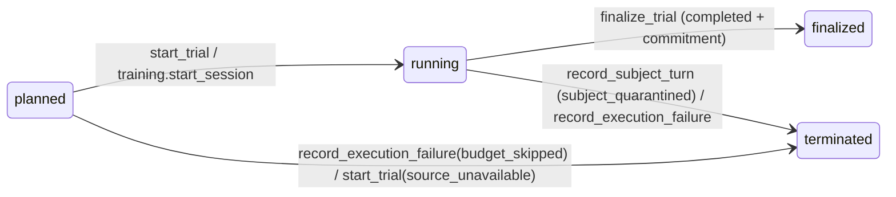

# S4: Data layer (Supabase Postgres)

Part of the build-ready spec for the Investigative AI Training Arena (GMU Challenge X, sponsor Unissant). **Version 2.1, 2026-10-08: S1 reconciled, cross-check X-01..X-17 resolved, D-013 applied.** Governed by `docs/spec/README.md` (baseline facts; it wins over this part), `docs/research/synthesis/02-direction.md` (v10.4; sections 4.1-4.6, 7.1, 8.2, 8.3, 10, 12), `docs/research/synthesis/03-ui-direction.md` (v2.1), `docs/spec/S8-build-plan.md` section 9 (C-01 to C-48) and `docs/challenge/REQUIREMENTS.md`. Owner decisions D-001 to D-014 are hard constraints (D-007 superseded by D-009; D-011 local-first; D-012 generated-and-applied budget ceilings; D-013 build first, one global spend ceiling, per-phase cost tuning deferred; D-014 case families authored offline by Claude agents with Codex review, no runtime generator). Today is 2026-10-08; the build runs to 2026-11-02.

Deliverables of this part:

| File | Content |
| --- | --- |
| `docs/spec/S4-data-layer.md` | This document |
| `docs/spec/sql/0001_foundation.sql` | Schemas, roles, revoke-all, helpers, append-only trigger |
| `docs/spec/sql/0002_cases.sql` | Case families, three packet tiers, evidence and predicates, hidden-split seal, candidate registry |
| `docs/spec/sql/0003_tournament_ledger.sql` | Hash-chained ledger, tournaments, frozen roster, trials, turns, work items, event store, findings, execution records, adjudications, seals, manifests, scores, lifecycle functions |
| `docs/spec/sql/0004_privileged_functions.sql` | The six privileged functions, the turn functions, context readers, commitment, manifest, projections |
| `docs/spec/sql/0005_training.sql` | Investigator sessions, KPI-1 participants, rubric scores, tickets, voice sessions |
| `docs/spec/sql/0006_ops_budget_traces.sql` | Spend guard, cost ledger, kill switch, latency samples, trace mirror, keep-alive |
| `docs/spec/sql/TESTS.md` | pgTAP test plan (every test, expected result) |

The migrations are drafts: never applied to any Supabase project. Version 2.1 was applied to a fresh throwaway local PostgreSQL 16 cluster in the session scratchpad to check that it parses and behaves, including the $0 seed of the one `global` bucket and the application of `budget_plan()`; results are in `sql/TESTS.md` section 0.1.

**Run mode.** Local-first is the default path (D-011): `arena-api`, `arena-subject`, `arena-referee` and the tournament job run as separate local processes, each with its own database role and credential; Phoenix runs locally; the database is the owner's Supabase project (a local `supabase start` is allowed for development); Vertex AI is the only billed GCP service. The hosted design (Cloud Run, IAP, billing guard, hosted judge link) is kept in section 2.5 as a deferred variant.

---

## 0. Summary

| # | Decision | Requirements |
| --- | --- | --- |
| 1 | Six schemas map the direction's tiers: `arena` (public tier and its projections), `subject` (subject-private), `sealed` (evaluator-only), `ledger` (hash chain, commitments, execution records, adjudications, manifests), `training` (investigators, voice), `ops` (budget, cost, traces). None is exposed to the Supabase Data API. | SCN-5, SCN-8, SCN-9 |
| 2 | Three runtime roles, one per credential, each used by its own local process (D-011): `arena_public` (arena-api and the tournament job), `arena_subject` (arena-subject), `arena_referee` (arena-referee and the operator CLI). `service_role` holds nothing in these schemas. `arena_public` and `arena_subject` hold no privilege on any base table; they read views and call functions. | SCN-5, KPI-5, EVL-10 |
| 3 | Every change to a trial's execution state goes through a SECURITY DEFINER function with `search_path=''`, EXECUTE revoked from PUBLIC and granted to one role, the trial row locked `FOR UPDATE`, inputs derived from committed rows, and a server-created work item bound to the transcript version. | BKO-9, SCN-10, F07 |
| 4 | The six privileged functions of direction 4.2 are implemented with the direction's grantees; four supporting turn functions (`submit_question`, `open_work_item`, `record_coaching_event`, `start_trial`) close gaps the direction left open. | direction 4.2 |
| 5 | One global hash-chained ledger; commitments are `sha256(nonce || payload)` with a 32-byte nonce in `sealed`; reveal checks every precondition, seals a hashed inclusion manifest and publishes the nonces. | BKO-9, EVL-10, F15 |
| 6 | Hidden-case material is reachable from `arena_public` only through `arena.trial_context` with an open work item on a running trial; every projection view hides hidden trials until reveal. | SCN-12, R3-03 |
| 7 | Spend guard (D-012, D-013): one global ceiling. The migration seeds the one bucket of `cost_model.budget_plan()`, `global`, at $0, so nothing can spend until the operator applies the plan through `ops.set_bucket_ceiling`; a test asserts the applied ceiling equals `cost_model.py --plan-json`. Every model call reserves its worst case, every voice session its whole-session worst case, against `global` before running; overrun trips the kill switch. No ceiling is typed in SQL. Per-phase buckets are deferred; the tree functions stay. | D-009, D-012, D-013, BKO-1, BKO-8 |
| 8 | A per-trial event store with a gap-free sequence feeds SSE (S5 section 6); assessment-mode coaching is held until the trial ends; the referee adds one persisted `debrief_ready` event (C-17); KPI-4 is the client acknowledgement time minus the subject-turn commit time, both server clock (C-28). | SOL-6, KPI-4 |
| 9 | The capability matrix is an executable fixture: the test asserts the actual privilege set equals the allowlist exactly. | KPI-5, EVL-10 |
| 10 | Free plan pausing is handled by a keep-alive or the Pro plan: OWNER DECISION PENDING; the schema works either way. | direction 12, 13.2 item 3 |

---

## 1. Requirement coverage

| ID | Mechanism in S4 | Tests (`sql/TESTS.md`) |
| --- | --- | --- |
| SCN-1, SCN-7, SCN-8, SCN-9 | Three packet tables in three schemas; role only in `sealed.evaluator_packets`; `variant_code` restricted to the opaque case-id shape (C-25) | CS-01, CS-02, CS-15, RR-01..RR-28 |
| SCN-3, SCN-11, PRB-4 | `case_variants.style` assigned independent of role and kept out of the case browser view (C-22, C-26); ingest refuses a family without both roles | CS-04, RR-30 |
| SCN-4, SCN-10 | `sealed.evidence_artifacts` with deterministic predicates; `release_evidence` derives the turn; every change versioned, timestamped and chained | RE-01..RE-16, SV-09, LC-01..LC-08 |
| SCN-5, KPI-5, EVL-10 | Credential per role; no base-table grants for public or subject; capability fixture | CM-01..CM-13, RR-* |
| SCN-6, SUB-7, SUB-8 | `record_subject_turn` answers only the derived open question; guard rejection quarantines atomically | ST-01..ST-14 |
| SCN-12 | Hidden split sealed before freeze; hidden public packets in `sealed`; projections gated on reveal; training only on dev variants | CS-07..CS-10, RR-26..RR-28, TT-01, RV-19 |
| BKO-1, BKO-5, AST-5 | Candidate registry (immutable, hashed S2 manifest.v1 manifests, four kinds; only assistants and subjects fill slots, C-47); equal per-call-type limits | CS-12, CS-13, CS-18, BU-01 |
| BKO-2, BKO-6 | Corpus sealed before replay; replay before interactive (`start_trial`) | EF-09..EF-11 |
| BKO-7, BKO-10 | Frozen roster with seeded positions; roster hash checked at reveal; retries only after `infra_failed` | EF-05..EF-08, RV-09 |
| BKO-8 | 12-exchange cap on every trial; spend-limited volume | SV-06, BU-04 |
| BKO-9 | Commit before reveal; commitments, nonces, reveal, manifest bound to leaderboards | FC-*, RV-* |
| EVL-3, EVL-8, EVL-11 | `sealed.independent_labels` (model label and human consensus per turn) and `sealed.judgments` (R1 detail, per-rater calibration) written by the referee (C-34) | CM-01, AD-10, AD-11 |
| EVL-5 | `ops.model_calls` single cost source; `ops.latency_samples`; execution states | BU-11, CC-11, CC-12 |
| EVL-7, KPI-1 | `training.rubric_scores` (total = 5 x sum), participants, counterbalanced case sets | TT-03, TT-10 |
| EVL-9, F14, F15 | Execution records and validity adjudications (with `decided_by`, C-33) as separate layers; manifest per direction 7.1 | AD-*, RV-11..RV-13 |
| SOL-6 | Event visibility `debrief` for assessment coaching; persisted `debrief_ready` (C-17) | CC-07..CC-09, CC-19 |
| KPI-4 | Sample opened at the coach commit; `ops.ack_card` stamps the client acknowledgement; KPI-4 = acknowledgement minus subject commit, server clock (S3 6.4, C-28) | CC-11, CC-12, CC-18 |
| SOL-5, AST-3 | One Finding object for assistants and investigators (C-27) | FC-04, FC-16 |
| D-009, D-012, D-013 | One `global` bucket seeded at $0, plan applied by the operator, reservations, voice reservations, unit admission, kill switch | BU-*, VB-* |
| EX-4 | EX-4 acknowledgement stored once per user (`training.acknowledgements`, X-15) | TT-14 |

---

## 2. Platform setup

### 2.1 Project, exposure and identity

- Supabase project: owner-provided (direction 13.2 item 3; OD-2). Postgres 15 or later; `pgcrypto` in schema `extensions` (Supabase default). For development a local `supabase start` database is allowed (S5 section 10); the migrations are the same.
- **Data API.** None of `arena`, `subject`, `sealed`, `ledger`, `training`, `ops` is listed under "Exposed schemas". If the dashboard allows disabling the Data API entirely, disable it; the browser talks only to `arena-api`. A SECURITY DEFINER function in an exposed schema is callable over the Data API with the owner's privileges (Supabase docs, cited in X10 Q2 line 45), which is why no function lives in an exposed schema.
- **`public` schema.** Left empty. Apply Supabase's documented default-privilege revokes for `public` (Context7 `/websites/supabase_guides`, "Securing your API", fetched 2026-10-08) so any accidental object there is not reachable by `anon` or `authenticated`.
- **Identity (C-02, C-03).** The browser does not use Supabase Auth and never reaches Postgres. Users are allowlisted rows in `auth.users`, created by the operator. `arena-api`'s identity layer resolves each request to one of them and passes the id to Postgres as `arena.actor_id` (section 2.3). Local default: S5 section 10's dev identity middleware (`ARENA_ENV=local`, bound to 127.0.0.1, a configured email mapped to its allowlisted user). The hosted mapping is in section 2.5. No row level security policy reads `auth.uid()`, because no browser request reaches Postgres directly.

### 2.2 Roles and connections

| Role | Used by (local processes, D-011) | Connects as | Reads | Writes |
| --- | --- | --- | --- | --- |
| `arena_public` | `arena-api` (:8080) and the tournament job (`python -m arena_tournament`) | Its own DSN from the gitignored `.env.local`: `arena_public.<project-ref>` on the Supavisor shared pooler, transaction mode, port 6543 (owner's project), or a direct connection to `supabase start` | 25 projection views; `arena.trial_context` | 28 functions (section 6.3) |
| `arena_subject` | `arena-subject` (:8081) | Its own DSN, same pooler | `subject.turn_context` only | 18 functions (`record_subject_turn`, voice, budget, spans) |
| `arena_referee` | `arena-referee` (:8082); operator CLI for case ingest and reveal | Its own DSN, same pooler | Every table and view except `training.voice_resumes` | 8 tables (labels, judgments, scores, leaderboards, isolation checks, participants, case sets, rubric scores); 34 functions |
| `postgres` (owner) | Migrations; owner-only controls (`ops.set_kill_switch`, `ops.set_bucket_ceiling`) and plan application (section 8.1) | Session mode, port 5432, or the SQL editor | All | All |

- Roles are created `NOLOGIN NOINHERIT` in git (TechnoMile `supabase/migrations/20260927000100_foundation.sql` lines 21-29). The owner enables `LOGIN` and sets each password outside git; each local process reads only its own DSN (S5 1.3 boot checks). Setting the passwords is a secret write and needs explicit owner authorization (S4-D4).
- Connection username format for a custom role on the shared pooler is `[ROLE].[PROJECT-REF]`; the shared pooler is IPv4 on every plan; transaction mode does not support session-level `SET`, `LISTEN` or Supavisor prepared statements (Context7 `/websites/supabase_guides`, "Connecting to Postgres", fetched 2026-10-08). Hence: drivers disable prepared statements (asyncpg `statement_cache_size=0`, psycopg `prepare_threshold=None`); per-request settings use `set_config(name, value, true)` inside the transaction; S5's SSE `LISTEN` uses one session-mode connection per process (S5 6.4).

### 2.3 Transaction contract for callers

1. Every call runs in a READ COMMITTED transaction (the functions refuse anything else, AR001; TechnoMile `20260927000600_run_ledger_rpcs.sql` lines 20-27).
2. Investigator requests start with `select set_config('arena.actor_id', <allowlisted user id>, true)`. Harness and job requests never set it. The functions use this to keep each kind of request on its own trials (section 5.5). A process that serves a coaching call as its first request after start also sets `arena.instance_cold` to `true` in that transaction; `record_coaching_event` copies it into the KPI-4 sample (C-28; unset means false).
3. One logical step per transaction; commit before any network call that depends on it (for example, commit `open_work_item('subject_answer')` before calling `arena-subject`).
4. Error mapping in `arena_core/db/calls.py` (S5): `AR002` becomes `StaleVersion` (discard the result), `AR003` `WorkItemMismatch`, `AR004` `TurnInProgress` (HTTP 409), `AR040` `Forbidden` (HTTP 404, no existence oracle), `42501` is a defect (alert).
5. Money is `ops.usd` (`numeric(14,6)`), never float.

### 2.4 Free plan keep-alive (OWNER DECISION PENDING: Supabase plan)

- Supabase pauses a Free plan project that shows low activity over 7 days; "typically a few user requests to the database each day over the previous week is enough to keep the project from being paused"; a paused project serves nothing until the owner restores it; paid plans are never paused (Supabase docs "Project Pausing", via Context7 `/websites/supabase_guides`, fetched 2026-10-08; X10 Q2). Local-first does not change this: the owner's project is still hosted by Supabase.
- **If Pro:** nothing to do; the keep-alive function stays unused.
- **If Free:** call `ops.keepalive('<source>')` (granted to `arena_public`; inserts one row, prunes rows older than 14 days) four times a day from a scheduled runner. Local default: a GitHub Actions cron holding an `arena_public` DSN as a repository secret (no GCP cost; the secret is an owner-authorized write). The Cloud Scheduler runner belongs to the hosted variant (2.5).
- Either way: a check in the operator page shows the last ping time; the Nov 2 rehearsal confirms the project is active the day before the demo.
- Size: the Free plan database limit is 500 MB (X10 Q2). The trace mirror is the only table that grows with span volume (section 11). No script produces its size; S5 8.4 gives an initial estimate, and the dev pilot measures spans per turn and mirror bytes (X-17). Pruning of verified non-hidden spans keeps it bounded.

### 2.5 Hosted variant (deferred, WP-33, owner decision OD-10)

Kept so the design is ready if the owner approves hosting; nothing below is on the default path.

- **Identity (C-03).** `arena-api` verifies the IAP JWT assertion on every request and maps its email to the same allowlisted `auth.users` row; there is no Supabase Auth in the browser (one credential fewer); `arena.actor_id` is set from the mapped user exactly as in 2.3.
- **Deployables and secrets.** Each Cloud Run service (`arena-api`, `arena-subject`, `arena-referee`) and the `arena-tournament` job mounts only its own DSN secret (S5 section 9.4); same roles, same functions, same grants.
- **Keep-alive runner.** Cloud Scheduler triggering the `arena-tournament` job image with a `keepalive` command (scales to zero; adds a scheduler job and a few job executions a day to the non-model itemization in `cost_model.py` before use).
- **Non-model costs.** Not in the ledger; minimized and backstopped by GCP budget alerts and the billing-disable function (direction 8.3, S5 9.6).
- **Plan switch.** The hosted plan is `cost_model.budget_plan(hosting="hosted")`, one global ceiling of `CAP - NON_MODEL_ALLOWANCE` ($60.00). Switching means re-applying it with `ops.set_bucket_ceiling`, which refuses a ceiling below current liability, so the switch succeeds only if committed liability is at or below $60.00 (README baseline facts).

---

## 3. Schemas and tiers

| Schema | Tier (direction 4.1) | Contents | `arena_public` | `arena_subject` | `arena_referee` |
| --- | --- | --- | --- | --- | --- |
| `arena` | Public | Families and variants (no role), dev public packets, candidates, tournaments, roster, trials, turns, released evidence, work items, trial events, findings, scores, leaderboards | Views and functions | `record_subject_turn` only | Read all; insert scores, leaderboards, isolation checks |
| `subject` | Subject-private | Private packets | None | `turn_context` only | Read |
| `sealed` | Evaluator-only | Evaluator packets (role), hidden public packets, evidence artifacts and predicates, hidden-split seal, tag proposals, quarantined artifacts, independent labels, judgments, commitment nonces | None | None | Read; insert labels and judgments |
| `ledger` | Public hashes, evaluator decisions | Event chain, commitments, execution records, adjudications, corpus seals, manifests, revealed nonces | Views | None | Read; functions |
| `training` | Public (actor-scoped) | Participants, case sets, sessions, rubric scores, tickets, voice sessions, fragments, utterances, resumes | Views and functions | Voice functions | Read (not resumes); insert participants, case sets, scores |
| `ops` | Operator | Config, buckets, prices, limits, reservations, model calls, kill-switch history, latency, trace mirror and summaries, keep-alive | Views and functions | Functions | Read; prune spans |

The direction calls the public tier "public projections"; the schema is named `arena` so it never collides with Supabase's exposed `public` schema.

---

## 4. Tables

Columns are listed in full in the SQL; this section gives keys and purpose. "Append-only" means `arena.tg_forbid_mutation` refuses UPDATE and DELETE for every role, the owner included (TechnoMile `20260927000100_foundation.sql` lines 57-62). Only the owner can disable a trigger; the tamper fixtures in `sql/TESTS.md` do exactly that and show that the seals, commitments and chain then fail verification.

### 4.1 `arena`

| Table | Key columns | Purpose | Written by | Mutability |
| --- | --- | --- | --- | --- |
| `case_families` | `id`, `family_code`, `domain`, `split` (dev, hidden) | One matched family (SCN-11) | `sealed.ingest_case_family` | Immutable |
| `case_variants` | `id`, `family_id`, `variant_code` (the opaque `case_id`, checked `^C-[0-9A-HJKMNP-TV-Z]{8}$`, C-25), `style` jsonb, `difficulty` 1-5 | A variant; no role column (SCN-5); style stays here for the fairness audit and is not projected to `arena_public` (C-26) | ingest | Immutable |
| `public_packets` | `variant_id`, `packet` (case id, objective, timeline, documents, context, requestable record list), `sha256` | Dev public packet (SCN-7); trigger refuses hidden variants | ingest | Immutable |
| `candidates` | `id`, `kind` (assistant, subject, referee, negative_control; C-47), `name` (= manifest `candidate_id`), `version`, `manifest` (S2 3.1 manifest.v1, every key present), `sha256` | Frozen candidate versions (AST-5, BKO-5); only assistant and subject kinds fill tournament slots and training sessions | `register_candidate` | Immutable |
| `tournaments` | `id`, `name`, `split`, `status` (draft, frozen, running, sealed, scoring, revealed), `seed`, `budget_bucket`, `max_exchanges`, `hidden_seal_id`, `roster_sha256` | A dev pilot or sealed run; `budget_bucket` names the bucket its reservations use: `global` for every run (D-013) | Lifecycle functions | Status only via functions; no delete |
| `blocks` | `id`, `tournament_id`, `block_no`, `family_id` | One family x nine pairings x one repeat (direction 7.2) | `add_planned_trials` | Immutable |
| `planned_trials` | `id`, `tournament_id`, `position` (seeded order), `track` (replay_corpus, replay, interactive), `variant_id`, candidates, `repeat`, `source_planned_trial_id` | The frozen roster (BKO-7, BKO-10) | `add_planned_trials` (draft only) | Immutable |
| `trials` | `id`, `kind` (training, interactive, replay_corpus, replay), `planned_trial_id`, `attempt` 1-3, `variant_id`, candidates, `source_trial_id`, `mode` (practice, assessment, harness), `owner_user_id`, `status` (planned, running, finalized, terminated), `transcript_version`, `exchanges`, `max_exchanges`, `coaching_pending` | One execution attempt or practice session | Functions only | No delete |
| `turns` | (`trial_id`, `turn_no`), `question`, `question_source`, `question_version`, `idempotency_key`, `answer`, `answer_partial`, timestamps | The transcript. The key is (`trial_id`, `turn_no`); the model-facing `tNN` is derived from `turn_no` and the UI label `T{n}` is display only (C-16) | `submit_question`, `record_voice_question`, `record_subject_turn` | Question immutable; answer written once |
| `released_evidence` | (`trial_id`, `record_id`), `release_seq` 1-6, `released_after_exchanges`, `kind`, `doc_kind` (C-24), content, `content_sha256`, `event_seq` | Evidence the trial has seen | `release_evidence` | Append-only |
| `work_items` | `id`, `trial_id`, `kind` (subject_answer, release, coaching, finalize, failure), `transcript_version`, `turn_no`, `request_sha256`, `status`, `result` | Idempotency and staleness (F07) | Functions | open to done once |
| `trial_events` | (`trial_id`, `seq`), `kind` (the nine turn and coaching kinds plus `debrief_ready`, C-17), `visibility` (live, debrief, internal), `transcript_version`, `turn_no`, `work_item_id`, `candidate_id`, `payload` <= 16 KiB | Event store for SSE and debriefs; coach cards live here | Functions (`arena._emit`) | Append-only |
| `final_findings` | `trial_id`, `classification` (the Finding's `label`: deceptive, truthful, insufficient_evidence), `likelihood` (seven ICD 203 terms), `confidence` (low, moderate, high), `finding` (the whole Finding object) | The committed finding (SOL-5, AST-3); one Finding shape for assistants and investigators (C-27) | `finalize_trial` | Append-only |
| `scores` | `id`, `tournament_id`, `manifest_id`, `candidate_id`, `metric`, `value` (point, interval, counts, provisional) | Metric values (S3 computes) | Referee insert after reveal | Append-only |
| `leaderboards` | `id`, `tournament_id`, `manifest_id`, `board` (assistant, subject), `label` (original, corrected), `body`, `sha256` | Published boards bound to a manifest | Referee insert after reveal | Append-only |
| `isolation_checks` | `id`, `candidate_id`, `check_name`, `passed`, `evidence` | Isolation gate evidence (EVL-10) | Referee insert | Append-only |

### 4.2 `subject` and `sealed`

| Table | Key columns | Purpose | Written by |
| --- | --- | --- | --- |
| `subject.private_packets` | `variant_id`, `packet` (role, actions, knowledge, disclosable and concealed facts, uncertainty limits, objective, permitted behaviors, disclosure gates, style), `sha256` | SCN-8; read by `arena_subject` only through `subject.turn_context` | ingest |
| `sealed.evaluator_packets` | `variant_id`, `role`, `packet` (canonical facts, contradictions, resolution criteria, rubric), `sha256` | SCN-9; the only place a role label exists | ingest |
| `sealed.hidden_public_packets` | `variant_id`, `packet`, `sha256` | Hidden variants' public packets until a running trial projects them | ingest |
| `sealed.evidence_artifacts` | (`variant_id`, `record_id` `rec-NN`, C-16), `kind` (record, clarification, context_change, difficulty_change), `doc_kind` (nullable, S1 `artifactKind` enum, filled by the loader, C-24), `title`, `content`, `sha256`, `requestable`, `scheduled_turn`, `request_after_turn` | Evidence and its deterministic release predicate in one row (replaces the direction's separate `release_predicates`) | ingest |
| `sealed.family_ingests` | `family_id`, `bundle_sha256` | Idempotent re-ingest check | ingest |
| `sealed.hidden_split_seals` | `id`, `seal_sha256`, counts | The one seal of the hidden split (SCN-12) | `seal_hidden_split` |
| `sealed.subject_tag_proposals` | (`trial_id`, `turn_no`), `tag` | The subject's own disclosure tag; a proposal, not ground truth | `record_subject_turn` |
| `sealed.quarantined_artifacts` | `trial_id`, `turn_no`, `utterance`, `tag`, `guard_result` | The offending output of a guard rejection (SUB-7) | `record_subject_turn` |
| `sealed.independent_labels` | (`trial_id`, `turn_no`, `labeler` model or human_consensus), `label` (words: evasion, genuine_uncertainty, legitimate_non_disclosure, poorly_framed_question, responsive; S3's codes are display abbreviations only, C-09), `compliant`, `rationale`, `prompt_sha256` | EVL-8 events and EVL-11 fidelity: the model label (R1) and the human consensus (C-34) | Referee insert |
| `sealed.judgments` | `id`, `trial_id`, `kind` (flag_support, questioning_quality, fidelity_detail, calibration), `rater_id` (calibration rows only), `payload` | Other referee outputs: R1's full output with F1-F6 detail (`fidelity_detail`) and each human rater's rating (`calibration`, with rater ID) (C-34) | Referee insert |
| `sealed.commitment_nonces` | `trial_id`, `nonce` (32 bytes) | Commitment nonces (direction 4.1) | `finalize_trial` |

All are append-only.

### 4.3 `ledger`

| Table | Key columns | Purpose |
| --- | --- | --- |
| `chain_head` | one row: `seq`, `head_sha256` | Lock point and head of the chain |
| `events` | `seq` (gap-free), `event_type`, `tournament_id`, `trial_id`, `transcript_version`, `payload` (ids, hashes, states only), `created_us`, `prev_sha256`, `sha256` | The hash chain (SCN-10, BKO-9) |
| `terminal_records` | `trial_id`, `planned_trial_id`, `state`, `reason`, `work_item_id`, `event_seq` | Execution records (one per attempt; the planned trial's record is its latest attempt's) |
| `finding_commitments` | `trial_id`, `payload`, `payload_sha256`, `commitment_sha256`, `event_seq` | Commit before reveal |
| `validity_adjudications` | `id`, `adj_seq`, `trial_id`, `verdict` (valid, subject_invalid), `reason` (S3 `reason_code`), `evidence_ref`, `decided_by` (`auto_rule` or a reviewer ID, C-33), `idempotency_key`, `after_reveal` | Subject validity, append-only, latest in force |
| `corpus_seals` | `tournament_id`, `corpus_sha256`, `n_transcripts` | Replay corpus seal (BKO-6) |
| `inclusion_manifests` | `id`, `tournament_id`, `version`, `manifest` (S3 4.4 canonical text), `manifest_sha256`, `supersedes_id` | Version 1 sealed at reveal; later versions are corrections (section 7.5) |
| `revealed_nonces` | `trial_id`, `nonce_hex` | Published at reveal so anyone can verify |

All are append-only.

### 4.4 `training`

| Table | Key columns | Purpose |
| --- | --- | --- |
| `participants` | `user_id`, `code` (P01), `counterbalance` (AB, BA), `consented_at` | KPI-1 volunteers (pseudonymous in reports) |
| `case_set_members` | (`set_code` A or B, `variant_id`) | Matched pre and post sets, each one truthful and one deceptive variant from different families. Families holding a member are excluded from the C-37 draw for every user and refused in practice by `start_session` (X-08) |
| `acknowledgements` | (`user_id`, `kind` `ex4`), `acknowledged_at` | The EX-4 acknowledgement, once per user, written by `training.acknowledge` (S5 `POST /api/me/ack-ex4`, X-15) |
| `sessions` | `id`, `trial_id`, `user_id`, `participant_id`, `phase` (practice, pre, post; S3's `free` maps to `practice`, C-44), `voice`, `idempotency_key` | One investigator session = one training trial |
| `rubric_scores` | `session_id`, `scorer` (proxy, human), `scorer_ref`, five 0-4 dimensions, `total` = 5 x sum, `rationale` | EVL-7, KPI-1 |
| `access_tickets` | `ticket_sha256`, `kind` (sse, voice), `user_id`, `trial_id`, `mode`, `expires_at` (60 s), `redeemed_at`, `subject_checked_at` | Single-use tickets bound to user, trial, split (dev) and mode |
| `voice_sessions` | `id`, `session_id`, `ticket_id`, `reservation_id`, `status`, `scored` (false), `close_code` | One Live session; one open per session |
| `voice_fragments` | (`voice_session_id`, `seq`), `speaker`, `text`, `partial` | Live transcription as written |
| `voice_utterances` | (`voice_session_id`, `utterance_no`), `received_samples`, `played_samples`, `ended`, `partial` (derived) | Playback grounding (F10) |
| `voice_resumes` | `token_sha256`, `live_handle`, `expires_at`, `redeemed_at`, `taken_at` | Resume credentials; the handle never leaves `arena_subject` |

### 4.5 `ops`

| Table | Key columns | Purpose |
| --- | --- | --- |
| `config` | one row: `kill_switch`, attempts, voice amounts and caps, per-user quotas | Spend and quota parameters (voice shutoff = two thirds of the reservation, computed, X-17) |
| `kill_switch_events` | `turned_on`, `reason`, `actor` | History of every flip (append-only) |
| `budget_buckets` | `name`, `parent`, `ceiling_usd` | The bucket of `budget_plan()`: `global`, seeded at $0 (D-012, D-013, section 8.1) |
| `model_prices` | (`model`, `effective_from`), text and audio rates per 1M tokens | Liability rates (immutable) |
| `call_limits` | `call_kind`, `input_limit`, `output_limit` | Enforced request limits: the five runtime `cost_model.LIMITS` rows (no `generate` or `validate`, D-014), plus `retranscribe` and `portrait` at S5 3.3's initial values (immutable; X-09) |
| `budget_reservations` | `id`, `idempotency_key`, `bucket`, `kind`, `parent_id`, `model`, `call_kind`, `trial_id`, `actor_user_id`, `caller_role`, `reserved_usd`, `state`, `settled_usd`, `overrun`, timestamps | Worst case held before any spend |
| `model_calls` | (`reservation_id`, `seq`), tokens by kind, `cost_usd`, `status`, `latency_ms`, trace ids | The single cost source (direction 10); append-only |
| `latency_samples` | (`trial_id`, `turn_no`), `subject_commit_at`, `card_validated_server_at`, `client_ack_at`, `card_outcome`, `population`, `instance_cold`; derived `server_ms`, `kpi4_ms`, `miss` | KPI-4 samples in S3 6.4's field names (C-28) |
| `trace_mirror` | (`trace_id`, `span_id`), `service`, `trial_id`, `tournament_id`, `split`, `otlp` <= 32 KiB, `export_state` | Durable spans (F11) |
| `trace_summaries` | (`trace_id`, `scope`), expected, mirrored, failures, `telemetry_incomplete` | Per-request telemetry completeness |
| `keepalive_pings` | `at`, `source` | Free plan keep-alive |

---

## 5. Trial lifecycle, work items and transcript versions

### 5.1 States

```mermaid
stateDiagram-v2
  direction LR
  state "Tournament" as T {
    draft --> frozen: freeze_tournament (seal verified, roster hashed, attempt-1 trials created)
    frozen --> running: open_tournament
    running --> sealed: close_tournament_run (every planned trial has an execution record; corpus sealed)
    sealed --> scoring: begin_scoring
    scoring --> revealed: reveal (preconditions, manifest v1, nonces published)
  }
```





`finalized` and `terminated` are frozen: no work item opens, and triggers refuse writes to turns and released evidence.

### 5.2 Work items and versions

- `arena.trials.transcript_version` changes only inside functions: +1 when a question is recorded, +1 when evidence is released (only if something is released), +1 when a subject turn commits or a quarantine is recorded, +1 at finalization. Coaching events do not change it.
- A work item is created by the server (`open_work_item`, or `record_voice_question` for voice) and stores the version current at creation and the turn number. Callers never supply a version to a privileged function; the function compares the item's version with the trial's.
- A completed item replayed with the same input returns its stored result; with different input it is refused (AR003). An item of another trial or another kind is refused (AR003). A stale item is refused (AR002) and its result discarded.
- `submit_question` takes the caller's expected version and an idempotency key stored on the turn (it creates the turn, so there is no item yet).

### 5.3 One turn (direction 4.5; S5 5.2)

| Step | Caller and function | Version | Event |
| --- | --- | --- | --- |
| 1 | `arena-api` or harness: `submit_question(trial, v, text, key)` | v+1 | `question_recorded` |
| 2 | `open_work_item(trial, 'release')`; `release_evidence(trial, wi, ids)`; always called, with an empty list if nothing is requested, so scheduled releases apply before the answer | +1 if released | `evidence_released` or `clarification` per artifact |
| 3 | `open_work_item(trial, 'subject_answer')`; commit; IAM call to `arena-subject.answer(trial, wi)` | | |
| 4 | `arena-subject`: `subject.turn_context(trial, wi)`; one model call; guard; `record_subject_turn(trial, wi, utterance, tag, guard_result)` | +1 | `subject_turn`, or `trial_ended` on quarantine |
| 5 | `open_work_item(trial, 'coaching')`; `trial_context(trial, wi)`; card call; `record_coaching_event(trial, wi, card, 'coach_card')` (A1 adds `coach_deep` in the same request) | +0 | `coach_card`; ends the turn in progress; opens the turn's KPI-4 sample |
| 5a | Practice only: the browser validates the complete card and `arena-api` calls `ops.ack_card(trial, turn_no, client_valid)` (C-28) | +0 | none; stamps `client_ack_at` |
| 6 | At 12 exchanges or a committed finding: `open_work_item(trial, 'finalize')`; `finalize_trial(trial, wi, finding)` | +1 | `finding_committed` (training), `trial_ended` |

One open turn per trial (S5 5.1): from step 4 until a `coach_card` or `coach_unavailable` event, `submit_question` and `release_evidence` return AR004; a crashed request cannot block the trial because the hold expires 120 s after the answer. Corpus trials have no assistant, so they never hold.

Voice (development cases only): the spoken question exists only inside `arena-subject`, so `training.record_voice_question(trial, voice_session, text, key)` (granted to `arena_subject`) records it on the voice session's own training trial and returns the `subject_answer` item for that turn. Evidence requests stay REST actions between turns.

### 5.4 Event store

`arena.trial_events` gives each trial one gap-free sequence, assigned under the trial lock by `arena._emit`, which also calls `pg_notify('arena_events', trial_id)` (delivered at commit). Visibility:

| Kind | Training, practice | Training, assessment | Tournament |
| --- | --- | --- | --- |
| `question_recorded`, `subject_turn`, `evidence_released`, `clarification`, `finding_committed`, `trial_ended` | live | live | internal |
| `coach_card`, `coach_deep`, `coach_unavailable` | live | debrief | internal |
| `debrief_ready` (written by `arena.record_debrief_ready`, `arena_referee`, after the trial ended) | live | live | n/a |

These are the persisted kinds (C-17). `arena_core/events/projections.py` (S5) maps them to S6's dotted wire names and synthesizes `snapshot`, `notice`, `subject.thinking` (after `question_recorded`) and `coach.working` (after `subject_turn`, practice only); nothing synthesized is stored. The tournament view polls in the slice and later derives its frames from trial events and `ledger.v_events`, with no new tables.

`arena.events_after(trial, after_seq, limit)` returns rows of the actor's own training trial: live rows always, debrief rows after the trial ends, never internal rows; at most 200 per call. Tournament events are read through `arena.v_trial_events` (dev tournaments, or after reveal).

### 5.5 Caller separation inside `arena_public`

`arena-api` (investigator routes) and `arena-tournament` (harness) share the `arena_public` credential, as the direction specifies. `arena._check_caller` gives the database a second line: a request with `arena.actor_id` set may act only on that actor's training trials; a request without it may act only on tournament trials. Every `arena_public` turn function and `trial_context` call it (tests CC-14..CC-16). This does not defend against a compromised `arena-api`, which is outside the direction's threat model for this credential; it catches route bugs.

---

## 6. Functions

### 6.1 Common contract

Every function in the six schemas: `SECURITY DEFINER` (except trigger and pure helpers), `set search_path = ''`, every name schema-qualified, EXECUTE revoked from PUBLIC and from every role, then granted explicitly. Every write function calls `ledger.require_read_committed()`, locks in the fixed order tournament row, trial row, work item row, `ledger.chain_head`, budget rows, and appends a ledger event for each state change. Pattern: TechnoMile `supabase/migrations/20260928001100_holdout_scoring.sql` lines 60-88 and 171-179; `20260927000700_grants.sql` lines 16-18.

### 6.2 The six privileged functions (direction 4.2)

#### 1. `arena.release_evidence(p_trial uuid, p_work_item uuid, p_requested_record_ids text[]) returns jsonb`

| Item | Contract |
| --- | --- |
| Grantee | `arena_public` |
| Caller supplies | Record ids from the case's public requestable list (empty allowed) |
| Derives and enforces | Trial `running`, not `replay`; item kind `release`, same trial, version current; no turn in progress; completed exchanges from the trial row; every requested id requestable on this variant (else AR005); releases each artifact not yet released whose `scheduled_turn <= exchanges`, or that was requested with `request_after_turn <= exchanges`; at most 6 per trial (AR006) |
| Effects | `arena.released_evidence` rows with `release_seq`; version +1 if anything released; one `evidence_released`/`clarification` event per artifact; one ledger event with record ids and content hashes |
| Returns | `{released: [{record_id, kind, doc_kind, title, content}], already_released: [ids], denied: [ids], transcript_version}`; denied ids carry no reason, so predicates do not leak. A release between turns with no open question is allowed (S5's evidence-request route, C-18) |
| Idempotency | Request hash = sorted id list; same item and list returns the stored result |
| Tests | RE-01..RE-16 |

#### 2. `arena.record_subject_turn(p_trial uuid, p_work_item uuid, p_utterance text, p_tag_proposal jsonb, p_guard_result jsonb, p_partial boolean default false) returns jsonb`

| Item | Contract |
| --- | --- |
| Grantee | `arena_subject` |
| Caller supplies | Utterance, tag proposal (object or null), guard result (`{passed: bool, ...}`), partial flag for interrupted voice output |
| Derives and enforces | Item kind `subject_answer`, same trial, version current; the item's turn is the latest turn and unanswered (AR004); trial `running` |
| Effects, guard passed | Answer stored once; exchanges +1; version +1; `coaching_pending` set when the trial has an assistant; tag proposal into `sealed.subject_tag_proposals`; `subject_turn` event; ledger event with the answer hash |
| Effects, guard rejected | In one transaction: utterance, tag and guard result into `sealed.quarantined_artifacts`; trial `terminated`; terminal record `subject_quarantined`; `trial_ended` event with reason `subject_invalid` and no detail; ledger event |
| Returns | `{outcome: recorded, turn_no, transcript_version}` or `{outcome: quarantined, turn_no}` |
| Idempotency | Request hash over utterance, tag, guard result and partial flag |
| Tests | ST-01..ST-14, CO-04 |

#### 3. `arena.finalize_trial(p_trial uuid, p_work_item uuid, p_final_finding jsonb) returns jsonb`

| Item | Contract |
| --- | --- |
| Grantee | `arena_public` |
| Caller supplies | The committed Finding (C-27): S2 `$defs.Finding` `{label, likelihood, confidence, basis_flag_refs, corroboration_needed, rationale}` plus derived `cited_turns` and `cited_records` and optional `alternative_explanations`; the same object for assistants and investigators; null for a corpus transcript |
| Derives and enforces | Item kind `finalize`, version current; trial `running`; no open question; transcript non-empty (the source corpus transcript for `replay`); `label` in the three values; `likelihood` one of the seven ICD 203 terms; `confidence` low, moderate or high; every cited turn exists; every cited record is an initial document (`doc-0N`) or a record released on the transcript's trial. S2 4.2's label and likelihood pairing is code-side schema validation |
| Effects | `arena.final_findings` (`classification` = `label`, `likelihood`, `confidence`, the whole object); `payload = ledger.commitment_payload(trial, finding)` from stored rows (section 7.2); 32-byte nonce from `extensions.gen_random_bytes` into `sealed.commitment_nonces`; `commitment = sha256(nonce || payload::text)`; trial `finalized` (frozen); ledger event with the commitment; `ledger.finding_commitments`; terminal record `completed`; `finding_committed` (training) and `trial_ended` events |
| Returns | `{commitment_sha256, payload_sha256}` |
| Idempotency | Request hash of the finding; same item returns the same commitment; a concurrent second item waits on the trial lock and fails AR001 |
| Tests | FC-01..FC-15, CO-01, CO-02 |

#### 4. `arena.record_execution_failure(p_trial uuid, p_work_item uuid, p_state text, p_reason text) returns jsonb`

| Item | Contract |
| --- | --- |
| Grantee | `arena_public` |
| Caller supplies | `assistant_failed`, `infra_failed`, `budget_skipped` or `budget_truncated`, and a reason (1-500 chars) |
| Derives and enforces | Allowed transitions only: `planned -> budget_skipped`; `running -> assistant_failed, infra_failed, budget_truncated`; not `assistant_failed` on a corpus trial; version current; one terminal record per attempt (primary key) |
| Effects | Trial `terminated`; terminal record; ledger event; `trial_ended` event |
| Returns | `{trial_id, state}` |
| Retries | `arena.retry_trial(planned_trial)` (also `arena_public`) creates attempt n+1 only after `infra_failed`, at most 3 attempts; the planned trial's execution record is its latest attempt's |
| Tests | EF-01..EF-12 |

#### 5. `ledger.adjudicate_validity(p_trial uuid, p_verdict text, p_reason text, p_evidence_ref text, p_decided_by text, p_idempotency_key text) returns uuid`

| Item | Contract |
| --- | --- |
| Grantee | `arena_referee` |
| Caller supplies | `valid` or `subject_invalid` after blinded review, reason (S3's `reason_code`), optional evidence reference, `decided_by` (`auto_rule` or the reviewer ID, C-33), idempotency key (reused with any other field refused, AR003) |
| Derives and enforces | Trial is `interactive` or `replay_corpus`; its terminal state is `completed` or `assistant_failed` (the trials whose subject turns count); locks the tournament row FOR SHARE so it cannot interleave with `reveal`; `after_reveal` derived from the tournament status |
| Effects | Appends one adjudication; never touches transcripts, findings, commitments or terminal records; ledger event with id and verdict only |
| Returns | Adjudication id; the latest by `adj_seq` is in force |
| Tests | AD-01..AD-08, CO-08 |

#### 6. `ledger.reveal(p_tournament uuid) returns jsonb`

| Item | Contract |
| --- | --- |
| Grantee | `arena_referee` |
| Preconditions (`ledger.check_reveal_preconditions`) | Status `scoring` (AR020); roster hash recomputes (AR021); every planned trial has an execution record (AR020); every trial needing subject review has an adjudication (AR020); corpus sealed and its digest recomputes, when the tournament has a replay track (AR021); every commitment of the tournament verifies (AR021); hidden seal verifies for a hidden tournament (AR021); ledger chain verifies (AR021) |
| Effects | Builds the inclusion manifest in S3's canonical text (section 7.5); `manifest_sha256` = sha256 of that text; status `revealed`; ledger event with the manifest hash; `ledger.inclusion_manifests` version 1; copies every nonce of the tournament into `ledger.revealed_nonces` |
| Returns | `{manifest_id, manifest_sha256}`; a second call returns the same |
| After reveal | Hidden trials become visible in the projections; held spans become exportable; scores and leaderboards can be inserted, each naming a manifest; `ledger.seal_corrected_manifest` creates version n+1 after a later adjudication; version 1 never changes |
| Tests | RV-01..RV-20 |

### 6.3 Supporting functions

| Function | Grantee | Purpose |
| --- | --- | --- |
| `arena.open_work_item(trial, kind)` | `arena_public` | Server-created item at the current version (`subject_answer` only with an open question) |
| `arena.start_trial(trial)` | `arena_public` | planned to running; BKO-2 order; `source_unavailable` for replay without a completed corpus transcript |
| `arena.retry_trial(planned_trial)` | `arena_public` | Next attempt after `infra_failed` |
| `arena.submit_question(trial, expected_version, text, key)` | `arena_public` | Records Q(t) (S5 "record_question") |
| `arena.record_coaching_event(trial, item, card, kind)` | `arena_public` | `coach_card`, `coach_deep`, `coach_unavailable` (S5 "record_coaching"); opens the KPI-4 sample |
| `arena.record_debrief_ready(trial, payload)` | `arena_referee` | Persisted `debrief_ready` event on an ended training trial, once (C-17) |
| `arena.trial_context(trial, item)` | `arena_public` | Public packet (hidden only while running), transcript, evidence, prior coaching, assistant manifest; S5 builds `PublicTrialView` from it |
| `arena.events_after(trial, after_seq, limit)` | `arena_public` | SSE projection |
| `arena.trial_visible(trial)`, `arena.actor_id()` | `arena_public` | Used inside projection views |
| `subject.turn_context(trial, item)` | `arena_subject` | Private packet, public packet, transcript, evidence, subject manifest for one open `subject_answer` item |
| `training.start_session`, `issue_access_ticket`, `redeem_access_ticket`, `redeem_voice_resume` | `arena_public` | Sessions and tickets (section 4.4); `start_session` refuses practice on a KPI-1 case-set family (X-08) |
| `training.acknowledge(kind)` | `arena_public` | Records the actor's EX-4 acknowledgement once and returns its time; `training.v_my_acknowledgements` reads it (X-15) |
| `training.claim_voice_ticket`, `open_voice_session`, `close_voice_session`, `record_voice_question`, `record_voice_fragment`, `record_voice_utterance`, `issue_voice_resume`, `take_voice_handle` | `arena_subject` | Voice session lifecycle |
| `ops.reserve_model_call`, `mark_dispatched`, `record_usage`, `settle_reservation`, `budget_status`, `mirror_spans`, `record_trace_summary` | all three runtime roles | Metering and tracing (section 8.7); every reservation names bucket `global` (D-013) |
| `ops.reserve_voice` | `arena_subject` | Whole-session voice reservation |
| `ops.admit_unit`, `ops.set_export_state` | `arena_public`, `arena_referee` | Soft unit admission; span export state |
| `ops.keepalive`, `ops.ack_card` | `arena_public` | Keep-alive; KPI-4 client acknowledgement (C-28) |
| `ops.prune_trace_mirror` | `arena_referee` | Drop verified non-hidden spans older than 7+ days |
| `ops.set_kill_switch`, `ops.set_bucket_ceiling` | owner only | Spend controls |

### 6.4 Lifecycle and case functions (`arena_referee`)

| Function | Contract |
| --- | --- |
| `sealed.ingest_case_family(bundle)` | One transaction writes family, variants, three packets and artifacts; refuses hidden families after the seal, families without both roles, more than 6 artifacts, re-use of a family code with different content |
| `sealed.seal_hidden_split()` | Once; digest over every hidden variant's packet and artifact hashes (section 7.4); ledger event with the seal hash |
| `arena.register_candidate(kind, name, version, manifest)` | Immutable; S2 manifest.v1 checked (every top-level key, `manifest_version`, `kind`, `candidate_id` and `version` equal to the row; AR007), four kinds (C-47) |
| `arena.create_tournament(name, split, seed, bucket, max_exchanges)` | Idempotent by name |
| `arena.add_planned_trials(tournament, rows)` | Draft only; one family per block; candidate kinds match slots (assistant and subject only; referee and negative_control refused, AR007); replay rows reference a corpus row of the same variant |
| `arena.freeze_tournament(tournament)` | Hidden: seal exists and verifies; every variant in the tournament's split; roster hash; attempt-1 trials |
| `arena.open_tournament`, `ledger.seal_replay_corpus`, `arena.close_tournament_run`, `arena.begin_scoring` | State transitions of section 5.1 |
| `ledger.verify_chain`, `ledger.verify_commitment`, `ledger.build_manifest`, `ledger.planned_execution`, `ledger.corpus_digest`, `arena.roster_digest` | Read-only checks used by reveal and the trust center |

### 6.5 Error codes

| SQLSTATE | Meaning | Caller action |
| --- | --- | --- |
| AR001 | Wrong state (trial, tournament, reservation) | Stop the step; report |
| AR002 | Stale transcript version | Discard the computed result |
| AR003 | Unknown, cross-trial or wrong-kind work item; key reused with different input | Defect or retry bug |
| AR004 | No open question, or turn in progress | HTTP 409 `turn_in_progress` |
| AR005 | Requested id not requestable | HTTP 422 |
| AR006 | Release limit | Authoring defect (S1's validator enforces 6) |
| AR007 | Invalid input | HTTP 422 |
| AR010 | Append-only or immutable row | Defect |
| AR020, AR021 | Reveal precondition; seal or hash mismatch | Operator investigates; never forced |
| AR031 | Session has open child reservations | Settle children first |
| AR040 | Caller, ticket, quota or resume refused | HTTP 404 (no existence oracle) |

---

## 7. Ledger, commitments and the inclusion manifest

### 7.1 Hash chain

`ledger.append_event(type, tournament, trial, payload)` locks `ledger.chain_head`, takes `seq = head.seq + 1`, and stores `sha256 = hash_jsonb({prev, seq, type, tournament, trial, version, payload, created_us})`, where `created_us` is microseconds since the epoch (independent of the session time zone) and `version` is read from the trial row. Payloads hold ids, hashes and states only: never a role label, an answer, a question or a private fact (LC-07). One global chain is enough at this volume and gives one head hash to publish. `ledger.verify_chain()` returns the first broken `seq`, or null.

### 7.2 Commitment and nonce

`ledger.commitment_payload(trial, finding)` is computed only from stored rows:

| Field | Content |
| --- | --- |
| `transcript_sha256` | Turns of the trial (of the source corpus trial for `replay`): turn, question, answer, partial flag, ordered by turn |
| `evidence_sha256` | Released evidence of the same trial: record, seq, exchanges before release, content hash |
| `coaching_sha256` | Coach events of this trial: seq, kind, version, turn, card |
| `finding_sha256` | The finding jsonb (null for a corpus transcript) |
| `manifest_sha256` | Planned trial, attempt, variant, assistant and subject manifest hashes, source trial, roster hash |

`commitment = sha256(nonce || convert_to(payload::text, 'UTF8'))`. `payload::text` is the jsonb text form, which Postgres renders deterministically (sorted keys, fixed spacing), so `verify_commitment` recomputes it exactly. The nonce makes the commitment hiding: a three-valued finding cannot be guessed from the hash. Before reveal `ledger.v_commitments` shows the commitment hash for every trial and the payload only for visible trials; after reveal it shows `payload_text`, and `ledger.v_revealed_nonces` the nonce, so a judge can recompute `sha256(nonce || payload_text)` outside the database.

### 7.3 Execution records and attempts

One terminal record per trial attempt, immutable: `completed`, `subject_quarantined`, `assistant_failed`, `infra_failed`, `budget_skipped`, `budget_truncated`, `source_unavailable`. A planned trial's execution record is its latest attempt's (`ledger.planned_execution`). Retries are allowed only after `infra_failed` (no outcome exists, so retrying cannot select on results), up to 3 attempts, same position and seed. `source_unavailable` is in S3's `Exec` enum: excluded for the replay assistant and listed in the manifest (C-35).

### 7.4 Seals and hashes

| Hash | Computed over | When | Checked |
| --- | --- | --- | --- |
| Hidden-split seal | Per hidden variant: family code, variant code, public, private and evaluator packet hashes, artifacts hash; lines sorted by code point | Once, before any hidden tournament freezes | `freeze_tournament`, `reveal` |
| Roster | Tournament id, split, seed, cap; per planned trial: position, id, track, block, variant, candidate manifest hashes, repeat, source position | `freeze_tournament` | `reveal` |
| Corpus | Per corpus planned trial: id, execution state, committed transcript and evidence hashes; sorted | `seal_replay_corpus` (before any replay trial starts) | `reveal` |
| Manifest | S3 4.4's canonical manifest text (UTF-8, LF, trailing newline), hashed with `ledger.hash_text`; S3's Python verifier recomputes the same bytes (X-07) | `reveal`, `seal_corrected_manifest` | Bound to every leaderboard |

### 7.5 Inclusion manifest (direction 7.1, F14, F15; S3 4.3-4.4 canonical, X-07)

`ledger.build_manifest(tournament)` returns S3 4.4's canonical text for the next version (1 at reveal, n + 1 for a correction), and `reveal` and `seal_corrected_manifest` store that text and its sha256 (`ledger.hash_text`). S3 owns the format, the labels and the reasons; this section states how the SQL fills them.

```
arena-inclusion-manifest|v1|{tournament_id}|{version}|{parent_manifest_sha256 or empty}|{roster_sha256}|{corpus_sha256 or empty}|{hidden_seal_sha256 or empty}
{planned_trial_id}|{track}|{assistant_id}|{subject_id}|{family_id}|{variant_id}|{role}|{repeat}|{exec_state}|{adjudication_id or empty}|{verdict or empty}|{asst_inclusion}|{subj_inclusion}|{reason}
```

- Lines after the header are sorted by `planned_trial_id` in byte order (`collate "C"`); every field is a UUID, an integer or an enum token. `assistant_id` and `subject_id` are candidate ids (empty where the track has none); `role` comes from `sealed.evaluator_packets` and is published only because the manifest exists only after reveal.
- `exec_state` is the planned trial's latest attempt (`ledger.planned_execution`). The adjudication in force is the trial's own, and for a `replay` row its source corpus transcript's (S3 4.3).
- Inclusion is S3's `inclusion(state, verdict, block_invalid)`: `asst_inclusion` is `included`, `included_as_insufficient` or `excluded` (empty on `replay_corpus` rows); `subj_inclusion` is `counted`, `against_subject` or `excluded` (empty on `replay` rows).
- Block infra rule (the default until OD-14 decides, C-36): a block is invalid when 20 x its `infra_failed` planned trials exceeds its planned trials (more than 5%), and every trial of an invalid block is excluded with reason `block_invalid_infra`.
- A reviewed trial without a verdict, or a planned trial without an execution record, raises AR020 (S3's `RevealBlocked`); `reveal` checks the same through its preconditions first.

| Execution state, verdict | `asst_inclusion` | `subj_inclusion` | `reason` |
| --- | --- | --- | --- |
| `source_unavailable` (replay) | excluded | (empty) | `source_unavailable` |
| any state in an invalid block | excluded | excluded | `block_invalid_infra` |
| `infra_failed` | excluded | excluded | `infra_failed` |
| `budget_skipped`, `budget_truncated` | excluded | excluded | the state |
| `subject_quarantined` | excluded | against_subject | `subject_quarantined` |
| `completed` or `assistant_failed`, `subject_invalid` (a replay row: its corpus transcript's verdict) | excluded | against_subject | `subject_invalid` |
| `completed`, `valid` | included | counted | `included` |
| `assistant_failed`, `valid` | included_as_insufficient | counted | `assistant_failed_as_insufficient` |

Each candidate's metrics use its own included trials (F14); S3 computes metrics from the manifest and labels, never from raw trial lists. A correction compares the trial lines with the last version's; if none changed, no new version is written.

### 7.6 Reveal and corrections

Reveal is the only route from `scoring` to `revealed` and checks every precondition again (section 6.2). Scores and leaderboards are insertable only for a revealed tournament and must name a manifest of that tournament; `original` boards only on version 1, `corrected` only on later versions (trigger, RV-16). A later adjudication never changes version 1: the referee calls `ledger.seal_corrected_manifest`, which writes version n+1 with `supersedes_id`, and publishes a separately labeled corrected board.

---

## 8. Budget (D-009, D-012, D-013, direction 8.2-8.3)

### 8.1 One global ceiling, $0 seed and plan application (D-012, D-013)

The migration (`0006_ops_budget_traces.sql`) seeds one bucket, `global`, the only entry of `cost_model.budget_plan()`, at $0. Fail-closed: until the operator applies the plan, every reservation and every voice reservation is refused with reason `cap`, and `admit_unit` answers `skip` (BU-27). No dollar ceiling appears in SQL. Every model call, voice session and unit admission names bucket `global` (the agent port passes it; no request chooses a bucket).

| Bucket | Parent | What reserves into it | Ceiling source (applied by the operator) |
| --- | --- | --- | --- |
| `global` | none | Every model call and voice session: experiments, dev pilot, replay, interactive, demo, training and art (no generation calls, D-014) | `budget_plan()["global"]` = `CAP` - `NON_MODEL_ALLOWANCE_LOCAL` |

For reading only (the SQL never contains this number, and the plan test compares against the live script output): on 2026-10-08 `python3 -I -B docs/research/synthesis/cost_model.py --plan-json` prints `{"global": {"parent": null, "ceiling_usd": 74.0}}` (`HOSTING = "local"`).

**Applying the plan.** The operator (owner role) runs `scripts/budget_plan.py --apply` (S5 4.4), which calls `ops.set_bucket_ceiling(name, parent, ceiling, note)` for each `--plan-json` entry. The test BU-28 applies the output this way and asserts that the bucket table equals it exactly (name, parent, ceiling). `set_bucket_ceiling` refuses a ceiling below the bucket's current liability and a change of parent. The tree rules stay for a later per-phase split (D-013 defers it): children's ceilings never sum above their parent (trigger), a bucket holding reservations cannot become a parent, and reservations go to leaf buckets only; with the root alone, `global` is the leaf.

**Plan size (OD-8).** The ceiling does not depend on the case count: 30 or 34 hidden cases run under the same `global` ceiling, and any unit the guard cannot admit is recorded `budget_skipped` (8.5). If the cost model's output changes, the operator re-applies it; the liability check keeps any lowered ceiling at or above what is already committed. Per-phase sizing and per-test cost lines are deferred (D-013). The hosted plan switch is in section 2.5.

### 8.2 Prices and limits

`ops.model_prices` holds liability rates per 1M tokens, effective 2026-10-08, equal to the runtime entries of `cost_model.LIABILITY_PRICES`: `gemini-3.1-flash-lite` 0.25/1.50, `gemini-3.5-flash-lite` 0.30/2.50, `gemini-3.8-flash` 1.50/7.50 (undiscounted), and the two Live models at the `cost_model.py` `VOICE` rates x1.5 (text 1.125/6.75, audio 4.50/18.00) until the Vertex Live price is confirmed. `ops.call_limits` holds the five runtime `cost_model.LIMITS` rows: subject and card 6000/1600, deep and final 7000/3000, referee 12000/4000. D-014: case families are authored offline, so `LIMITS`' `generate` and `validate` rows and the `gemini-3.1-pro-preview` price are not seeded and a reservation naming them is refused (AR007); plus two rows at S5 3.3's initial values, tuned in the dev pilot (X-09): `retranscribe` 15860/2000 (`VOICE_LIMITS["audio_seconds"]` x `VOICE["tok_per_s"]` + a 500-token prompt allowance) and `portrait` 2000/2000. Both tables are immutable: a price or limit change is a new row or a new migration, checked by S5's parity script.

Call kinds (C-31, X-02): S5's call-type table holds the call-kind ceilings and S2 manifest values must be at or below them. S2's four referee calls are `purpose` labels on call kind `referee`: `reserve_model_call` refuses a `referee` call whose purpose is not `referee_subject`, `referee_assistant`, `r3_subject` or `r3_investigator` (AR007). A `retranscribe` or `portrait` call reserves only once its model has an `ops.model_prices` row (the day-1 price lookup appends it, S8 5.2); a `retranscribe` call also needs that row's `audio_in` rate, which its reservation uses for the input side. Until then both are refused (AR007), so voice sessions stay `scored = false` and no portrait is generated.

### 8.3 Model-call reservation lifecycle

| Step | Function | Rule |
| --- | --- | --- |
| Reserve | `ops.reserve_model_call(key, 'global', model, call_kind, purpose, trial, actor, parent)` | Worst case = `ATTEMPTS` (4) x (input_limit x input rate + output_limit x text_out) / 1e6, rounded up to 6 dp, derived in the database (the formula of `cost_model.liab_reservation`; the input rate is `text_in`, or `audio_in` for `retranscribe`). Kill switch off. Locks the bucket (and any ancestors, root first); admits only if liability plus the amount stays at or under the ceiling; then the actor's daily cap (OWNER DECISION PENDING, initial value $3.00; S4-D3). Refusals are returned, not raised. Idempotent on `key` |
| Dispatch | `ops.mark_dispatched(reservation)` | Before the Vertex call; kill switch read again; a reservation that was never dispatched can be released |
| Receipts | `ops.record_usage(reservation, attempt, model, tokens...)` | One row per attempt (at most 4) in `ops.model_calls`; cost computed from the price row; idempotent on (reservation, seq) |
| Settle | `ops.settle_reservation(reservation, outcome)` | `committed` = sum of receipts; `usage_unknown` keeps the full reservation (direction 8.3: missing usage keeps the reservation); `released` only if never dispatched |

`purpose` is a label from the agent port's fixed list (S2 section 2 and S5 3.3: for example `coach.card`, `subject.answer`, and the four referee purposes for call kind `referee`), never a case or family code, because `ops.v_call_costs` shows it for calls with no trial; the link to a case is `trial_id`. With one bucket, `purpose` and `trial_id` are how spend is grouped by activity.

Liability in every cap check: open and `usage_unknown` reservations at the reserved amount, committed at the settled amount, released at 0 (TechnoMile `20260927000600_run_ledger_rpcs.sql` lines 806-833). Worked values from the reservation formula: a `card` on 3.5-flash-lite reserves 4 x (6000 x 0.30 + 1600 x 2.50) / 1e6 = $0.023200; a `referee` on 3.5-flash-lite 4 x (12000 x 0.30 + 4000 x 2.50) / 1e6 = $0.054400 (BU-02, BU-03).

**Overrun.** If receipts exceed the reservation (a limit or price assumption is wrong), the receipt is still recorded, the reservation is flagged `overrun`, the kill switch turns on and a history row is written. Every new reservation then fails until the owner reviews and turns it off. This is a fail-safe, not an expected path (BU-16).

### 8.4 Voice whole-session reservation

`ops.reserve_voice(key, 'global', kind, purpose, trial, actor)` (`arena_subject`) reserves `voice_session` = `cost_model.VOICE_RESERVATION` rounded up to 6 dp ($1.635720) or `voice_probe` = `PROBE_RESERVATION` ($0.132140), seeded in `ops.config`, before the Live session opens, after bucket admission, with three counts serialized by the bucket lock: open voice reservations at most `max_open_voice_sessions` (initial value 2), voice sessions in total at most `VOICE_SESSIONS` (8), probes at most `LIVE_PROBE[0]` (30). Usage reports (`record_usage` with audio tokens) return `shutoff = true` once session spend reaches two thirds of the reservation (the script's rule; for a session that is `VOICE_SHUTOFF`, $1.090480, computed in the database, never seeded, X-17) or the kill switch is on; S5's safety loop closes the socket (4413). Coaching and retranscription calls during the session reserve as children (`parent`), bounded by the session's remaining room, not by the bucket; the session cannot settle while a child is open (AR031); a committed session settles at its receipts plus its children.

### 8.5 Unit admission (soft completeness)

`ops.admit_unit('global', high_cost)` answers `admit` only if every bucket on the path (today `global` alone) has at least 1.5 x the unit's high cost free; it holds nothing. A skipped unit's planned trials get `budget_skipped`; a unit the per-call guard stops mid-way gets `budget_truncated` (direction 8.3).

### 8.6 Kill switch

`ops.config.kill_switch` is read by every reservation, dispatch, voice usage report and unit admission. Only the owner flips it (`ops.set_kill_switch`, every flip recorded in `ops.kill_switch_events`), or the overrun path turns it on. S5 4.8 covers the HTTP 503 and the ingress runbook.

### 8.7 One deliberate exception to "one grantee per function"

`reserve_model_call`, `mark_dispatched`, `record_usage`, `settle_reservation`, `budget_status`, `mirror_spans` and `record_trace_summary` are granted to all three runtime roles, because every service calls Vertex and emits spans. They touch only `ops` rows and derive amounts themselves; `caller_role` records which credential made each reservation. The six privileged functions keep exactly one grantee (CM-07).

### 8.8 KPI-4 samples (S3 6.4 canonical, C-28)

`record_coaching_event` opens one `ops.latency_samples` row per turn when the `coach_card` (or `coach_unavailable`) event commits: `subject_commit_at` and `card_validated_server_at` are the `clock_timestamp()` values of the turn's `subject_turn` event and of this event; `card_outcome` is `delivered`, or for `coach_unavailable` `repair_failed` when the payload says so and `timeout` otherwise; `population` is derived from the trial (`practice_client` for practice training trials, `assessment` for assessment ones, `harness` for tournament trials); `instance_cold` comes from the transaction setting in 2.3. On practice turns the browser acknowledges immediately after it has the complete card and has validated it against the shared JSON schema; `arena-api` calls `ops.ack_card(trial, turn_no, client_valid)`, which stamps `client_ack_at = clock_timestamp()` once, or records `client_invalid` (a miss). KPI-4 = `client_ack_at` - `subject_commit_at`, both server clock, so it includes one uplink and is conservative; `server_ms` stays as a diagnostic and is the harness population's latency; assessment turns are server-only and excluded from KPI-4. Derived columns: `kpi4_ms` (null for a miss or an unacknowledged practice turn) and `miss`. S3 computes the share within 3 s, the nearest-rank p95 and the session-cluster bootstrap from `ops.v_latency` (or the referee's direct read). S6 drops its round-trip arithmetic.

---

## 9. Projections, RLS and grants

### 9.1 Projection views (`arena_public`)

All views are `security_barrier`, owned by the migration owner, and read through `arena.trial_visible(trial)`: true for the actor's own training trial, for any dev tournament trial, and for any trial of a revealed tournament.

| View | Rows |
| --- | --- |
| `arena.v_dev_cases` | Dev variants with public packets (case browser); no `style` column (C-22, C-26) |
| `arena.v_candidates`, `v_tournaments`, `v_planned_trials` | Registry, tournaments, roster (no role anywhere) |
| `arena.v_trials` | Every tournament trial's ids and states, the actor's training trials, execution state |
| `arena.v_transcripts`, `v_released_evidence` (with `doc_kind`), `v_findings` (with `likelihood`) | Visible trials only |
| `arena.v_trial_events` | Visible trials; debrief rows hidden while running |
| `arena.v_scores`, `v_leaderboards` | Exist only after reveal; leaderboards carry the manifest hash and version |
| `ledger.v_events` | Tournament-level events and events of visible trials |
| `ledger.v_commitments` | Every commitment hash; payload and payload text for visible trials |
| `ledger.v_revealed_nonces`, `v_manifests`, `v_corpus_seals` | All rows (exist only when published) |
| `ledger.v_adjudications` | Visible trials (with `decided_by`; no evidence reference) |
| `training.v_my_sessions`, `v_my_scores` (after the trial ends), `v_my_voice_fragments`, `v_my_acknowledgements` | The actor's rows |
| `ops.v_budget_status`, `v_call_costs` (visible trials), `v_latency` (visible trials; S3 6.4 field names), `v_exportable_spans` | Operator page, exporter |

### 9.2 RLS

RLS is enabled on every table in the six schemas (CM-04) with no policy for `anon`, `authenticated` or `service_role`, so they see nothing even if a grant slipped in. `arena_referee` has `using (true)` select policies on the tables it may read and insert policies on the eight tables it writes (TechnoMile `20260927000700_grants.sql` lines 82-108 pattern). `arena_public` and `arena_subject` have no table grants, so they need no policies. Views run with the owner's rights and filter rows in their own `where` clauses; the `security_barrier` option stops a caller-supplied function from seeing filtered rows.

### 9.3 Grants matrix (summary; the fixture in section 10 is authoritative)

| Role | USAGE | Tables | Views | Functions |
| --- | --- | --- | --- | --- |
| `arena_public` | arena, ledger, training, ops | none | all 25 (SELECT) | 28 |
| `arena_subject` | arena, subject, training, ops | none | none | 18 |
| `arena_referee` | all six | SELECT on 55 of 56 (all but `training.voice_resumes`); INSERT on 8 | SELECT on all 25 | 34 |
| `anon`, `authenticated`, `service_role` | none | none | none | none |

---

## 10. Capability matrix as a test fixture (KPI-5, EVL-10)

Copy this block verbatim to `supabase/tests/fixtures/capability_matrix.csv`. `001_capability_matrix.sql` (CM-01, CM-02) expands the pattern rows (`table+view`, `<schema>.*`), applies `deny` rows last, and asserts that the actual privilege set of the six roles over the six schemas equals the result exactly, in both directions. Any new grant, function or view therefore fails CI until the fixture is updated in the same change, and that diff is reviewed like code. Version 2.1 rows were regenerated from the v2.1 drafts applied to a fresh local Postgres 16 database (TESTS.md section 0.1): the live privilege set (207 role, object, privilege triples) was read with `has_function_privilege`, `has_schema_privilege` and `has_table_privilege`, collapsed into the rows below, and the rows were expanded again and checked equal to the live set. Against v2 the diff is exactly `training.acknowledge(text)` and `training.v_my_acknowledgements` for `arena_public` (X-15); `arena_referee` reads the new `training.acknowledgements` table and view through its `training.*` pattern row.

```csv
role,object_type,object,privilege,expect
arena_public,function,arena.actor_id(),EXECUTE,allow
arena_public,function,"arena.events_after(uuid,integer,integer)",EXECUTE,allow
arena_public,function,"arena.finalize_trial(uuid,uuid,jsonb)",EXECUTE,allow
arena_public,function,"arena.open_work_item(uuid,text)",EXECUTE,allow
arena_public,function,"arena.record_coaching_event(uuid,uuid,jsonb,text)",EXECUTE,allow
arena_public,function,"arena.record_execution_failure(uuid,uuid,text,text)",EXECUTE,allow
arena_public,function,"arena.release_evidence(uuid,uuid,text[])",EXECUTE,allow
arena_public,function,arena.retry_trial(uuid),EXECUTE,allow
arena_public,function,arena.start_trial(uuid),EXECUTE,allow
arena_public,function,"arena.submit_question(uuid,integer,text,text)",EXECUTE,allow
arena_public,function,"arena.trial_context(uuid,uuid)",EXECUTE,allow
arena_public,function,arena.trial_visible(uuid),EXECUTE,allow
arena_public,function,"ops.ack_card(uuid,smallint,boolean)",EXECUTE,allow
arena_public,function,"ops.admit_unit(text,numeric)",EXECUTE,allow
arena_public,function,ops.budget_status(),EXECUTE,allow
arena_public,function,ops.keepalive(text),EXECUTE,allow
arena_public,function,ops.mark_dispatched(uuid),EXECUTE,allow
arena_public,function,"ops.mirror_spans(text,jsonb)",EXECUTE,allow
arena_public,function,"ops.record_trace_summary(text,text,uuid,integer,integer,integer)",EXECUTE,allow
arena_public,function,"ops.record_usage(uuid,integer,text,bigint,bigint,bigint,bigint,bigint,text,integer,text,text)",EXECUTE,allow
arena_public,function,"ops.reserve_model_call(text,text,text,text,text,uuid,uuid,uuid)",EXECUTE,allow
arena_public,function,"ops.set_export_state(jsonb,text)",EXECUTE,allow
arena_public,function,"ops.settle_reservation(uuid,text)",EXECUTE,allow
arena_public,function,training.acknowledge(text),EXECUTE,allow
arena_public,function,"training.issue_access_ticket(text,uuid)",EXECUTE,allow
arena_public,function,"training.redeem_access_ticket(text,text)",EXECUTE,allow
arena_public,function,training.redeem_voice_resume(text),EXECUTE,allow
arena_public,function,"training.start_session(uuid,text,text,uuid,uuid,boolean,text)",EXECUTE,allow
arena_public,schema,arena,USAGE,allow
arena_public,schema,ledger,USAGE,allow
arena_public,schema,ops,USAGE,allow
arena_public,schema,training,USAGE,allow
arena_public,view,arena.v_candidates,SELECT,allow
arena_public,view,arena.v_dev_cases,SELECT,allow
arena_public,view,arena.v_findings,SELECT,allow
arena_public,view,arena.v_leaderboards,SELECT,allow
arena_public,view,arena.v_planned_trials,SELECT,allow
arena_public,view,arena.v_released_evidence,SELECT,allow
arena_public,view,arena.v_scores,SELECT,allow
arena_public,view,arena.v_tournaments,SELECT,allow
arena_public,view,arena.v_transcripts,SELECT,allow
arena_public,view,arena.v_trial_events,SELECT,allow
arena_public,view,arena.v_trials,SELECT,allow
arena_public,view,ledger.v_adjudications,SELECT,allow
arena_public,view,ledger.v_commitments,SELECT,allow
arena_public,view,ledger.v_corpus_seals,SELECT,allow
arena_public,view,ledger.v_events,SELECT,allow
arena_public,view,ledger.v_manifests,SELECT,allow
arena_public,view,ledger.v_revealed_nonces,SELECT,allow
arena_public,view,ops.v_budget_status,SELECT,allow
arena_public,view,ops.v_call_costs,SELECT,allow
arena_public,view,ops.v_exportable_spans,SELECT,allow
arena_public,view,ops.v_latency,SELECT,allow
arena_public,view,training.v_my_acknowledgements,SELECT,allow
arena_public,view,training.v_my_scores,SELECT,allow
arena_public,view,training.v_my_sessions,SELECT,allow
arena_public,view,training.v_my_voice_fragments,SELECT,allow
arena_referee,function,"arena.add_planned_trials(uuid,jsonb)",EXECUTE,allow
arena_referee,function,arena.begin_scoring(uuid),EXECUTE,allow
arena_referee,function,arena.close_tournament_run(uuid),EXECUTE,allow
arena_referee,function,"arena.create_tournament(text,text,bigint,text,smallint)",EXECUTE,allow
arena_referee,function,arena.freeze_tournament(uuid),EXECUTE,allow
arena_referee,function,arena.open_tournament(uuid),EXECUTE,allow
arena_referee,function,"arena.record_debrief_ready(uuid,jsonb)",EXECUTE,allow
arena_referee,function,"arena.register_candidate(text,text,text,jsonb)",EXECUTE,allow
arena_referee,function,arena.roster_digest(uuid),EXECUTE,allow
arena_referee,function,"ledger.adjudicate_validity(uuid,text,text,text,text,text)",EXECUTE,allow
arena_referee,function,ledger.build_manifest(uuid),EXECUTE,allow
arena_referee,function,ledger.corpus_digest(uuid),EXECUTE,allow
arena_referee,function,ledger.hash_jsonb(jsonb),EXECUTE,allow
arena_referee,function,ledger.hash_text(text),EXECUTE,allow
arena_referee,function,ledger.planned_execution(uuid),EXECUTE,allow
arena_referee,function,ledger.reveal(uuid),EXECUTE,allow
arena_referee,function,ledger.seal_corrected_manifest(uuid),EXECUTE,allow
arena_referee,function,ledger.seal_replay_corpus(uuid),EXECUTE,allow
arena_referee,function,ledger.verify_chain(),EXECUTE,allow
arena_referee,function,ledger.verify_commitment(uuid),EXECUTE,allow
arena_referee,function,"ops.admit_unit(text,numeric)",EXECUTE,allow
arena_referee,function,ops.budget_status(),EXECUTE,allow
arena_referee,function,ops.mark_dispatched(uuid),EXECUTE,allow
arena_referee,function,"ops.mirror_spans(text,jsonb)",EXECUTE,allow
arena_referee,function,ops.prune_trace_mirror(integer),EXECUTE,allow
arena_referee,function,"ops.record_trace_summary(text,text,uuid,integer,integer,integer)",EXECUTE,allow
arena_referee,function,"ops.record_usage(uuid,integer,text,bigint,bigint,bigint,bigint,bigint,text,integer,text,text)",EXECUTE,allow
arena_referee,function,"ops.reserve_model_call(text,text,text,text,text,uuid,uuid,uuid)",EXECUTE,allow
arena_referee,function,"ops.set_export_state(jsonb,text)",EXECUTE,allow
arena_referee,function,"ops.settle_reservation(uuid,text)",EXECUTE,allow
arena_referee,function,sealed.hidden_split_digest(),EXECUTE,allow
arena_referee,function,sealed.ingest_case_family(jsonb),EXECUTE,allow
arena_referee,function,sealed.seal_hidden_split(),EXECUTE,allow
arena_referee,function,sealed.verify_hidden_seal(),EXECUTE,allow
arena_referee,schema,arena,USAGE,allow
arena_referee,schema,ledger,USAGE,allow
arena_referee,schema,ops,USAGE,allow
arena_referee,schema,sealed,USAGE,allow
arena_referee,schema,subject,USAGE,allow
arena_referee,schema,training,USAGE,allow
arena_referee,table,arena.isolation_checks,INSERT,allow
arena_referee,table,arena.leaderboards,INSERT,allow
arena_referee,table,arena.scores,INSERT,allow
arena_referee,table,sealed.independent_labels,INSERT,allow
arena_referee,table,sealed.judgments,INSERT,allow
arena_referee,table,training.case_set_members,INSERT,allow
arena_referee,table,training.participants,INSERT,allow
arena_referee,table,training.rubric_scores,INSERT,allow
arena_subject,function,"arena.record_subject_turn(uuid,uuid,text,jsonb,jsonb,boolean)",EXECUTE,allow
arena_subject,function,ops.budget_status(),EXECUTE,allow
arena_subject,function,ops.mark_dispatched(uuid),EXECUTE,allow
arena_subject,function,"ops.mirror_spans(text,jsonb)",EXECUTE,allow
arena_subject,function,"ops.record_trace_summary(text,text,uuid,integer,integer,integer)",EXECUTE,allow
arena_subject,function,"ops.record_usage(uuid,integer,text,bigint,bigint,bigint,bigint,bigint,text,integer,text,text)",EXECUTE,allow
arena_subject,function,"ops.reserve_model_call(text,text,text,text,text,uuid,uuid,uuid)",EXECUTE,allow
arena_subject,function,"ops.reserve_voice(text,text,text,text,uuid,uuid)",EXECUTE,allow
arena_subject,function,"ops.settle_reservation(uuid,text)",EXECUTE,allow
arena_subject,function,"subject.turn_context(uuid,uuid)",EXECUTE,allow
arena_subject,function,"training.claim_voice_ticket(uuid,uuid,uuid,text)",EXECUTE,allow
arena_subject,function,"training.close_voice_session(uuid,text)",EXECUTE,allow
arena_subject,function,"training.issue_voice_resume(uuid,text)",EXECUTE,allow
arena_subject,function,"training.open_voice_session(uuid,uuid)",EXECUTE,allow
arena_subject,function,"training.record_voice_fragment(uuid,integer,text,text,boolean)",EXECUTE,allow
arena_subject,function,"training.record_voice_question(uuid,uuid,text,text)",EXECUTE,allow
arena_subject,function,"training.record_voice_utterance(uuid,integer,integer,integer,boolean)",EXECUTE,allow
arena_subject,function,training.take_voice_handle(uuid),EXECUTE,allow
arena_subject,schema,arena,USAGE,allow
arena_subject,schema,ops,USAGE,allow
arena_subject,schema,subject,USAGE,allow
arena_subject,schema,training,USAGE,allow
arena_referee,table+view,arena.*,SELECT,allow
arena_referee,table+view,subject.*,SELECT,allow
arena_referee,table+view,sealed.*,SELECT,allow
arena_referee,table+view,ledger.*,SELECT,allow
arena_referee,table+view,training.*,SELECT,allow
arena_referee,table+view,ops.*,SELECT,allow
arena_referee,table,training.voice_resumes,SELECT,deny
```

The direction's capability matrix (4.3) also has route-level rows (local: the dev identity middleware, the per-run service token between processes, SSE, WebSocket, local Phoenix; hosted variant: IAP and IAM between services). Those are S5's route tests, which also carry the job-to-referee (block scoring) and api-to-referee (debrief) routes: callers send identifiers only and receive public data (C-42). The database half above is what they rest on: whatever route an investigator reaches, it holds `arena_public`, and `arena_public` cannot read a role label, a private packet, an evaluator packet, an unreleased artifact, or any hidden-trial content after finalization and before reveal.

---

## 11. Trace mirror (direction 10, F11, R3-03)

- `ops.mirror_spans(service, spans)` inserts up to 500 sanitized spans per call, idempotent on (trace, span). A span is durable once its row commits. Rows carry the sanitized OTLP JSON (at most 32 KiB, redacted before export by S5's processor chain) so Phoenix can be re-fed from the mirror.
- The insert trigger derives `tournament_id` and `split` from `trial_id` and sets `export_state = 'held'` for a hidden, unrevealed tournament, else `pending`. `ops.v_exportable_spans` lists pending rows and held rows of revealed tournaments; `ops.set_export_state` moves pending to exported to verified, and held to exported only after reveal.
- `ops.prune_trace_mirror(days >= 7)` (referee) deletes verified, non-hidden spans; the trigger refuses any other delete and any change other than the export state.
- `ops.record_trace_summary` stores spans expected and mirrored per request or job task; `telemetry_incomplete` is derived (TechnoMile `20260927001000_trace_mirror.sql` lines 78-98).
- `ops.model_calls` stays the only cost source; spans carry no cost.

---

## 12. Interface mapping to S5

S5 section 4.6 and 5.1 proposed names and stated that S4's names win. This mapping governs: S5's text and its `db/calls.py` wrappers use the S4 names (C-30).

| S5 name | S4 name | Note |
| --- | --- | --- |
| `record_question(trial, work_item, text)` | `arena.submit_question(trial, expected_version, text, idempotency_key)` | Creates the turn, so idempotency is on the turn's key, not a work item |
| `record_coaching(trial, wi, expected_version, card, kind)` | `arena.record_coaching_event(trial, work_item, card, kind)` | The version lives in the work item |
| work item kinds `ask, answer, release, coach, deep, finalize` | `subject_answer, release, coaching, finalize, failure` | `coach_deep` is a coaching kind; asking needs no item |
| `abort_turn` after 120 s | Automatic: the turn hold expires 120 s after the answer | No call needed |
| `arena.trial_events`, `arena.events_after` | Same | |
| `ops.reserve_spend` | `ops.reserve_model_call` | |
| `ops.record_model_call`, `ops.settle_spend` | `ops.record_usage` per attempt, then `ops.settle_reservation` | Cost computed in the database |
| `ops.reserve_voice_session` | `ops.reserve_voice` | |
| `ops.meter_voice(session, delta_usd)` | `ops.record_usage(voice_reservation, seq, model, tokens...)` | Takes token counts, not a caller-computed dollar delta; returns `shutoff` |
| `ops.settle_voice_session` | `ops.settle_reservation` | AR031 while children are open |
| `ops.liability_rates` | `ops.model_prices` | |
| `ops.admit_unit`, `ops.set_kill_switch`, `ops.set_bucket_ceiling`, `ops.latency_samples`, `ops.trace_mirror`, `ops.trace_summaries` | Same | Kill switch and buckets are owner-only; buckets start at $0 and the operator applies `budget_plan()` (D-012) |
| `POST /api/telemetry/kpi4` (client difference) | `ops.ack_card(trial, turn_no, client_valid)` | The acknowledgement time is stamped by the database; no client clock arithmetic (C-28) |
| Call type `referee` (one type); S2 `referee_subject`, `referee_assistant` | Call kind `referee` with `purpose` `referee_subject` or `referee_assistant` | Enforced in `reserve_model_call` (C-31) |
| Call types `retranscribe`, `portrait` | `ops.call_limits` rows at S5 3.3's initial values (X-09) | Reserve once the model has a price row (and, for `retranscribe`, an `audio_in` rate); refused (AR007) before |
| `POST /api/me/ack-ex4`, `GET /api/me` `ex4_acknowledged` | `training.acknowledge('ex4')`, `training.v_my_acknowledgements` | X-15 |
| S5 bucket selection | None: every reservation names `global` (D-013) | `tournaments.budget_bucket` is `global` |
| S6 `debrief.ready` | Persisted `debrief_ready`, written by `arena.record_debrief_ready` (`arena_referee`) | Other S6 wire names are mapped or synthesized by `events/projections.py` (C-17) |
| S3 `reason_code`, `decided_by` | `ledger.validity_adjudications.reason`, `decided_by` | C-33 |
| `ops.sse_tickets`, `ops.voice_tickets` | `training.access_tickets` (kind `sse` or `voice`) | |
| `ops.voice_resume` | `training.voice_resumes` with `issue_voice_resume`, `redeem_voice_resume`, `take_voice_handle` | |
| `training.voice_events` | `training.voice_fragments` | |
| `training.voice_sessions.metered_usd` | `ops.session_spend(reservation)`, returned by `record_usage` as `spend_usd` | |
| `relay_pending` row at ticket mint | Ticket at mint; the session row is created at claim (`claim_voice_ticket`, `reserve_voice`, `open_voice_session` in one transaction) | |
| `record_voice_question` (S5 Q8) | `training.record_voice_question` | Granted to `arena_subject` |
| Per-user quotas (2 voice sessions/day, 5 text sessions/day) | `ops.config.voice_sessions_per_user_day`, `text_sessions_per_user_day` | Initial values; OWNER DECISION PENDING (S5 D-P7, S4-D3) |

---

## 13. Work items

| ID | Task | Acceptance criteria | Size |
| --- | --- | --- | --- |
| WI-S4-01 | Port the six drafts to `supabase/migrations/<timestamp>_*.sql` unchanged in substance; add `supabase/config.toml` with no arena schema in `[api].schemas` | `supabase db reset` on a local Supabase applies cleanly; `config.toml` check in CI fails if any of the six schemas is exposed | S |
| WI-S4-02 | Test harness: lift TechnoMile `run_pgtap.sh`, `supabase_shim.psql`, fixtures; `make db-test` | Runs on plain Postgres 16 and on local Supabase; fails on any failing or skipped test | S |
| WI-S4-03 | pgTAP files 001-018 per `sql/TESTS.md` | Every row present with the stated `plan(n)`; all green; CM-13 gate-proof fails as designed when the bad grant is present | L |
| WI-S4-04 | Capability fixture file and expansion in 001 | Exact-equality test green; adding any grant without a fixture row fails CI | S |
| WI-S4-05 | Owner setup (owner-gated): LOGIN and passwords for the three roles; Data API exposure off; three DSNs in the gitignored `.env.local`, one per local process (hosted variant: three DSN secrets, 2.5) | A connection as each role through the shared pooler (transaction mode) runs `select 1`; a request to the Data API for any arena schema fails | S |
| WI-S4-06 | Isolation smoke on the owner's project (direction 13.1 item 5) | Files 001 and 003 green against the hosted project from a throwaway branch or the dev project, never production data | S |
| WI-S4-07 | Keep-alive (only if the Free plan is chosen) | Last ping within 8 h on the operator page for 7 consecutive days before Nov 2 | S |
| WI-S4-08 | Parity seeds and plan (D-012, D-013): S5 `check_cost_parity.py` reads `ops.config`, `ops.model_prices`, `ops.call_limits` from a migrated database (the five runtime `LIMITS` rows and the runtime `LIABILITY_PRICES` entries against `cost_model.py`, `retranscribe` and `portrait` against S5 3.3); BU-27 and BU-28 run the $0 seed of `global` and the `--plan-json` application | A one-cent change in a seed fails `make check`; a ceiling that differs from `cost_model.py --plan-json` after application fails BU-28 | S |
| WI-S4-09 | Seed dev data: one development family through `ingest_case_family` for the Oct 18 slice | Slice runs a full trial through every section 5.3 step with real functions | S |
| WI-S4-10 | Teardown plan for 2026-11-09 (direction 8.3) | Export of ledger, manifests, scores and leaderboards to the repo; roles set NOLOGIN; documented | S |

---

## 14. Deviations from the direction (implementing it, recorded for review)

| # | Direction | S4 | Why |
| --- | --- | --- | --- |
| 1 | Data model sketch names the public tier `arena.*` and calls it "public projections" | Schema `arena` with projection views | Avoids Supabase's exposed `public` schema |
| 2 | Separate `sealed.release_predicates` | Predicates are columns of `sealed.evidence_artifacts` | A predicate cannot point at a missing artifact |
| 3 | `record_execution_failure` lists three states | Also `budget_truncated` | Direction 7.1 defines it and needs a writer |
| 4 | `adjudicate_validity(trial, verdict, reason, evidence_ref)` | Adds `idempotency_key` | Retries must not create duplicate adjudications |
| 5 | `record_subject_turn(..., guard_result)` | Adds optional `p_partial` | Playback-grounded voice turns (direction 9, F10) |
| 6 | `arena.coaching_events` | `arena.trial_events` (coach cards plus all turn events) | One gap-free stream per trial for SSE (S5 6.1) |
| 7 | Reveal from the tournament state machine | Reveal only from `scoring` | Makes "every subject review resolved" a deliberate step |
| 8 | Each privileged function granted to one role | Metering and tracing functions granted to all three runtime roles | Every service calls Vertex (section 8.7) |
| 9 | Kill switch "read on every model call" | Also read on dispatch, voice usage and unit admission; overrun turns it on | Fail-safe for a wrong worst-case assumption |

---

## 15. Owner decisions pending

| ID | Decision | Default the design assumes | Works either way because |
| --- | --- | --- | --- |
| S4-D1 | Supabase plan: Pro, or Free with a keep-alive (direction 13.2 item 3) | Free with keep-alive until told | `ops.keepalive` is unused on Pro; nothing else depends on the plan. If hosted Phoenix is chosen (S5 D-P3), Pro is recommended for the 500 MB limit |
| S4-D2 | Keep-alive runner if Free: a GitHub Actions cron holding an `arena_public` DSN (local default), or Cloud Scheduler plus the job image (hosted variant, 2.5) | GitHub Actions cron; its repository secret is an owner-authorized write | Both call the same function |
| S4-D3 | Per-user and concurrency values: `per_user_daily_usd` $3.00, `text_sessions_per_user_day` 5, `voice_sessions_per_user_day` 2, `max_open_voice_sessions` 2 (rate-limit class: global owner-approval gate). These are initial values, tuned in the dev pilot, not cost-model outputs. As seeded they conflict: a user's second voice session in a day needs 2 x `VOICE_RESERVATION` = $3.27 of reservations, above $3.00, so it is refused with `per_user_cap` (X-17). The owner raises the cap, lowers the voice quota, or accepts it | Initial values seeded for local development; confirmed by the owner before any hosted deploy | Each is a config column; null disables a check |
| S4-D4 | LOGIN and passwords for the three roles; DSNs in `.env.local` (secret writes) | Not done until authorized | Migrations create the roles NOLOGIN |
| S4-D5 | Plan size (OD-8): 30 hidden cases baseline, 34 if the dev pilot's measured costs track the expected column | 30 (`cost_model.PLAN`) | One `global` ceiling serves either size (D-013); units the guard cannot admit are `budget_skipped` |

---

## 16. Open questions (flaws found, with proposed fixes)

| ID | Finding | Proposed fix (implemented in the drafts unless noted) |
| --- | --- | --- |
| Q1 | Direction 4.1 puts hidden-family contents in the evaluator-only tier, yet assistants (in `arena_public` processes) must read a hidden case's public packet during the run, and 4.6 lists `arena.public_packets` without saying how hidden ones are reached. | Hidden public packets live in `sealed`; `arena.trial_context` returns them only for a running trial with an open coaching, finalize or release item. After finalization nothing hidden is readable by `arena_public` until reveal (RR-27, RR-28). |
| Q2 | Direction 7.1 has no execution state for a replay trial whose corpus transcript was quarantined or failed; one record per planned trial is still required. | State `source_unavailable`, written by `start_trial` from server state, excluded from all metrics (EF-09, manifest rule in 7.5). Resolved by C-35: S3's `Exec` enum lists it (excluded for the replay assistant, listed in the manifest). |
| Q3 | Direction 4.2 has no function to record the investigator's question, though `record_subject_turn` derives "the open question it answers" and versions depend on it (also S5 Q8). | `arena.submit_question` (`arena_public`) and `training.record_voice_question` (`arena_subject`). |
| Q4 | Direction 4.5 order (question, release, answer) means a subject work item created with the question would go stale on release. | The `subject_answer` item is opened after the release step, so the subject answers in light of the released evidence (RE-16). |
| Q5 | Both investigator routes and the harness use `arena_public`; the database cannot tell them apart by credential. | `arena._check_caller` keyed on `arena.actor_id` (section 5.5). Residual: a compromised `arena-api` could omit the actor; that is within the direction's accepted model for this credential. |
| Q6 | `ops.config.per_user_daily_usd` and the voice quotas are rate-limit-class settings that the global gate requires the owner to approve before use. | Seeded as proposals; S4-D3. |
| Q7 | Retranscription (direction 9) and portraits have no call type in `cost_model.py` `LIMITS`. | Resolved in v2.1 (X-09): `ops.call_limits` carries both rows at S5 3.3's initial values, tuned in the dev pilot; no cost line is added (D-013). A call reserves only once its model has a price row from the day-1 lookup, and `retranscribe` reserves its input at the row's `audio_in` rate, so an unknown audio price refuses the call instead of under-reserving it. |
| Q8 | Live model IDs and their Vertex prices are unconfirmed (direction 5, 9; PROBE P4). | Seeds use the direction's IDs and VOICE x1.5; correct by a new price row (prices are append-only by date) after the day-1 probe. |
| Q9 | Supabase Data API disablement is a dashboard setting not visible in migrations. | WI-S4-01 adds a CI check on `config.toml` and WI-S4-06 a live check that the Data API cannot reach any arena schema. |
| Q10 | `cost_model.py --plan-json` printed the module's lineup report before the JSON object, so its stdout was not pure JSON. | Resolved: the research owner guarded the report block (`"--plan-json" not in sys.argv`); stdout is one JSON object and BU-28 parses it directly. |

---

## 17. Sources

| Source | Used for |
| --- | --- |
| TechnoMile `supabase/migrations/20260927000100_foundation.sql` lines 19-69 | Roles NOLOGIN NOINHERIT, schema revokes, default privileges, money domain, append-only trigger |
| TechnoMile `supabase/migrations/20260927000700_grants.sql` lines 16-18, 82-108 | Revoke-all then minimum grants; per-role RLS policies |
| TechnoMile `supabase/migrations/20260928001100_holdout_scoring.sql` lines 16-24, 60-153, 171-179 | Seal by hash of sorted ids, once-only admission, database-computed hashes, single-grantee functions |
| TechnoMile `supabase/migrations/20260927001000_trace_mirror.sql` lines 57-115 | Span mirror rows, trace summaries, derived `telemetry_incomplete` |
| TechnoMile `supabase/migrations/20261003000100_model_call_receipts.sql` lines 33-34, 65-89 | Cost rounded up to 6 dp; receipt bound to a reservation |
| TechnoMile `supabase/migrations/20260927000300_budget_cost_tables.sql` lines 13-104, 148-179 | Immutable prices, settle-once trigger, receipts never exceed the reservation |
| TechnoMile `supabase/migrations/20260927000600_run_ledger_rpcs.sql` lines 20-27, 746-760, 806-833 | READ COMMITTED guard, key reuse refused, liability counting, refusal returned |
| TechnoMile `supabase/tests/001_security_rls.sql` lines 63-126; `011_holdout_scoring.sql` lines 1-140; `007_checkpoint_fence_concurrency.sql` lines 10-40; `harness/*` | Test patterns |
| `docs/research/external/X10-judge-hosting-phoenix-supabase-cloudrun.md` Q2 | Free plan pause, exposure rules, Pro plan |
| Supabase docs via Context7 `/websites/supabase_guides`, fetched 2026-10-08 | Custom-role pooler usernames, transaction mode limits, default-privilege revokes, project pausing |
| `docs/research/synthesis/cost_model.py` (run 2026-10-08): `budget_plan()`, `--plan-json`, `PLAN`, `LIMITS`, `LIABILITY_PRICES`, `VOICE_RESERVATION`, `VOICE_SHUTOFF`, `PROBE_RESERVATION`, `VOICE_LIMITS`, `VOICE`, `VOICE_SESSIONS`, `LIVE_PROBE`, `ATTEMPTS`, `liab_reservation` | Every dollar figure, ceiling source and limit in sections 2.5 and 8 |
| `docs/handoff/DECISIONS.md` D-011, D-012, D-013; `docs/spec/README.md` baseline facts; `docs/spec/S8-build-plan.md` sections 2 and 9; `docs/spec/review-v2-crosscheck.md` | Local-first run mode, $0 seed and plan application, one global ceiling, owner decisions, C-01 to C-48, X-01 to X-17 |
| `docs/spec/S2-agents-and-prompts.md` 2, 3.1, 4.1-4.2, 4.7; `S3-scoring-rubrics-metrics.md` 1.3, 4.2-4.3, 6.4, 7.1-7.3; `S1-scenario-engine.md` 4.4 and `schemas/public-packet.schema.json` (`caseId`, `artifactKind`) | Manifest.v1, Finding, referee purposes, adjudication fields, KPI-4 fields, calibration storage, case-id and document-kind enums |
| `docs/spec/S5-backend-and-lift.md` sections 3-8 and 10 (parallel part) | Interface names mapped in section 12; dev identity middleware |

---

## 18. Changes in v2

| ID | What changed in S4 and `sql/` |
| --- | --- |
| C-01 (mechanism replaced by D-012) | `ops.budget_buckets` is seeded with the ten buckets of `budget_plan()` at $0; the operator applies `--plan-json` top-down with `set_bucket_ceiling`; the typed 60.00 / 12.43 / 47.57 are gone; the plan is 24 hidden cases baseline, 30 pilot-gated (OD-8); tests BU-01, BU-27 to BU-29. |
| C-02 | Local-first is the default run mode (separate local processes per credential, local Phoenix, owner's Supabase project or `supabase start`); Cloud Run, IAP, Cloud Scheduler, billing guard and the hosted plan moved to section 2.5. |
| C-03 | Identity: the dev identity middleware sets `arena.actor_id` locally; the hosted variant maps the IAP JWT to the same allowlisted user; no Supabase Auth in the browser. |
| C-09 | Label words stated as the storage vocabulary; codes are display abbreviations only. |
| C-15 | R3 runs as call kind `referee` with the two referee purposes, reserved in `training` (KPI-1, calibration) or `demo` (demo sessions). |
| C-16 | Turn key (`trial_id`, `turn_no`) with derived `tNN`; artifact `record_id` checked `^rec-0[1-6]$`. |
| C-17 | Persisted kind `debrief_ready` written by the new `arena.record_debrief_ready` (`arena_referee`); projection mapping and synthesized wire events documented in 5.4. |
| C-18 | Release between turns with no open question stated as allowed (no SQL change needed). |
| C-22, C-26 | `arena.v_dev_cases` no longer projects `style`; style stays in `arena.case_variants` for the fairness audit. |
| C-24 | Nullable `doc_kind` (S1 `artifactKind`) on `sealed.evidence_artifacts`, copied to `arena.released_evidence`, release results, events, `v_released_evidence` and `trial_context`. |
| C-25 | `variant_code` checked `^C-[0-9A-HJKMNP-TV-Z]{8}$`. |
| C-27 | One Finding object: `final_findings.classification` holds `label`, new `likelihood` column, `confidence` limited to low, moderate, high; `finalize_trial` checks the enums and that cited turns and records exist. |
| C-28 | `ops.latency_samples` uses S3 6.4's fields (`subject_commit_at`, `card_validated_server_at`, `client_ack_at`, `card_outcome`, `population`, `instance_cold`); `ops.ack_card` replaces `ops.record_client_latency`; KPI-4 = acknowledgement minus subject commit, server clock. |
| C-30 | Section 12's mapping stated as governing S5's names; rows added for the v2 interfaces. |
| C-31 | `reserve_model_call` requires purpose `referee_subject` or `referee_assistant` on call kind `referee`; `retranscribe` and `portrait` stay refused until `cost_model.LIMITS` has rows (figures not produced by any script; reported as a new conflict). |
| C-33 | `ledger.validity_adjudications.decided_by` (`auto_rule` or reviewer ID); `adjudicate_validity` takes `p_decided_by`; S3 `reason_code` maps to `reason`. |
| C-34 | `independent_labels.labeler` is `model` or `human_consensus`; `sealed.judgments.rater_id` required exactly on `calibration` rows; R1 detail in `fidelity_detail`. |
| C-35 | `source_unavailable` recorded as part of S3's `Exec` enum; Q2 closed. |
| C-42 | Section 10 names the job-to-referee and api-to-referee route rows as S5 capability tests (identifiers in, public data out). |
| C-43 | The `generation` leaf covers the 4 extra KPI-1 development families. |
| C-44 | `training.sessions.phase`: S3's `free` maps to `practice`. |
| C-47 | `arena.candidates.kind` widened to assistant, subject, referee, negative_control; manifest.v1 keys checked by the constraint and by `register_candidate` (AR007); slots and sessions still take only assistants and subjects. |

## 19. Changes in v2.1

| ID | What changed in S4 and `sql/` |
| --- | --- |
| D-013 | `0006` seeds one bucket, `global`, at $0 (the nine other seed rows removed); every reservation, voice reservation and unit admission names `global`; `tournaments.budget_bucket` is `global`; `set_bucket_ceiling` and the tree rules stay for a later per-phase split. Sections 0, 1, 4, 8, 12, 15 and TESTS BU-01, BU-04, BU-21 to BU-29, CO-05, CO-07 restated. |
| X-02 | `reserve_model_call` accepts S2's four referee purposes (`referee_subject`, `referee_assistant`, `r3_subject`, `r3_investigator`) on call kind `referee`; 8.2, 8.3, TESTS BU-30. |
| X-03, X-04 | Deferred (D-013): no per-leaf sizing and no evaluation cost lines; the single ceiling bounds all spend. |
| X-07 | `ledger.build_manifest` returns S3 4.4's canonical text (labels `counted`, `against_subject`, `excluded`; reasons including `block_invalid_infra` with the default block infra rule); `inclusion_manifests.manifest` is text and its hash is sha256 of the text; corrections compare trial lines. An independent Python rebuild matched the SQL bytes and hashes (TESTS 0.1). Sections 4.3, 6.2, 7.4, 7.5. |
| X-08 | `case_set_members` families are excluded from the C-37 draw; `start_session` refuses practice on them (4.4, 6.3, TESTS TT-03). |
| X-09 | `ops.call_limits` adds `retranscribe` (15860, 2000) and `portrait` (2000, 2000) at S5 3.3's initial values; `retranscribe` reserves at the model's `audio_in` rate and is refused without one; no cost line added (8.2, Q7, TESTS BU-31). |
| X-11 | No change needed: `ops.ack_card(trial, turn_no, client_valid)`, populations `practice_client`, `harness`, `assessment`, and `coach_unavailable` outcomes `timeout` and `repair_failed` are the one set, which S3, S5 and S6 now use. |
| X-15 | `training.acknowledgements`, `training.acknowledge(kind)` and `training.v_my_acknowledgements` store the EX-4 acknowledgement (4.4, 6.3, 9.1, 12; TESTS TT-14). The privilege allowlist (section 10) was regenerated from the live database: 207 triples, two new `arena_public` rows. |
| X-17 | The voice shutoff is computed as two thirds of the reservation (the script's rule), giving `VOICE_SHUTOFF` $1.090480; the `voice_shutoff_fraction` column is removed. Trace-mirror size is an initial estimate to be measured (2.4). `per_user_daily_usd` and the quotas are labeled initial values and their voice conflict is stated (S4-D3). |
| Q10 | Closed: `--plan-json` stdout is pure JSON. |
| D-014 | No runtime generator: `0006` no longer seeds the `generate` and `validate` call limits or the `gemini-3.1-pro-preview` price, so such a reservation is refused (AR007); worked values and TESTS BU-01, BU-03, BU-04, CO-05 use a `referee` reservation; AR006 is an authoring defect; plan size 30 or 34 (8.1, 8.2, 13, S4-D5). Re-applied on a fresh PostgreSQL 16 cluster, smokes pass; grants unchanged, so the section 10 allowlist still equals the live set. |
