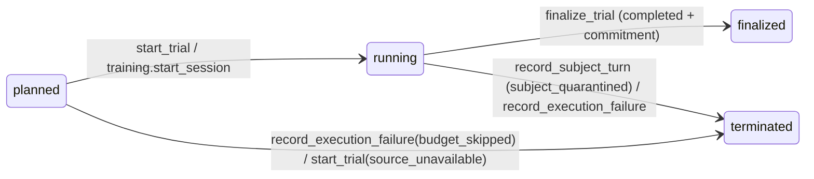

# S4: Data layer (Supabase Postgres)

Part of the build-ready spec for the Investigative AI Training Arena (GMU Challenge X, sponsor Unissant). **Version 2.8, 2026-10-09: WP-03 draft fixes folded in.** Governed by `docs/spec/README.md` (baseline facts; it wins over this part), `docs/research/synthesis/02-direction.md` (v10.4; sections 4.1-4.6, 7.1, 8.2, 8.3, 10, 12), `docs/research/synthesis/03-ui-direction.md` (v2.1), `docs/spec/S8-build-plan.md` section 9 (C-01 to C-48) and `docs/challenge/REQUIREMENTS.md`. Owner decisions D-001 to D-014 are hard constraints (D-007 superseded by D-009; D-011 local-first; D-012 generated-and-applied budget ceilings; D-013 build first, one global spend ceiling, per-phase cost tuning deferred; D-014 case families authored offline by Claude agents with Codex review, no runtime generator). Today is 2026-10-08; the build runs to 2026-11-02.

Deliverables of this part:

| File | Content |
| --- | --- |
| `docs/spec/S4-data-layer.md` | This document |
| `docs/spec/sql/0001_foundation.sql` | Schemas, roles, revoke-all, global function default privileges, helpers, append-only trigger |
| `docs/spec/sql/0002_cases.sql` | Case families, three packet tiers, evidence and predicates, ingest parity and archive, development revisions, hidden-split seal, candidate registry |
| `docs/spec/sql/0003_tournament_ledger.sql` | Hash-chained ledger, tournaments, frozen roster, trials, turns, work items, event store, findings, execution records, adjudications, seals, manifests, scores, lifecycle functions |
| `docs/spec/sql/0004_privileged_functions.sql` | The six privileged functions, the turn functions, replay copying, work-item recovery, context readers, commitment, manifest, projections |
| `docs/spec/sql/0005_training.sql` | Investigator sessions with derived phase, KPI-1 participants, rubric scores, published debriefs, tickets, voice sessions, case library |
| `docs/spec/sql/0006_ops_budget_traces.sql` | Spend guard, cost ledger, kill switch, voice context and settlement, latency samples, trace mirror, keep-alive |
| `docs/spec/sql/TESTS.md` | pgTAP test plan (every test, expected result) |

The migrations are drafts: never applied to any Supabase project. Version 2.3 was applied to a fresh throwaway PostgreSQL 17.11 container (the owner's project runs 17.11) to check that it parses and behaves, including the $0 seed of the one `global` bucket, the application of `budget_plan()`, the ingest of seed families F01-F03 and every finding fixed in this version; results are in `sql/TESTS.md` section 0.1.

**Run mode.** Local-first is the default path (D-011): `arena-api`, `arena-subject`, `arena-referee` and the tournament job run as separate local processes, each with its own database role and credential; Phoenix runs locally; the database is the owner's Supabase project (a local `supabase start` is allowed for development); Vertex AI is the only billed GCP service. The hosted design (Cloud Run, IAP, billing guard, hosted judge link) is kept in section 2.5 as a deferred variant.

---

## 0. Summary

| # | Decision | Requirements |
| --- | --- | --- |
| 1 | Six schemas map the direction's tiers: `arena` (public tier and its projections), `subject` (subject-private), `sealed` (evaluator-only), `ledger` (hash chain, commitments, execution records, adjudications, manifests), `training` (investigators, debriefs, voice), `ops` (budget, cost, traces). None is exposed to the Supabase Data API. | SCN-5, SCN-8, SCN-9 |
| 2 | Three runtime roles, one per credential, each used by its own local process (D-011): `arena_public` (arena-api and the tournament job), `arena_subject` (arena-subject), `arena_referee` (arena-referee and the operator CLI). `service_role` holds nothing in these schemas. `arena_public` and `arena_subject` hold no privilege on any base table; they read views and call functions. | SCN-5, KPI-5, EVL-10 |
| 3 | Every change to a trial's execution state goes through a SECURITY DEFINER function with `search_path=''`, EXECUTE revoked from PUBLIC and granted to one role, the trial row locked `FOR UPDATE`, inputs derived from committed rows, and a server-created work item bound to the transcript version. Each model step has its own work item, found again by the caller's request key, so a restarted orchestrator resumes (D3). | BKO-9, SCN-10, F07 |
| 4 | The six privileged functions of direction 4.2 are implemented with the direction's grantees; supporting turn functions (`submit_question`, `open_work_item`, `record_coaching_event`, `start_trial`, `advance_replay`, `work_item_results`) close gaps the direction left open. A replay trial owns its transcript: each step copies one source turn into it (D2). | direction 4.2, BKO-6 |
| 5 | One global hash-chained ledger; commitments are `sha256(nonce || payload)` with a 32-byte nonce in `sealed`, over every stored transcript and evidence field (content hashed from content); reveal checks every precondition, seals a hashed inclusion manifest and publishes the nonces. | BKO-9, EVL-10, F15 |
| 6 | Hidden-case material is reachable from `arena_public` only through `arena.trial_context` with an open work item on a running trial, and through `arena.harness_trial_state` for a harness request (no actor) on a running tournament trial (WP-28 amendment, section 6.3); every projection view hides hidden trials until reveal, and tournament progress before reveal is counts only. The hidden seal covers every field an interview or the scoring consumes, and hidden ingest serializes with the seal. | SCN-12, R3-03 |
| 7 | Spend guard (D-012, D-013, D11): one global ceiling. The migration seeds `global` at $0; the operator applies `budget_plan()`. Every model call reserves its worst case from the byte length of its largest request, every voice session its whole-session worst case; only the role that made a reservation dispatches, meters and settles it; a voice reservation settles after its session closes; overrun trips the kill switch. | D-009, D-012, D-013, BKO-1, BKO-8 |
| 8 | A per-trial event store with a gap-free sequence feeds SSE deltas (each payload at most 14,336 bytes); assessment-mode coaching is held until the trial ends; the referee publishes a typed debrief and its `debrief_ready` event in one transaction (D8); a KPI-4 sample opens pending at every text subject commit and ends delivered, failed or `unmeasured_timeout` (D4). | SOL-6, KPI-4 |
| 9 | The capability matrix is an executable fixture over every applicable privilege (EXECUTE; USAGE, CREATE; SELECT to MAINTAIN with column grants; sequence privileges): the test asserts the actual privilege set equals the allowlist exactly. | KPI-5, EVL-10 |
| 10 | Free plan pausing is handled by a keep-alive or the Pro plan: OWNER DECISION PENDING; the schema works either way. | direction 12, 13.2 item 3 |

---

## 1. Requirement coverage

| ID | Mechanism in S4 | Tests (`sql/TESTS.md`) |
| --- | --- | --- |
| SCN-1, SCN-7, SCN-8, SCN-9 | Three packet tables in three schemas; role only in `sealed.evaluator_packets`; `variant_code` restricted to the opaque case-id shape (C-25) | CS-01, CS-02, CS-15, RR-01..RR-30 |
| SCN-3, SCN-11, PRB-4 | `case_variants.style` assigned independent of role and kept out of the case library view (C-22, C-26); ingest refuses a family without both roles | CS-04, RR-30 |
| SCN-4, SCN-10 | `sealed.evidence_artifacts` with deterministic predicates, equal to the evaluator packet's releasable records at ingest; `release_evidence` derives the turn; every change versioned, timestamped and chained | CS-19, RE-01..RE-17, SV-09, LC-01..LC-08 |
| SCN-5, KPI-5, EVL-10 | Credential per role; no base-table grants for public or subject; capability fixture over every privilege type; global function default privileges | CM-01..CM-15, RR-* |
| SCN-6, SUB-7, SUB-8 | `record_subject_turn` answers only the derived open question; guard rejection quarantines atomically; the subject reads its committed disclosure state | ST-01..ST-16 |
| SCN-12 | Hidden split sealed before freeze over every operational field; hidden ingest and seal serialize; hidden public packets in `sealed`; projections gated on reveal; training only on dev variants | CS-07..CS-10, CS-20..CS-22, RR-26..RR-28, TT-01, RV-19 |
| BKO-1, BKO-5, AST-5 | Candidate registry (immutable, hashed S2 manifest.v1 manifests, four kinds; only assistants and subjects fill slots, C-47); equal per-call-type limits | CS-12, CS-13, CS-18, BU-01 |
| BKO-2, BKO-6 | Corpus sealed before replay; replay before interactive (`start_trial`); `advance_replay` copies one sealed source turn per step into the replay trial (D2) | EF-09..EF-11, RP-01..RP-09 |
| BKO-7, BKO-10 | Frozen roster with seeded positions; roster hash checked at reveal; retries only after `infra_failed`; each harness question stores its origin, relay outcome and proposal (SG2-09) | EF-05..EF-08, RV-09, SV-18 |
| BKO-8 | 12-exchange cap on every trial; spend-limited volume | SV-06, BU-04 |
| BKO-9 | Commit before reveal; commitments, nonces, reveal, manifest bound to leaderboards | FC-*, RV-* |
| EVL-3, EVL-8, EVL-11 | `sealed.independent_labels` (model label and human consensus per turn; empty evidence quote allowed) and `sealed.judgments` (R1 detail, per-rater calibration, stage keys) written by the referee (C-34) | AD-10..AD-12 |
| EVL-5 | `ops.model_calls` single cost source; `ops.latency_samples`; execution states | BU-11, CC-11, CC-12 |
| EVL-7, KPI-1 | `training.rubric_scores` (total = 5 x sum); participants; counterbalanced case sets; session phase derived from committed state; `training.debriefs` | TT-03, TT-10, TT-15..TT-18, DB-01..DB-06 |
| EVL-9, F14, F15 | Execution records and validity adjudications (with `decided_by`, C-33) as separate layers; manifest per direction 7.1 | AD-*, RV-11..RV-13 |
| SOL-6 | Event visibility `debrief` for assessment coaching; the published debrief and its `debrief_ready` event (D8) | CC-07..CC-09, DB-01..DB-06 |
| KPI-4 | Sample opened pending at the text subject commit; completed by the turn's card or `coach_unavailable`; `unmeasured_timeout` at the next question or the trial's end; `ops.ack_card` stamps the client acknowledgement (S3 6.4, C-28, D4) | CC-11, CC-12, CC-18, CC-20, CC-21 |
| SOL-5, AST-3 | One Finding object for assistants and investigators (C-27) with a rationale of at most 600 characters (D5); citations of answered turns and existing records (SG3-17) | FC-04, FC-16, FC-17 |
| D-009, D-012, D-013, D11 | One `global` bucket seeded at $0, plan applied by the operator, byte-length reservations, voice reservations, unit admission, kill switch, reservation ownership | BU-*, VB-* |
| D-006 (voice, D7, D-016) | Voice sessions are unscored, display-only practice: no turns or work items; completed exchanges in `training.voice_exchanges`; no coaching and no KPI-4 sample; `subject.voice_context`, `ops.settle_voice_reservation`, `close_orphan_voice_sessions` | VB-11..VB-19 |
| EX-4 | EX-4 acknowledgement stored once per user (`training.acknowledgements`, X-15) | TT-14 |

---

## 2. Platform setup

### 2.1 Project, exposure and identity

- Supabase project: owner-provided (direction 13.2 item 3; OD-2), PostgreSQL 17.11; the drafts are verified on 17.11 (TESTS 0.1). `pgcrypto` in schema `extensions` (Supabase default). For development a local `supabase start` database is allowed (S5 section 10); the migrations are the same.
- **Default privileges (SG3-20).** PostgreSQL grants EXECUTE on every new function to PUBLIC, and a per-schema `ALTER DEFAULT PRIVILEGES` cannot remove that global default (PostgreSQL 17 documentation, ALTER DEFAULT PRIVILEGES). `0001` therefore runs the global form, `alter default privileges revoke execute on functions from public`, for the migration owner: any function the owner creates later, in any schema, is executable by no one until it is granted. Extensions the tests need (pgtap, dblink) are created before the migrations; on the owner's project the arena uses no function in `public`.
- **Data API.** None of `arena`, `subject`, `sealed`, `ledger`, `training`, `ops` is listed under "Exposed schemas". If the dashboard allows disabling the Data API entirely, disable it; the browser talks only to `arena-api`. A SECURITY DEFINER function in an exposed schema is callable over the Data API with the owner's privileges (Supabase docs, cited in X10 Q2 line 45), which is why no function lives in an exposed schema.
- **`public` schema.** Left empty. `0001` ends with Supabase's documented default-privilege revokes for `public` (Context7 `/websites/supabase_guides`, "Securing your API", fetched 2026-10-08), widened to ALL on tables, sequences and functions for `anon`, `authenticated` and `service_role`, so any accidental object there is reachable by no API role (WP-03 migration 0007, folded in v2.8; CM-21).
- **Identity (C-02, C-03).** The browser does not use Supabase Auth and never reaches Postgres. Users are allowlisted rows in `auth.users`, created by the operator. `arena-api`'s identity layer resolves each request to one of them and passes the id to Postgres as `arena.actor_id` (section 2.3). Local default: S5 section 10's dev identity middleware (`ARENA_ENV=local`, bound to 127.0.0.1, a configured email mapped to its allowlisted user). The hosted mapping is in section 2.5. No row level security policy reads `auth.uid()`, because no browser request reaches Postgres directly.

### 2.2 Roles and connections

| Role | Used by (local processes, D-011) | Connects as | Reads | Writes |
| --- | --- | --- | --- | --- |
| `arena_public` | `arena-api` (:8080) and the tournament job (`python -m arena_tournament`) | Its own DSN in its own gitignored file, `.env.local.public` (S5 10.2): `arena_public.<project-ref>` on the Supavisor shared pooler, transaction mode, port 6543 (owner's project), or a direct connection to `supabase start` | 28 projection views; `arena.trial_context`; `arena.harness_trial_state`; `arena.work_item_results` | 31 functions (section 6.3; WP-28 adds `arena.harness_trial_state`) |
| `arena_subject` | `arena-subject` (:8081) | Its own DSN in `.env.local.subject`, same pooler | `subject.turn_context`, `subject.voice_context` | 17 functions (`record_subject_turn`, voice, budget, spans) |
| `arena_referee` | `arena-referee` (:8082); operator CLI for case ingest and reveal | Its own DSN in `.env.local.referee`, same pooler | Every table, and every view except the 16 actor-scoped public projections (with `ledger.v_commitments`, SG3-45) (they call `arena.trial_visible` or `arena.actor_id`, which only `arena_public` executes; the referee reads the tables and `ops.v_latency_report`, SG3-38) | 8 tables (labels, judgments, scores, leaderboards, isolation checks, participants, case sets, rubric scores); 35 functions, among them `training.publish_debrief` |
| `postgres` (owner) | Migrations; owner-only controls (`ops.set_kill_switch`, `ops.set_bucket_ceiling`) and plan application (section 8.1) | Session mode, port 5432, or the SQL editor | All | All |

- Roles are created `NOLOGIN NOINHERIT` in git (TechnoMile `supabase/migrations/20260927000100_foundation.sql` lines 21-29). The owner enables `LOGIN` and sets each password outside git; each local process reads only its own DSN (S5 1.3 boot checks). Setting the passwords is a secret write and needs explicit owner authorization (S4-D4).
- Connection username format for a custom role on the shared pooler is `[ROLE].[PROJECT-REF]`; the shared pooler is IPv4 on every plan; transaction mode does not support session-level `SET`, `LISTEN` or Supavisor prepared statements (Context7 `/websites/supabase_guides`, "Connecting to Postgres", fetched 2026-10-08). Hence: drivers disable prepared statements (asyncpg `statement_cache_size=0`, psycopg `prepare_threshold=None`); per-request settings use `set_config(name, value, true)` inside the transaction; S5's SSE `LISTEN` uses one session-mode connection per process (S5 6.4).

### 2.3 Transaction contract for callers

1. Every call runs in a READ COMMITTED transaction (the functions refuse anything else, AR001; TechnoMile `20260927000600_run_ledger_rpcs.sql` lines 20-27).
2. Investigator requests start with `select set_config('arena.actor_id', <allowlisted user id>, true)`. Harness and job requests never set it. The functions use this to keep each kind of request on its own trials (section 5.5). A process that serves a coaching call as its first request after start also sets `arena.instance_cold` to `true` in that transaction; `record_coaching_event` copies it into the KPI-4 sample (C-28; unset means false).
3. One logical step per transaction; commit before any network call that depends on it (for example, commit `open_work_item('subject_answer', key)` before calling `arena-subject`).
4. Every work item is opened with the caller's request key, a hash of trial, turn, step kind and purpose (D3; S5 5.1). A repeated key returns the same item with its status and stored result, so a retried request resumes at the first step without a result; `arena.work_item_results(trial)` lists every step after a process restart.
5. Error mapping in `arena_core/db/calls.py` (S5): `AR002` becomes `StaleVersion` (discard the result), `AR003` `WorkItemMismatch`, `AR004` `TurnInProgress` (HTTP 409), `AR005` `NotRequestable` (HTTP 422), `AR007` `InvalidInput` (HTTP 422), `AR040` `Forbidden` (HTTP 404, no existence oracle; also a reservation used by a role that did not make it), `42501` is a defect (alert).
6. Money is `ops.usd` (`numeric(14,6)`), never float. Sizes are serialized UTF-8 bytes of the jsonb text (`octet_length(x::text)`), the size that reaches a prompt or a wire frame.

### 2.4 Free plan keep-alive (OWNER DECISION PENDING: Supabase plan)

- Supabase pauses a Free plan project that shows low activity over 7 days; "typically a few user requests to the database each day over the previous week is enough to keep the project from being paused"; a paused project serves nothing until the owner restores it; paid plans are never paused (Supabase docs "Project Pausing", via Context7 `/websites/supabase_guides`, fetched 2026-10-08; X10 Q2). Local-first does not change this: the owner's project is still hosted by Supabase.
- **If Pro:** nothing to do; the keep-alive function stays unused.
- **If Free:** call `ops.keepalive('<source>')` (granted to `arena_public`; inserts one row, prunes rows older than 14 days) four times a day from a scheduled runner. Local default: a GitHub Actions cron holding an `arena_public` DSN as a repository secret (no GCP cost; the secret is an owner-authorized write). The Cloud Scheduler runner belongs to the hosted variant (2.5).
- Either way: a check in the operator page shows the last ping time; the Nov 2 rehearsal confirms the project is active the day before the demo.
- Size: the Free plan database limit is 500 MB (X10 Q2). The trace mirror is the only table that grows with span volume (section 11). No script produces its size; S5 8.4 gives an initial estimate, and the dev pilot measures spans per turn and mirror bytes (X-17). Pruning of verified non-hidden spans keeps it bounded.

### 2.5 Hosted variant (deferred, WP-33, owner decision OD-10)

Kept so the design is ready if the owner approves hosting; nothing below is on the default path.

- **Identity (C-03).** `arena-api` verifies the IAP JWT assertion on every request and maps its email to the same allowlisted `auth.users` row; there is no Supabase Auth in the browser (one credential fewer); `arena.actor_id` is set from the mapped user exactly as in 2.3.
- **Deployables and secrets.** Each Cloud Run service (`arena-api`, `arena-subject`, `arena-referee`) and the `arena-tournament` job mounts only its own DSN secret (S5 section 9.4); same roles, same functions, same grants.
- **Keep-alive runner.** Cloud Scheduler triggering the `arena-tournament` job image with a `keepalive` command (scales to zero; adds a scheduler job and a few job executions a day to the non-model itemization in `cost_model.py` before use).
- **Non-model costs.** Not in the ledger; minimized and backstopped by GCP budget alerts and the billing-disable function (direction 8.3, S5 9.6).
- **Plan switch.** The hosted plan is `cost_model.budget_plan(hosting="hosted")`, one global ceiling of `CAP - NON_MODEL_ALLOWANCE` ($60.00). Switching means re-applying it with `ops.set_bucket_ceiling`, which refuses a ceiling below current liability, so the switch succeeds only if committed liability is at or below $60.00 (README baseline facts).

---

## 3. Schemas and tiers

| Schema | Tier (direction 4.1) | Contents | `arena_public` | `arena_subject` | `arena_referee` |
| --- | --- | --- | --- | --- | --- |
| `arena` | Public | Families and variants (no role), family retirements, dev public packets, candidates, tournaments, roster, trials, turns, released evidence, work items, trial events, findings, scores, leaderboards | Views and functions | `record_subject_turn` only | Read all; insert scores, leaderboards, isolation checks |
| `subject` | Subject-private | Private packets | None | `turn_context`, `voice_context` only | Read |
| `sealed` | Evaluator-only | Evaluator packets (role), hidden public packets, evidence artifacts and predicates, family ingests (bundle hash, accepted family file, attestations), hidden-split seal, tag proposals, quarantined artifacts, independent labels, judgments, commitment nonces | None | None | Read; insert labels and judgments |
| `ledger` | Public hashes, evaluator decisions | Event chain, commitments, execution records, adjudications, corpus seals, manifests, revealed nonces | Views | None | Read; functions |
| `training` | Public (actor-scoped) | Participants, case sets, sessions, rubric scores, debriefs, acknowledgements, tickets, voice sessions | Views and functions | Voice functions | Read (not resumes); insert participants, case sets, scores; publish debriefs |
| `ops` | Operator | Config, buckets, prices, limits, reservations, model calls, kill-switch history, latency, trace mirror and summaries, keep-alive | Views and functions | Functions | Read; prune spans |

The direction calls the public tier "public projections"; the schema is named `arena` so it never collides with Supabase's exposed `public` schema.

---

## 4. Tables

Columns are listed in full in the SQL; this section gives keys and purpose. "Append-only" means `arena.tg_forbid_mutation` refuses UPDATE and DELETE for every role, the owner included (TechnoMile `20260927000100_foundation.sql` lines 57-62). Only the owner can disable a trigger; the tamper fixtures in `sql/TESTS.md` do exactly that and show that the seals, commitments and chain then fail verification. Sizes are serialized UTF-8 bytes of the jsonb text.

### 4.1 `arena`

| Table | Key columns | Purpose | Written by | Mutability |
| --- | --- | --- | --- | --- |
| `case_families` | `id`, `family_code`, `domain`, `split` (dev, hidden) | One matched family (SCN-11) | `sealed.ingest_case_family` | Immutable |
| `family_retirements` | `family_id`, `superseded_by`, `retired_at` | A development family revised under a new code (for example F01.r2); retired families leave the case library, new sessions and new rosters, and old trials keep their packets (SG1-11) | ingest of a bundle with `supersedes` | Append-only |
| `case_variants` | `id`, `family_id`, `variant_code` (the opaque `case_id`, checked `^C-[0-9A-HJKMNP-TV-Z]{8}$`, C-25), `style` jsonb, `difficulty` 1-5 | A variant; no role column (SCN-5); style stays here for the fairness audit and is not projected to `arena_public` (C-26) | ingest | Immutable |
| `public_packets` | `variant_id`, `packet` (S1 public packet, at most 65,536 bytes), `sha256` | Dev public packet (SCN-7); trigger refuses hidden variants | ingest | Immutable |
| `candidates` | `id`, `kind` (assistant, subject, referee, negative_control; C-47), `name` (= manifest `candidate_id`), `version`, `manifest` (S2 3.1 manifest.v1, every key present), `sha256` | Frozen candidate versions (AST-5, BKO-5); only assistant and subject kinds fill tournament slots and training sessions | `register_candidate` | Immutable |
| `tournaments` | `id`, `name`, `split`, `status` (draft, frozen, running, sealed, scoring, revealed), `seed`, `budget_bucket`, `max_exchanges`, `hidden_seal_id`, `roster_sha256` | A dev pilot or sealed run; `budget_bucket` is `global` for every run (D-013) | Lifecycle functions | Status only via functions; no delete |
| `blocks` | `id`, `tournament_id`, `block_no`, `family_id` | One family x nine pairings x one repeat (direction 7.2) | `add_planned_trials` | Immutable |
| `planned_trials` | `id`, `tournament_id`, `position` (seeded order), `track` (replay_corpus, replay, interactive), `variant_id`, candidates, `repeat`, `source_planned_trial_id` | The frozen roster (BKO-7, BKO-10) | `add_planned_trials` (draft only) | Immutable |
| `trials` | `id`, `kind` (training, interactive, replay_corpus, replay), `planned_trial_id`, `attempt` 1-3, `variant_id`, candidates, `source_trial_id`, `mode` (practice, assessment, harness), `owner_user_id`, `status` (planned, running, finalized, terminated), `transcript_version`, `exchanges`, `max_exchanges`, `coaching_pending` | One execution attempt or practice session | Functions only | No delete |
| `turns` | (`trial_id`, `turn_no`), `question` (1-600 characters, D11), `question_source` (investigator, harness_fixed, harness_fallback, assistant_relay), `relay_outcome`, `proposal_seq`, `channel` (always `text` since v2.5), `question_version`, `idempotency_key`, `answer` (1-900 characters, S2 V1), `answer_partial` (always false since v2.5), timestamps | The transcript. The key is (`trial_id`, `turn_no`); the model-facing `tNN` is derived from `turn_no` and the UI label `T{n}` is display only (C-16). Each harness question stores who asked it, the relay outcome and the coach card it relayed or rejected (SG2-09). A replay trial's turns are copies of its source turns with the same numbers (D2) | `submit_question`, `record_subject_turn`, `advance_replay` | Every column immutable except the answer, written once |
| `released_evidence` | (`trial_id`, `record_id`), `release_seq` 1-6, `released_after_exchanges`, `kind`, `doc_kind` (C-24), `title`, `content`, `content_sha256` (generated from content), `event_seq` | Evidence the trial has seen; a replay trial's rows are copies of its source's, same ids and sequence (D2) | `release_evidence`, `advance_replay` | Append-only |
| `work_items` | `id`, `trial_id`, `kind` (subject_answer, release, coaching, finalize, failure, replay_turn), `transcript_version`, `turn_no`, `idempotency_key` (the caller's request key, required, unique per trial), `request_sha256`, `status`, `result` | One per model or state step (D3): idempotency, recovery and staleness (F07). Results never carry case content | Functions | open to done once |
| `trial_events` | (`trial_id`, `seq`), `kind` (the nine turn and coaching kinds plus `debrief_ready`, C-17), `visibility` (live, debrief, internal), `transcript_version`, `turn_no`, `work_item_id`, `candidate_id`, `payload` <= 14,336 bytes | Event store for SSE deltas and debriefs; coach cards live here (D9: with its envelope every delta stays under 16 KiB) | Functions (`arena._emit`) | Append-only |
| `final_findings` | `trial_id`, `classification` (the Finding's `label`: deceptive, truthful, insufficient_evidence), `likelihood` (seven ICD 203 terms), `confidence` (low, moderate, high), `finding` (the whole Finding object, <= 8,192 bytes) | The committed finding (SOL-5, AST-3); one Finding shape for assistants and investigators (C-27, D5) | `finalize_trial` | Append-only |
| `scores` | `id`, `tournament_id`, `manifest_id`, `candidate_id`, `metric`, `value` (point, interval, counts, provisional) | Metric values (S3 computes) | Referee insert after reveal | Append-only |
| `leaderboards` | `id`, `tournament_id`, `manifest_id`, `board` (assistant, subject), `label` (original, corrected), `body`, `sha256` | Published boards bound to a manifest | Referee insert after reveal | Append-only |
| `isolation_checks` | `id`, `candidate_id`, `check_name`, `passed`, `evidence` | Isolation gate evidence (EVL-10), including the hidden-text scan result (D1; S5 5.3) | Referee insert | Append-only |

### 4.2 `subject` and `sealed`

| Table | Key columns | Purpose | Written by |
| --- | --- | --- | --- |
| `subject.private_packets` | `variant_id`, `packet` (role, actions, knowledge, disclosable and concealed facts, uncertainty limits, objective, permitted behaviors, disclosure gates, style; at most 65,536 bytes), `sha256` | SCN-8; read by `arena_subject` only through `subject.turn_context` and `subject.voice_context` | ingest |
| `sealed.evaluator_packets` | `variant_id`, `role`, `packet` (canonical facts, contradictions, resolution criteria, rubric, evidence artifacts with release predicates; at most 131,072 bytes), `sha256` | SCN-9; the only place a role label exists | ingest |
| `sealed.hidden_public_packets` | `variant_id`, `packet`, `sha256` | Hidden variants' public packets until a running trial projects them | ingest |
| `sealed.evidence_artifacts` | (`variant_id`, `record_id` `rec-NN`, C-16), `kind` (record, clarification, context_change; follows `doc_kind`), `doc_kind` (S1 `artifactKind`, C-24), `title`, `content` (<= 12,288 bytes, SG1-14), `sha256`, `requestable`, `scheduled_turn`, `request_after_turn` (exactly one of the two) | Evidence and its deterministic release predicate in one row (replaces the direction's separate `release_predicates`). Ingest refuses rows that differ from the evaluator packet's releasable records or from the public requestable list (SG1-09) | ingest |
| `sealed.family_ingests` | `family_id`, `bundle_sha256`, `source` (the accepted family file text), `source_sha256` (generated), `attestation` (S1 10.5's object) | Idempotent re-ingest check and the sealed authoring archive kept after the workspace is deleted (SG1-08, SG1-19) | ingest |
| `sealed.hidden_split_seals` | `id`, `seal_sha256`, counts, `sampler_record`, `sampler_sha256` (generated) | The one seal of the hidden split with its sampler record (SCN-12, SG1-19) | `seal_hidden_split` |
| `sealed.subject_tag_proposals` | (`trial_id`, `turn_no`), `tag` | The subject's own disclosure tag; a proposal, not ground truth; the source of the subject's committed disclosure state (SG1-02) | `record_subject_turn` |
| `sealed.quarantined_artifacts` | `trial_id`, `turn_no`, `utterance`, `tag`, `guard_result` | The offending output of a guard rejection (SUB-7) | `record_subject_turn` |
| `sealed.independent_labels` | (`trial_id`, `turn_no`, `labeler` model or human_consensus), `label` (words: evasion, genuine_uncertainty, legitimate_non_disclosure, poorly_framed_question, responsive; S3's codes are display abbreviations only, C-09), `compliant`, `rationale` (R1's evidence quote; empty when the label needs none or the quote check failed, SG2-08), `prompt_sha256` | EVL-8 events and EVL-11 fidelity: the model label (R1) and the human consensus (C-34) | Referee insert |
| `sealed.judgments` | `id`, `trial_id`, `kind` (flag_support, questioning_quality, fidelity_detail, calibration), `rater_id` (calibration rows only), `payload`, `idempotency_key` (stage key, unique) | Other referee outputs: R1's full output with F1-F6 detail (`fidelity_detail`) and each human rater's rating (`calibration`, with rater ID) (C-34); an interrupted R1, R2 or R3 stage re-runs without duplicates (D3, D8) | Referee insert |
| `sealed.commitment_nonces` | `trial_id`, `nonce` (32 bytes) | Commitment nonces (direction 4.1) | `finalize_trial` |

All are append-only.

### 4.3 `ledger`

| Table | Key columns | Purpose |
| --- | --- | --- |
| `chain_head` | one row: `seq`, `head_sha256` | Lock point and head of the chain |
| `events` | `seq` (gap-free), `event_type`, `tournament_id`, `trial_id`, `transcript_version`, `payload` (ids, hashes, states only), `created_us`, `prev_sha256`, `sha256` | The hash chain (SCN-10, BKO-9) |
| `terminal_records` | `trial_id`, `planned_trial_id`, `state`, `reason`, `work_item_id`, `event_seq` | Execution records (one per attempt; the planned trial's record is its latest attempt's) |
| `finding_commitments` | `trial_id`, `payload`, `payload_sha256`, `commitment_sha256`, `event_seq` | Commit before reveal |
| `validity_adjudications` | `id`, `adj_seq`, `trial_id`, `verdict` (valid, subject_invalid), `reason` (S3 `reason_code`), `evidence_ref`, `decided_by` (`auto_rule` or a reviewer ID, C-33), `idempotency_key`, `after_reveal` | Subject validity, append-only, latest in force |
| `corpus_seals` | `tournament_id`, `corpus_sha256`, `n_transcripts` | Replay corpus seal (BKO-6) |
| `inclusion_manifests` | `id`, `tournament_id`, `version`, `manifest` (S3 4.4 canonical text), `manifest_sha256`, `supersedes_id` | Version 1 sealed at reveal; later versions are corrections (section 7.5) |
| `revealed_nonces` | `trial_id`, `nonce_hex` | Published at reveal so anyone can verify |

All are append-only.

### 4.4 `training`

| Table | Key columns | Purpose |
| --- | --- | --- |
| `participants` | `user_id`, `code` (P01), `counterbalance` (AB, BA), `consented_at` | KPI-1 volunteers (pseudonymous in reports) |
| `case_set_members` | (`set_code` A or B, `variant_id`) | Matched pre and post sets, each one truthful and one deceptive variant from different families. Families holding a member are excluded from the C-37 draw for every user and refused in practice by `start_session` (X-08) |
| `acknowledgements` | (`user_id`, `kind` `ex4`), `acknowledged_at` | The EX-4 acknowledgement, once per user, written by `training.acknowledge` (S5 `POST /api/me/ack-ex4`, X-15) |
| `sessions` | `id`, `trial_id`, `user_id`, `participant_id`, `phase` (practice, pre, post; derived by `start_session` from committed state, never sent; S3's `free` maps to `practice`, C-44), `voice`, `idempotency_key` | One investigator session = one training trial |
| `rubric_scores` | `session_id`, `scorer` (proxy, human), `scorer_ref`, five 0-4 dimensions, `total` = 5 x sum, `rationale` | EVL-7, KPI-1 |
| `debriefs` | `session_id`, `payload` (S3 5.7 debrief.v1: `schema_version`, `session_id`, `scored`, `outcome` with its `resolution`; when scored, also `rubric`, `scorecards` and `provenance`, which the unscored voice branch never carries; at most 65,536 bytes; one envelope check, `training.debrief_envelope_ok`, used by the table and `publish_debrief`, SG3-34), `sha256`, `published_at` | The one published debrief of a session (D8, SG3-14); its owner reads it through `training.v_my_debrief` |
| `access_tickets` | `ticket_sha256`, `kind` (sse, voice), `user_id`, `trial_id`, `mode`, `expires_at` (60 s), `redeemed_at`, `subject_checked_at` | Single-use tickets bound to user, trial, split (dev) and mode |
| `voice_sessions` | `id`, `session_id`, `ticket_id`, `reservation_id`, `status`, `close_code` | One Live session (unscored practice, D7); one open per session |
| `voice_exchanges` | (`trial_id`, `exchange_no` 1-12), `voice_session_id`, `lines` (array of at most 40 `{role, text <= 900, partial}`, at most 16 KB) | A voice session's spoken transcript, one row per exchange window, role-tagged and unpaired, display only (D-016, SG3-41); append-only | `record_voice_exchange` |

Voice transcription fragments and playback counts are not stored (D7): a voice session stores one row per completed exchange in `training.voice_exchanges`, never a turn, and playback acknowledgements drive only the browser.

### 4.5 `ops`

| Table | Key columns | Purpose |
| --- | --- | --- |
| `config` | one row: `kill_switch`, attempts, voice amounts and caps, per-user quotas, `per_user_daily_usd` ($5.00, D-017) | Spend and quota parameters (voice shutoff = two thirds of the reservation, computed, X-17) |
| `kill_switch_events` | `turned_on`, `reason`, `actor` | History of every flip (append-only) |
| `budget_buckets` | `name`, `parent`, `ceiling_usd` | The bucket of `budget_plan()`: `global`, seeded at $0 (D-012, D-013, section 8.1) |
| `model_prices` | (`model`, `effective_from`), text and audio rates per 1M tokens | Liability rates (immutable) |
| `call_limits` | `call_kind`, `input_limit`, `output_limit` | Enforced request limits: the five runtime `cost_model.LIMITS` rows (no `generate` or `validate`, D-014), plus `portrait` at S5 3.3's initial values (immutable; X-09). `input_limit` bounds the UTF-8 byte length of the largest request a call may send (D11) |
| `budget_reservations` | `id`, `idempotency_key`, `bucket`, `kind`, `model`, `call_kind`, `input_bytes`, `purpose`, `trial_id`, `actor_user_id`, `caller_role`, `reserved_usd`, `state`, `settled_usd`, `overrun`, timestamps | Worst case held before any spend; only `caller_role` uses it (SG3-11) |
| `model_calls` | (`reservation_id`, `seq`), tokens by kind, `cost_usd`, `status`, `latency_ms`, trace ids | The single cost source (direction 10); append-only |
| `latency_samples` | (`trial_id`, `turn_no`), `subject_commit_at`, `card_validated_server_at`, `client_ack_at`, `card_outcome` (pending, delivered, timeout, repair_failed, client_invalid, unmeasured_timeout), `population`, `instance_cold`; derived `server_ms`, `kpi4_ms`, `miss`, `unmeasured` | KPI-4 samples in S3 6.4's field names (C-28), opened at the subject commit (D4) |
| `trace_mirror` | (`trace_id`, `span_id`), `service`, `trial_id`, `tournament_id`, `split`, `otlp` <= 32 KiB, `export_state` | Durable spans (F11); the producer's hidden classification is kept (SG3-12) |
| `trace_summaries` | (`trace_id`, `scope`), expected, mirrored, failures, `telemetry_incomplete` | Per-request telemetry completeness |
| `keepalive_pings` | `at`, `source` | Free plan keep-alive |

---

## 5. Trial lifecycle, work items and transcript versions

### 5.1 States

```mermaid
stateDiagram-v2
  direction LR
  state "Tournament" as T {
    draft --> frozen: freeze_tournament (seal verified, roster hashed, attempt-1 trials created)
    frozen --> running: open_tournament
    running --> sealed: close_tournament_run (every planned trial has an execution record; corpus sealed)
    sealed --> scoring: begin_scoring
    scoring --> revealed: reveal (preconditions, manifest v1, nonces published)
  }
```





`finalized` and `terminated` are frozen: no work item opens, and triggers refuse writes to turns and released evidence.

### 5.2 Work items and versions

- `arena.trials.transcript_version` changes only inside functions: +1 when a question is recorded, +1 when evidence is released (only if something is released), +1 when a subject turn commits or a quarantine is recorded, +1 per replay copy (`advance_replay`), +1 at finalization. Coaching events do not change it.
- A work item is created by the server (`open_work_item`; voice creates none, D-016) and stores the version current at creation and the turn number. Callers never supply a version to a privileged function; the function compares the item's version with the trial's.
- One work item per step (D3): release, subject answer, coach card, deep update, final finding, failure, replay copy. The caller names the step with a request key, a hash of trial, turn, step kind and purpose (for example `sha256('<trial>:3:coaching:coach.deep')`). `open_work_item(trial, kind, key)` returns the existing item, with its status and stored result, when the key repeats, before any state check: a retry after a crash, after an answer committed or after finalization resumes instead of failing. `arena.work_item_results(trial)` lists every item of a trial for the caller allowed to act on it, so a restarted orchestrator rebuilds its position. Results never carry case content (a release result lists ids and kinds), so the listing is safe on a hidden trial.
- A completed item replayed with the same input returns its stored result; with different input it is refused (AR003). An item of another trial or another kind is refused (AR003). A stale item is refused (AR002) and its result discarded: a deep update overtaken by the next question or a release is discarded this way.
- `submit_question` takes the caller's expected version and an idempotency key stored on the turn (it creates the turn, so there is no item yet).

### 5.3 One turn (direction 4.5; S5 5.2)

| Step | Caller and function | Version | Event |
| --- | --- | --- | --- |
| 1 | `arena-api` or harness: `submit_question(trial, v, text, key)` (harness: plus source, relay outcome and proposal seq) | v+1 | `question_recorded`; a KPI-4 sample still pending from the last turn becomes `unmeasured_timeout` |
| 2 | `open_work_item(trial, 'release', key)`; `release_evidence(trial, wi, ids)`; always called, with an empty list if nothing is requested, so scheduled releases apply before the answer | +1 if released | `evidence_released` or `clarification` per artifact |
| 3 | `open_work_item(trial, 'subject_answer', key)`; commit; call to `arena-subject.answer(trial, wi)` | | |
| 4 | `arena-subject`: `subject.turn_context(trial, wi)`; one model call; guard; `record_subject_turn(trial, wi, utterance, tag, guard_result)` | +1 | `subject_turn`, or `trial_ended` on quarantine; the turn's KPI-4 sample opens `pending` (text turn with an assistant) |
| 5 | `open_work_item(trial, 'coaching', card key)`; `trial_context(trial, wi)`; card call; `record_coaching_event(trial, wi, card, 'coach_card')` | +0 | `coach_card`; ends the turn in progress; completes the KPI-4 sample |
| 5b | A1 only: `open_work_item(trial, 'coaching', deep key, card version)` (refused AR002 if the version moved, SG3-26); deep call; `record_coaching_event(trial, wi, update, 'coach_deep')` | +0 | `coach_deep`; stale (AR002, discarded) if the next question or a release came first |
| 5c | Practice only: the browser validates the complete card and `arena-api` calls `ops.ack_card(trial, turn_no, client_valid)` (C-28) | +0 | none; stamps `client_ack_at` |
| 6 | At 12 exchanges or a committed finding: `open_work_item(trial, 'finalize', key)`; `finalize_trial(trial, wi, finding)` | +1 | `finding_committed` (training), `trial_ended`; pending KPI-4 samples become `unmeasured_timeout` |

One open turn per trial (S5 5.1): from step 4 until a `coach_card` or `coach_unavailable` event, `submit_question` and `release_evidence` return AR004; a crashed request cannot block the trial because the hold expires 120 s after the answer, and the next question then closes the turn's sample as `unmeasured_timeout` (a miss, counted as unmeasured; D4). Corpus trials have no assistant, so they never hold. Voice turns never hold (D7).

**Replay (D2).** A replay trial owns its transcript. Each step is `open_work_item(trial, 'replay_turn', key)` then `arena.advance_replay(trial, wi)`, which copies the next turn n of the sealed source corpus transcript into the replay trial as turn n: the question, then every source release made after turn n - 1 was answered (the evidence the source subject had when it answered), then the answer, with the same turn number, record ids and release sequence (+1 version; events `question_recorded`, `evidence_released`, `subject_turn`; the coaching hold starts). Steps 5 and 5b follow as for an interactive trial. The coach therefore never sees a later answer or a later record; work items, events, citations, the commitment and the scorer use the replay trial's own rows, and the source references are (`source_trial_id`, `turn_no`) and (`source_trial_id`, `record_id`). Finalization needs the whole source copied. No KPI-4 sample is opened (no live subject).

**Voice (D7, D-016; development cases only, unscored practice).** A spoken exchange writes no `arena.turns` row and no per-question or coaching work item; the evidence route's release item and the finding's finalize item are the only items on a voice session's trial (SG4-41). `arena-subject` closes an exchange window at each Live model `turn_complete` and stores it with `training.record_voice_exchange(voice_session, exchange_no, lines)` (granted to `arena_subject`): `lines` are the transcription fragments of that window, role-tagged (`investigator` or `subject`), in arrival order, with no question-answer pairing (Live's transcription carries no exchange identifier, SG3-41); the number is the next after the trial's stored windows, at most 12 (a 13th is AR004, WP-03 fix 7, VB-24); idempotent on the number, and a repeat answers the scheduled release its original commit applied, so a caller whose first response was lost still updates Live (fix 5, VB-21). The same transaction releases every due scheduled record (the shared internal `arena._apply_releases`, whose predicates count the trial's text exchanges plus its stored voice windows) and returns what it released, so `arena-subject` updates Live before forwarding more audio (SG3-27). Requested records use the evidence route exactly as in text: `open_work_item('release')` and `release_evidence` run in one transaction under the trial lock, so a concurrent `record_voice_exchange` waits and the item is never left bound to an outdated version; a retry after a rollback starts fresh (SG1-32). `arena-subject` reads its context with `subject.voice_context(voice_session)` (no work item), which carries the trial's stored windows. A session started with voice takes no typed question (`submit_question` AR007); its finding is committed in text and `finalize_trial` accepts a trial whose transcript is its stored windows (the finding then cites records only). A dropped connection ends the voice session with nothing half-written; a reconnect is a new voice session on the same trial; `training.close_orphan_voice_sessions()` closes sessions a dead process left open and settles their holds `usage_unknown` (SG3-36). The owner reads the windows through `training.v_my_voice_exchanges`.

### 5.4 Event store

`arena.trial_events` gives each trial one gap-free sequence, assigned under the trial lock by `arena._emit`, which also calls `pg_notify('arena_events', trial_id)` (delivered at commit). A payload is at most 14,336 bytes serialized, so every SSE delta with its envelope stays under 16 KiB (D9). Visibility:

| Kind | Training, practice | Training, assessment | Tournament |
| --- | --- | --- | --- |
| `question_recorded`, `subject_turn`, `evidence_released`, `clarification`, `finding_committed`, `trial_ended` | live | live | internal |
| `coach_card`, `coach_deep`, `coach_unavailable` | live | debrief | internal |
| `debrief_ready` (written by `training.publish_debrief`, `arena_referee`, in the transaction that stores the debrief, after the trial ended; D8) | live | live | n/a |

These are the persisted kinds (C-17). `arena_core/events/projections.py` (S5) maps them to S6's dotted wire names and synthesizes `notice`, `subject.thinking` (after `question_recorded`) and `coach.working` (after `subject_turn`, practice only); nothing synthesized is stored. The `evidence_released` payload carries the record's whole content object (body and table), so the evidence board loses nothing (SG1-04).

`arena.events_after(trial, after_seq, limit)` returns rows of the actor's own training trial: live rows always, debrief rows after the trial ends, never internal rows; at most 200 per call. Its cursor is the trial's own `seq`. Tournament trial events are read through `arena.v_trial_events` (dev tournaments, or after reveal), one trial at a time with that trial's `seq`. The tournament view has its own cursor, the global `ledger.v_events` sequence, for dev and revealed tournaments; a hidden tournament before reveal shows only `arena.v_tournament_progress`, counts per track and block by execution state (D9, SG3-15). No cursor merges the two sequences.

### 5.5 Caller separation inside `arena_public`

`arena-api` (investigator routes) and `arena-tournament` (harness) share the `arena_public` credential, as the direction specifies. `arena._check_caller` gives the database a second line: a request with `arena.actor_id` set may act only on that actor's training trials; a request without it may act only on tournament trials. Every `arena_public` turn function and `trial_context` call it (tests CC-14..CC-16). This does not defend against a compromised `arena-api`, which is outside the direction's threat model for this credential; it catches route bugs.

---

## 6. Functions

### 6.1 Common contract

Every function in the six schemas: `SECURITY DEFINER` (except trigger and pure helpers), `set search_path = ''`, every name schema-qualified, EXECUTE revoked from PUBLIC and from every role, then granted explicitly. Every write function calls `ledger.require_read_committed()`, locks in the fixed order tournament row, trial row, work item row, `ledger.chain_head`, budget rows, and appends a ledger event for each state change. Pattern: TechnoMile `supabase/migrations/20260928001100_holdout_scoring.sql` lines 60-88 and 171-179; `20260927000700_grants.sql` lines 16-18.

### 6.2 The six privileged functions (direction 4.2)

#### 1. `arena.release_evidence(p_trial uuid, p_work_item uuid, p_requested_record_ids text[]) returns jsonb`

| Item | Contract |
| --- | --- |
| Grantee | `arena_public` |
| Caller supplies | Record ids from the case's public requestable list (empty allowed) |
| Derives and enforces | Trial `running`, not `replay`; item kind `release`, same trial, version current; no turn in progress; completed exchanges from the trial row; every requested id requestable on this variant (else AR005); releases each artifact not yet released whose `scheduled_turn <= exchanges`, or that was requested with `request_after_turn <= exchanges`; at most 6 per trial (AR006) |
| Effects | `arena.released_evidence` rows with `release_seq`; version +1 if anything released; one `evidence_released`/`clarification` event per artifact, carrying the whole content object; one ledger event with record ids and content hashes |
| Returns | `{released: [{record_id, kind, doc_kind}], already_released: [ids], denied: [ids], transcript_version}`. One contract (SG1-15): an id outside the requestable list is AR005 (HTTP 422); a known id requested too early is in `denied`, with no reason so predicates do not leak, beside anything the same call released (HTTP 200). The result carries no content: the browser gets it from the events, the coach from `trial_context`, and a stored result is safe to list (D3). A release between turns with no open question is allowed (S5's evidence-request route, C-18) |
| Idempotency | Request hash = sorted id list; same item and list returns the stored result |
| Tests | RE-01..RE-17 |

#### 2. `arena.record_subject_turn(p_trial uuid, p_work_item uuid, p_utterance text, p_tag_proposal jsonb, p_guard_result jsonb) returns jsonb`

| Item | Contract |
| --- | --- |
| Grantee | `arena_subject` |
| Caller supplies | Utterance (required for an accepted answer; may be empty only for a G0 failure, `{passed: false, rule: "G0_schema" | "G0_blocked"}`, which is quarantined with a null utterance and no fabricated speech, SG2-39), tag proposal (object or null), guard result (`{passed: bool, ...}`) |
| Derives and enforces | Item kind `subject_answer`, same trial, version current; the item's turn is the latest turn and unanswered (AR004); trial `running` |
| Effects, guard passed | Answer stored once; exchanges +1; version +1; on a trial with an assistant, `coaching_pending` set and the turn's KPI-4 sample opened `pending` with the `subject_turn` event's commit time (D4); tag proposal into `sealed.subject_tag_proposals`; `subject_turn` event; ledger event with the answer hash. Voice never calls it (D-016) |
| Effects, guard rejected | In one transaction: utterance, tag and guard result into `sealed.quarantined_artifacts`; trial `terminated`; terminal record `subject_quarantined`; `trial_ended` event with reason `subject_invalid` and no detail; ledger event |
| Returns | `{outcome: recorded, turn_no, transcript_version}` or `{outcome: quarantined, turn_no}` |
| Idempotency | Request hash over utterance, tag and guard result |
| Tests | ST-01..ST-16, CO-04 |

#### 3. `arena.finalize_trial(p_trial uuid, p_work_item uuid, p_final_finding jsonb) returns jsonb`

| Item | Contract |
| --- | --- |
| Grantee | `arena_public` |
| Caller supplies | The committed Finding (C-27, D5): S2 `$defs.Finding` `{label, likelihood, confidence, basis_flag_refs, corroboration_needed, rationale}` plus `cited_turns` and `cited_records` and optional `alternative_explanations`; the same object for assistants and investigators; null for a corpus transcript |
| Derives and enforces | Item kind `finalize`, version current; trial `running`; no open question; transcript non-empty; a replay trial has copied its whole source; `label` in the three values; `likelihood` one of the seven ICD 203 terms; `confidence` low, moderate or high; `rationale` a string of 1 to 600 characters; `basis_flag_refs` and `corroboration_needed` arrays; citations (SG3-17): every cited turn an integer naming an answered, non-partial turn of this trial, every cited record an initial document of the trial's public packet (`doc-NN` in `initial_documents`) or a record released on this trial; the finding at most 8,192 bytes. S2 4.2's label and likelihood pairing is code-side schema validation |
| Effects | Pending KPI-4 samples become `unmeasured_timeout` (D4); `arena.final_findings` (`classification` = `label`, `likelihood`, `confidence`, the whole object); `payload = ledger.commitment_payload(trial, finding)` from stored rows (section 7.2); 32-byte nonce from `extensions.gen_random_bytes` into `sealed.commitment_nonces`; `commitment = sha256(nonce || payload::text)`; trial `finalized` (frozen); ledger event with the commitment; `ledger.finding_commitments`; terminal record `completed`; `finding_committed` (training) and `trial_ended` events |
| Returns | `{commitment_sha256, payload_sha256}` |
| Idempotency | Request hash of the finding; same item returns the same commitment; a concurrent second item waits on the trial lock and fails AR001 |
| Tests | FC-01..FC-18, CO-01, CO-02 |

#### 4. `arena.record_execution_failure(p_trial uuid, p_work_item uuid, p_state text, p_reason text) returns jsonb`

| Item | Contract |
| --- | --- |
| Grantee | `arena_public` |
| Caller supplies | `assistant_failed`, `infra_failed`, `budget_skipped` or `budget_truncated`, and a reason (1-500 chars) |
| Derives and enforces | Allowed transitions only: `planned -> budget_skipped`; `running -> assistant_failed, infra_failed, budget_truncated`; not `assistant_failed` on a corpus trial; version current; one terminal record per attempt (primary key) |
| Effects | Pending KPI-4 samples become `unmeasured_timeout` (D4); trial `terminated`; terminal record; ledger event; `trial_ended` event |
| Returns | `{trial_id, state}` |
| Retries | `arena.retry_trial(planned_trial)` (also `arena_public`) creates attempt n+1 only after `infra_failed`, at most 3 attempts; the planned trial's execution record is its latest attempt's |
| Tests | EF-01..EF-12 |

#### 5. `ledger.adjudicate_validity(p_trial uuid, p_verdict text, p_reason text, p_evidence_ref text, p_decided_by text, p_idempotency_key text) returns uuid`

| Item | Contract |
| --- | --- |
| Grantee | `arena_referee` |
| Caller supplies | `valid` or `subject_invalid` after blinded review, reason (S3's `reason_code`), optional evidence reference, `decided_by` (`auto_rule` or the reviewer ID, C-33), idempotency key (reused with any other field refused, AR003) |
| Derives and enforces | Trial is `interactive` or `replay_corpus`; its terminal state is `completed` or `assistant_failed` (the trials whose subject turns count); locks the tournament row FOR SHARE so it cannot interleave with `reveal`; `after_reveal` derived from the tournament status |
| Effects | Appends one adjudication; never touches transcripts, findings, commitments or terminal records; ledger event with id and verdict only |
| Returns | Adjudication id; the latest by `adj_seq` is in force |
| Tests | AD-01..AD-08, CO-08 |

#### 6. `ledger.reveal(p_tournament uuid) returns jsonb`

| Item | Contract |
| --- | --- |
| Grantee | `arena_referee` |
| Preconditions (`ledger.check_reveal_preconditions`) | Status `scoring` (AR020); roster hash recomputes (AR021); every planned trial has an execution record (AR020); every trial needing subject review has an adjudication (AR020); corpus sealed and its digest recomputes, when the tournament has a replay track (AR021); every chained `trial_finalized` event of the tournament and every completed terminal record has a commitment and nonce that verify against that event (`ledger.first_unverified_finalization`; a rewritten terminal state or a deleted commitment fails, SG3-42, SG3-47) (AR021); hidden seal verifies for a hidden tournament (AR021); ledger chain verifies (AR021) |
| Effects | Builds the inclusion manifest in S3's canonical text (section 7.5); `manifest_sha256` = sha256 of that text; status `revealed`; ledger event with the manifest hash; `ledger.inclusion_manifests` version 1; copies every nonce of the tournament into `ledger.revealed_nonces` |
| Returns | `{manifest_id, manifest_sha256}`; a second call returns the same |
| After reveal | Hidden trials become visible in the projections; held spans become exportable; scores and leaderboards can be inserted, each naming a manifest; `ledger.seal_corrected_manifest` creates version n+1 after a later adjudication; version 1 never changes |
| Tests | RV-01..RV-20 |

### 6.3 Supporting functions

| Function | Grantee | Purpose |
| --- | --- | --- |
| `arena.open_work_item(trial, kind, request_key, expected_version)` | `arena_public` | Server-created item at the current version; with `expected_version`, created only while the trial is at that version, else AR002 (SG3-26) (`subject_answer` only with an open question; `replay_turn` only on a replay trial with an uncopied source turn); a repeated key returns the existing item and its stored result (D3) |
| `arena.work_item_results(trial)` | `arena_public` | Every work item of the trial with status and result, for the caller allowed to act on it (D3 recovery) |
| `arena.start_trial(trial)` | `arena_public` | planned to running; BKO-2 order; `source_unavailable` for replay without a completed corpus transcript |
| `arena.retry_trial(planned_trial)` | `arena_public` | Next attempt after `infra_failed` |
| `arena.submit_question(trial, expected_version, text, key, source, relay_outcome, proposal_seq)` | `arena_public` | Records Q(t) (S5 "record_question"); investigator requests pass no origin; harness requests name `harness_fixed`, `harness_fallback` or `assistant_relay`, the relay outcome and the relayed or rejected coach card (SG2-09) |
| `arena.advance_replay(trial, item)` | `arena_public` | Copies the next source turn, with the releases made before its answer, into a replay trial (D2) |
| `arena.record_coaching_event(trial, item, card, kind)` | `arena_public` | `coach_card`, `coach_deep`, `coach_unavailable` (S5 "record_coaching"); a card and a deep update use separate items (SG3-04); completes the KPI-4 sample |
| `arena.trial_context(trial, item)` | `arena_public` | Public packet (hidden only while running), the trial's own transcript and evidence, prior coaching, assistant manifest; S5 builds `PublicTrialView` from it |
| `arena.harness_trial_state(trial)` | `arena_public` | WP-28 amendment. The tournament job's own reads between its steps (S5 5.3): public packet, whether a question is open, released record ids, titles and exchange counts (no content), `coach_card` and `coach_unavailable` events. A harness request (no actor) on a tournament trial only (AR040 otherwise, unknown ids alike), and only while the trial is `running` (AR001); no work item is needed, because the harness reads between steps, when none is open. `arena.trial_visible` is unchanged, so no projection or export shows a hidden trial before reveal |
| `arena.events_after(trial, after_seq, limit)` | `arena_public` | SSE projection |
| `arena.trial_visible(trial)`, `arena.actor_id()` | `arena_public` | Used inside projection views |
| `subject.turn_context(trial, item)` | `arena_subject` | Private packet, public packet, transcript, evidence, the committed disclosure state (facts first disclosed and gates opened, by turn, from stored tags; SG1-02), subject manifest, for one open `subject_answer` item |
| `subject.voice_context(voice_session)` | `arena_subject` | The same view for an open voice session with no work item, plus the session's reservation, recorded spend and shutoff point (D7, SG3-05) |
| `training.start_session(variant, mode, coach, subject, voice, key)` | `arena_public` | Sessions; the phase is derived from committed state (SG3-13, SG4-10): pre on the participant's pre-test set, post after both pre-tests and three qualifying practice sessions (Practice mode, text, finalized: `training.session_counts`, the one predicate that `v_my_study` also uses; SG3-31), practice otherwise (after both pre-tests for a participant); tests in assessment mode and text; each test variant once; refuses practice on a KPI-1 case-set family (X-08) and any retired family (SG1-11) |
| `training.issue_access_ticket`, `redeem_access_ticket` | `arena_public` | Tickets; an SSE ticket is also issued for an ended trial until its debrief is published (catch-up, D9, SG3-18); a voice ticket only for a running trial |
| `training.acknowledge(kind)` | `arena_public` | Records the actor's EX-4 acknowledgement once and returns its time; `training.v_my_acknowledgements` reads it (X-15) |
| `training.publish_debrief(session, payload)` | `arena_referee` | Stores the session's debrief.v1 once after the trial ended and appends `debrief_ready` in the same transaction (D8, C-17) |
| `training.claim_voice_ticket`, `open_voice_session`, `close_voice_session`, `record_voice_exchange`, `close_orphan_voice_sessions` | `arena_subject` | `open_voice_session` rechecks the per-user daily voice quota under a per-actor advisory lock, so tickets issued before the quota was reached open no session beyond it (WP-03 fix 6, VB-22, VB-23). Voice session lifecycle and display transcript; no resume credential: a reconnect is a new voice session (D-016, S5 7.2) |
| `ops.reserve_model_call`, `mark_dispatched`, `record_usage`, `settle_reservation`, `budget_status`, `mirror_spans`, `record_trace_summary` | all three runtime roles | Metering and tracing (section 8.7); every reservation names bucket `global` (D-013); only the role that made a reservation dispatches, meters and settles it (SG3-11) |
| `ops.reserve_voice`, `ops.settle_voice_reservation` | `arena_subject` | Whole-session voice reservation; its settlement after the session closed (D7) |
| `ops.admit_unit`, `ops.set_export_state` | `arena_public`, `arena_referee` | Soft unit admission; span export state |
| `ops.keepalive`, `ops.ack_card` | `arena_public` | Keep-alive; KPI-4 client acknowledgement (C-28) |
| `ops.prune_trace_mirror` | `arena_referee` | Drop verified non-hidden spans older than 7+ days |
| `ops.set_kill_switch`, `ops.set_bucket_ceiling` | owner only | Spend controls |

### 6.4 Lifecycle and case functions (`arena_referee`)

| Function | Contract |
| --- | --- |
| `sealed.ingest_case_family(bundle)` | One transaction writes family, variants, three packets, artifacts and the archive (the accepted family file text and its attestation, SG1-08, SG1-19); refuses hidden families after the seal, families without both roles, more than 6 artifacts, artifact rows that differ from the evaluator packet's releasable records or from the public requestable list (SG1-09), an archive that does not match (S1 10.5: text hash not the attested `family_sha256`, a required check or Codex result not passed, family code not derived from the file, bundle variants not the file's variants; SG1-19), a revision whose `supersedes` is missing, wrong or not active, a `supersedes` on revision 1, a revision of a KPI-1 case-set family (SG1-11, SG1-22, SG1-23), re-use of a family code with different content. A revision retires its predecessor in the same transaction; there is no other retirement writer. A hidden ingest takes the seal table in SHARE mode before it checks for the seal, so it serializes with `seal_hidden_split` (SG3-09, SG1-10) |
| `sealed.seal_hidden_split(sampler_record)` | Once, under an EXCLUSIVE lock on the seal table; digest over every hidden variant's whole case material and its family's archive entry (file hash and attestation, SG1-19; section 7.4); stores the sampler record, whose `n` and assignment must match the sealed families; ledger event with the seal hash and the sampler hash |
| `arena.register_candidate(kind, name, version, manifest)` | Immutable; S2 manifest.v1 checked (every top-level key, `manifest_version`, `kind`, `candidate_id` and `version` equal to the row; AR007), four kinds (C-47) |
| `arena.create_tournament(name, split, seed, bucket, max_exchanges)` | Idempotent by name |
| `arena.add_planned_trials(tournament, rows)` | Draft only; one family per block; candidate kinds match slots (assistant and subject only; referee and negative_control refused, AR007); no retired family; replay rows reference a corpus row of the same variant |
| `arena.freeze_tournament(tournament)` | Hidden: seal exists and verifies; every variant in the tournament's split; roster hash; attempt-1 trials |
| `arena.open_tournament`, `ledger.seal_replay_corpus`, `arena.close_tournament_run`, `arena.begin_scoring` | State transitions of section 5.1 |
| `ledger.verify_chain`, `ledger.verify_commitment`, `ledger.build_manifest`, `ledger.planned_execution`, `ledger.corpus_digest`, `arena.roster_digest` | Read-only checks used by reveal and the trust center |

### 6.5 Error codes

| SQLSTATE | Meaning | Caller action |
| --- | --- | --- |
| AR001 | Wrong state (trial, tournament, reservation, voice session) | Stop the step; report |
| AR002 | Stale transcript version | Discard the computed result |
| AR003 | Unknown, cross-trial or wrong-kind work item; key reused with different input | Defect or retry bug |
| AR004 | No open question, or turn in progress | HTTP 409 `turn_in_progress` |
| AR005 | Requested id not on the requestable list | HTTP 422 |
| AR006 | Release limit | Authoring defect (S1's validator enforces 6) |
| AR007 | Invalid input | HTTP 422 |
| AR010 | Append-only or immutable row | Defect |
| AR020, AR021 | Reveal precondition; seal or hash mismatch | Operator investigates; never forced |
| AR040 | Caller, ticket or quota refused; a reservation used by a role that did not make it | HTTP 404 (no existence oracle) |

---

## 7. Ledger, commitments and the inclusion manifest

### 7.1 Hash chain

`ledger.append_event(type, tournament, trial, payload)` locks `ledger.chain_head`, takes `seq = head.seq + 1`, and stores `sha256 = hash_jsonb({prev, seq, type, tournament, trial, version, payload, created_us})`, where `created_us` is microseconds since the epoch (independent of the session time zone) and `version` is read from the trial row. Payloads hold ids, hashes and states only: never a role label, an answer, a question or a private fact (LC-07). One global chain is enough at this volume and gives one head hash to publish. `ledger.verify_chain()` returns the first broken `seq`, or null.

### 7.2 Commitment and nonce

`ledger.commitment_payload(trial, finding)` is computed only from stored rows of the trial itself (a replay trial's own copies, D2):

| Field | Content |
| --- | --- |
| `transcript_sha256` | Every stored turn field except timestamps, the request key and the version counter (turn, question, source, relay outcome, proposal, channel, answer, partial flag), ordered by turn (SG3-08) |
| `evidence_sha256` | Released evidence of the trial: record, seq, exchanges before release, kind, document kind, title and the sha256 of the content recomputed from the content, never the stored hash column (SG3-08) |
| `coaching_sha256` | Coach events of this trial: seq, kind, version, turn, card |
| `finding_sha256` | The finding jsonb (null for a corpus transcript) |
| `manifest_sha256` | Planned trial, attempt, variant, assistant and subject manifest hashes, source trial, roster hash |

`commitment = sha256(nonce || convert_to(payload::text, 'UTF8'))`. `payload::text` is the jsonb text form, which Postgres renders deterministically (sorted keys, fixed spacing), so `verify_commitment` recomputes it exactly. A replay trial that copied its whole source has the corpus trial's `transcript_sha256` and `evidence_sha256` (FC-14). The nonce makes the commitment hiding: a three-valued finding cannot be guessed from the hash. Before reveal `ledger.v_commitments` shows the commitment hash for every trial and the payload only for visible trials; after reveal it shows `payload_text`, and `ledger.v_revealed_nonces` the nonce, so a judge can recompute `sha256(nonce || payload_text)` outside the database.

### 7.3 Execution records and attempts

One terminal record per trial attempt, immutable: `completed`, `subject_quarantined`, `assistant_failed`, `infra_failed`, `budget_skipped`, `budget_truncated`, `source_unavailable`. A planned trial's execution record is its latest attempt's (`ledger.planned_execution`). Retries are allowed only after `infra_failed` (no outcome exists, so retrying cannot select on results), up to 3 attempts, same position and seed. `source_unavailable` is in S3's `Exec` enum: excluded for the replay assistant and listed in the manifest (C-35).

### 7.4 Seals and hashes

| Hash | Computed over | When | Checked |
| --- | --- | --- | --- |
| Hidden-split seal | Per hidden variant: family code, variant code and the sha256 of one canonical jsonb of everything an interview or the scoring consumes: family row (code, domain, split), variant row (code, style, difficulty), the three packets, the role, every artifact row in full (record id, kind, document kind, title, content, requestable, scheduled turn, request threshold) and the family's archive entry (the accepted file text's sha256 and the attestation, SG1-19); the seal row also stores the sampler record and its hash. Recomputed from stored values, never from stored hash columns; lines sorted by code point (SG3-08, SG1-09) | Once, before any hidden tournament freezes | `freeze_tournament`, `reveal` |
| Roster | Tournament id, split, seed, cap; per planned trial: position, id, track, block, variant, candidate manifest hashes, repeat, source position | `freeze_tournament` | `reveal` |
| Corpus | Per corpus planned trial: id, execution state, committed transcript and evidence hashes, the hash of its first R1 report (`fidelity_detail`) and its first validity adjudication (id and verdict); sorted. Sealing requires both for every completed transcript and is idempotent (SG2-27, SG3-24); later corrections append adjudications and leave the digest unchanged | `seal_replay_corpus` through the referee's corpus-seal route (before any replay trial starts; replay starts only from completed transcripts whose first verdict is `valid`) | `reveal` |
| Manifest | S3 4.4's canonical manifest text (UTF-8, LF, trailing newline), hashed with `ledger.hash_text`; S3's Python verifier recomputes the same bytes (X-07) | `reveal`, `seal_corrected_manifest` | Bound to every leaderboard |

### 7.5 Inclusion manifest (direction 7.1, F14, F15; S3 4.3-4.4 canonical, X-07)

`ledger.build_manifest(tournament)` returns S3 4.4's canonical text for the next version (1 at reveal, n + 1 for a correction), and `reveal` and `seal_corrected_manifest` store that text and its sha256 (`ledger.hash_text`). S3 owns the format, the labels and the reasons; this section states how the SQL fills them.

```
arena-inclusion-manifest|v1|{tournament_id}|{version}|{parent_manifest_sha256 or empty}|{roster_sha256}|{corpus_sha256 or empty}|{hidden_seal_sha256 or empty}
{planned_trial_id}|{track}|{assistant_id}|{subject_id}|{family_id}|{variant_id}|{role}|{repeat}|{exec_state}|{adjudication_id or empty}|{verdict or empty}|{asst_inclusion}|{subj_inclusion}|{reason}
```

- Lines after the header are sorted by `planned_trial_id` in byte order (`collate "C"`); every field is a UUID, an integer or an enum token. `assistant_id` and `subject_id` are candidate ids (empty where the track has none); `role` comes from `sealed.evaluator_packets` and is published only because the manifest exists only after reveal.
- `exec_state` is the planned trial's latest attempt (`ledger.planned_execution`). The adjudication in force is the trial's own, and for a `replay` row its source corpus transcript's (S3 4.3).
- Inclusion is S3's `inclusion(state, verdict, block_invalid)`: `asst_inclusion` is `included`, `included_as_insufficient` or `excluded` (empty on `replay_corpus` rows); `subj_inclusion` is `counted`, `against_subject` or `excluded` (empty on `replay` rows).
- Block infra rule (the default until OD-14 decides, C-36): a block is invalid when 20 x its `infra_failed` planned trials exceeds its planned trials (more than 5%), and every trial of an invalid block is excluded with reason `block_invalid_infra`.
- A reviewed trial without a verdict, or a planned trial without an execution record, raises AR020 (S3's `RevealBlocked`); `reveal` checks the same through its preconditions first.

| Execution state, verdict | `asst_inclusion` | `subj_inclusion` | `reason` |
| --- | --- | --- | --- |
| `source_unavailable` (replay) | excluded | (empty) | `source_unavailable` |
| any state in an invalid block | excluded | excluded | `block_invalid_infra` |
| `infra_failed` | excluded | excluded | `infra_failed` |
| `budget_skipped`, `budget_truncated` | excluded | excluded | the state |
| `subject_quarantined` | excluded | against_subject | `subject_quarantined` |
| `completed` or `assistant_failed`, `subject_invalid` (a replay row: its corpus transcript's verdict) | excluded | against_subject | `subject_invalid` |
| `completed`, `valid` | included | counted | `included` |
| `assistant_failed`, `valid` | included_as_insufficient | counted | `assistant_failed_as_insufficient` |

Each candidate's metrics use its own included trials (F14); S3 computes metrics from the manifest and labels, never from raw trial lists. A correction compares the trial lines with the last version's; if none changed, no new version is written.

### 7.6 Reveal and corrections

Reveal is the only route from `scoring` to `revealed` and checks every precondition again (section 6.2). Scores and leaderboards are insertable only for a revealed tournament and must name a manifest of that tournament; `original` boards only on version 1, `corrected` only on later versions (trigger, RV-16). A later adjudication never changes version 1: the referee calls `ledger.seal_corrected_manifest`, which writes version n+1 with `supersedes_id`, and publishes a separately labeled corrected board.

---

## 8. Budget (D-009, D-012, D-013, direction 8.2-8.3)

### 8.1 One global ceiling, $0 seed and plan application (D-012, D-013)

The migration (`0006_ops_budget_traces.sql`) seeds one bucket, `global`, the only entry of `cost_model.budget_plan()`, at $0. Fail-closed: until the operator applies the plan, every reservation and every voice reservation is refused with reason `cap`, and `admit_unit` answers `skip` (BU-27). No dollar ceiling appears in SQL. Every model call, voice session and unit admission names bucket `global` (the agent port passes it; no request chooses a bucket).

| Bucket | Parent | What reserves into it | Ceiling source (applied by the operator) |
| --- | --- | --- | --- |
| `global` | none | Every model call and voice session: experiments, dev pilot, replay, interactive, demo, training and art (no generation calls, D-014) | `budget_plan()["global"]` = `CAP` - `NON_MODEL_ALLOWANCE_LOCAL` |

For reading only (the SQL never contains this number, and the plan test compares against the live script output): on 2026-10-08 `python3 -I -B docs/research/synthesis/cost_model.py --plan-json` prints `{"global": {"parent": null, "ceiling_usd": 74.0}}` (`HOSTING = "local"`).

**Applying the plan.** The operator (owner role) runs `scripts/budget_plan.py --apply` (S5 4.4), which calls `ops.set_bucket_ceiling(name, parent, ceiling, note)` for each `--plan-json` entry. The test BU-28 applies the output this way and asserts that the bucket table equals it exactly (name, parent, ceiling). `set_bucket_ceiling` refuses a ceiling below the bucket's current liability and a change of parent. The tree rules stay for a later per-phase split (D-013 defers it): children's ceilings never sum above their parent (trigger), a bucket holding reservations cannot become a parent, and reservations go to leaf buckets only; with the root alone, `global` is the leaf.

**Plan size (OD-8).** The ceiling does not depend on the case count: 30 or 34 hidden cases run under the same `global` ceiling, and any unit the guard cannot admit is recorded `budget_skipped` (8.5). If the cost model's output changes, the operator re-applies it; the liability check keeps any lowered ceiling at or above what is already committed. Per-phase sizing and per-test cost lines are deferred (D-013). The hosted plan switch is in section 2.5.

### 8.2 Prices and limits

`ops.model_prices` holds liability rates per 1M tokens, effective 2026-10-08, equal to the runtime entries of `cost_model.LIABILITY_PRICES`: `gemini-3.1-flash-lite` 0.25/1.50, `gemini-3.5-flash-lite` 0.30/2.50, `gemini-3.8-flash` 1.50/7.50 (undiscounted), and the two Live models at the `cost_model.py` `VOICE` rates x1.5 (text 1.125/6.75, audio 4.50/18.00) until the Vertex Live price is confirmed. `ops.call_limits` holds the five runtime `cost_model.LIMITS` rows, in bytes as S2 section 2 (canonical) sets them: subject 80,000/1,600, card 128,000/1,600, deep and final 128,000/3,000, referee 160,000/4,000. D-014: case families are authored offline, so `LIMITS`' `generate` and `validate` rows and the `gemini-3.1-pro-preview` price are not seeded and a reservation naming them is refused (AR007). One more row holds S5 3.3's initial values, tuned in the dev pilot (X-09): `portrait` 2000/2000. Voice is unscored (D7), so there is no `retranscribe` row and such a call is refused (AR007). Both tables are immutable: a price or limit change is a new row or a new migration, checked by S5's parity script.

**Input limits are byte limits (D11, SG3-10, SG2-15).** A token covers at least one byte of its input, so the UTF-8 byte length of a request bounds its input tokens; `input_limit` bounds the byte length of the largest request a call may send, its one repair re-prompt included. S2 section 2 owns the values and the context budget behind them; the seeds equal `cost_model.LIMITS`, and the parity check keeps them equal (SG2-35).

Call kinds (C-31, X-02): S5's call-type table holds the call-kind ceilings and S2 manifest values must be at or below them. S2's four referee calls are `purpose` labels on call kind `referee`: `reserve_model_call` refuses a `referee` call whose purpose is not `referee_subject`, `referee_assistant`, `r3_subject` or `r3_investigator` (AR007). A `portrait` call reserves only once its model has an `ops.model_prices` row (the day-1 price lookup appends it, S8 5.2); until then it is refused (AR007) and no portrait is generated.

### 8.3 Model-call reservation lifecycle

| Step | Function | Rule |
| --- | --- | --- |
| Reserve | `ops.reserve_model_call(key, 'global', model, call_kind, purpose, trial, actor, input_bytes)` | `input_bytes` is the UTF-8 byte length of the largest request the call may send, measured by the port, between 1 and the call kind's `input_limit` (else AR007). Worst case = `ATTEMPTS` (4) x ceil(input_bytes x `text_in` + output_limit x `text_out`) / 1e6: each attempt's worst case is rounded up to the micro-dollar before multiplying, the way `record_usage` rounds each receipt, so the receipts of every permitted attempt never exceed the reservation (WP-03 fix 1, BU-38), derived in the database (at `input_bytes` = `input_limit` this is `cost_model.liab_reservation`); the caller supplies a size, never an amount. Kill switch off. Locks the bucket (and any ancestors, root first); admits only if liability plus the amount stays at or under the ceiling; then the actor's daily cap ($5.00, owner decision D-017; S4-D3). Records `caller_role`, the role that made the call. Refusals are returned, not raised. Idempotent on `key`: a repeat returns the reservation with its state and whether it was dispatched, so a restarted caller settles an uncertain dispatch as `usage_unknown` before it reserves again. Calls with the same key serialize on a transaction-level advisory lock on the key, so a concurrent retry returns the first reservation (`exists`) instead of 23505 or a cap refusal (fix 2, BU-40); a key's identity includes its `purpose` (fix 3, BU-39); the same holds for `reserve_voice` |
| Dispatch | `ops.mark_dispatched(reservation)` | Before the Vertex call; kill switch read again; a reservation that was never dispatched can be released |
| Receipts | `ops.record_usage(reservation, attempt, model, tokens...)` | One row per attempt (at most 4) in `ops.model_calls`; cost computed from the price row, rounded up to the micro-dollar; idempotent on (reservation, seq): a repeated report must be the same report (else AR003) and returns spend, reservation and shutoff as they stand, so a voice caller whose first response was lost still learns to stop (fix 4, BU-41) |
| Settle | `ops.settle_reservation(reservation, outcome)` | Model calls only. `committed` = sum of receipts; `usage_unknown` keeps the full reservation (direction 8.3: missing usage keeps the reservation); `released` only if never dispatched |

Ownership (SG3-11): dispatch, receipts and settlement are refused (AR040) to any role other than the reservation's `caller_role`. Inside a SECURITY DEFINER function `current_user` is the owner, so the invoking role is read as the session's SET ROLE target when one is set (the test harness) or the login role (a runtime process, `ops.invoker_role()`); runtime roles are NOINHERIT members of nothing, so neither can be forged. A route bug in one service can therefore never settle, or record usage on, another service's reservation.

`purpose` is a label from the agent port's fixed list (S2 section 2 and S5 3.3: for example `coach.card`, `subject.answer`, and the four referee purposes for call kind `referee`), never a case or family code, because `ops.v_call_costs` shows it for calls with no trial; the link to a case is `trial_id`. With one bucket, `purpose` and `trial_id` are how spend is grouped by activity.

Liability in every cap check: open and `usage_unknown` reservations at the reserved amount, committed at the settled amount, released at 0 (TechnoMile `20260927000600_run_ledger_rpcs.sql` lines 806-833). Worked values from the reservation formula: a `card` on 3.5-flash-lite at its 128,000-byte limit reserves 4 x ceil(128000 x 0.30 + 1600 x 2.50) / 1e6 = $0.169600, a 6,001-byte card $0.023204 (BU-38), and a 2,500-byte card $0.019000; a `referee` on 3.5-flash-lite at 12,000 bytes 4 x (12000 x 0.30 + 4000 x 2.50) / 1e6 = $0.054400 (BU-02, BU-03).

**Overrun.** If receipts exceed the reservation (a limit, a byte count or a price assumption is wrong), the receipt is still recorded, the reservation is flagged `overrun`, the kill switch turns on and a history row is written. Every new reservation then fails until the owner reviews and turns it off. This is a fail-safe, not an expected path (BU-16).

### 8.4 Voice whole-session reservation

`ops.reserve_voice(key, 'global', kind, purpose, trial, actor)` (`arena_subject`) reserves `voice_session` = `cost_model.VOICE_RESERVATION` rounded up to 6 dp ($3.392520, as the script prints it on 2026-10-09, SG3-35) or `voice_probe` = `PROBE_RESERVATION` ($0.424940), seeded in `ops.config`, before the Live session opens, after bucket admission, with three counts serialized by the bucket lock: open voice reservations at most `max_open_voice_sessions` (initial value 2), voice sessions in total at most `VOICE_SESSIONS` (8), probes at most `LIVE_PROBE[0]` (30). Usage reports (`record_usage` with audio tokens) return `shutoff = true` once the session's receipts reach two thirds of the reservation (the script's rule; for a session that is `VOICE_SHUTOFF`, $2.261680, computed in the database, never seeded, X-17) or the kill switch is on; S5's safety loop closes the socket (4413).

Coaching cards during a voice session reserve on their own against `global`, like any card: there is no parent reservation, so the API needs no reservation id and no session can draw on another's hold (D7, SG3-05, SG3-11). The voice reservation settles only through `ops.settle_voice_reservation(reservation, outcome)` (`arena_subject`, the role that made it) and only after its voice session closed (AR001 while open); `committed` = its Live receipts. `subject.voice_context(voice_session)` returns the reservation, its recorded spend and its shutoff point, which `arena-subject` checks before a resume. A voice reservation still open 60 minutes after it was made belongs to a process that died (no session runs that long: 480 s of audio, a 90 s idle close); the next `reserve_voice` closes its session (`expired`) and settles it `usage_unknown`, which keeps its full hold and frees its concurrency slot. `VOICE_RESERVATION` still includes 12 card reservations and one retranscription, which no longer draw on it; the hold over-reserves until cost tuning resumes (D-013), which is safe.

### 8.5 Unit admission (soft completeness)

`ops.admit_unit('global', high_cost)` answers `admit` only if every bucket on the path (today `global` alone) has at least 1.5 x the unit's high cost free; it holds nothing. A skipped unit's planned trials get `budget_skipped`; a unit the per-call guard stops mid-way gets `budget_truncated` (direction 8.3).

### 8.6 Kill switch

`ops.config.kill_switch` is read by every reservation, dispatch, voice usage report and unit admission. Only the owner flips it (`ops.set_kill_switch`, every flip recorded in `ops.kill_switch_events`), or the overrun path turns it on. S5 4.8 covers the HTTP 503 and the ingress runbook.

### 8.7 One deliberate exception to "one grantee per function"

`reserve_model_call`, `mark_dispatched`, `record_usage`, `settle_reservation`, `budget_status`, `mirror_spans` and `record_trace_summary` are granted to all three runtime roles, because every service calls Vertex and emits spans. They touch only `ops` rows, derive amounts themselves, and act on a reservation only for the role that made it (`caller_role`). The six privileged functions keep exactly one grantee (CM-07).

### 8.8 KPI-4 samples (S3 6.4 canonical, C-28, D4)

`record_subject_turn` opens one `ops.latency_samples` row per text turn of a trial with an assistant (not replay; a voice session has no turns, D-016) when the subject turn commits: `card_outcome = 'pending'`, `subject_commit_at` = the `clock_timestamp()` of the `subject_turn` event, `population` derived from the trial (`practice_client` for practice training trials, `assessment` for assessment ones, `harness` for tournament trials). The turn's `coach_card` or `coach_unavailable` completes it: `card_validated_server_at` = that event's `clock_timestamp()`, `card_outcome` `delivered`, or for `coach_unavailable` `repair_failed` when the payload says so and `timeout` otherwise, `instance_cold` from the transaction setting in 2.3. A row still pending when the next question is recorded or the trial ends (finalized, failed or quarantined) becomes `unmeasured_timeout`: a miss that is also counted as unmeasured, so a turn whose coaching died with its process stays in the metric population (SG3-16, SG2-12). On practice turns the browser acknowledges immediately after it has the complete card and has validated it against the shared JSON schema; `arena-api` calls `ops.ack_card(trial, turn_no, client_valid)`, which stamps `client_ack_at = clock_timestamp()` once, or records `client_invalid` (a miss). KPI-4 = `client_ack_at` - `subject_commit_at`, both server clock, so it includes one uplink and is conservative; `server_ms` stays as a diagnostic and is the harness population's latency; assessment turns are server-only and excluded from KPI-4. Derived columns: `kpi4_ms` (null unless delivered, and for practice until acknowledged), `miss` (timeout, repair_failed, client_invalid, unmeasured_timeout) and `unmeasured` (unmeasured_timeout, or a delivered practice card with no acknowledgement). A row of an abandoned session needs no later request (SG2-23, SG3-30): `ops.v_latency` exposes `report_outcome`, which is `unmeasured_timeout` for a row still pending 120 s after its subject commit (the coaching deadline that also ends the hold, S5 5.1), and derives `miss`, `unmeasured` and `in_flight` from it; a pending row inside the deadline is `in_flight` and stays out of the share until it resolves. S3's scorer (`arena-referee`, which has no actor and is not `arena_public`) computes the share within 3 s, the nearest-rank p95 and the session-cluster bootstrap from `ops.v_latency_report`, the same projection over every owner's rows; `ops.v_latency` is that projection filtered to the actor's visible trials for `arena_public` (SG2-31, SG3-38).

---

## 9. Projections, RLS and grants

### 9.1 Projection views (`arena_public`)

All views are `security_barrier`, owned by the migration owner, and read through `arena.trial_visible(trial)` where they hold trial content: true for the actor's own training trial, for any dev tournament trial, and for any trial of a revealed tournament.

| View | Rows |
| --- | --- |
| `arena.v_dev_cases` | The case library: dev variants with public packets of active families (retired families absent, SG1-11), `kpi1_set` for families holding a KPI-1 case-set member (excluded from the C-37 draw, X-08); no `style` column (C-22, C-26) |
| `arena.v_candidates`, `v_tournaments`, `v_planned_trials` | Registry, tournaments, roster (no role anywhere) |
| `arena.v_trials` | Every tournament trial's ids and states, the actor's training trials, execution state |
| `arena.v_tournament_progress` | Per tournament, track and block: planned, running and ended counts and counts by execution state; the only progress source for a hidden tournament before reveal (D9, SG3-15) |
| `arena.v_isolation_checks` | Per isolation check: check name, candidate, pass or fail, run time, the commit SHA it ran on (`evidence.commit_sha`, which the referee writes) and the gate run's id (`evidence.run_id`, one per run, all six rows written in one transaction; WP-28 amendment, read by the tournament job before a hidden run); never the `evidence` object, so hidden-text scan matches stay referee-only (SG3-43) |
| `arena.v_transcripts` (with origin and channel), `v_released_evidence` (with `doc_kind` and content), `v_findings` (with `likelihood`) | Visible trials only |
| `arena.v_trial_events` | Visible trials; debrief rows hidden while running |
| `arena.v_scores`, `v_leaderboards` | Exist only after reveal; leaderboards carry the manifest hash and version |
| `ledger.v_events` | Tournament-level events and events of visible trials; its `seq` is the tournament view's cursor (D9) |
| `ledger.v_commitments` | Every commitment hash; payload and payload text for visible trials |
| `ledger.v_revealed_nonces`, `v_manifests`, `v_corpus_seals` | All rows (exist only when published) |
| `ledger.v_adjudications` | Visible trials (with `decided_by`; no evidence reference) |
| `training.v_my_sessions`, `v_my_scores` (after the trial ends), `v_my_debrief`, `v_my_study`, `v_my_acknowledgements` | The actor's rows: sessions with their derived phase, rubric scores, the published debrief (D8), the KPI-1 study state (sets, tested variants, ended sessions per phase; SG3-13), the EX-4 acknowledgement |
| `ops.v_budget_status`, `v_call_costs` (visible trials), `v_latency` (visible trials; S3 6.4 field names; the referee reads the unfiltered `v_latency_report` instead), `v_exportable_spans`, `v_public_config` (paused flag and per-user quotas only, SG3-13) | Operator page, exporter, `GET /api/config` |

### 9.2 RLS

RLS is enabled on every table in the six schemas (CM-04) with no policy for `anon`, `authenticated` or `service_role`, so they see nothing even if a grant slipped in. `arena_referee` has `using (true)` select policies on the tables it may read and insert policies on the eight tables it writes (TechnoMile `20260927000700_grants.sql` lines 82-108 pattern). `arena_public` and `arena_subject` have no table grants, so they need no policies. Views run with the owner's rights for tables and filter rows in their own `where` clauses; the `security_barrier` option stops a caller-supplied function from seeing filtered rows. Functions a view calls are checked against the caller, which is why `arena.actor_id()` and `arena.trial_visible()` are granted to `arena_public`.

### 9.3 Grants matrix (summary; the fixture in section 10 is authoritative)

| Role | USAGE | Tables | Views | Functions |
| --- | --- | --- | --- | --- |
| `arena_public` | arena, ledger, training, ops | none | 30 (SELECT) | 30 |
| `arena_subject` | arena, subject, training, ops | none | none | 17 |
| `arena_referee` | all six | SELECT on all 56; INSERT on 8 | SELECT on 15 of 31 (deny rows below) | 35 |
| `anon`, `authenticated`, `service_role` | none | none | none | none |

No runtime role holds schema CREATE, a sequence privilege, or UPDATE, DELETE, TRUNCATE, REFERENCES, TRIGGER or MAINTAIN on any table or view (CM-14).

---

## 10. Capability matrix as a test fixture (KPI-5, EVL-10)

Copy this block verbatim to `supabase/tests/fixtures/capability_matrix.csv`. `001_capability_matrix.sql` (CM-01, CM-02) expands the pattern rows (`table+view`, `<schema>.*`), applies `deny` rows last, and asserts that the actual privilege set of the six roles over the six schemas equals the result exactly, in both directions. The actual set is read over every applicable privilege (SG3-21): function EXECUTE; schema USAGE and CREATE; table and view SELECT, INSERT, UPDATE, DELETE, TRUNCATE, REFERENCES, TRIGGER and MAINTAIN (PostgreSQL 17), with SELECT, INSERT, UPDATE and REFERENCES read by `has_any_column_privilege` so a column-level grant counts; sequence USAGE, SELECT and UPDATE. Any new grant, function or view therefore fails CI until the fixture is updated in the same change, and that diff is reviewed like code. Version 2.3 rows were regenerated from the v2.3 drafts applied to a fresh PostgreSQL 17.11 database (TESTS.md section 0.1): the live privilege set (215 role, object, privilege triples) was read with `has_function_privilege`, `has_schema_privilege`, `has_any_column_privilege`, `has_table_privilege` and `has_sequence_privilege`, collapsed into the rows below, and the rows were expanded again and checked equal to the live set. Version 2.6 rows were checked the same way: 205 expanded rows equal the live set; against v2.5 `arena_public` gains `arena.v_isolation_checks` (SG3-43), `arena_referee` loses SELECT on `ledger.v_commitments` (SG3-45; it calls `arena.trial_visible`), and `record_voice_exchange` takes `(uuid, smallint, jsonb)` (SG3-41). Version 2.5 rows were checked the same way on PostgreSQL 16.13 (MAINTAIN is PostgreSQL 17 and no role holds it): 204 expanded rows equal the live set in both directions; against v2.4 `arena_public` gains `training.v_my_voice_exchanges`, `arena_subject` gains `training.record_voice_exchange` and `training.close_orphan_voice_sessions` and loses `record_voice_question` and `record_subject_turn`'s `partial` argument, and `arena_referee` gains `training.voice_exchanges` and `ops.v_latency_report` and loses SELECT on the 15 actor-scoped projections it could never read (deny rows, SG3-38). Against v2.1 the diff is: `arena_public` gains `arena.advance_replay`, `arena.work_item_results`, `arena.v_tournament_progress`, `ops.v_public_config`, `training.v_my_debrief` and `training.v_my_study`, loses `training.v_my_voice_fragments`, and has new signatures for `open_work_item`, `submit_question`, `reserve_model_call` and `start_session`; `arena_subject` gains `ops.settle_voice_reservation` and `subject.voice_context` and loses `record_voice_fragment` and `record_voice_utterance`; `arena_referee` gains `training.publish_debrief` and loses `arena.record_debrief_ready`.

```csv
role,object_type,object,privilege,expect
arena_public,function,arena.actor_id(),EXECUTE,allow
arena_public,function,"arena.advance_replay(uuid,uuid)",EXECUTE,allow
arena_public,function,"arena.events_after(uuid,integer,integer)",EXECUTE,allow
arena_public,function,"arena.finalize_trial(uuid,uuid,jsonb)",EXECUTE,allow
arena_public,function,arena.harness_trial_state(uuid),EXECUTE,allow
arena_public,function,"arena.open_work_item(uuid,text,text,integer)",EXECUTE,allow
arena_public,function,"arena.record_coaching_event(uuid,uuid,jsonb,text)",EXECUTE,allow
arena_public,function,"arena.record_execution_failure(uuid,uuid,text,text)",EXECUTE,allow
arena_public,function,"arena.release_evidence(uuid,uuid,text[])",EXECUTE,allow
arena_public,function,arena.retry_trial(uuid),EXECUTE,allow
arena_public,function,arena.start_trial(uuid),EXECUTE,allow
arena_public,function,"arena.submit_question(uuid,integer,text,text,text,text,integer)",EXECUTE,allow
arena_public,function,"arena.trial_context(uuid,uuid)",EXECUTE,allow
arena_public,function,arena.trial_visible(uuid),EXECUTE,allow
arena_public,function,arena.work_item_results(uuid),EXECUTE,allow
arena_public,function,"ops.ack_card(uuid,smallint,boolean)",EXECUTE,allow
arena_public,function,"ops.admit_unit(text,numeric)",EXECUTE,allow
arena_public,function,ops.budget_status(),EXECUTE,allow
arena_public,function,ops.keepalive(text),EXECUTE,allow
arena_public,function,ops.mark_dispatched(uuid),EXECUTE,allow
arena_public,function,"ops.mirror_spans(text,jsonb)",EXECUTE,allow
arena_public,function,"ops.record_trace_summary(text,text,uuid,integer,integer,integer)",EXECUTE,allow
arena_public,function,"ops.record_usage(uuid,integer,text,bigint,bigint,bigint,bigint,bigint,text,integer,text,text)",EXECUTE,allow
arena_public,function,"ops.reserve_model_call(text,text,text,text,text,uuid,uuid,integer)",EXECUTE,allow
arena_public,function,"ops.set_export_state(jsonb,text)",EXECUTE,allow
arena_public,function,"ops.settle_reservation(uuid,text)",EXECUTE,allow
arena_public,function,training.acknowledge(text),EXECUTE,allow
arena_public,function,"training.issue_access_ticket(text,uuid)",EXECUTE,allow
arena_public,function,"training.redeem_access_ticket(text,text)",EXECUTE,allow
arena_public,function,"training.session_counts(text,text,boolean,text)",EXECUTE,allow
arena_public,function,"training.start_session(uuid,text,uuid,uuid,boolean,text)",EXECUTE,allow
arena_public,schema,arena,USAGE,allow
arena_public,schema,ledger,USAGE,allow
arena_public,schema,ops,USAGE,allow
arena_public,schema,training,USAGE,allow
arena_public,view,arena.v_candidates,SELECT,allow
arena_public,view,arena.v_dev_cases,SELECT,allow
arena_public,view,arena.v_findings,SELECT,allow
arena_public,view,arena.v_isolation_checks,SELECT,allow
arena_public,view,arena.v_leaderboards,SELECT,allow
arena_public,view,arena.v_planned_trials,SELECT,allow
arena_public,view,arena.v_released_evidence,SELECT,allow
arena_public,view,arena.v_scores,SELECT,allow
arena_public,view,arena.v_tournament_progress,SELECT,allow
arena_public,view,arena.v_tournaments,SELECT,allow
arena_public,view,arena.v_transcripts,SELECT,allow
arena_public,view,arena.v_trial_events,SELECT,allow
arena_public,view,arena.v_trials,SELECT,allow
arena_public,view,ledger.v_adjudications,SELECT,allow
arena_public,view,ledger.v_commitments,SELECT,allow
arena_public,view,ledger.v_corpus_seals,SELECT,allow
arena_public,view,ledger.v_events,SELECT,allow
arena_public,view,ledger.v_manifests,SELECT,allow
arena_public,view,ledger.v_revealed_nonces,SELECT,allow
arena_public,view,ops.v_budget_status,SELECT,allow
arena_public,view,ops.v_call_costs,SELECT,allow
arena_public,view,ops.v_exportable_spans,SELECT,allow
arena_public,view,ops.v_latency,SELECT,allow
arena_public,view,ops.v_public_config,SELECT,allow
arena_public,view,training.v_my_acknowledgements,SELECT,allow
arena_public,view,training.v_my_debrief,SELECT,allow
arena_public,view,training.v_my_scores,SELECT,allow
arena_public,view,training.v_my_sessions,SELECT,allow
arena_public,view,training.v_my_study,SELECT,allow
arena_public,view,training.v_my_voice_exchanges,SELECT,allow
arena_referee,function,"arena.add_planned_trials(uuid,jsonb)",EXECUTE,allow
arena_referee,function,arena.begin_scoring(uuid),EXECUTE,allow
arena_referee,function,arena.close_tournament_run(uuid),EXECUTE,allow
arena_referee,function,"arena.create_tournament(text,text,bigint,text,smallint)",EXECUTE,allow
arena_referee,function,arena.freeze_tournament(uuid),EXECUTE,allow
arena_referee,function,arena.open_tournament(uuid),EXECUTE,allow
arena_referee,function,"arena.register_candidate(text,text,text,jsonb)",EXECUTE,allow
arena_referee,function,arena.roster_digest(uuid),EXECUTE,allow
arena_referee,function,"ledger.adjudicate_validity(uuid,text,text,text,text,text)",EXECUTE,allow
arena_referee,function,ledger.build_manifest(uuid),EXECUTE,allow
arena_referee,function,ledger.corpus_digest(uuid),EXECUTE,allow
arena_referee,function,ledger.hash_jsonb(jsonb),EXECUTE,allow
arena_referee,function,ledger.hash_text(text),EXECUTE,allow
arena_referee,function,ledger.planned_execution(uuid),EXECUTE,allow
arena_referee,function,ledger.reveal(uuid),EXECUTE,allow
arena_referee,function,ledger.seal_corrected_manifest(uuid),EXECUTE,allow
arena_referee,function,ledger.seal_replay_corpus(uuid),EXECUTE,allow
arena_referee,function,ledger.verify_chain(),EXECUTE,allow
arena_referee,function,ledger.verify_commitment(uuid),EXECUTE,allow
arena_referee,function,"ops.admit_unit(text,numeric)",EXECUTE,allow
arena_referee,function,ops.budget_status(),EXECUTE,allow
arena_referee,function,ops.mark_dispatched(uuid),EXECUTE,allow
arena_referee,function,"ops.mirror_spans(text,jsonb)",EXECUTE,allow
arena_referee,function,ops.prune_trace_mirror(integer),EXECUTE,allow
arena_referee,function,"ops.record_trace_summary(text,text,uuid,integer,integer,integer)",EXECUTE,allow
arena_referee,function,"ops.record_usage(uuid,integer,text,bigint,bigint,bigint,bigint,bigint,text,integer,text,text)",EXECUTE,allow
arena_referee,function,"ops.reserve_model_call(text,text,text,text,text,uuid,uuid,integer)",EXECUTE,allow
arena_referee,function,"ops.set_export_state(jsonb,text)",EXECUTE,allow
arena_referee,function,"ops.settle_reservation(uuid,text)",EXECUTE,allow
arena_referee,function,sealed.hidden_split_digest(),EXECUTE,allow
arena_referee,function,sealed.ingest_case_family(jsonb),EXECUTE,allow
arena_referee,function,sealed.seal_hidden_split(jsonb),EXECUTE,allow
arena_referee,function,sealed.verify_hidden_seal(),EXECUTE,allow
arena_referee,function,"training.publish_debrief(uuid,jsonb)",EXECUTE,allow
arena_referee,function,"training.session_counts(text,text,boolean,text)",EXECUTE,allow
arena_referee,schema,arena,USAGE,allow
arena_referee,schema,ledger,USAGE,allow
arena_referee,schema,ops,USAGE,allow
arena_referee,schema,sealed,USAGE,allow
arena_referee,schema,subject,USAGE,allow
arena_referee,schema,training,USAGE,allow
arena_referee,table,arena.isolation_checks,INSERT,allow
arena_referee,table,arena.leaderboards,INSERT,allow
arena_referee,table,arena.scores,INSERT,allow
arena_referee,table,sealed.independent_labels,INSERT,allow
arena_referee,table,sealed.judgments,INSERT,allow
arena_referee,table,training.case_set_members,INSERT,allow
arena_referee,table,training.participants,INSERT,allow
arena_referee,table,training.rubric_scores,INSERT,allow
arena_subject,function,"arena.record_subject_turn(uuid,uuid,text,jsonb,jsonb)",EXECUTE,allow
arena_subject,function,ops.budget_status(),EXECUTE,allow
arena_subject,function,ops.mark_dispatched(uuid),EXECUTE,allow
arena_subject,function,"ops.mirror_spans(text,jsonb)",EXECUTE,allow
arena_subject,function,"ops.record_trace_summary(text,text,uuid,integer,integer,integer)",EXECUTE,allow
arena_subject,function,"ops.record_usage(uuid,integer,text,bigint,bigint,bigint,bigint,bigint,text,integer,text,text)",EXECUTE,allow
arena_subject,function,"ops.reserve_model_call(text,text,text,text,text,uuid,uuid,integer)",EXECUTE,allow
arena_subject,function,"ops.reserve_voice(text,text,text,text,uuid,uuid)",EXECUTE,allow
arena_subject,function,"ops.settle_reservation(uuid,text)",EXECUTE,allow
arena_subject,function,"ops.settle_voice_reservation(uuid,text)",EXECUTE,allow
arena_subject,function,"subject.turn_context(uuid,uuid)",EXECUTE,allow
arena_subject,function,subject.voice_context(uuid),EXECUTE,allow
arena_subject,function,"training.claim_voice_ticket(uuid,uuid,uuid,text)",EXECUTE,allow
arena_subject,function,training.close_orphan_voice_sessions(),EXECUTE,allow
arena_subject,function,"training.close_voice_session(uuid,text)",EXECUTE,allow
arena_subject,function,"training.open_voice_session(uuid,uuid)",EXECUTE,allow
arena_subject,function,"training.record_voice_exchange(uuid,smallint,jsonb)",EXECUTE,allow
arena_subject,schema,arena,USAGE,allow
arena_subject,schema,ops,USAGE,allow
arena_subject,schema,subject,USAGE,allow
arena_subject,schema,training,USAGE,allow
arena_referee,table+view,arena.*,SELECT,allow
arena_referee,table+view,subject.*,SELECT,allow
arena_referee,table+view,sealed.*,SELECT,allow
arena_referee,table+view,ledger.*,SELECT,allow
arena_referee,table+view,training.*,SELECT,allow
arena_referee,table+view,ops.*,SELECT,allow
arena_referee,view,arena.v_findings,SELECT,deny
arena_referee,view,arena.v_released_evidence,SELECT,deny
arena_referee,view,arena.v_transcripts,SELECT,deny
arena_referee,view,arena.v_trial_events,SELECT,deny
arena_referee,view,arena.v_trials,SELECT,deny
arena_referee,view,ledger.v_adjudications,SELECT,deny
arena_referee,view,ledger.v_commitments,SELECT,deny
arena_referee,view,ledger.v_events,SELECT,deny
arena_referee,view,ops.v_call_costs,SELECT,deny
arena_referee,view,ops.v_latency,SELECT,deny
arena_referee,view,training.v_my_acknowledgements,SELECT,deny
arena_referee,view,training.v_my_debrief,SELECT,deny
arena_referee,view,training.v_my_scores,SELECT,deny
arena_referee,view,training.v_my_sessions,SELECT,deny
arena_referee,view,training.v_my_study,SELECT,deny
arena_referee,view,training.v_my_voice_exchanges,SELECT,deny
```

The direction's capability matrix (4.3) also has route-level rows (local: the dev identity middleware with its Host, Origin and CSRF checks, the per-run service token between processes, SSE, WebSocket, local Phoenix; hosted variant: IAP and IAM between services). Those are S5's route tests, which also carry the job-to-referee (block and trial scoring) and api-to-referee (debrief) routes: callers send identifiers only and receive public data (C-42). The database half above is what they rest on: whatever route an investigator reaches, it holds `arena_public`, and `arena_public` cannot read a role label, a private packet, an evaluator packet, an unreleased artifact, or any hidden-trial content after finalization and before reveal.

---

## 11. Trace mirror (direction 10, F11, R3-03)

- `ops.mirror_spans(service, spans)` inserts up to 500 sanitized spans per call, idempotent on (trace, span). A span is durable once its row commits. Rows carry the sanitized OTLP JSON (at most 32 KiB, redacted before export by S5's processor chain) so Phoenix can be re-fed from the mirror. Each span carries `trial_id` and `tournament_id` when its request is bound to one, and `split` as S5's ExportGate classified it.
- The insert trigger keeps the producer's classification and only raises it (SG3-12): a span bound to a trial takes that trial's tournament (a disagreeing tournament binding is refused, AR007); a span bound to a tournament with no trial (block scoring, the tournament job) takes that tournament's split; a span the producer marked hidden stays hidden whatever its bindings say. `export_state` is `held` for a hidden span whose tournament is not revealed, including one with no tournament at all (fail closed: it stays held), else `pending`.
- `ops.v_exportable_spans` lists pending rows and held rows of revealed tournaments, of traces that have no span still held: one held span keeps its whole trace (its root request span and every sibling) out of export until reveal. `ops.set_export_state` moves to exported only a span in that view, and exported to verified.
- `ops.prune_trace_mirror(days >= 7)` (referee) deletes verified, non-hidden spans; the trigger refuses any other delete and any change other than the export state.
- `ops.record_trace_summary` stores spans expected and mirrored per request or job task; `telemetry_incomplete` is derived (TechnoMile `20260927001000_trace_mirror.sql` lines 78-98).
- `ops.model_calls` stays the only cost source; spans carry no cost.

---

## 12. Interface mapping to S5

S5 section 4.6 and 5.1 proposed names and stated that S4's names win. This mapping governs: S5's text and its `db/calls.py` wrappers use the S4 names (C-30).

| S5 name | S4 name | Note |
| --- | --- | --- |
| `record_question(trial, work_item, text)` | `arena.submit_question(trial, expected_version, text, idempotency_key, source, relay_outcome, proposal_seq)` | Creates the turn, so idempotency is on the turn's key, not a work item; harness requests name the question's origin (SG2-09) |
| `record_coaching(trial, wi, expected_version, card, kind)` | `arena.record_coaching_event(trial, work_item, card, kind)` | The version lives in the work item; card and deep update use separate items (SG3-04) |
| work item kinds `ask, answer, release, coach, deep, finalize` | `subject_answer, release, coaching, finalize, failure, replay_turn`, opened with a request key | `coach_deep` is a coaching kind on its own item; asking needs no item (D3) |
| Request recovery | `arena.open_work_item(trial, kind, request_key)` returns an existing item and its result; `arena.work_item_results(trial)` | D3 |
| Replay scoring loop | `open_work_item(trial, 'replay_turn', key)` and `arena.advance_replay(trial, item)` per source turn | D2 |
| `abort_turn` after 120 s | Automatic: the turn hold expires 120 s after the answer; the next question closes the KPI-4 sample as `unmeasured_timeout` | No call needed (D4) |
| `arena.trial_events`, `arena.events_after` | Same | |
| `ops.reserve_spend` | `ops.reserve_model_call(key, 'global', model, call_kind, purpose, trial, actor, input_bytes)` | Byte length of the largest request (D11) |
| `ops.record_model_call`, `ops.settle_spend` | `ops.record_usage` per attempt, then `ops.settle_reservation` | Cost computed in the database; only the reservation's own role (SG3-11) |
| `ops.reserve_voice_session` | `ops.reserve_voice` | |
| `ops.meter_voice(session, delta_usd)` | `ops.record_usage(voice_reservation, seq, model, tokens...)` | Takes token counts, not a caller-computed dollar delta; returns `spend_usd` and `shutoff` |
| `ops.settle_voice_session` | `ops.settle_voice_reservation(reservation, outcome)` | `arena_subject` only, after `training.close_voice_session` (D7) |
| Voice startup, reconnect (a new voice session) and context refresh | `subject.voice_context(voice_session)` | No work item; returns reservation, spend and shutoff (D7, SG3-05) |
| `ops.liability_rates` | `ops.model_prices` | |
| `ops.admit_unit`, `ops.set_kill_switch`, `ops.set_bucket_ceiling`, `ops.latency_samples`, `ops.trace_mirror`, `ops.trace_summaries` | Same | Kill switch and buckets are owner-only; buckets start at $0 and the operator applies `budget_plan()` (D-012) |
| `POST /api/telemetry/kpi4` (client difference) | `ops.ack_card(trial, turn_no, client_valid)` | The acknowledgement time is stamped by the database; no client clock arithmetic (C-28) |
| Call type `referee` (one type); S2 `referee_subject`, `referee_assistant` | Call kind `referee` with `purpose` `referee_subject`, `referee_assistant`, `r3_subject` or `r3_investigator` | Enforced in `reserve_model_call` (C-31, X-02) |
| Call type `portrait` | `ops.call_limits` row at S5 3.3's initial values (X-09) | Reserves once the model has a price row; refused (AR007) before |
| `POST /api/me/ack-ex4`, `GET /api/me` `ex4_acknowledged` | `training.acknowledge('ex4')`, `training.v_my_acknowledgements` | X-15 |
| `GET /api/me` study status, `GET /api/cases` test sets | `training.v_my_study`, `arena.v_dev_cases.kpi1_set` | SG3-13 |
| `GET /api/config` | `ops.v_public_config` | SG3-13 |
| `POST /api/sessions` phase | Derived by `training.start_session` | SG4-10 |
| Debrief storage and read | `training.publish_debrief` (`arena_referee`), `training.v_my_debrief` | D8; `debrief_ready` is appended in the same transaction |
| Tournament progress | `arena.v_tournament_progress`; `ledger.v_events` with its own cursor | D9 |
| S5 bucket selection | None: every reservation names `global` (D-013) | `tournaments.budget_bucket` is `global` |
| S6 `debrief.ready` | Persisted `debrief_ready`, written by `training.publish_debrief` | Other S6 wire names are mapped or synthesized by `events/projections.py` (C-17) |
| S3 `reason_code`, `decided_by` | `ledger.validity_adjudications.reason`, `decided_by` | C-33 |
| `ops.sse_tickets`, `ops.voice_tickets` | `training.access_tickets` (kind `sse` or `voice`) | |
| `ops.voice_resume` | None: removed by D-016 (a reconnect is a new voice session) | |
| `training.voice_events`, playback counts | `training.voice_exchanges`, one display row per completed exchange (no turns); playback acknowledgements stay in the browser | D7, D-016 |
| `training.voice_sessions.metered_usd` | `spend_usd` from `ops.record_usage` and `subject.voice_context` | |
| `relay_pending` row at ticket mint | Ticket at mint; the session row is created at claim (`claim_voice_ticket`, `reserve_voice`, `open_voice_session` in one transaction) | |
| `record_voice_question` (S5 Q8) | `training.record_voice_exchange` (display windows, D-016, SG3-41) | Granted to `arena_subject` |
| Per-user quotas (2 voice sessions/day, 5 text sessions/day) | `ops.config.voice_sessions_per_user_day`, `text_sessions_per_user_day` | Initial values; OWNER DECISION PENDING (S5 D-P7, S4-D3) |

---

## 13. Work items

| ID | Task | Acceptance criteria | Size |
| --- | --- | --- | --- |
| WI-S4-01 | Port the six drafts to `supabase/migrations/<timestamp>_*.sql` unchanged in substance; add `supabase/config.toml` with no arena schema in `[api].schemas` | `supabase db reset` on a local Supabase applies cleanly; `config.toml` check in CI fails if any of the six schemas is exposed | S |
| WI-S4-02 | Test harness: lift TechnoMile `run_pgtap.sh`, `supabase_shim.psql`, fixtures; `make db-test` | Runs on plain PostgreSQL 17 (the owner's 17.11) and on local Supabase; fails on any failing or skipped test | S |
| WI-S4-03 | pgTAP files 001-020 per `sql/TESTS.md` | Every row present with the stated `plan(n)`; all green; the CM-13 and CM-15 gate proofs fail as designed when the bad grants are present | L |
| WI-S4-04 | Capability fixture file and expansion in 001 | Exact-equality test green over every privilege type; adding any grant without a fixture row fails CI | S |
| WI-S4-05 | Owner setup (owner-gated): LOGIN and passwords for the three roles; Data API exposure off; one DSN per role in its own gitignored, mode 0600 file, `.env.local.public`, `.env.local.subject` and `.env.local.referee` (S5 10.2); the shared `.env.local` holds no DSN, and the launcher refuses one that does (hosted variant: three DSN secrets, 2.5) | A connection as each role through the shared pooler (transaction mode) runs `select 1`; `scripts/run_local.py` starts each process with only its own file; a request to the Data API for any arena schema fails | S |
| WI-S4-06 | Isolation smoke on the owner's project (direction 13.1 item 5) | Files 001 and 003 green against the hosted project from a throwaway branch or the dev project, never production data | S |
| WI-S4-07 | Keep-alive (only if the Free plan is chosen) | Last ping within 8 h on the operator page for 7 consecutive days before Nov 2 | S |
| WI-S4-08 | Parity seeds and plan (D-012, D-013): S5 `check_cost_parity.py` reads `ops.config`, `ops.model_prices`, `ops.call_limits` from a migrated database (the five runtime `LIMITS` rows and the runtime `LIABILITY_PRICES` entries against `cost_model.py`, `portrait` against S5 3.3); BU-27 and BU-28 run the $0 seed of `global` and the `--plan-json` application | A one-cent change in a seed fails `make check`; a ceiling that differs from `cost_model.py --plan-json` after application fails BU-28 | S |
| WI-S4-09 | Seed dev data: F01-F03 (and the authored F04-F09) through `ingest_case_family` with the loader of S1 4.4, with their archive and attestations | Slice runs a full trial through every section 5.3 step with real functions | S |
| WI-S4-10 | Teardown plan for 2026-11-09 (direction 8.3) | Export of ledger, manifests, scores, leaderboards and the sealed archive (`sealed.family_ingests`) to the repo after reveal; roles set NOLOGIN; documented | S |

---

## 14. Deviations from the direction (implementing it, recorded for review)

| # | Direction | S4 | Why |
| --- | --- | --- | --- |
| 1 | Data model sketch names the public tier `arena.*` and calls it "public projections" | Schema `arena` with projection views | Avoids Supabase's exposed `public` schema |
| 2 | Separate `sealed.release_predicates` | Predicates are columns of `sealed.evidence_artifacts` | A predicate cannot point at a missing artifact |
| 3 | `record_execution_failure` lists three states | Also `budget_truncated` | Direction 7.1 defines it and needs a writer |
| 4 | `adjudicate_validity(trial, verdict, reason, evidence_ref)` | Adds `idempotency_key` | Retries must not create duplicate adjudications |
| 5 | `record_subject_turn(..., guard_result)` | No `p_partial` (v2.5, SG3-46): voice writes no turns; interruption is recorded only on voice exchange lines | D-016 |
| 6 | `arena.coaching_events` | `arena.trial_events` (coach cards plus all turn events) | One gap-free stream per trial for SSE (S5 6.1) |
| 7 | Reveal from the tournament state machine | Reveal only from `scoring` | Makes "every subject review resolved" a deliberate step |
| 8 | Each privileged function granted to one role | Metering and tracing functions granted to all three runtime roles | Every service calls Vertex (section 8.7) |
| 9 | Kill switch "read on every model call" | Also read on dispatch, voice usage and unit admission; overrun turns it on | Fail-safe for a wrong worst-case assumption |
| 10 | Replay trials score the sealed corpus transcript | The replay trial owns copies of the source turns and releases, one turn per step (`advance_replay`) | Work items, events, citations and the commitment need the replay trial's own turn numbers and a per-turn evidence boundary (D2) |
| 11 | Model-call reservations from fixed token limits | Reservations from the byte length of the largest request, bounded by byte-sized limits | A byte count bounds tokens without an estimate (D11) |

---

## 15. Owner decisions pending

| ID | Decision | Default the design assumes | Works either way because |
| --- | --- | --- | --- |
| S4-D1 | Supabase plan: Pro, or Free with a keep-alive (direction 13.2 item 3) | Free with keep-alive until told | `ops.keepalive` is unused on Pro; nothing else depends on the plan. If hosted Phoenix is chosen (S5 D-P3), Pro is recommended for the 500 MB limit |
| S4-D2 | Keep-alive runner if Free: a GitHub Actions cron holding an `arena_public` DSN (local default), or Cloud Scheduler plus the job image (hosted variant, 2.5) | GitHub Actions cron; its repository secret is an owner-authorized write | Both call the same function |
| S4-D3 | Per-user and concurrency values: `per_user_daily_usd` $5.00 (owner decision D-017, 2026-10-09; was $3.00, below one voice hold), `text_sessions_per_user_day` 5, `voice_sessions_per_user_day` 2, `max_open_voice_sessions` 2 (rate-limit class: global owner-approval gate). The quotas are initial values, tuned in the dev pilot, not cost-model outputs. At $5.00 one voice session ($3.392520 hold) fits per user per day with room for text; while the first session's hold is still reserved (or settled `usage_unknown`, which keeps the full hold), a second voice session the same day needs 2 x `VOICE_RESERVATION` = $6.79 of liability, above $5.00, so it is refused with `per_user_cap` (X-17) even though `voice_sessions_per_user_day` is 2; in general a voice hold is admitted only while the actor's existing daily liability plus $3.392520 stays within $5.00 (admission counts the actor's whole daily liability (holds reserved or `usage_unknown` at their amount, settled reservations at their receipts)), so after the first settles committed at its receipts a second may fit; and a KPI-1 participant's seven sessions (two pre-tests, three practice, two post-tests) take two days at 5 text sessions a day. The owner raises the values, spreads the protocol over two days, or accepts it | Initial values seeded for local development; confirmed by the owner before any hosted deploy | Each is a config column; null disables a check |
| S4-D4 | LOGIN and passwords for the three roles; one DSN per role in its own gitignored file (`.env.local.public`, `.env.local.subject`, `.env.local.referee`; secret writes) | Not done until authorized | Migrations create the roles NOLOGIN |
| S4-D5 | Plan size (OD-8): 30 hidden cases baseline, 34 if the dev pilot's measured costs track the expected column | 30 (`cost_model.PLAN`) | One `global` ceiling serves either size (D-013); units the guard cannot admit are `budget_skipped` |

---

## 16. Open questions (flaws found, with proposed fixes)

| ID | Finding | Proposed fix (implemented in the drafts unless noted) |
| --- | --- | --- |
| Q1 | Direction 4.1 puts hidden-family contents in the evaluator-only tier, yet assistants (in `arena_public` processes) must read a hidden case's public packet during the run, and 4.6 lists `arena.public_packets` without saying how hidden ones are reached. | Hidden public packets live in `sealed`; `arena.trial_context` returns them only for a running trial with an open coaching, finalize or release item, and `arena.harness_trial_state` (WP-28 amendment) to a harness request on a running tournament trial. After finalization nothing hidden is readable by `arena_public` until reveal (RR-27, RR-28; HS-10, HS-11). |
| Q2 | Direction 7.1 has no execution state for a replay trial whose corpus transcript was quarantined or failed; one record per planned trial is still required. | State `source_unavailable`, written by `start_trial` from server state, excluded from all metrics (EF-09, manifest rule in 7.5). Resolved by C-35: S3's `Exec` enum lists it (excluded for the replay assistant, listed in the manifest). |
| Q3 | Direction 4.2 has no function to record the investigator's question, though `record_subject_turn` derives "the open question it answers" and versions depend on it (also S5 Q8). | `arena.submit_question` (`arena_public`); voice stores display exchanges with `training.record_voice_exchange` (`arena_subject`, v2.5, D-016) and records no question. |
| Q4 | Direction 4.5 order (question, release, answer) means a subject work item created with the question would go stale on release. | The `subject_answer` item is opened after the release step, so the subject answers in light of the released evidence (RE-16). |
| Q5 | Both investigator routes and the harness use `arena_public`; the database cannot tell them apart by credential. | `arena._check_caller` keyed on `arena.actor_id` (section 5.5). Residual: a compromised `arena-api` could omit the actor; that is within the direction's accepted model for this credential. |
| Q6 | `ops.config.per_user_daily_usd` and the voice quotas are rate-limit-class settings that the global gate requires the owner to approve before use. | `per_user_daily_usd` = 5.00 is owner-approved (D-017); the session quotas remain seeded proposals; S4-D3. |
| Q7 | Retranscription (direction 9) and portraits have no call type in `cost_model.py` `LIMITS`. | Resolved: `portrait` has an `ops.call_limits` row at S5 3.3's initial values (X-09), reserving once its model has a price row; retranscription is deleted with the playback-grounded voice scoring pipeline (D7), so a `retranscribe` call is refused. |
| Q11 | Token limits cannot bound a request without a tokenizer, and S2's `ceil(chars / 3)` estimate is not an upper bound (SG3-10). | Resolved (D11): reservations price the UTF-8 byte length of the largest request; `input_limit` is a byte limit. `cost_model.LIMITS` must move to byte-sized values from S2's rendered-context bound before coaching runs (section 8.2; reported to the research owner). |
| Q8 | Live model IDs and their Vertex prices are unconfirmed (direction 5, 9; PROBE P4). | Seeds use the direction's IDs and VOICE x1.5; correct by a new price row (prices are append-only by date) after the day-1 probe. |
| Q9 | Supabase Data API disablement is a dashboard setting not visible in migrations. | WI-S4-01 adds a CI check on `config.toml` and WI-S4-06 a live check that the Data API cannot reach any arena schema. |
| Q10 | `cost_model.py --plan-json` printed the module's lineup report before the JSON object, so its stdout was not pure JSON. | Resolved: the research owner guarded the report block (`"--plan-json" not in sys.argv`); stdout is one JSON object and BU-28 parses it directly. |

---

## 17. Sources

| Source | Used for |
| --- | --- |
| TechnoMile `supabase/migrations/20260927000100_foundation.sql` lines 19-69 | Roles NOLOGIN NOINHERIT, schema revokes, default privileges, money domain, append-only trigger |
| TechnoMile `supabase/migrations/20260927000700_grants.sql` lines 16-18, 82-108 | Revoke-all then minimum grants; per-role RLS policies |
| TechnoMile `supabase/migrations/20260928001100_holdout_scoring.sql` lines 16-24, 60-153, 171-179 | Seal by hash of sorted ids, once-only admission, database-computed hashes, single-grantee functions |
| TechnoMile `supabase/migrations/20260927001000_trace_mirror.sql` lines 57-115 | Span mirror rows, trace summaries, derived `telemetry_incomplete` |
| TechnoMile `supabase/migrations/20261003000100_model_call_receipts.sql` lines 33-34, 65-89 | Cost rounded up to 6 dp; receipt bound to a reservation |
| TechnoMile `supabase/migrations/20260927000300_budget_cost_tables.sql` lines 13-104, 148-179 | Immutable prices, settle-once trigger, receipts never exceed the reservation |
| TechnoMile `supabase/migrations/20260927000600_run_ledger_rpcs.sql` lines 20-27, 746-760, 806-833 | READ COMMITTED guard, key reuse refused, liability counting, refusal returned |
| TechnoMile `supabase/tests/001_security_rls.sql` lines 63-126; `011_holdout_scoring.sql` lines 1-140; `007_checkpoint_fence_concurrency.sql` lines 10-40; `harness/*` | Test patterns |
| `docs/research/external/X10-judge-hosting-phoenix-supabase-cloudrun.md` Q2 | Free plan pause, exposure rules, Pro plan |
| Supabase docs via Context7 `/websites/supabase_guides`, fetched 2026-10-08 | Custom-role pooler usernames, transaction mode limits, default-privilege revokes, project pausing |
| PostgreSQL 17 documentation: ALTER DEFAULT PRIVILEGES (a per-schema revoke cannot subtract a global default), GRANT and the MAINTAIN privilege (release 17), PL/pgSQL record-field resolution at expression preparation | SG3-20, SG3-21, SG3-01; each reproduced on a PostgreSQL 17.11 container (TESTS 0.1) |
| `docs/research/synthesis/cost_model.py` (run 2026-10-08): `budget_plan()`, `--plan-json`, `PLAN`, `LIMITS`, `LIABILITY_PRICES`, `VOICE_RESERVATION`, `VOICE_SHUTOFF`, `PROBE_RESERVATION`, `VOICE_LIMITS`, `VOICE`, `VOICE_SESSIONS`, `LIVE_PROBE`, `ATTEMPTS`, `liab_reservation` | Every dollar figure, ceiling source and limit in sections 2.5 and 8 |
| `docs/handoff/DECISIONS.md` D-011, D-012, D-013; `docs/spec/README.md` baseline facts; `docs/spec/S8-build-plan.md` sections 2 and 9; `docs/spec/review-v2-crosscheck.md` | Local-first run mode, $0 seed and plan application, one global ceiling, owner decisions, C-01 to C-48, X-01 to X-17 |
| `docs/spec/S2-agents-and-prompts.md` 2, 3.1, 4.1-4.2, 4.7; `S3-scoring-rubrics-metrics.md` 1.3, 4.2-4.3, 6.4, 7.1-7.3; `S1-scenario-engine.md` 4.4 and `schemas/public-packet.schema.json` (`caseId`, `artifactKind`) | Manifest.v1, Finding, referee purposes, adjudication fields, KPI-4 fields, calibration storage, case-id and document-kind enums |
| `docs/spec/S5-backend-and-lift.md` sections 3-8 and 10 (parallel part) | Interface names mapped in section 12; dev identity middleware |

---

## 18. Changes in v2

| ID | What changed in S4 and `sql/` |
| --- | --- |
| C-01 (mechanism replaced by D-012) | `ops.budget_buckets` is seeded with the ten buckets of `budget_plan()` at $0; the operator applies `--plan-json` top-down with `set_bucket_ceiling`; the typed 60.00 / 12.43 / 47.57 are gone; the plan is 24 hidden cases baseline, 30 pilot-gated (OD-8); tests BU-01, BU-27 to BU-29. |
| C-02 | Local-first is the default run mode (separate local processes per credential, local Phoenix, owner's Supabase project or `supabase start`); Cloud Run, IAP, Cloud Scheduler, billing guard and the hosted plan moved to section 2.5. |
| C-03 | Identity: the dev identity middleware sets `arena.actor_id` locally; the hosted variant maps the IAP JWT to the same allowlisted user; no Supabase Auth in the browser. |
| C-09 | Label words stated as the storage vocabulary; codes are display abbreviations only. |
| C-15 | R3 runs as call kind `referee` with the two referee purposes, reserved in `training` (KPI-1, calibration) or `demo` (demo sessions). |
| C-16 | Turn key (`trial_id`, `turn_no`) with derived `tNN`; artifact `record_id` checked `^rec-0[1-6]$`. |
| C-17 | Persisted kind `debrief_ready` written by the new `arena.record_debrief_ready` (`arena_referee`); projection mapping and synthesized wire events documented in 5.4. |
| C-18 | Release between turns with no open question stated as allowed (no SQL change needed). |
| C-22, C-26 | `arena.v_dev_cases` no longer projects `style`; style stays in `arena.case_variants` for the fairness audit. |
| C-24 | Nullable `doc_kind` (S1 `artifactKind`) on `sealed.evidence_artifacts`, copied to `arena.released_evidence`, release results, events, `v_released_evidence` and `trial_context`. |
| C-25 | `variant_code` checked `^C-[0-9A-HJKMNP-TV-Z]{8}$`. |
| C-27 | One Finding object: `final_findings.classification` holds `label`, new `likelihood` column, `confidence` limited to low, moderate, high; `finalize_trial` checks the enums and that cited turns and records exist. |
| C-28 | `ops.latency_samples` uses S3 6.4's fields (`subject_commit_at`, `card_validated_server_at`, `client_ack_at`, `card_outcome`, `population`, `instance_cold`); `ops.ack_card` replaces `ops.record_client_latency`; KPI-4 = acknowledgement minus subject commit, server clock. |
| C-30 | Section 12's mapping stated as governing S5's names; rows added for the v2 interfaces. |
| C-31 | `reserve_model_call` requires purpose `referee_subject` or `referee_assistant` on call kind `referee`; `retranscribe` and `portrait` stay refused until `cost_model.LIMITS` has rows (figures not produced by any script; reported as a new conflict). |
| C-33 | `ledger.validity_adjudications.decided_by` (`auto_rule` or reviewer ID); `adjudicate_validity` takes `p_decided_by`; S3 `reason_code` maps to `reason`. |
| C-34 | `independent_labels.labeler` is `model` or `human_consensus`; `sealed.judgments.rater_id` required exactly on `calibration` rows; R1 detail in `fidelity_detail`. |
| C-35 | `source_unavailable` recorded as part of S3's `Exec` enum; Q2 closed. |
| C-42 | Section 10 names the job-to-referee and api-to-referee route rows as S5 capability tests (identifiers in, public data out). |
| C-43 | The `generation` leaf covers the 4 extra KPI-1 development families. |
| C-44 | `training.sessions.phase`: S3's `free` maps to `practice`. |
| C-47 | `arena.candidates.kind` widened to assistant, subject, referee, negative_control; manifest.v1 keys checked by the constraint and by `register_candidate` (AR007); slots and sessions still take only assistants and subjects. |

## 19. Changes in v2.1

| ID | What changed in S4 and `sql/` |
| --- | --- |
| D-013 | `0006` seeds one bucket, `global`, at $0 (the nine other seed rows removed); every reservation, voice reservation and unit admission names `global`; `tournaments.budget_bucket` is `global`; `set_bucket_ceiling` and the tree rules stay for a later per-phase split. Sections 0, 1, 4, 8, 12, 15 and TESTS BU-01, BU-04, BU-21 to BU-29, CO-05, CO-07 restated. |
| X-02 | `reserve_model_call` accepts S2's four referee purposes (`referee_subject`, `referee_assistant`, `r3_subject`, `r3_investigator`) on call kind `referee`; 8.2, 8.3, TESTS BU-30. |
| X-03, X-04 | Deferred (D-013): no per-leaf sizing and no evaluation cost lines; the single ceiling bounds all spend. |
| X-07 | `ledger.build_manifest` returns S3 4.4's canonical text (labels `counted`, `against_subject`, `excluded`; reasons including `block_invalid_infra` with the default block infra rule); `inclusion_manifests.manifest` is text and its hash is sha256 of the text; corrections compare trial lines. An independent Python rebuild matched the SQL bytes and hashes (TESTS 0.1). Sections 4.3, 6.2, 7.4, 7.5. |
| X-08 | `case_set_members` families are excluded from the C-37 draw; `start_session` refuses practice on them (4.4, 6.3, TESTS TT-03). |
| X-09 | `ops.call_limits` adds `retranscribe` (15860, 2000) and `portrait` (2000, 2000) at S5 3.3's initial values; `retranscribe` reserves at the model's `audio_in` rate and is refused without one; no cost line added (8.2, Q7, TESTS BU-31). |
| X-11 | No change needed: `ops.ack_card(trial, turn_no, client_valid)`, populations `practice_client`, `harness`, `assessment`, and `coach_unavailable` outcomes `timeout` and `repair_failed` are the one set, which S3, S5 and S6 now use. |
| X-15 | `training.acknowledgements`, `training.acknowledge(kind)` and `training.v_my_acknowledgements` store the EX-4 acknowledgement (4.4, 6.3, 9.1, 12; TESTS TT-14). The privilege allowlist (section 10) was regenerated from the live database: 207 triples, two new `arena_public` rows. |
| X-17 | The voice shutoff is computed as two thirds of the reservation (the script's rule), giving `VOICE_SHUTOFF` $2.261680 (v2.5, SG3-35); the `voice_shutoff_fraction` column is removed. Trace-mirror size is an initial estimate to be measured (2.4). `per_user_daily_usd` and the quotas are labeled initial values and their voice conflict is stated (S4-D3). |
| Q10 | Closed: `--plan-json` stdout is pure JSON. |
| D-014 | No runtime generator: `0006` no longer seeds the `generate` and `validate` call limits or the `gemini-3.1-pro-preview` price, so such a reservation is refused (AR007); worked values and TESTS BU-01, BU-03, BU-04, CO-05 use a `referee` reservation; AR006 is an authoring defect; plan size 30 or 34 (8.1, 8.2, 13, S4-D5). Re-applied on a fresh PostgreSQL 16 cluster, smokes pass; grants unchanged, so the section 10 allowlist still equals the live set. |

## 20. Changes in v2.3

Codex spec round 1 fixes (`docs/spec/review-codex-r1.md`), implemented with the shared decisions D1-D11. Every SQL finding was reproduced red on the v2.1 drafts on PostgreSQL 17.11 and is green on v2.3 (TESTS 0.1).

| ID | What changed in S4 and `sql/` |
| --- | --- |
| SG3-01 | The scores and leaderboards trigger no longer reads `NEW.label` (PL/pgSQL resolved it on `arena.scores`, which has no label, and every score insert failed); the leaderboard label rule is its own trigger. Score inserts and both board labels tested (RV-16, RV-21). |
| SG3-02, SG2-17, D2 | A replay trial owns its transcript: `arena.advance_replay` copies one source turn, with the releases made before its answer, per step; events, work items, citations and the commitment use the replay trial's own rows; finalization needs the whole source (5.3, 6.3; TESTS RP-01..RP-09). |
| SG3-03, D3 | `open_work_item(trial, kind, request_key)` returns an existing item and its stored result for a repeated key; `arena.work_item_results(trial)` lists a trial's steps; stored results carry no case content; a repeated reservation key reports whether it was dispatched (2.3, 5.2, 8.3; TESTS WI-01..WI-08). |
| SG3-04, SG2-11 | A card and an A1 deep update use separate coaching items; a deep update overtaken by the next question or a release is stale and discarded (5.3; CC-22). |
| SG3-05, SG3-06, SG3-07, SG1-03, SG4-06, D7 | Voice is unscored practice: the playback-grounded scoring pipeline is deleted (`voice_fragments`, `voice_utterances`, their writers and view, `voice_sessions.scored`, the `retranscribe` call kind); voice writes no turns (D-016: `training.voice_exchanges`, display only), starts no coaching and no KPI-4 sample; `subject.voice_context` gives the subject its context, reservation and spend with no work item; no card runs during voice; `ops.settle_voice_reservation` settles a voice hold after its session closed; an abandoned voice hold is reaped after 60 minutes, keeping its full liability (4.4, 5.3, 8.4; VB-11..VB-19). |
| SG3-08, SG1-09 | The hidden seal hashes one canonical jsonb per variant over every operational field (packets, role, variant row, every artifact column), recomputed from stored values; ingest refuses artifact rows that differ from the evaluator packet's releasable records or from the public requestable list; `released_evidence.content_sha256` is generated and commitments hash the content and every evidence and turn field (6.4, 7.2, 7.4; CS-19, CS-20, FC-18). |
| SG3-09, SG1-10 | Hidden ingest takes the seal table in SHARE mode before its seal check, so it serializes with the EXCLUSIVE seal (6.4; CS-21, CS-22 with dblink). |
| SG3-10, SG2-15, D11 | Reservations price `input_bytes`, the UTF-8 byte length of the largest request including the repair re-prompt, bounded by the call kind's byte limit; questions are at most 600 characters and answers 900; `cost_model.LIMITS` needs byte-sized values (8.2, 8.3; BU-32..BU-34, SV-19). |
| SG3-11 | Only the role that made a reservation dispatches, meters and settles it (AR040 otherwise); voice holds settle only through the subject's function after close; parent reservations are removed (8.3, 8.4; BU-35..BU-37). |
| SG3-12 | The trace mirror keeps the producer's hidden classification and tournament binding, never lowers it, holds a hidden span without a tournament for good, and keeps a whole trace out of export while any span of it is held (11; TM-11..TM-15). |
| SG3-13, SG4-10 | `start_session` derives the phase from committed state (two pre-tests, three practice, two post-tests; tests in assessment mode and text, once each; practice after the pre-tests); `training.v_my_study`, `arena.v_dev_cases.kpi1_set` and `ops.v_public_config` give the API what it reads (6.3, 9.1; TT-15..TT-18). |
| SG3-14, SG4-07, D8 | `training.debriefs` holds one typed debrief.v1 per session, written by `training.publish_debrief` (`arena_referee`) with `debrief_ready` in the same transaction; `training.v_my_debrief` reads it; `arena.record_debrief_ready` is deleted; `sealed.judgments.idempotency_key` makes interrupted referee stages resumable (4.4, 5.4, 6.3; DB-01..DB-06). |
| SG3-15, SG4-04, D9 | Separate cursors: a trial's own `seq`, and the global `ledger.v_events` sequence for dev and revealed tournaments; `arena.v_tournament_progress` gives hidden tournaments counts only before reveal (5.4, 9.1; RV-22). |
| SG3-16, SG2-12, D4 | A KPI-4 sample opens `pending` at every text subject commit of a trial with an assistant; the card or `coach_unavailable` completes it; one still pending at the next question or the trial's end becomes `unmeasured_timeout` (a miss, counted as unmeasured) (8.8; CC-20, CC-21). |
| SG3-17 | Citations are integer turns that exist, answered and not partial, and records that are initial documents of the packet or released on the trial (6.2; FC-17). |
| SG3-18, D9 | An SSE ticket is issued for an ended trial until its debrief is published (6.3; TT-05, TT-19). |
| SG3-19 | WI-S4-05 and S4-D4 name the three per-role DSN files of S5 10.2; the shared `.env.local` holds none (13, 15). |
| SG3-20 | `0001` sets the global function default for the migration owner; a helper created later is executable by no one (2.1; CM-15). |
| SG3-21 | The capability enumeration covers schema CREATE, REFERENCES, TRIGGER, MAINTAIN, column grants and sequence privileges, with a gate proof for each; section 10 regenerated from PostgreSQL 17.11 (215 triples) (10; CM-01, CM-13, CM-14). |
| SG1-02 | `subject.turn_context` and `subject.voice_context` return the committed disclosure state (facts first disclosed and gates opened, by turn) from stored tags (6.3; ST-15). |
| SG1-04 | The `evidence_released` event carries the whole content object (body and table) (5.4; CS-17). |
| SG1-08 | `sealed.family_ingests` keeps the accepted family file and the validator and review attestations under the bundle hash (4.2, 6.4; CS-23). |
| SG1-11 | A development revision is ingested under a new code with `supersedes`; `arena.family_retirements` removes the old family from the library, new sessions and rosters (4.1, 6.4; CS-24, CS-25). |
| SG1-14 | Sizes are serialized bytes: artifact content at most 12,288, event payloads 14,336, findings 8,192, packets 65,536 or 131,072 (4; CS-26). |
| SG1-15 | One release contract: unknown ids AR005 (HTTP 422); known ids requested too early in `denied` beside the same call's releases (6.2; RE-17). |
| SG2-08 | `independent_labels.rationale` may be empty (R1's evidence quote) (4.2; AD-12). |
| SG2-09 | `arena.turns` stores `question_source` (investigator, harness_fixed, harness_fallback, assistant_relay), `relay_outcome` and `proposal_seq`; `submit_question` takes them for harness requests (4.1, 6.3; SV-18). |
| SG4-01, SG4-03, SG4-05, SG4-11, SG4-18 | Route-side only (S5 5.5, 6.2, 10.3): Host, Origin and CSRF checks; REST snapshots and SSE deltas; the wire card without candidate identifiers; referee bootstrap and review detail routes; no pin storage. The database rests on the same grants (section 10). |
| D1 | The hidden-text scan reads sealed tables as `arena_referee` and records its result in `arena.isolation_checks` (4.1; S5 5.3). |
| D5 | `finalize_trial` requires a rationale of 1 to 600 characters (6.2; FC-17). |
