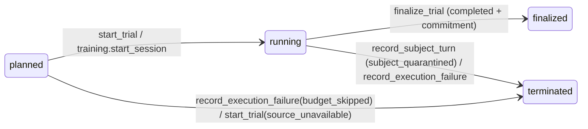

# S4: Data layer (Supabase Postgres)

Part of the build-ready spec for the Investigative AI Training Arena (GMU Challenge X, sponsor Unissant). Governed by `docs/research/synthesis/02-direction.md` (v10; sections 4.1-4.6, 7.1, 8.3, 10, 12) and `docs/challenge/REQUIREMENTS.md`. Owner decisions D-001 to D-009 are hard constraints (D-007 superseded by D-009). Today is 2026-10-08; the build runs to 2026-11-02.

Deliverables of this part:

| File | Content |
| --- | --- |
| `docs/spec/S4-data-layer.md` | This document |
| `docs/spec/sql/0001_foundation.sql` | Schemas, roles, revoke-all, helpers, append-only trigger |
| `docs/spec/sql/0002_cases.sql` | Case families, three packet tiers, evidence and predicates, hidden-split seal, candidate registry |
| `docs/spec/sql/0003_tournament_ledger.sql` | Hash-chained ledger, tournaments, frozen roster, trials, turns, work items, event store, findings, execution records, adjudications, seals, manifests, scores, lifecycle functions |
| `docs/spec/sql/0004_privileged_functions.sql` | The six privileged functions, the turn functions, context readers, commitment, manifest, projections |
| `docs/spec/sql/0005_training.sql` | Investigator sessions, KPI-1 participants, rubric scores, tickets, voice sessions |
| `docs/spec/sql/0006_ops_budget_traces.sql` | Spend guard, cost ledger, kill switch, latency samples, trace mirror, keep-alive |
| `docs/spec/sql/TESTS.md` | pgTAP test plan (every test, expected result) |

The migrations are drafts: never applied to any Supabase project. They were applied to a throwaway local PostgreSQL 16 cluster in the session scratchpad to check that they parse and behave; results are in `sql/TESTS.md` section 0.1.

---

## 0. Summary

| # | Decision | Requirements |
| --- | --- | --- |
| 1 | Six schemas map the direction's tiers: `arena` (public tier and its projections), `subject` (subject-private), `sealed` (evaluator-only), `ledger` (hash chain, commitments, execution records, adjudications, manifests), `training` (investigators, voice), `ops` (budget, cost, traces). None is exposed to the Supabase Data API. | SCN-5, SCN-8, SCN-9 |
| 2 | Three runtime roles, one per credential: `arena_public` (arena-api and arena-tournament), `arena_subject` (arena-subject), `arena_referee` (arena-referee). `service_role` holds nothing in these schemas. `arena_public` and `arena_subject` hold no privilege on any base table; they read views and call functions. | SCN-5, KPI-5, EVL-10 |
| 3 | Every change to a trial's execution state goes through a SECURITY DEFINER function with `search_path=''`, EXECUTE revoked from PUBLIC and granted to one role, the trial row locked `FOR UPDATE`, inputs derived from committed rows, and a server-created work item bound to the transcript version. | BKO-9, SCN-10, F07 |
| 4 | The six privileged functions of direction 4.2 are implemented with the direction's grantees; four supporting turn functions (`submit_question`, `open_work_item`, `record_coaching_event`, `start_trial`) close gaps the direction left open. | direction 4.2 |
| 5 | One global hash-chained ledger; commitments are `sha256(nonce || payload)` with a 32-byte nonce in `sealed`; reveal checks every precondition, seals a hashed inclusion manifest and publishes the nonces. | BKO-9, EVL-10, F15 |
| 6 | Hidden-case material is reachable from `arena_public` only through `arena.trial_context` with an open work item on a running trial; every projection view hides hidden trials until reveal. | SCN-12, R3-03 |
| 7 | Spend guard: a bucket tree under a $60.00 model-and-voice ceiling ($75 cap minus the $15 non-model allowance); every model call reserves its worst case, every voice session its whole-session worst case, before running; overrun trips the kill switch. All figures come from `cost_model.py`. | D-009, BKO-1, BKO-8 |
| 8 | A per-trial event store with a gap-free sequence feeds SSE (S5 section 6); assessment-mode coaching is held until the trial ends. | SOL-6, KPI-4 |
| 9 | The capability matrix is an executable fixture: the test asserts the actual privilege set equals the allowlist exactly. | KPI-5, EVL-10 |
| 10 | Free plan pausing is handled by a keep-alive or the Pro plan: OWNER DECISION PENDING; the schema works either way. | direction 12, 13.2 item 3 |

---

## 1. Requirement coverage

| ID | Mechanism in S4 | Tests (`sql/TESTS.md`) |
| --- | --- | --- |
| SCN-1, SCN-7, SCN-8, SCN-9 | Three packet tables in three schemas; role only in `sealed.evaluator_packets` | CS-01, CS-02, RR-01..RR-28 |
| SCN-3, SCN-11, PRB-4 | `case_variants.style` assigned independent of role; ingest refuses a family without both roles | CS-04 |
| SCN-4, SCN-10 | `sealed.evidence_artifacts` with deterministic predicates; `release_evidence` derives the turn; every change versioned, timestamped and chained | RE-01..RE-16, SV-09, LC-01..LC-08 |
| SCN-5, KPI-5, EVL-10 | Credential per role; no base-table grants for public or subject; capability fixture | CM-01..CM-13, RR-* |
| SCN-6, SUB-7, SUB-8 | `record_subject_turn` answers only the derived open question; guard rejection quarantines atomically | ST-01..ST-14 |
| SCN-12 | Hidden split sealed before freeze; hidden public packets in `sealed`; projections gated on reveal; training only on dev variants | CS-07..CS-10, RR-26..RR-28, TT-01, RV-19 |
| BKO-1, BKO-5, AST-5 | Candidate registry (immutable, hashed manifests); equal per-call-type limits | CS-12, CS-13, BU-01 |
| BKO-2, BKO-6 | Corpus sealed before replay; replay before interactive (`start_trial`) | EF-09..EF-11 |
| BKO-7, BKO-10 | Frozen roster with seeded positions; roster hash checked at reveal; retries only after `infra_failed` | EF-05..EF-08, RV-09 |
| BKO-8 | 12-exchange cap on every trial; spend-limited volume | SV-06, BU-04 |
| BKO-9 | Commit before reveal; commitments, nonces, reveal, manifest bound to leaderboards | FC-*, RV-* |
| EVL-3, EVL-8, EVL-11 | `sealed.independent_labels` (label and fidelity per turn) written by the referee | Referee inserts (CM-01) |
| EVL-5 | `ops.model_calls` single cost source; `ops.latency_samples`; execution states | BU-11, CC-11, CC-12 |
| EVL-7, KPI-1 | `training.rubric_scores` (total = 5 x sum), participants, counterbalanced case sets | TT-03, TT-10 |
| EVL-9, F14, F15 | Execution records and validity adjudications as separate layers; manifest per direction 7.1 | AD-*, RV-11..RV-13 |
| SOL-6 | Event visibility `debrief` for assessment coaching | CC-07..CC-09 |
| KPI-4 | Server segment written at the coach commit; client segment added later; max of both | CC-11, CC-12 |
| D-009 | Bucket tree, reservations, voice reservations, unit admission, kill switch | BU-*, VB-* |

---

## 2. Platform setup

### 2.1 Project and exposure

- Supabase project: owner-provided (direction 13.2 item 3). Postgres 15 or later; `pgcrypto` in schema `extensions` (Supabase default).
- **Data API.** None of `arena`, `subject`, `sealed`, `ledger`, `training`, `ops` is listed under "Exposed schemas". If the dashboard allows disabling the Data API entirely, disable it; the browser talks only to Supabase Auth and to `arena-api`. A SECURITY DEFINER function in an exposed schema is callable over the Data API with the owner's privileges (Supabase docs, cited in X10 Q2 line 45), which is why no function lives in an exposed schema.
- **`public` schema.** Left empty. Apply Supabase's documented default-privilege revokes for `public` (Context7 `/websites/supabase_guides`, "Securing your API", fetched 2026-10-08) so any accidental object there is not reachable by `anon` or `authenticated`.
- **Auth.** Supabase Auth issues the investigator's session; `arena-api` verifies the JWT (and the IAP identity, S5 Q6) and passes the user id to Postgres as `arena.actor_id`. No row level security policy reads `auth.uid()`, because no browser request reaches Postgres directly.

### 2.2 Roles and connections

| Role | Used by | Connects as | Reads | Writes |
| --- | --- | --- | --- | --- |
| `arena_public` | `arena-api`, `arena-tournament` (job) | `arena_public.<project-ref>` on the Supavisor shared pooler, transaction mode, port 6543 | 24 projection views; `arena.trial_context` | 27 functions (section 6.3) |
| `arena_subject` | `arena-subject` | `arena_subject.<project-ref>`, same pooler | `subject.turn_context` only | 18 functions (`record_subject_turn`, voice, budget, spans) |
| `arena_referee` | `arena-referee`; operator CLI for case ingest and reveal | `arena_referee.<project-ref>`, same pooler | Every table and view except `training.voice_resumes` | 8 tables (labels, judgments, scores, leaderboards, isolation checks, participants, case sets, rubric scores); 33 functions |
| `postgres` (owner) | Migrations; owner-only controls (`ops.set_kill_switch`, `ops.set_bucket_ceiling`) | Session mode, port 5432, or the SQL editor | All | All |

- Roles are created `NOLOGIN NOINHERIT` in git (TechnoMile `supabase/migrations/20260927000100_foundation.sql` lines 21-29). The owner enables `LOGIN` and sets each password outside git; each Cloud Run service mounts only its own DSN secret (S5 section 9.4). Setting the passwords is a secret write and needs explicit owner authorization.
- Connection username format for a custom role on the shared pooler is `[ROLE].[PROJECT-REF]`; the shared pooler is IPv4 on every plan; transaction mode does not support session-level `SET`, `LISTEN` or Supavisor prepared statements (Context7 `/websites/supabase_guides`, "Connecting to Postgres", fetched 2026-10-08). Hence: drivers disable prepared statements (asyncpg `statement_cache_size=0`, psycopg `prepare_threshold=None`); per-request settings use `set_config(name, value, true)` inside the transaction; S5's SSE `LISTEN` uses one session-mode connection per instance (S5 6.4).

### 2.3 Transaction contract for callers

1. Every call runs in a READ COMMITTED transaction (the functions refuse anything else, AR001; TechnoMile `20260927000600_run_ledger_rpcs.sql` lines 20-27).
2. Investigator requests start with `select set_config('arena.actor_id', <verified user id>, true)`. Harness and job requests never set it. The functions use this to keep each kind of request on its own trials (section 5.5).
3. One logical step per transaction; commit before any network call that depends on it (for example, commit `open_work_item('subject_answer')` before calling `arena-subject`).
4. Error mapping in `arena_core/db/calls.py` (S5): `AR002` becomes `StaleVersion` (discard the result), `AR003` `WorkItemMismatch`, `AR004` `TurnInProgress` (HTTP 409), `AR040` `Forbidden` (HTTP 404, no existence oracle), `42501` is a defect (alert).
5. Money is `ops.usd` (`numeric(14,6)`), never float.

### 2.4 Free plan keep-alive (OWNER DECISION PENDING: Supabase plan)

- Supabase pauses a Free plan project that shows low activity over 7 days; "typically a few user requests to the database each day over the previous week is enough to keep the project from being paused"; a paused project serves nothing until the owner restores it; paid plans are never paused (Supabase docs "Project Pausing", via Context7 `/websites/supabase_guides`, fetched 2026-10-08; X10 Q2).
- **If Pro:** nothing to do; the keep-alive function stays unused.
- **If Free:** call `ops.keepalive('<source>')` (granted to `arena_public`; inserts one row, prunes rows older than 14 days) four times a day from a scheduled runner. Two runners, owner to choose:
  - Cloud Scheduler triggering the `arena-tournament` job image with a `keepalive` command (scales to zero; adds a scheduler job and a few job executions a day to the non-model itemization in `cost_model.py` before use).
  - A GitHub Actions cron holding an `arena_public` DSN as a repository secret (no GCP cost; the secret is an owner-authorized write).
- Either way: a check in the operator page shows the last ping time; the Nov 2 rehearsal confirms the project is active the day before the demo.
- Size: the Free plan database limit is 500 MB (X10 Q2). The trace mirror is the only table that grows with span volume (section 11); S5 Q2 estimates about 120 MB for the 20-case plan. Pruning of verified non-hidden spans keeps it bounded.

---

## 3. Schemas and tiers

| Schema | Tier (direction 4.1) | Contents | `arena_public` | `arena_subject` | `arena_referee` |
| --- | --- | --- | --- | --- | --- |
| `arena` | Public | Families and variants (no role), dev public packets, candidates, tournaments, roster, trials, turns, released evidence, work items, trial events, findings, scores, leaderboards | Views and functions | `record_subject_turn` only | Read all; insert scores, leaderboards, isolation checks |
| `subject` | Subject-private | Private packets | None | `turn_context` only | Read |
| `sealed` | Evaluator-only | Evaluator packets (role), hidden public packets, evidence artifacts and predicates, hidden-split seal, tag proposals, quarantined artifacts, independent labels, judgments, commitment nonces | None | None | Read; insert labels and judgments |
| `ledger` | Public hashes, evaluator decisions | Event chain, commitments, execution records, adjudications, corpus seals, manifests, revealed nonces | Views | None | Read; functions |
| `training` | Public (actor-scoped) | Participants, case sets, sessions, rubric scores, tickets, voice sessions, fragments, utterances, resumes | Views and functions | Voice functions | Read (not resumes); insert participants, case sets, scores |
| `ops` | Operator | Config, buckets, prices, limits, reservations, model calls, kill-switch history, latency, trace mirror and summaries, keep-alive | Views and functions | Functions | Read; prune spans |

The direction calls the public tier "public projections"; the schema is named `arena` so it never collides with Supabase's exposed `public` schema.

---

## 4. Tables

Columns are listed in full in the SQL; this section gives keys and purpose. "Append-only" means `arena.tg_forbid_mutation` refuses UPDATE and DELETE for every role, the owner included (TechnoMile `20260927000100_foundation.sql` lines 57-62). Only the owner can disable a trigger; the tamper fixtures in `sql/TESTS.md` do exactly that and show that the seals, commitments and chain then fail verification.

### 4.1 `arena`

| Table | Key columns | Purpose | Written by | Mutability |
| --- | --- | --- | --- | --- |
| `case_families` | `id`, `family_code`, `domain`, `split` (dev, hidden) | One matched family (SCN-11) | `sealed.ingest_case_family` | Immutable |
| `case_variants` | `id`, `family_id`, `variant_code`, `style` jsonb, `difficulty` 1-5 | A variant; no role column (SCN-5) | ingest | Immutable |
| `public_packets` | `variant_id`, `packet` (case id, objective, timeline, documents, context, requestable record list), `sha256` | Dev public packet (SCN-7); trigger refuses hidden variants | ingest | Immutable |
| `candidates` | `id`, `kind`, `name`, `version`, `manifest` (model, prompt sha, tools, policy, limits, thinking, timeout), `sha256` | Frozen candidate versions (AST-5, BKO-5) | `register_candidate` | Immutable |
| `tournaments` | `id`, `name`, `split`, `status` (draft, frozen, running, sealed, scoring, revealed), `seed`, `budget_bucket`, `max_exchanges`, `hidden_seal_id`, `roster_sha256` | A dev pilot or sealed run | Lifecycle functions | Status only via functions; no delete |
| `blocks` | `id`, `tournament_id`, `block_no`, `family_id` | One family x nine pairings x one repeat (direction 7.2) | `add_planned_trials` | Immutable |
| `planned_trials` | `id`, `tournament_id`, `position` (seeded order), `track` (replay_corpus, replay, interactive), `variant_id`, candidates, `repeat`, `source_planned_trial_id` | The frozen roster (BKO-7, BKO-10) | `add_planned_trials` (draft only) | Immutable |
| `trials` | `id`, `kind` (training, interactive, replay_corpus, replay), `planned_trial_id`, `attempt` 1-3, `variant_id`, candidates, `source_trial_id`, `mode` (practice, assessment, harness), `owner_user_id`, `status` (planned, running, finalized, terminated), `transcript_version`, `exchanges`, `max_exchanges`, `coaching_pending` | One execution attempt or practice session | Functions only | No delete |
| `turns` | (`trial_id`, `turn_no`), `question`, `question_source`, `question_version`, `idempotency_key`, `answer`, `answer_partial`, timestamps | The transcript | `submit_question`, `record_voice_question`, `record_subject_turn` | Question immutable; answer written once |
| `released_evidence` | (`trial_id`, `record_id`), `release_seq` 1-6, `released_after_exchanges`, content, `content_sha256`, `event_seq` | Evidence the trial has seen | `release_evidence` | Append-only |
| `work_items` | `id`, `trial_id`, `kind` (subject_answer, release, coaching, finalize, failure), `transcript_version`, `turn_no`, `request_sha256`, `status`, `result` | Idempotency and staleness (F07) | Functions | open to done once |
| `trial_events` | (`trial_id`, `seq`), `kind`, `visibility` (live, debrief, internal), `transcript_version`, `turn_no`, `work_item_id`, `candidate_id`, `payload` <= 16 KiB | Event store for SSE and debriefs; coach cards live here | Functions (`arena._emit`) | Append-only |
| `final_findings` | `trial_id`, `classification` (deceptive, truthful, insufficient_evidence), `confidence`, `finding` (with `cited_turns`) | The committed finding (SOL-5, AST-3) | `finalize_trial` | Append-only |
| `scores` | `id`, `tournament_id`, `manifest_id`, `candidate_id`, `metric`, `value` (point, interval, counts, provisional) | Metric values (S3 computes) | Referee insert after reveal | Append-only |
| `leaderboards` | `id`, `tournament_id`, `manifest_id`, `board` (assistant, subject), `label` (original, corrected), `body`, `sha256` | Published boards bound to a manifest | Referee insert after reveal | Append-only |
| `isolation_checks` | `id`, `candidate_id`, `check_name`, `passed`, `evidence` | Isolation gate evidence (EVL-10) | Referee insert | Append-only |

### 4.2 `subject` and `sealed`

| Table | Key columns | Purpose | Written by |
| --- | --- | --- | --- |
| `subject.private_packets` | `variant_id`, `packet` (role, actions, knowledge, disclosable and concealed facts, uncertainty limits, objective, permitted behaviors, disclosure gates, style), `sha256` | SCN-8; read by `arena_subject` only through `subject.turn_context` | ingest |
| `sealed.evaluator_packets` | `variant_id`, `role`, `packet` (canonical facts, contradictions, resolution criteria, rubric), `sha256` | SCN-9; the only place a role label exists | ingest |
| `sealed.hidden_public_packets` | `variant_id`, `packet`, `sha256` | Hidden variants' public packets until a running trial projects them | ingest |
| `sealed.evidence_artifacts` | (`variant_id`, `record_id`), `kind` (record, clarification, context_change, difficulty_change), `title`, `content`, `sha256`, `requestable`, `scheduled_turn`, `request_after_turn` | Evidence and its deterministic release predicate in one row (replaces the direction's separate `release_predicates`) | ingest |
| `sealed.family_ingests` | `family_id`, `bundle_sha256` | Idempotent re-ingest check | ingest |
| `sealed.hidden_split_seals` | `id`, `seal_sha256`, counts | The one seal of the hidden split (SCN-12) | `seal_hidden_split` |
| `sealed.subject_tag_proposals` | (`trial_id`, `turn_no`), `tag` | The subject's own disclosure tag; a proposal, not ground truth | `record_subject_turn` |
| `sealed.quarantined_artifacts` | `trial_id`, `turn_no`, `utterance`, `tag`, `guard_result` | The offending output of a guard rejection (SUB-7) | `record_subject_turn` |
| `sealed.independent_labels` | (`trial_id`, `turn_no`, `labeler`), `label` (evasion, genuine_uncertainty, legitimate_non_disclosure, poorly_framed_question, responsive), `compliant`, `rationale`, `prompt_sha256` | EVL-8 events and EVL-11 fidelity, by the referee and the human sample | Referee insert |
| `sealed.judgments` | `id`, `trial_id`, `kind` (flag_support, questioning_quality, fidelity_detail, calibration), `payload` | Other referee outputs | Referee insert |
| `sealed.commitment_nonces` | `trial_id`, `nonce` (32 bytes) | Commitment nonces (direction 4.1) | `finalize_trial` |

All are append-only.

### 4.3 `ledger`

| Table | Key columns | Purpose |
| --- | --- | --- |
| `chain_head` | one row: `seq`, `head_sha256` | Lock point and head of the chain |
| `events` | `seq` (gap-free), `event_type`, `tournament_id`, `trial_id`, `transcript_version`, `payload` (ids, hashes, states only), `created_us`, `prev_sha256`, `sha256` | The hash chain (SCN-10, BKO-9) |
| `terminal_records` | `trial_id`, `planned_trial_id`, `state`, `reason`, `work_item_id`, `event_seq` | Execution records (one per attempt; the planned trial's record is its latest attempt's) |
| `finding_commitments` | `trial_id`, `payload`, `payload_sha256`, `commitment_sha256`, `event_seq` | Commit before reveal |
| `validity_adjudications` | `id`, `adj_seq`, `trial_id`, `verdict` (valid, subject_invalid), `reason`, `evidence_ref`, `idempotency_key`, `after_reveal` | Subject validity, append-only, latest in force |
| `corpus_seals` | `tournament_id`, `corpus_sha256`, `n_transcripts` | Replay corpus seal (BKO-6) |
| `inclusion_manifests` | `id`, `tournament_id`, `version`, `manifest`, `manifest_sha256`, `supersedes_id` | Version 1 sealed at reveal; later versions are corrections |
| `revealed_nonces` | `trial_id`, `nonce_hex` | Published at reveal so anyone can verify |

All are append-only.

### 4.4 `training`

| Table | Key columns | Purpose |
| --- | --- | --- |
| `participants` | `user_id`, `code` (P01), `counterbalance` (AB, BA), `consented_at` | KPI-1 volunteers (pseudonymous in reports) |
| `case_set_members` | (`set_code` A or B, `variant_id`) | Matched pre and post sets |
| `sessions` | `id`, `trial_id`, `user_id`, `participant_id`, `phase` (practice, pre, post), `voice`, `idempotency_key` | One investigator session = one training trial |
| `rubric_scores` | `session_id`, `scorer` (proxy, human), `scorer_ref`, five 0-4 dimensions, `total` = 5 x sum, `rationale` | EVL-7, KPI-1 |
| `access_tickets` | `ticket_sha256`, `kind` (sse, voice), `user_id`, `trial_id`, `mode`, `expires_at` (60 s), `redeemed_at`, `subject_checked_at` | Single-use tickets bound to user, trial, split (dev) and mode |
| `voice_sessions` | `id`, `session_id`, `ticket_id`, `reservation_id`, `status`, `scored` (false), `close_code` | One Live session; one open per session |
| `voice_fragments` | (`voice_session_id`, `seq`), `speaker`, `text`, `partial` | Live transcription as written |
| `voice_utterances` | (`voice_session_id`, `utterance_no`), `received_samples`, `played_samples`, `ended`, `partial` (derived) | Playback grounding (F10) |
| `voice_resumes` | `token_sha256`, `live_handle`, `expires_at`, `redeemed_at`, `taken_at` | Resume credentials; the handle never leaves `arena_subject` |

### 4.5 `ops`

| Table | Key columns | Purpose |
| --- | --- | --- |
| `config` | one row: `kill_switch`, attempts, voice amounts and caps, per-user quotas | Spend and quota parameters |
| `kill_switch_events` | `turned_on`, `reason`, `actor` | History of every flip (append-only) |
| `budget_buckets` | `name`, `parent`, `ceiling_usd` | Bucket tree under `global` |
| `model_prices` | (`model`, `effective_from`), text and audio rates per 1M tokens | Liability rates (immutable) |
| `call_limits` | `call_kind`, `input_limit`, `output_limit` | Enforced request limits (immutable) |
| `budget_reservations` | `id`, `idempotency_key`, `bucket`, `kind`, `parent_id`, `model`, `call_kind`, `trial_id`, `actor_user_id`, `caller_role`, `reserved_usd`, `state`, `settled_usd`, `overrun`, timestamps | Worst case held before any spend |
| `model_calls` | (`reservation_id`, `seq`), tokens by kind, `cost_usd`, `status`, `latency_ms`, trace ids | The single cost source (direction 10); append-only |
| `latency_samples` | (`trial_id`, `turn_no`), `server_ms`, `client_ms`, `kpi4_ms`, `miss` | KPI-4 samples |
| `trace_mirror` | (`trace_id`, `span_id`), `service`, `trial_id`, `tournament_id`, `split`, `otlp` <= 32 KiB, `export_state` | Durable spans (F11) |
| `trace_summaries` | (`trace_id`, `scope`), expected, mirrored, failures, `telemetry_incomplete` | Per-request telemetry completeness |
| `keepalive_pings` | `at`, `source` | Free plan keep-alive |

---

## 5. Trial lifecycle, work items and transcript versions

### 5.1 States

```mermaid
stateDiagram-v2
  direction LR
  state "Tournament" as T {
    draft --> frozen: freeze_tournament (seal verified, roster hashed, attempt-1 trials created)
    frozen --> running: open_tournament
    running --> sealed: close_tournament_run (every planned trial has an execution record; corpus sealed)
    sealed --> scoring: begin_scoring
    scoring --> revealed: reveal (preconditions, manifest v1, nonces published)
  }
```





`finalized` and `terminated` are frozen: no work item opens, and triggers refuse writes to turns and released evidence.

### 5.2 Work items and versions

- `arena.trials.transcript_version` changes only inside functions: +1 when a question is recorded, +1 when evidence is released (only if something is released), +1 when a subject turn commits or a quarantine is recorded, +1 at finalization. Coaching events do not change it.
- A work item is created by the server (`open_work_item`, or `record_voice_question` for voice) and stores the version current at creation and the turn number. Callers never supply a version to a privileged function; the function compares the item's version with the trial's.
- A completed item replayed with the same input returns its stored result; with different input it is refused (AR003). An item of another trial or another kind is refused (AR003). A stale item is refused (AR002) and its result discarded.
- `submit_question` takes the caller's expected version and an idempotency key stored on the turn (it creates the turn, so there is no item yet).

### 5.3 One turn (direction 4.5; S5 5.2)

| Step | Caller and function | Version | Event |
| --- | --- | --- | --- |
| 1 | `arena-api` or harness: `submit_question(trial, v, text, key)` | v+1 | `question_recorded` |
| 2 | `open_work_item(trial, 'release')`; `release_evidence(trial, wi, ids)`; always called, with an empty list if nothing is requested, so scheduled releases apply before the answer | +1 if released | `evidence_released` or `clarification` per artifact |
| 3 | `open_work_item(trial, 'subject_answer')`; commit; IAM call to `arena-subject.answer(trial, wi)` | | |
| 4 | `arena-subject`: `subject.turn_context(trial, wi)`; one model call; guard; `record_subject_turn(trial, wi, utterance, tag, guard_result)` | +1 | `subject_turn`, or `trial_ended` on quarantine |
| 5 | `open_work_item(trial, 'coaching')`; `trial_context(trial, wi)`; card call; `record_coaching_event(trial, wi, card, 'coach_card')` (A1 adds `coach_deep` in the same request) | +0 | `coach_card`; ends the turn in progress; KPI-4 server segment |
| 6 | At 12 exchanges or a committed finding: `open_work_item(trial, 'finalize')`; `finalize_trial(trial, wi, finding)` | +1 | `finding_committed` (training), `trial_ended` |

One open turn per trial (S5 5.1): from step 4 until a `coach_card` or `coach_unavailable` event, `submit_question` and `release_evidence` return AR004; a crashed request cannot block the trial because the hold expires 120 s after the answer. Corpus trials have no assistant, so they never hold.

Voice (development cases only): the spoken question exists only inside `arena-subject`, so `training.record_voice_question(trial, voice_session, text, key)` (granted to `arena_subject`) records it on the voice session's own training trial and returns the `subject_answer` item for that turn. Evidence requests stay REST actions between turns.

### 5.4 Event store

`arena.trial_events` gives each trial one gap-free sequence, assigned under the trial lock by `arena._emit`, which also calls `pg_notify('arena_events', trial_id)` (delivered at commit). Visibility:

| Kind | Training, practice | Training, assessment | Tournament |
| --- | --- | --- | --- |
| `question_recorded`, `subject_turn`, `evidence_released`, `clarification`, `finding_committed`, `trial_ended` | live | live | internal |
| `coach_card`, `coach_deep`, `coach_unavailable` | live | debrief | internal |

`arena.events_after(trial, after_seq, limit)` returns rows of the actor's own training trial: live rows always, debrief rows after the trial ends, never internal rows; at most 200 per call. Tournament events are read through `arena.v_trial_events` (dev tournaments, or after reveal).

### 5.5 Caller separation inside `arena_public`

`arena-api` (investigator routes) and `arena-tournament` (harness) share the `arena_public` credential, as the direction specifies. `arena._check_caller` gives the database a second line: a request with `arena.actor_id` set may act only on that actor's training trials; a request without it may act only on tournament trials. Every `arena_public` turn function and `trial_context` call it (tests CC-14..CC-16). This does not defend against a compromised `arena-api`, which is outside the direction's threat model for this credential; it catches route bugs.

---

## 6. Functions

### 6.1 Common contract

Every function in the six schemas: `SECURITY DEFINER` (except trigger and pure helpers), `set search_path = ''`, every name schema-qualified, EXECUTE revoked from PUBLIC and from every role, then granted explicitly. Every write function calls `ledger.require_read_committed()`, locks in the fixed order tournament row, trial row, work item row, `ledger.chain_head`, budget rows, and appends a ledger event for each state change. Pattern: TechnoMile `supabase/migrations/20260928001100_holdout_scoring.sql` lines 60-88 and 171-179; `20260927000700_grants.sql` lines 16-18.

### 6.2 The six privileged functions (direction 4.2)

#### 1. `arena.release_evidence(p_trial uuid, p_work_item uuid, p_requested_record_ids text[]) returns jsonb`

| Item | Contract |
| --- | --- |
| Grantee | `arena_public` |
| Caller supplies | Record ids from the case's public requestable list (empty allowed) |
| Derives and enforces | Trial `running`, not `replay`; item kind `release`, same trial, version current; no turn in progress; completed exchanges from the trial row; every requested id requestable on this variant (else AR005); releases each artifact not yet released whose `scheduled_turn <= exchanges`, or that was requested with `request_after_turn <= exchanges`; at most 6 per trial (AR006) |
| Effects | `arena.released_evidence` rows with `release_seq`; version +1 if anything released; one `evidence_released`/`clarification` event per artifact; one ledger event with record ids and content hashes |
| Returns | `{released: [{record_id, kind, title, content}], already_released: [ids], denied: [ids], transcript_version}`; denied ids carry no reason, so predicates do not leak |
| Idempotency | Request hash = sorted id list; same item and list returns the stored result |
| Tests | RE-01..RE-16 |

#### 2. `arena.record_subject_turn(p_trial uuid, p_work_item uuid, p_utterance text, p_tag_proposal jsonb, p_guard_result jsonb, p_partial boolean default false) returns jsonb`

| Item | Contract |
| --- | --- |
| Grantee | `arena_subject` |
| Caller supplies | Utterance, tag proposal (object or null), guard result (`{passed: bool, ...}`), partial flag for interrupted voice output |
| Derives and enforces | Item kind `subject_answer`, same trial, version current; the item's turn is the latest turn and unanswered (AR004); trial `running` |
| Effects, guard passed | Answer stored once; exchanges +1; version +1; `coaching_pending` set when the trial has an assistant; tag proposal into `sealed.subject_tag_proposals`; `subject_turn` event; ledger event with the answer hash |
| Effects, guard rejected | In one transaction: utterance, tag and guard result into `sealed.quarantined_artifacts`; trial `terminated`; terminal record `subject_quarantined`; `trial_ended` event with reason `subject_invalid` and no detail; ledger event |
| Returns | `{outcome: recorded, turn_no, transcript_version}` or `{outcome: quarantined, turn_no}` |
| Idempotency | Request hash over utterance, tag, guard result and partial flag |
| Tests | ST-01..ST-14, CO-04 |

#### 3. `arena.finalize_trial(p_trial uuid, p_work_item uuid, p_final_finding jsonb) returns jsonb`

| Item | Contract |
| --- | --- |
| Grantee | `arena_public` |
| Caller supplies | The committed finding `{classification, confidence, cited_turns, ...}`; null for a corpus transcript |
| Derives and enforces | Item kind `finalize`, version current; trial `running`; no open question; transcript non-empty (the source corpus transcript for `replay`); classification in the three values; confidence 1-40 chars (ICD 203 wording is S2's concern); every cited turn exists |
| Effects | `arena.final_findings`; `payload = ledger.commitment_payload(trial, finding)` from stored rows (section 7.2); 32-byte nonce from `extensions.gen_random_bytes` into `sealed.commitment_nonces`; `commitment = sha256(nonce || payload::text)`; trial `finalized` (frozen); ledger event with the commitment; `ledger.finding_commitments`; terminal record `completed`; `finding_committed` (training) and `trial_ended` events |
| Returns | `{commitment_sha256, payload_sha256}` |
| Idempotency | Request hash of the finding; same item returns the same commitment; a concurrent second item waits on the trial lock and fails AR001 |
| Tests | FC-01..FC-15, CO-01, CO-02 |

#### 4. `arena.record_execution_failure(p_trial uuid, p_work_item uuid, p_state text, p_reason text) returns jsonb`

| Item | Contract |
| --- | --- |
| Grantee | `arena_public` |
| Caller supplies | `assistant_failed`, `infra_failed`, `budget_skipped` or `budget_truncated`, and a reason (1-500 chars) |
| Derives and enforces | Allowed transitions only: `planned -> budget_skipped`; `running -> assistant_failed, infra_failed, budget_truncated`; not `assistant_failed` on a corpus trial; version current; one terminal record per attempt (primary key) |
| Effects | Trial `terminated`; terminal record; ledger event; `trial_ended` event |
| Returns | `{trial_id, state}` |
| Retries | `arena.retry_trial(planned_trial)` (also `arena_public`) creates attempt n+1 only after `infra_failed`, at most 3 attempts; the planned trial's execution record is its latest attempt's |
| Tests | EF-01..EF-12 |

#### 5. `ledger.adjudicate_validity(p_trial uuid, p_verdict text, p_reason text, p_evidence_ref text, p_idempotency_key text) returns uuid`

| Item | Contract |
| --- | --- |
| Grantee | `arena_referee` |
| Caller supplies | `valid` or `subject_invalid` after blinded review, reason, optional evidence reference, idempotency key |
| Derives and enforces | Trial is `interactive` or `replay_corpus`; its terminal state is `completed` or `assistant_failed` (the trials whose subject turns count); locks the tournament row FOR SHARE so it cannot interleave with `reveal`; `after_reveal` derived from the tournament status |
| Effects | Appends one adjudication; never touches transcripts, findings, commitments or terminal records; ledger event with id and verdict only |
| Returns | Adjudication id; the latest by `adj_seq` is in force |
| Tests | AD-01..AD-08, CO-08 |

#### 6. `ledger.reveal(p_tournament uuid) returns jsonb`

| Item | Contract |
| --- | --- |
| Grantee | `arena_referee` |
| Preconditions (`ledger.check_reveal_preconditions`) | Status `scoring` (AR020); roster hash recomputes (AR021); every planned trial has an execution record (AR020); every trial needing subject review has an adjudication (AR020); corpus sealed and its digest recomputes, when the tournament has a replay track (AR021); every commitment of the tournament verifies (AR021); hidden seal verifies for a hidden tournament (AR021); ledger chain verifies (AR021) |
| Effects | Builds the inclusion manifest (section 7.5); `manifest_sha256`; status `revealed`; ledger event with the manifest hash; `ledger.inclusion_manifests` version 1; copies every nonce of the tournament into `ledger.revealed_nonces` |
| Returns | `{manifest_id, manifest_sha256}`; a second call returns the same |
| After reveal | Hidden trials become visible in the projections; held spans become exportable; scores and leaderboards can be inserted, each naming a manifest; `ledger.seal_corrected_manifest` creates version n+1 after a later adjudication; version 1 never changes |
| Tests | RV-01..RV-20 |

### 6.3 Supporting functions

| Function | Grantee | Purpose |
| --- | --- | --- |
| `arena.open_work_item(trial, kind)` | `arena_public` | Server-created item at the current version (`subject_answer` only with an open question) |
| `arena.start_trial(trial)` | `arena_public` | planned to running; BKO-2 order; `source_unavailable` for replay without a completed corpus transcript |
| `arena.retry_trial(planned_trial)` | `arena_public` | Next attempt after `infra_failed` |
| `arena.submit_question(trial, expected_version, text, key)` | `arena_public` | Records Q(t) (S5 "record_question") |
| `arena.record_coaching_event(trial, item, card, kind)` | `arena_public` | `coach_card`, `coach_deep`, `coach_unavailable` (S5 "record_coaching") |
| `arena.trial_context(trial, item)` | `arena_public` | Public packet (hidden only while running), transcript, evidence, prior coaching, assistant manifest; S5 builds `PublicTrialView` from it |
| `arena.events_after(trial, after_seq, limit)` | `arena_public` | SSE projection |
| `arena.trial_visible(trial)`, `arena.actor_id()` | `arena_public` | Used inside projection views |
| `subject.turn_context(trial, item)` | `arena_subject` | Private packet, public packet, transcript, evidence, subject manifest for one open `subject_answer` item |
| `training.start_session`, `issue_access_ticket`, `redeem_access_ticket`, `redeem_voice_resume` | `arena_public` | Sessions and tickets (section 4.4) |
| `training.claim_voice_ticket`, `open_voice_session`, `close_voice_session`, `record_voice_question`, `record_voice_fragment`, `record_voice_utterance`, `issue_voice_resume`, `take_voice_handle` | `arena_subject` | Voice session lifecycle |
| `ops.reserve_model_call`, `mark_dispatched`, `record_usage`, `settle_reservation`, `budget_status`, `mirror_spans`, `record_trace_summary` | all three runtime roles | Metering and tracing (section 8.7) |
| `ops.reserve_voice` | `arena_subject` | Whole-session voice reservation |
| `ops.admit_unit`, `ops.set_export_state` | `arena_public`, `arena_referee` | Soft unit admission; span export state |
| `ops.keepalive`, `ops.record_client_latency` | `arena_public` | Keep-alive; KPI-4 client segment |
| `ops.prune_trace_mirror` | `arena_referee` | Drop verified non-hidden spans older than 7+ days |
| `ops.set_kill_switch`, `ops.set_bucket_ceiling` | owner only | Spend controls |

### 6.4 Lifecycle and case functions (`arena_referee`)

| Function | Contract |
| --- | --- |
| `sealed.ingest_case_family(bundle)` | One transaction writes family, variants, three packets and artifacts; refuses hidden families after the seal, families without both roles, more than 6 artifacts, re-use of a family code with different content |
| `sealed.seal_hidden_split()` | Once; digest over every hidden variant's packet and artifact hashes (section 7.4); ledger event with the seal hash |
| `arena.register_candidate(kind, name, version, manifest)` | Immutable; required manifest keys checked |
| `arena.create_tournament(name, split, seed, bucket, max_exchanges)` | Idempotent by name |
| `arena.add_planned_trials(tournament, rows)` | Draft only; one family per block; candidate kinds match slots; replay rows reference a corpus row of the same variant |
| `arena.freeze_tournament(tournament)` | Hidden: seal exists and verifies; every variant in the tournament's split; roster hash; attempt-1 trials |
| `arena.open_tournament`, `ledger.seal_replay_corpus`, `arena.close_tournament_run`, `arena.begin_scoring` | State transitions of section 5.1 |
| `ledger.verify_chain`, `ledger.verify_commitment`, `ledger.build_manifest`, `ledger.planned_execution`, `ledger.corpus_digest`, `arena.roster_digest` | Read-only checks used by reveal and the trust center |

### 6.5 Error codes

| SQLSTATE | Meaning | Caller action |
| --- | --- | --- |
| AR001 | Wrong state (trial, tournament, reservation) | Stop the step; report |
| AR002 | Stale transcript version | Discard the computed result |
| AR003 | Unknown, cross-trial or wrong-kind work item; key reused with different input | Defect or retry bug |
| AR004 | No open question, or turn in progress | HTTP 409 `turn_in_progress` |
| AR005 | Requested id not requestable | HTTP 422 |
| AR006 | Release limit | Generator defect (it enforces 6) |
| AR007 | Invalid input | HTTP 422 |
| AR010 | Append-only or immutable row | Defect |
| AR020, AR021 | Reveal precondition; seal or hash mismatch | Operator investigates; never forced |
| AR031 | Session has open child reservations | Settle children first |
| AR040 | Caller, ticket, quota or resume refused | HTTP 404 (no existence oracle) |

---

## 7. Ledger, commitments and the inclusion manifest

### 7.1 Hash chain

`ledger.append_event(type, tournament, trial, payload)` locks `ledger.chain_head`, takes `seq = head.seq + 1`, and stores `sha256 = hash_jsonb({prev, seq, type, tournament, trial, version, payload, created_us})`, where `created_us` is microseconds since the epoch (independent of the session time zone) and `version` is read from the trial row. Payloads hold ids, hashes and states only: never a role label, an answer, a question or a private fact (LC-07). One global chain is enough at this volume and gives one head hash to publish. `ledger.verify_chain()` returns the first broken `seq`, or null.

### 7.2 Commitment and nonce

`ledger.commitment_payload(trial, finding)` is computed only from stored rows:

| Field | Content |
| --- | --- |
| `transcript_sha256` | Turns of the trial (of the source corpus trial for `replay`): turn, question, answer, partial flag, ordered by turn |
| `evidence_sha256` | Released evidence of the same trial: record, seq, exchanges before release, content hash |
| `coaching_sha256` | Coach events of this trial: seq, kind, version, turn, card |
| `finding_sha256` | The finding jsonb (null for a corpus transcript) |
| `manifest_sha256` | Planned trial, attempt, variant, assistant and subject manifest hashes, source trial, roster hash |

`commitment = sha256(nonce || convert_to(payload::text, 'UTF8'))`. `payload::text` is the jsonb text form, which Postgres renders deterministically (sorted keys, fixed spacing), so `verify_commitment` recomputes it exactly. The nonce makes the commitment hiding: a three-valued finding cannot be guessed from the hash. Before reveal `ledger.v_commitments` shows the commitment hash for every trial and the payload only for visible trials; after reveal it shows `payload_text`, and `ledger.v_revealed_nonces` the nonce, so a judge can recompute `sha256(nonce || payload_text)` outside the database.

### 7.3 Execution records and attempts

One terminal record per trial attempt, immutable: `completed`, `subject_quarantined`, `assistant_failed`, `infra_failed`, `budget_skipped`, `budget_truncated`, `source_unavailable`. A planned trial's execution record is its latest attempt's (`ledger.planned_execution`). Retries are allowed only after `infra_failed` (no outcome exists, so retrying cannot select on results), up to 3 attempts, same position and seed.

### 7.4 Seals and hashes

| Hash | Computed over | When | Checked |
| --- | --- | --- | --- |
| Hidden-split seal | Per hidden variant: family code, variant code, public, private and evaluator packet hashes, artifacts hash; lines sorted by code point | Once, before any hidden tournament freezes | `freeze_tournament`, `reveal` |
| Roster | Tournament id, split, seed, cap; per planned trial: position, id, track, block, variant, candidate manifest hashes, repeat, source position | `freeze_tournament` | `reveal` |
| Corpus | Per corpus planned trial: id, execution state, committed transcript and evidence hashes; sorted | `seal_replay_corpus` (before any replay trial starts) | `reveal` |
| Manifest | The manifest jsonb | `reveal`, `seal_corrected_manifest` | Bound to every leaderboard |

### 7.5 Inclusion manifest (direction 7.1, F14, F15)

`ledger.build_manifest` emits one entry per planned trial: planned trial id, position, track, trial id, attempt, execution state, adjudication id and verdict in force, `assistant` and `subject` inclusion, reason. Rules:

| Track | Execution state, verdict | `assistant` | `subject` | Reason |
| --- | --- | --- | --- | --- |
| interactive | completed, valid | included | included | included |
| interactive | assistant_failed, valid | included_as_insufficient | included | counted as insufficient evidence |
| interactive | completed or assistant_failed, subject_invalid | excluded | included | counts against the subject |
| interactive | subject_quarantined | excluded | included | counts against the subject |
| any | infra_failed | excluded | excluded | infra_failed |
| any | budget_skipped, budget_truncated | excluded | excluded | budget state |
| replay_corpus | completed, valid | n/a | included | included (corpus usable) |
| replay_corpus | completed, subject_invalid; or subject_quarantined | n/a | included | counts against the subject (corpus unusable) |
| replay | source corpus not completed-and-valid (includes source_unavailable) | excluded | n/a | source transcript invalid |
| replay | completed | included | n/a | included |
| replay | assistant_failed | included_as_insufficient | n/a | counted as insufficient evidence |

Each candidate's metrics use its own included trials (F14); S3 computes metrics from the manifest and labels, never from raw trial lists. The manifest also carries the roster, corpus and hidden-seal hashes.

### 7.6 Reveal and corrections

Reveal is the only route from `scoring` to `revealed` and checks every precondition again (section 6.2). Scores and leaderboards are insertable only for a revealed tournament and must name a manifest of that tournament; `original` boards only on version 1, `corrected` only on later versions (trigger, RV-16). A later adjudication never changes version 1: the referee calls `ledger.seal_corrected_manifest`, which writes version n+1 with `supersedes_id`, and publishes a separately labeled corrected board.

---

## 8. Budget (D-009, direction 8.3)

### 8.1 Envelope and buckets

| Bucket | Parent | Ceiling | Source |
| --- | --- | --- | --- |
| `global` | none | $60.00 | $75 cap minus `NON_MODEL_ALLOWANCE` $15 (`cost_model.py`) |
| `demo` | global | $12.43 | `demo_ceiling()` 12.429816, rounded up |
| `build` | global | $47.57 | 60.00 - 12.43 |

S5 section 4.4 splits `build` into phase buckets (experiments, generation, dev_pilot, replay, interactive) from `scripts/budget_plan.py`. The owner applies that plan with `ops.set_bucket_ceiling(name, parent, ceiling, note)` (owner only), which refuses: a ceiling below the bucket's current liability, a change of parent, making a bucket that already holds reservations into a parent, and children whose ceilings sum above their parent (trigger, checked on every change; to move money between siblings, lower one first). Reservations go to leaf buckets only. Non-model costs are not in the ledger; they are minimized and backstopped by GCP budget alerts and the billing-disable function (direction 8.3, S5 9.6).

### 8.2 Prices and limits

`ops.model_prices` holds liability rates per 1M tokens, effective 2026-10-08: `gemini-3.1-flash-lite` 0.25/1.50, `gemini-3.5-flash-lite` 0.30/2.50, `gemini-3.1-pro-preview` 2.00/12.00, `gemini-3.8-flash` 1.50/7.50 (undiscounted), and the two Live models at the `cost_model.py` VOICE rates x1.5 (text 1.125/6.75, audio 4.50/18.00) until the Vertex Live price is confirmed. `ops.call_limits` holds `LIMITS`: subject and card 6000/1600, deep and final 7000/3000, referee 12000/4000, generate 12000/40000, validate 20000/4000. Both tables are immutable: a price or limit change is a new row or a new migration, checked against `cost_model.py` by S5's parity script.

### 8.3 Model-call reservation lifecycle

| Step | Function | Rule |
| --- | --- | --- |
| Reserve | `ops.reserve_model_call(key, bucket, model, call_kind, purpose, trial, actor, parent)` | Worst case = 4 x (input_limit x text_in + output_limit x text_out) / 1e6, rounded up to 6 dp, derived in the database. Kill switch off. Locks the leaf and every ancestor, root first; admits only if each subtree's liability plus the amount stays at or under its ceiling; then the actor's daily cap (OWNER DECISION PENDING, proposed $3.00). Refusals are returned, not raised. Idempotent on `key` |
| Dispatch | `ops.mark_dispatched(reservation)` | Before the Vertex call; kill switch read again; a reservation that was never dispatched can be released |
| Receipts | `ops.record_usage(reservation, attempt, model, tokens...)` | One row per attempt (at most 4) in `ops.model_calls`; cost computed from the price row; idempotent on (reservation, seq) |
| Settle | `ops.settle_reservation(reservation, outcome)` | `committed` = sum of receipts; `usage_unknown` keeps the full reservation (direction 8.3: missing usage keeps the reservation); `released` only if never dispatched |

`purpose` is a label from the agent port's fixed list (for example `coach.card`, `subject.answer`, `generate.family`), never a case or family code, because `ops.v_call_costs` shows it for calls with no trial; the link to a case is `trial_id`.

Liability in every cap check: open and `usage_unknown` reservations at the reserved amount, committed at the settled amount, released at 0 (TechnoMile `20260927000600_run_ledger_rpcs.sql` lines 806-833). Worked values: a `card` on 3.5-flash-lite reserves $0.023200; a `generate` on 3.1-pro-preview $2.016000 (BU-02, BU-03).

**Overrun.** If receipts exceed the reservation (a limit or price assumption is wrong), the receipt is still recorded, the reservation is flagged `overrun`, the kill switch turns on and a history row is written. Every new reservation then fails until the owner reviews and turns it off. This is a fail-safe, not an expected path (BU-16).

### 8.4 Voice whole-session reservation

`ops.reserve_voice(key, bucket, kind, purpose, trial, actor)` (`arena_subject`) reserves `voice_session` $1.635720 or `voice_probe` $0.132140 (`cost_model.py` `VOICE_RESERVATION`, `PROBE_RESERVATION`) before the Live session opens, after bucket admission, with three counts serialized by the bucket lock: open voice reservations at most `max_open_voice_sessions` (proposed 2), voice sessions in total at most 8 (`VOICE_SESSIONS`), probes at most 30 (`LIVE_PROBE`). Usage reports (`record_usage` with audio tokens) return `shutoff = true` once session spend reaches two thirds of the reservation ($1.090481) or the kill switch is on; S5's safety loop closes the socket (4413). Coaching and retranscription calls during the session reserve as children (`parent`), bounded by the session's remaining room, not by the bucket; the session cannot settle while a child is open (AR031); a committed session settles at its receipts plus its children.

### 8.5 Unit admission (soft completeness)

`ops.admit_unit(bucket, high_cost)` answers `admit` only if every bucket on the path has at least 1.5 x the unit's high cost free; it holds nothing. A skipped unit's planned trials get `budget_skipped`; a unit the per-call guard stops mid-way gets `budget_truncated` (direction 8.3).

### 8.6 Kill switch

`ops.config.kill_switch` is read by every reservation, dispatch, voice usage report and unit admission. Only the owner flips it (`ops.set_kill_switch`, every flip recorded in `ops.kill_switch_events`), or the overrun path turns it on. S5 4.8 covers the HTTP 503 and the ingress runbook.

### 8.7 One deliberate exception to "one grantee per function"

`reserve_model_call`, `mark_dispatched`, `record_usage`, `settle_reservation`, `budget_status`, `mirror_spans` and `record_trace_summary` are granted to all three runtime roles, because every service calls Vertex and emits spans. They touch only `ops` rows and derive amounts themselves; `caller_role` records which credential made each reservation. The six privileged functions keep exactly one grantee (CM-07).

### 8.8 KPI-4 samples

`record_coaching_event` writes `ops.latency_samples.server_ms` = `coach_card` (or `coach_unavailable`) commit time minus the turn's `subject_turn` commit time, both `clock_timestamp()` values from `arena.trial_events`; `coach_unavailable` sets `miss`. `ops.record_client_latency` adds the client segment once; `kpi4_ms = max(server_ms, client_ms)`, so the metric never flatters (S5 8.7). S3 computes p95 with its session-cluster bootstrap from `ops.v_latency` (or the referee's direct read).

---

## 9. Projections, RLS and grants

### 9.1 Projection views (`arena_public`)

All views are `security_barrier`, owned by the migration owner, and read through `arena.trial_visible(trial)`: true for the actor's own training trial, for any dev tournament trial, and for any trial of a revealed tournament.

| View | Rows |
| --- | --- |
| `arena.v_dev_cases` | Dev variants with public packets (case browser) |
| `arena.v_candidates`, `v_tournaments`, `v_planned_trials` | Registry, tournaments, roster (no role anywhere) |
| `arena.v_trials` | Every tournament trial's ids and states, the actor's training trials, execution state |
| `arena.v_transcripts`, `v_released_evidence`, `v_findings` | Visible trials only |
| `arena.v_trial_events` | Visible trials; debrief rows hidden while running |
| `arena.v_scores`, `v_leaderboards` | Exist only after reveal; leaderboards carry the manifest hash and version |
| `ledger.v_events` | Tournament-level events and events of visible trials |
| `ledger.v_commitments` | Every commitment hash; payload and payload text for visible trials |
| `ledger.v_revealed_nonces`, `v_manifests`, `v_corpus_seals` | All rows (exist only when published) |
| `ledger.v_adjudications` | Visible trials (no evidence reference) |
| `training.v_my_sessions`, `v_my_scores` (after the trial ends), `v_my_voice_fragments` | The actor's rows |
| `ops.v_budget_status`, `v_call_costs` (visible trials), `v_latency` (visible trials), `v_exportable_spans` | Operator page, exporter |

### 9.2 RLS

RLS is enabled on every table in the six schemas (CM-04) with no policy for `anon`, `authenticated` or `service_role`, so they see nothing even if a grant slipped in. `arena_referee` has `using (true)` select policies on the tables it may read and insert policies on the eight tables it writes (TechnoMile `20260927000700_grants.sql` lines 82-108 pattern). `arena_public` and `arena_subject` have no table grants, so they need no policies. Views run with the owner's rights and filter rows in their own `where` clauses; the `security_barrier` option stops a caller-supplied function from seeing filtered rows.

### 9.3 Grants matrix (summary; the fixture in section 10 is authoritative)

| Role | USAGE | Tables | Views | Functions |
| --- | --- | --- | --- | --- |
| `arena_public` | arena, ledger, training, ops | none | all 24 (SELECT) | 27 |
| `arena_subject` | arena, subject, training, ops | none | none | 18 |
| `arena_referee` | all six | SELECT on 54 of 55 (all but `training.voice_resumes`); INSERT on 8 | SELECT on all 24 | 33 |
| `anon`, `authenticated`, `service_role` | none | none | none | none |

---

## 10. Capability matrix as a test fixture (KPI-5, EVL-10)

Copy this block verbatim to `supabase/tests/fixtures/capability_matrix.csv`. `001_capability_matrix.sql` (CM-01, CM-02) expands the pattern rows (`table+view`, `<schema>.*`), applies `deny` rows last, and asserts that the actual privilege set of the six roles over the six schemas equals the result exactly, in both directions. Any new grant, function or view therefore fails CI until the fixture is updated in the same change, and that diff is reviewed like code. The rows were exported from the drafts applied to a local Postgres 16 database (section 0.1 of TESTS.md).

```csv
role,object_type,object,privilege,expect
arena_public,function,arena.actor_id(),EXECUTE,allow
arena_public,function,"arena.events_after(uuid,integer,integer)",EXECUTE,allow
arena_public,function,"arena.finalize_trial(uuid,uuid,jsonb)",EXECUTE,allow
arena_public,function,"arena.open_work_item(uuid,text)",EXECUTE,allow
arena_public,function,"arena.record_coaching_event(uuid,uuid,jsonb,text)",EXECUTE,allow
arena_public,function,"arena.record_execution_failure(uuid,uuid,text,text)",EXECUTE,allow
arena_public,function,"arena.release_evidence(uuid,uuid,text[])",EXECUTE,allow
arena_public,function,arena.retry_trial(uuid),EXECUTE,allow
arena_public,function,arena.start_trial(uuid),EXECUTE,allow
arena_public,function,"arena.submit_question(uuid,integer,text,text)",EXECUTE,allow
arena_public,function,"arena.trial_context(uuid,uuid)",EXECUTE,allow
arena_public,function,arena.trial_visible(uuid),EXECUTE,allow
arena_public,function,"ops.admit_unit(text,numeric)",EXECUTE,allow
arena_public,function,ops.budget_status(),EXECUTE,allow
arena_public,function,ops.keepalive(text),EXECUTE,allow
arena_public,function,ops.mark_dispatched(uuid),EXECUTE,allow
arena_public,function,"ops.mirror_spans(text,jsonb)",EXECUTE,allow
arena_public,function,"ops.record_client_latency(uuid,smallint,integer)",EXECUTE,allow
arena_public,function,"ops.record_trace_summary(text,text,uuid,integer,integer,integer)",EXECUTE,allow
arena_public,function,"ops.record_usage(uuid,integer,text,bigint,bigint,bigint,bigint,bigint,text,integer,text,text)",EXECUTE,allow
arena_public,function,"ops.reserve_model_call(text,text,text,text,text,uuid,uuid,uuid)",EXECUTE,allow
arena_public,function,"ops.set_export_state(jsonb,text)",EXECUTE,allow
arena_public,function,"ops.settle_reservation(uuid,text)",EXECUTE,allow
arena_public,function,"training.issue_access_ticket(text,uuid)",EXECUTE,allow
arena_public,function,"training.redeem_access_ticket(text,text)",EXECUTE,allow
arena_public,function,training.redeem_voice_resume(text),EXECUTE,allow
arena_public,function,"training.start_session(uuid,text,text,uuid,uuid,boolean,text)",EXECUTE,allow
arena_public,schema,arena,USAGE,allow
arena_public,schema,ledger,USAGE,allow
arena_public,schema,ops,USAGE,allow
arena_public,schema,training,USAGE,allow
arena_public,view,arena.v_candidates,SELECT,allow
arena_public,view,arena.v_dev_cases,SELECT,allow
arena_public,view,arena.v_findings,SELECT,allow
arena_public,view,arena.v_leaderboards,SELECT,allow
arena_public,view,arena.v_planned_trials,SELECT,allow
arena_public,view,arena.v_released_evidence,SELECT,allow
arena_public,view,arena.v_scores,SELECT,allow
arena_public,view,arena.v_tournaments,SELECT,allow
arena_public,view,arena.v_transcripts,SELECT,allow
arena_public,view,arena.v_trial_events,SELECT,allow
arena_public,view,arena.v_trials,SELECT,allow
arena_public,view,ledger.v_adjudications,SELECT,allow
arena_public,view,ledger.v_commitments,SELECT,allow
arena_public,view,ledger.v_corpus_seals,SELECT,allow
arena_public,view,ledger.v_events,SELECT,allow
arena_public,view,ledger.v_manifests,SELECT,allow
arena_public,view,ledger.v_revealed_nonces,SELECT,allow
arena_public,view,ops.v_budget_status,SELECT,allow
arena_public,view,ops.v_call_costs,SELECT,allow
arena_public,view,ops.v_exportable_spans,SELECT,allow
arena_public,view,ops.v_latency,SELECT,allow
arena_public,view,training.v_my_scores,SELECT,allow
arena_public,view,training.v_my_sessions,SELECT,allow
arena_public,view,training.v_my_voice_fragments,SELECT,allow
arena_referee,function,"arena.add_planned_trials(uuid,jsonb)",EXECUTE,allow
arena_referee,function,arena.begin_scoring(uuid),EXECUTE,allow
arena_referee,function,arena.close_tournament_run(uuid),EXECUTE,allow
arena_referee,function,"arena.create_tournament(text,text,bigint,text,smallint)",EXECUTE,allow
arena_referee,function,arena.freeze_tournament(uuid),EXECUTE,allow
arena_referee,function,arena.open_tournament(uuid),EXECUTE,allow
arena_referee,function,"arena.register_candidate(text,text,text,jsonb)",EXECUTE,allow
arena_referee,function,arena.roster_digest(uuid),EXECUTE,allow
arena_referee,function,"ledger.adjudicate_validity(uuid,text,text,text,text)",EXECUTE,allow
arena_referee,function,ledger.build_manifest(uuid),EXECUTE,allow
arena_referee,function,ledger.corpus_digest(uuid),EXECUTE,allow
arena_referee,function,ledger.hash_jsonb(jsonb),EXECUTE,allow
arena_referee,function,ledger.hash_text(text),EXECUTE,allow
arena_referee,function,ledger.planned_execution(uuid),EXECUTE,allow
arena_referee,function,ledger.reveal(uuid),EXECUTE,allow
arena_referee,function,ledger.seal_corrected_manifest(uuid),EXECUTE,allow
arena_referee,function,ledger.seal_replay_corpus(uuid),EXECUTE,allow
arena_referee,function,ledger.verify_chain(),EXECUTE,allow
arena_referee,function,ledger.verify_commitment(uuid),EXECUTE,allow
arena_referee,function,"ops.admit_unit(text,numeric)",EXECUTE,allow
arena_referee,function,ops.budget_status(),EXECUTE,allow
arena_referee,function,ops.mark_dispatched(uuid),EXECUTE,allow
arena_referee,function,"ops.mirror_spans(text,jsonb)",EXECUTE,allow
arena_referee,function,ops.prune_trace_mirror(integer),EXECUTE,allow
arena_referee,function,"ops.record_trace_summary(text,text,uuid,integer,integer,integer)",EXECUTE,allow
arena_referee,function,"ops.record_usage(uuid,integer,text,bigint,bigint,bigint,bigint,bigint,text,integer,text,text)",EXECUTE,allow
arena_referee,function,"ops.reserve_model_call(text,text,text,text,text,uuid,uuid,uuid)",EXECUTE,allow
arena_referee,function,"ops.set_export_state(jsonb,text)",EXECUTE,allow
arena_referee,function,"ops.settle_reservation(uuid,text)",EXECUTE,allow
arena_referee,function,sealed.hidden_split_digest(),EXECUTE,allow
arena_referee,function,sealed.ingest_case_family(jsonb),EXECUTE,allow
arena_referee,function,sealed.seal_hidden_split(),EXECUTE,allow
arena_referee,function,sealed.verify_hidden_seal(),EXECUTE,allow
arena_referee,schema,arena,USAGE,allow
arena_referee,schema,ledger,USAGE,allow
arena_referee,schema,ops,USAGE,allow
arena_referee,schema,sealed,USAGE,allow
arena_referee,schema,subject,USAGE,allow
arena_referee,schema,training,USAGE,allow
arena_referee,table,arena.isolation_checks,INSERT,allow
arena_referee,table,arena.leaderboards,INSERT,allow
arena_referee,table,arena.scores,INSERT,allow
arena_referee,table,sealed.independent_labels,INSERT,allow
arena_referee,table,sealed.judgments,INSERT,allow
arena_referee,table,training.case_set_members,INSERT,allow
arena_referee,table,training.participants,INSERT,allow
arena_referee,table,training.rubric_scores,INSERT,allow
arena_subject,function,"arena.record_subject_turn(uuid,uuid,text,jsonb,jsonb,boolean)",EXECUTE,allow
arena_subject,function,ops.budget_status(),EXECUTE,allow
arena_subject,function,ops.mark_dispatched(uuid),EXECUTE,allow
arena_subject,function,"ops.mirror_spans(text,jsonb)",EXECUTE,allow
arena_subject,function,"ops.record_trace_summary(text,text,uuid,integer,integer,integer)",EXECUTE,allow
arena_subject,function,"ops.record_usage(uuid,integer,text,bigint,bigint,bigint,bigint,bigint,text,integer,text,text)",EXECUTE,allow
arena_subject,function,"ops.reserve_model_call(text,text,text,text,text,uuid,uuid,uuid)",EXECUTE,allow
arena_subject,function,"ops.reserve_voice(text,text,text,text,uuid,uuid)",EXECUTE,allow
arena_subject,function,"ops.settle_reservation(uuid,text)",EXECUTE,allow
arena_subject,function,"subject.turn_context(uuid,uuid)",EXECUTE,allow
arena_subject,function,"training.claim_voice_ticket(uuid,uuid,uuid,text)",EXECUTE,allow
arena_subject,function,"training.close_voice_session(uuid,text)",EXECUTE,allow
arena_subject,function,"training.issue_voice_resume(uuid,text)",EXECUTE,allow
arena_subject,function,"training.open_voice_session(uuid,uuid)",EXECUTE,allow
arena_subject,function,"training.record_voice_fragment(uuid,integer,text,text,boolean)",EXECUTE,allow
arena_subject,function,"training.record_voice_question(uuid,uuid,text,text)",EXECUTE,allow
arena_subject,function,"training.record_voice_utterance(uuid,integer,integer,integer,boolean)",EXECUTE,allow
arena_subject,function,training.take_voice_handle(uuid),EXECUTE,allow
arena_subject,schema,arena,USAGE,allow
arena_subject,schema,ops,USAGE,allow
arena_subject,schema,subject,USAGE,allow
arena_subject,schema,training,USAGE,allow
arena_referee,table+view,arena.*,SELECT,allow
arena_referee,table+view,subject.*,SELECT,allow
arena_referee,table+view,sealed.*,SELECT,allow
arena_referee,table+view,ledger.*,SELECT,allow
arena_referee,table+view,training.*,SELECT,allow
arena_referee,table+view,ops.*,SELECT,allow
arena_referee,table,training.voice_resumes,SELECT,deny
```

The direction's capability matrix (4.3) also has route-level rows (IAP, IAM between services, SSE, WebSocket, Phoenix). Those are S5's route tests; the database half above is what they rest on: whatever route an investigator reaches, it holds `arena_public`, and `arena_public` cannot read a role label, a private packet, an evaluator packet, an unreleased artifact, or any hidden-trial content after finalization and before reveal.

---

## 11. Trace mirror (direction 10, F11, R3-03)

- `ops.mirror_spans(service, spans)` inserts up to 500 sanitized spans per call, idempotent on (trace, span). A span is durable once its row commits. Rows carry the sanitized OTLP JSON (at most 32 KiB, redacted before export by S5's processor chain) so Phoenix can be re-fed from the mirror.
- The insert trigger derives `tournament_id` and `split` from `trial_id` and sets `export_state = 'held'` for a hidden, unrevealed tournament, else `pending`. `ops.v_exportable_spans` lists pending rows and held rows of revealed tournaments; `ops.set_export_state` moves pending to exported to verified, and held to exported only after reveal.
- `ops.prune_trace_mirror(days >= 7)` (referee) deletes verified, non-hidden spans; the trigger refuses any other delete and any change other than the export state.
- `ops.record_trace_summary` stores spans expected and mirrored per request or job task; `telemetry_incomplete` is derived (TechnoMile `20260927001000_trace_mirror.sql` lines 78-98).
- `ops.model_calls` stays the only cost source; spans carry no cost.

---

## 12. Interface mapping to S5

S5 section 4.6 and 5.1 proposed names and stated that S4's names win. The mapping:

| S5 name | S4 name | Note |
| --- | --- | --- |
| `record_question(trial, work_item, text)` | `arena.submit_question(trial, expected_version, text, idempotency_key)` | Creates the turn, so idempotency is on the turn's key, not a work item |
| `record_coaching(trial, wi, expected_version, card, kind)` | `arena.record_coaching_event(trial, work_item, card, kind)` | The version lives in the work item |
| work item kinds `ask, answer, release, coach, deep, finalize` | `subject_answer, release, coaching, finalize, failure` | `coach_deep` is a coaching kind; asking needs no item |
| `abort_turn` after 120 s | Automatic: the turn hold expires 120 s after the answer | No call needed |
| `arena.trial_events`, `arena.events_after` | Same | |
| `ops.reserve_spend` | `ops.reserve_model_call` | |
| `ops.record_model_call`, `ops.settle_spend` | `ops.record_usage` per attempt, then `ops.settle_reservation` | Cost computed in the database |
| `ops.reserve_voice_session` | `ops.reserve_voice` | |
| `ops.meter_voice(session, delta_usd)` | `ops.record_usage(voice_reservation, seq, model, tokens...)` | Takes token counts, not a caller-computed dollar delta; returns `shutoff` |
| `ops.settle_voice_session` | `ops.settle_reservation` | AR031 while children are open |
| `ops.liability_rates` | `ops.model_prices` | |
| `ops.admit_unit`, `ops.set_kill_switch`, `ops.set_bucket_ceiling`, `ops.latency_samples`, `ops.trace_mirror`, `ops.trace_summaries` | Same | Kill switch and buckets are owner-only |
| `ops.sse_tickets`, `ops.voice_tickets` | `training.access_tickets` (kind `sse` or `voice`) | |
| `ops.voice_resume` | `training.voice_resumes` with `issue_voice_resume`, `redeem_voice_resume`, `take_voice_handle` | |
| `training.voice_events` | `training.voice_fragments` | |
| `training.voice_sessions.metered_usd` | `ops.session_spend(reservation)`, returned by `record_usage` as `spend_usd` | |
| `relay_pending` row at ticket mint | Ticket at mint; the session row is created at claim (`claim_voice_ticket`, `reserve_voice`, `open_voice_session` in one transaction) | |
| `record_voice_question` (S5 Q8) | `training.record_voice_question` | Granted to `arena_subject` |
| Per-user quotas (2 voice sessions/day, 5 text sessions/day) | `ops.config.voice_sessions_per_user_day`, `text_sessions_per_user_day` | OWNER DECISION PENDING (S5 D-P7) |

---

## 13. Work items

| ID | Task | Acceptance criteria | Size |
| --- | --- | --- | --- |
| WI-S4-01 | Port the six drafts to `supabase/migrations/<timestamp>_*.sql` unchanged in substance; add `supabase/config.toml` with no arena schema in `[api].schemas` | `supabase db reset` on a local Supabase applies cleanly; `config.toml` check in CI fails if any of the six schemas is exposed | S |
| WI-S4-02 | Test harness: lift TechnoMile `run_pgtap.sh`, `supabase_shim.psql`, fixtures; `make db-test` | Runs on plain Postgres 16 and on local Supabase; fails on any failing or skipped test | S |
| WI-S4-03 | pgTAP files 001-018 per `sql/TESTS.md` | Every row present with the stated `plan(n)`; all green; CM-13 gate-proof fails as designed when the bad grant is present | L |
| WI-S4-04 | Capability fixture file and expansion in 001 | Exact-equality test green; adding any grant without a fixture row fails CI | S |
| WI-S4-05 | Owner setup (owner-gated): LOGIN and passwords for the three roles; Data API exposure off; three DSN secrets | A connection as each role through the shared pooler (transaction mode) runs `select 1`; a request to the Data API for any arena schema fails | S |
| WI-S4-06 | Isolation smoke on the owner's project (direction 13.1 item 5) | Files 001 and 003 green against the hosted project from a throwaway branch or the dev project, never production data | S |
| WI-S4-07 | Keep-alive (only if the Free plan is chosen) | Last ping within 8 h on the operator page for 7 consecutive days before Nov 2 | S |
| WI-S4-08 | Parity seeds: S5 `check_cost_parity.py` reads `ops.config`, `ops.model_prices`, `ops.call_limits` from a migrated database | A one-cent change in a seed fails `make check` | S |
| WI-S4-09 | Seed dev data: one development family through `ingest_case_family` for the Oct 18 slice | Slice runs a full trial through every section 5.3 step with real functions | S |
| WI-S4-10 | Teardown plan for 2026-11-09 (direction 8.3) | Export of ledger, manifests, scores and leaderboards to the repo; roles set NOLOGIN; documented | S |

---

## 14. Deviations from the direction (implementing it, recorded for review)

| # | Direction | S4 | Why |
| --- | --- | --- | --- |
| 1 | Data model sketch names the public tier `arena.*` and calls it "public projections" | Schema `arena` with projection views | Avoids Supabase's exposed `public` schema |
| 2 | Separate `sealed.release_predicates` | Predicates are columns of `sealed.evidence_artifacts` | A predicate cannot point at a missing artifact |
| 3 | `record_execution_failure` lists three states | Also `budget_truncated` | Direction 7.1 defines it and needs a writer |
| 4 | `adjudicate_validity(trial, verdict, reason, evidence_ref)` | Adds `idempotency_key` | Retries must not create duplicate adjudications |
| 5 | `record_subject_turn(..., guard_result)` | Adds optional `p_partial` | Playback-grounded voice turns (direction 9, F10) |
| 6 | `arena.coaching_events` | `arena.trial_events` (coach cards plus all turn events) | One gap-free stream per trial for SSE (S5 6.1) |
| 7 | Reveal from the tournament state machine | Reveal only from `scoring` | Makes "every subject review resolved" a deliberate step |
| 8 | Each privileged function granted to one role | Metering and tracing functions granted to all three runtime roles | Every service calls Vertex (section 8.7) |
| 9 | Kill switch "read on every model call" | Also read on dispatch, voice usage and unit admission; overrun turns it on | Fail-safe for a wrong worst-case assumption |

---

## 15. Owner decisions pending

| ID | Decision | Default the design assumes | Works either way because |
| --- | --- | --- | --- |
| S4-D1 | Supabase plan: Pro, or Free with a keep-alive (direction 13.2 item 3) | Free with keep-alive until told | `ops.keepalive` is unused on Pro; nothing else depends on the plan. If hosted Phoenix is chosen (S5 D-P3), Pro is recommended for the 500 MB limit |
| S4-D2 | Keep-alive runner if Free: Cloud Scheduler plus the job image, or a GitHub Actions cron holding an `arena_public` DSN | Cloud Scheduler (no new secret outside GCP) | Both call the same function |
| S4-D3 | Per-user and concurrency values: `per_user_daily_usd` $3.00, `text_sessions_per_user_day` 5, `voice_sessions_per_user_day` 2, `max_open_voice_sessions` 2 (rate-limit class: global owner-approval gate) | Proposed values seeded; not used in a hosted deploy before approval | Each is a config column; null disables a check |
| S4-D4 | LOGIN and passwords for the three roles; DSN secrets (secret writes) | Not done until authorized | Migrations create the roles NOLOGIN |
| S4-D5 | S5's phase-bucket split of `build` | Owner applies `budget_plan.py` output with `set_bucket_ceiling` | With no split, `build` is one leaf and the global ceiling still holds |

---

## 16. Open questions (flaws found, with proposed fixes)

| ID | Finding | Proposed fix (implemented in the drafts unless noted) |
| --- | --- | --- |
| Q1 | Direction 4.1 puts hidden-family contents in the evaluator-only tier, yet assistants (in `arena_public` processes) must read a hidden case's public packet during the run, and 4.6 lists `arena.public_packets` without saying how hidden ones are reached. | Hidden public packets live in `sealed`; `arena.trial_context` returns them only for a running trial with an open coaching, finalize or release item. After finalization nothing hidden is readable by `arena_public` until reveal (RR-27, RR-28). |
| Q2 | Direction 7.1 has no execution state for a replay trial whose corpus transcript was quarantined or failed; one record per planned trial is still required. | State `source_unavailable`, written by `start_trial` from server state, excluded from all metrics (EF-09, manifest rule in 7.5). Needs S3 to list it among exclusions. |
| Q3 | Direction 4.2 has no function to record the investigator's question, though `record_subject_turn` derives "the open question it answers" and versions depend on it (also S5 Q8). | `arena.submit_question` (`arena_public`) and `training.record_voice_question` (`arena_subject`). |
| Q4 | Direction 4.5 order (question, release, answer) means a subject work item created with the question would go stale on release. | The `subject_answer` item is opened after the release step, so the subject answers in light of the released evidence (RE-16). |
| Q5 | Both investigator routes and the harness use `arena_public`; the database cannot tell them apart by credential. | `arena._check_caller` keyed on `arena.actor_id` (section 5.5). Residual: a compromised `arena-api` could omit the actor; that is within the direction's accepted model for this credential. |
| Q6 | `ops.config.per_user_daily_usd` and the voice quotas are rate-limit-class settings that the global gate requires the owner to approve before use. | Seeded as proposals; S4-D3. |
| Q7 | Retranscription (direction 9) has no call type in `cost_model.py` `LIMITS`, so `reserve_model_call` cannot reserve it yet; S5 Q7 prices it on Gemini audio input. | Not implemented: add a `retranscribe` row to `LIMITS` and to `ops.call_limits` (with an audio input limit column) in the same change, before voice output is scored. Until then voice sessions stay `scored = false`. |
| Q8 | Live model IDs and their Vertex prices are unconfirmed (direction 5, 9; PROBE P4). | Seeds use the direction's IDs and VOICE x1.5; correct by a new price row (prices are append-only by date) after the day-1 probe. |
| Q9 | Supabase Data API disablement is a dashboard setting not visible in migrations. | WI-S4-01 adds a CI check on `config.toml` and WI-S4-06 a live check that the Data API cannot reach any arena schema. |

---

## 17. Sources

| Source | Used for |
| --- | --- |
| TechnoMile `supabase/migrations/20260927000100_foundation.sql` lines 19-69 | Roles NOLOGIN NOINHERIT, schema revokes, default privileges, money domain, append-only trigger |
| TechnoMile `supabase/migrations/20260927000700_grants.sql` lines 16-18, 82-108 | Revoke-all then minimum grants; per-role RLS policies |
| TechnoMile `supabase/migrations/20260928001100_holdout_scoring.sql` lines 16-24, 60-153, 171-179 | Seal by hash of sorted ids, once-only admission, database-computed hashes, single-grantee functions |
| TechnoMile `supabase/migrations/20260927001000_trace_mirror.sql` lines 57-115 | Span mirror rows, trace summaries, derived `telemetry_incomplete` |
| TechnoMile `supabase/migrations/20261003000100_model_call_receipts.sql` lines 33-34, 65-89 | Cost rounded up to 6 dp; receipt bound to a reservation |
| TechnoMile `supabase/migrations/20260927000300_budget_cost_tables.sql` lines 13-104, 148-179 | Immutable prices, settle-once trigger, receipts never exceed the reservation |
| TechnoMile `supabase/migrations/20260927000600_run_ledger_rpcs.sql` lines 20-27, 746-760, 806-833 | READ COMMITTED guard, key reuse refused, liability counting, refusal returned |
| TechnoMile `supabase/tests/001_security_rls.sql` lines 63-126; `011_holdout_scoring.sql` lines 1-140; `007_checkpoint_fence_concurrency.sql` lines 10-40; `harness/*` | Test patterns |
| `docs/research/external/X10-judge-hosting-phoenix-supabase-cloudrun.md` Q2 | Free plan pause, exposure rules, Pro plan |
| Supabase docs via Context7 `/websites/supabase_guides`, fetched 2026-10-08 | Custom-role pooler usernames, transaction mode limits, default-privilege revokes, project pausing |
| `docs/research/synthesis/cost_model.py` (run 2026-10-08) | Every dollar figure and limit in section 8 |
| `docs/spec/S5-backend-and-lift.md` sections 4-8 (parallel part) | Interface names mapped in section 12 |
