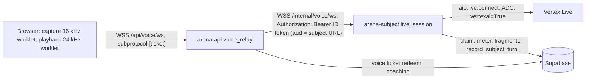

# S5: Backend architecture and lift dossier

Spec part S5 of the Investigative AI Training Arena build specification. Written 2026-10-08 for the build window 2026-10-08 to 2026-11-02.

Governing inputs: `docs/research/synthesis/02-direction.md` v10 (sections 3, 4, 8.3, 9, 10, 11), `docs/challenge/REQUIREMENTS.md` (IDs cited inline), `docs/handoff/DECISIONS.md` (D-001 to D-009; D-007 superseded by D-009), `docs/handoff/PATTERNS.md`, `docs/research/synthesis/cost_model.py` (every dollar figure here is printed by that file or by a script that imports it; see section 4.9). Data definitions (tables, privileged SQL functions, grants, pgTAP) belong to S4 (`docs/spec/sql/`); this part defines the services that call them and the interfaces it needs from S4.

Status markers: **OWNER DECISION PENDING** marks a choice the owner has not made; the design works for either answer. **PROBE** marks a fact this part depends on that must be measured on day 1 (section 12).

---

## 0. Summary

| Area | Decision | Requirements |
| --- | --- | --- |
| Shape | One Python repo (uv workspace), one container image, four Cloud Run deployables selected by `ARENA_ROLE`: `arena-api`, `arena-subject`, `arena-referee` (services), `arena-tournament` (job). Static web built into the image and served same-origin by `arena-api`. | SCN-5, SCN-9, EVL-10, KPI-5 |
| Isolation | Credential per role (S4 roles `arena_public`, `arena_subject`, `arena_referee`); each deployable mounts only its own DSN secret; an AST import linter keeps public code from importing subject or referee modules. | SCN-5, SCN-9, SCN-12, BKO-9 |
| Agent port | Every model call goes through one typed port lifted from TechnoMile `bh_core.providers`: Vertex only, per-call-type limits, at most 4 attempts, reserve before, settle after, one span and one cost row per attempt. | D-001, AST-5, AST-7, BKO-5, EVL-5 |
| Spend guard | Transactional reservation ledger in Postgres at liability rates; caller never supplies an amount; voice reserves its whole-session worst case ($1.64); kill switch read inside every reservation. | D-009, BKO-8, EVL-5 |
| Turns | One open turn per trial; work items and transcript versions make every step idempotent and stale-safe; no work outlives a request. | SCN-4, SCN-10, BKO-7, KPI-4 |
| Streaming | Events written to Postgres; browser reads them through a single-use-ticket SSE stream resumed by sequence number; assessment mode withholds coaching until the debrief. | SOL-6, KPI-4, SCN-10 |
| Voice | Browser to `arena-api` (ticketed WebSocket) relayed to IAM-private `arena-subject`, which holds the Vertex Live session. Only bounded audio frames and four control types cross the relay. Redis primitives replaced by Postgres transactions. Interrupted utterances are partial; scored text comes from played audio. | D-006, SOL-1, PRB-4 |
| Observability | OpenInference plus manual spans; default-deny redaction before export; `ops.trace_mirror` commit is the durability barrier; Phoenix is a viewer; hidden-tournament spans held until reveal. | EVL-5, KPI-4, SCN-12 |
| Deploy | min-instances 0 everywhere, low max-instances, request-based CPU, IAP on `arena-api`, budget alerts at $25/$50/$65, billing-disable at $70, teardown 2026-11-09, scale-to-zero audit that fails on any violation. | D-003, D-008, D-009 |

---

## 1. Repository layout

Python 3.12, uv workspace (pattern: TechnoMile `pyproject.toml` lines 1-58, workspace members, `exclude-newer = "7 days"`, strict mypy at lines 103-118). Package names use the `arena_` prefix.

```
arena/
  pyproject.toml              uv workspace root; ruff, mypy strict, pytest, coverage config
  uv.lock
  Makefile                    `make check` (section 11), lifted from TechnoMile
  Dockerfile                  the one image; web build stage + Python stage (section 9.1)
  docker-compose.dev.yml      local Phoenix only (section 10)
  ATTRIBUTIONS.md             every lift: source path, commit, sha256, what changed (section 2)
  packages/core/src/arena_core/
    config.py                 typed settings per role; boot checks (section 1.3)
    ids.py                    uuid, hashing helpers (sha256 of canonical JSON)
    policy.py                 Vertex-only boot checks, model allowlist per call type
    providers/                the agent port (section 3)
      port.py  vertex.py  structured.py  retry.py  telemetry.py  errors.py  types.py  fake.py
    spend/                    spend guard client (section 4)
      rates.py  limits.py  guard.py  voice.py
    agents/                   schemas and prompt builders shared by roles
      schemas.py              CoachCard, DeepUpdate, FinalFinding, SubjectReply, RefereeLabels (flat, bounded)
      manifests.py            candidate manifest model + sha256 (AST-5, BKO-5)
      fence.py                untrusted-data boundary (gokbase injection_defense lift)
    turns/                    orchestrator used by api and tournament (section 5)
      orchestrator.py  work_items.py  harness.py  replay.py
    events/                   event envelope, projections, SSE framing (section 6)
      envelope.py  projections.py  sse.py
    voice/                    relay protocol types and validators shared by api and subject (section 7)
      protocol.py  tickets.py
    observability/            tracing, export policy, mirror, pump, read-back (section 8)
      tracing.py  export_policy.py  processors.py  spans.py  redaction.py  pii.py  phoenix.py  pump.py  anomaly.py
    db/
      pool.py                 psycopg async pool per role; listener connection (section 6.4)
      calls.py                typed wrappers for S4 privileged functions
    safety/
      guard.py                deterministic subject-output detectors (S2/S3 own rules; this is the runner)
  services/
    api/src/arena_api/        ARENA_ROLE=api
      app.py  auth.py  routes/{sessions,turns,evidence,sse,voice,debrief,telemetry,static}.py
      subject_client.py  voice_relay.py  kill.py
    subject/src/arena_subject/ ARENA_ROLE=subject
      app.py  answer.py  live_session.py  live_meter.py  retranscribe.py
    referee/src/arena_referee/ ARENA_ROLE=referee
      app.py  routes/{label,score,adjudicate,reveal,generate,admin}.py
    tournament/src/arena_tournament/ ARENA_ROLE=tournament
      main.py  roster.py  blocks.py  admission.py
  web/                        static front end (UI part); `web/dist` copied into the image
  supabase/migrations/  supabase/tests/   owned by S4
  ops/billing_guard/          billing-disable function source (section 9.6)
  scripts/
    deploy.sh  teardown.sh  audit_gcp_cost.sh  audit_gcp_cost.py  kill_switch.sh
    budget_plan.py            prints bucket ceilings from cost_model.py (section 4.4)
    run_local.py              local four-role launcher (section 10)
  tools/                      gates lifted from TechnoMile (section 11)
    check_no_rigging.py  check_silent_except.py  check_ratchet.py  check_push_clean.py
    check_deps_policy.py  check_licenses.py  check_scope.py  check_roles.py  check_cost_parity.py
    gates/ratchet.toml  gates/suppressions-allowlist.toml  gates/suppression-markers.toml
  .github/workflows/  .github/dependabot.yml  .github/PULL_REQUEST_TEMPLATE.md  .github/instructions/
  docs/                       research, spec, handoff (exists)
```

### 1.1 Module map and responsibilities

| Module | Runs in | Holds credential | Responsibility | Must never |
| --- | --- | --- | --- | --- |
| `arena_core.providers` | all roles | Vertex ADC of the running service account | The only `google.genai` importer; one path for every model call | Read an API key; retry inside the SDK; ask for more output than the call type allows |
| `arena_core.spend` | all roles | role DSN | Reserve, settle, voice reservation and metering, kill-switch reads | Compute a reservation amount client-side for the database to trust |
| `arena_core.turns` | api, tournament | `arena_public` | Turn orchestration, work items, interviewer harness, replay scoring loop | Read subject or evaluator tiers; hold work past a request or job task |
| `arena_core.events` | api | `arena_public` | Event envelope, typed projections, SSE framing | Emit a frame outside the projection for the viewer's mode |
| `arena_core.voice` | api, subject | none | Frame schemas, size limits, ticket shape | Carry provider handles, prompts or tool payloads |
| `arena_core.observability` | all roles | role DSN (mirror insert only) | Tracing install, redaction, mirror, Phoenix export and read-back | Export a span before redaction; export hidden spans before reveal |
| `arena_api` | `arena-api` | `arena_public` | Investigator REST, SSE, voice relay edge, coaching calls, static web | Import `arena_subject` or `arena_referee` |
| `arena_subject` | `arena-subject` | `arena_subject` | `answer()`, guard, `record_subject_turn()`, Live voice sessions, retranscription | Accept browser traffic; import `arena_referee` |
| `arena_referee` | `arena-referee` | `arena_referee` | Generation and validation, independent labels, scoring, adjudication, reveal, leaderboards | Be invoked by a browser |
| `arena_tournament` | `arena-tournament` job | `arena_public` | Frozen roster, block scheduling, harness trials, unit admission | Read subject or evaluator tiers |

### 1.2 Role boundaries enforced in code (SCN-5, SCN-9, EVL-10)

1. **Credentials.** Each deployable mounts exactly one DSN secret (section 9.4). The boot check (1.3) refuses to start when a DSN for another role is present in the environment.
2. **Imports.** `tools/check_roles.py` (AST, pattern from TechnoMile `tools/check_adk_scope.py` lines 1-20) fails `make check` when: `arena_api` or `arena_tournament` imports `arena_subject`, `arena_referee` or `arena_core.agents.subject_prompts`/`referee_prompts`; `arena_subject` imports `arena_referee`; any module other than `arena_core.providers.vertex` imports `google.genai`; any module imports `google.adk` (the typed port replaces ADK, direction DM-1).
3. **Assistant context type.** The coach prompt builder accepts only `PublicTrialView` (a frozen Pydantic model built from the `arena_public` projection). A type test asserts the builder's signature and that `PublicTrialView` has no field from the S4 private or evaluator column lists.

### 1.3 Boot checks (every role)

| Check | Source | Failure |
| --- | --- | --- |
| No `GOOGLE_API_KEY` or `GEMINI_API_KEY` in env | TechnoMile `providers/policy.py` lines 91-96 (`refuse_gemini_api_keys`) | Exit 1 (D-001) |
| `ARENA_GCP_PROJECT` set explicitly and not `kbg-production` | PATTERNS.md permission walls | Exit 1 |
| Exactly one role DSN present, matching `ARENA_ROLE` | new | Exit 1 |
| `ARENA_ENV=local` features (dev auth, fake model, local service token) refused when `K_SERVICE` is set (Cloud Run) | new | Exit 1 |
| Tracing installed before any instrumented import | TechnoMile `observability/tracing.py` lines 141-160 | Exit 1 |

### 1.4 Acceptance criteria (layout)

- `uv sync --locked` from a clean clone creates one environment with all four service packages; `docker build .` produces one image whose entrypoint runs the role in `ARENA_ROLE`.
- `make check` fails on a seeded file in `services/api` that imports `arena_subject.answer` (gateproof test).
- Starting the image with `ARENA_ROLE=api` and `ARENA_SUBJECT_DSN` set exits non-zero with a message naming the extra secret.
- Starting any role with `GEMINI_API_KEY` set exits non-zero.

---

## 2. Lift dossier

Reference repos are read-only (D-002). Lifting means copying into this repo with attribution in `ATTRIBUTIONS.md` (source path, commit, sha256 of the source file at that commit, what changed), the practice TechnoMile already follows (`docs/ATTRIBUTIONS.md`). Commits read on 2026-10-08: TechnoMile `b5f1de3`; Pangea `adapi-av2` `c44f86ba`; gokbase backend `cc0b13a`, frontend `0371855`, recruiter-backend `b9a8f59`; cloudforce `542a0bb`.

Provenance and licence: TechnoMile, gokbase and cloudforce are the owner's own projects (cloudforce carries an MIT licence, copyright Satvik Balla; the others carry no licence file and are internal). Pangea `adapi-av2` is a PangeaChat repository (no licence file; employer code). **OWNER DECISION PENDING (D-P5):** whether Pangea code may be copied. Default until answered: lift Pangea patterns only through TechnoMile's rewrite (TechnoMile already rewrote `otel_tracing.py` into its own `tracing.py`/`processors.py`, per its `ATTRIBUTIONS.md`), and adapt Pangea's CI workflow structure (generic GitHub Actions configuration, rewritten for this repo). No Pangea source line is copied verbatim under the default.

Verdicts: **Lift** = copy with renames only. **Adapt** = copy, then change as stated. **Pattern** = reimplement the mechanism.

### 2.1 TechnoMile (`/Users/balla/Desktop/satvik/2026 Fall/Challenge X/TechnoMile Agentic Black Hat`)

| # | Source (path:lines) | Target | Verdict | What changes |
| --- | --- | --- | --- | --- |
| T1 | `packages/core/src/bh_core/providers/policy.py:91-96` (`refuse_gemini_api_keys`), `:80-88` (data class) | `arena_core/policy.py` | Adapt | Drop OpenRouter/Jev/loopback rules (`:19-77`); keep API-key refusal; data classes become `public`, `subject_private`, `evaluator` (all Vertex-only, so the check becomes "model allowed for call type", section 3.3). |
| T2 | `providers/retry.py:1-21` | `providers/retry.py` | Lift | Default `max_attempts` becomes 3 transient attempts inside a 4-attempt total (section 3.4). |
| T3 | `providers/budget.py:1-74` (`RunBudget` reserve/check_admission/settle) | `spend/guard.py` | Adapt | In-memory per-run cap replaced by calls to S4's transactional SQL (section 4.6), because several processes share one ceiling. The method names and fail-closed semantics are kept; the in-memory class survives only as the test double. |
| T4 | `providers/telemetry.py:18-32` (`llm_span`) | `providers/telemetry.py` | Lift | Span name `llm.<call_type>`; attributes from section 8.2. |
| T5 | `providers/structured.py:47-135` (`lint_schema`, `vertex_schema`, `parse_output`) | `providers/structured.py` | Lift | Unchanged: flat bounded schemas, every field required, no repair of truncated JSON. |
| T6 | `providers/port.py:246-262` (`_structured` repair loop), `:462-567` (`_with_retries`, `_attempt_once`), `:686-727` (`_charge`, `_record`) | `providers/port.py` | Adapt | One route only (no failover ladder `:372-450`); repairs capped at 1 (TechnoMile default 2, `:81`); total attempts capped at 4 across repairs and transient retries (cost model `ATTEMPTS`); reservation once per logical call for 4 attempts, settled once with the summed usage, one `ops.model_calls` row per attempt; free-tier cooldowns (`:84-89`) removed. |
| T7 | `providers/adapters/vertex.py:109-192` | `providers/vertex.py` | Adapt | `max_output_tokens` set to the call type's output limit, not the model maximum (`:118-121` asks for 65,536, which would invalidate every reservation); `HttpRetryOptions(attempts=1)` so the SDK never retries on its own (google-genai defaults to 5 attempts, X3 section 6); `location` from config (`global` for text). `_parse` (`:161-192`) kept: thinking tokens billed as output, MAX_TOKENS and safety stops typed. |
| T8 | `providers/pricing.py:52-62` (`VERTEX_GLOBAL_PRICES`), `:127-138` (`cost`) | `spend/rates.py` | Adapt | Table replaced by the D-009 liability rates (section 4.2); settlement uses liability rates, never promotional ones (TechnoMile settles 3.8 Flash at the promo, `:64-67`, `:105-117`). |
| T9 | `providers/ledger.py:11-34` (`CostRecord`) | `spend/guard.py` | Adapt | Adds `reservation_id`, `work_item_id`, `call_type`, `bucket`; written to S4 `ops.model_calls`. |
| T10 | `services/run/src/bh_run/tail/a2a.py:221-240` (`typed_turn`) | `providers/port.py` | Pattern | Folded into the port's structured path (T6). |
| T11 | `observability/export_policy.py:1-491` (default-deny `Sanitizer`, `KNOWN`, cost-attribute rename `:45-52`) | `observability/export_policy.py` | Adapt | Allowlists rewritten for `arena.*` keys (section 8.2); `STAGES`, `_PHASE`, claim ids removed; Class C = `subject_private` and `evaluator` spans. |
| T12 | `observability/spans.py:76-174` (anchor, `node`, `agent`, `bridge`) | `observability/spans.py` | Adapt | Hierarchy session > trial > turn > agent > LLM (section 8.1); trial anchor ids stored on the trial row (pattern of `supabase/migrations/20260927001000_trace_mirror.sql:15-55`). |
| T13 | `observability/tracing.py:41-211` (`install`, `Tracing.flush`, SIGTERM flush `:280-292`) | `observability/tracing.py` | Adapt | ADK instrumentation replaced by OpenInference google-genai instrumentation (PROBE P7); `mode="api"` for services (synchronous export), `mode="job"` for the tournament (batch, flush at block boundaries and SIGTERM). |
| T14 | `observability/processors.py:240-284` (`Redactor`), `:331-568` (`SpanRow`, `PostgresMirrorSink`, `SpanMirror`), `:570-655` (`RecordingExporter`), `:656-664` (`EndedSpans`) | `observability/processors.py` | Adapt | The mirror stores the full sanitized OTLP span (bounded 32 KB), not TechnoMile's payload-free 4 KB row (`trace_mirror.sql:57-74`), because the direction re-exports from it (section 8.4). An `ExportGate` processor is added (section 8.5). |
| T15 | `observability/phoenix.py:1-174` (read-back of `GET /v1/projects/{project}/spans`), `observability/ack.py:116-147` (`confirm`) | `observability/phoenix.py` | Lift | Pin the same Phoenix image (`arizephoenix/phoenix:version-20.16.0`). |
| T16 | `observability/redaction.py:278-362` (`is_credential_name`, `hash_payload`, `Redaction`) | `observability/redaction.py` | Lift | Credential masking for every exported string. |
| T17 | `supabase/migrations/20260927001000_trace_mirror.sql:1-115` | S4 migration (`ops.trace_mirror`, `ops.trace_summaries`) | Adapt (S4) | Columns per section 8.4. |
| T18 | `supabase/migrations/20261001000100_api_live.sql:24-110` (`ops.sse_tickets`, `mint_sse_ticket`, `redeem_sse_ticket`) | S4 migration | Adapt (S4) | Ticket bound to (user, trial, mode); same 60 s life, sha256-only storage, single conditional UPDATE. |
| T19 | `services/api/src/bh_api/routes.py:734-810` (`mint`, `events`, `stream`), `services/api/src/bh_api/deps.py:27` (`stream_max_s`) | `arena_api/routes/sse.py`, `arena_core/events/sse.py` | Adapt | Replay `seq > after` through the mode projection, then wait on a wake-up (section 6.4). |
| T20 | `web/src/lib/sse/ticketed-stream.ts:1-206` (itself lifted from gokbase `frontend/src/lib/sse/ticketed-stream.ts:1-249` with the resume fix) | `web/src/lib/sse/ticketed-stream.ts` | Lift | Backoff for the coaching stream shortened to 250 ms x attempt, capped at 2 s (the donor's 2 s x attempt, capped 15 s, would by itself exceed KPI-4 on a reconnect; I7). |
| T21 | `Makefile:1-194` | `Makefile` | Adapt | Drop `verifier*` targets (`:196-223`), `adk-scope`, Chromium install; add `roles`, `cost-parity`, `db-test` (section 11). Thresholds unchanged (`:21-26`). |
| T22 | `tools/gates/ratchet.toml` (543 lines), `tools/check_ratchet.py:1-236` | `tools/` | Lift | Entries re-pointed to this repo's files; directions and values unchanged. |
| T23 | `tools/check_no_rigging.py:1-163`, `tools/check_silent_except.py:1-149`, `tools/check_push_clean.py:1-113`, `tools/check_deps_policy.py`, `tools/check_licenses.py`, `tools/check_scope.py`, `tools/check_codeql.py`, `tools/proc.py`, `tools/gates/*.toml` | `tools/` | Lift | Roots renamed (`SCANNED_ROOTS`, `PY_SOURCES`). Their tests under `tools/tests/` lifted too. |
| T24 | `tools/check_adk_scope.py:1-194` | `tools/check_roles.py` | Adapt | Same AST walker; rules replaced by section 1.2 item 2. |
| T25 | `scripts/audit_gcp_cost.py:1-385`, `scripts/audit_gcp_cost.sh:1-123`, `tools/tests/test_audit_gcp_cost.py` + fixtures | `scripts/audit_gcp_cost.{py,sh}` | Adapt | Project guard set to the arena project and refuses `kbg-production`; `INTERNAL_ONLY` becomes `arena-subject`, `arena-referee` with invoker allowlists (section 9.7); new rules: `arena-api` and Phoenix must have IAP enabled; per-service max-instances ceilings; the billing guard function is allowed. |
| T26 | `scripts/demo/deploy_demo.sh:1-431`, `scripts/demo/teardown_demo.sh:1-95` | `scripts/deploy.sh`, `scripts/teardown.sh` | Adapt | `--plan` dry-run mode kept; services per section 9.2; teardown ends with the cost audit (as donor). |
| T27 | `services/api/Dockerfile:1-28` (digest-pinned uv and python base, non-root uid 10001) | `Dockerfile` | Adapt | No Chromium; one image for all roles; web build stage added. |

### 2.2 Pangea `adapi-av2` (`/Users/balla/PangeaChat/adapi-av2`); see D-P5 above

| # | Source (path:lines) | Target | Verdict | What changes |
| --- | --- | --- | --- | --- |
| P1 | `app/assistant/otel_tracing.py:123-201` (redacting `SpanProcessor` ahead of the exporter; `llm.token_count.*` rename), `:217-263` (dedicated provider, endpoint-gated no-op) | via TechnoMile T13/T14 | Pattern | Taken through TechnoMile's rewrite; not copied directly. |
| P2 | `app/assistant/service.py:435-480` (`_start_turn_span`, `_end_turn_span`), `:1075-1090` (attach as current context across retries), `:1643-1650` (end in `finally`) | `arena_core/turns/orchestrator.py` | Pattern | One `arena.turn` span made current around the turn's subject call, coaching call and every retry; cost stamped as a string from `ops.model_calls`. |
| P3 | `docker-compose.observability.yml:1-48` | `docker-compose.dev.yml` | Pattern | Pinned Phoenix tag, auth on, ports bound to 127.0.0.1, `PHOENIX_SECRET` required. |
| P4 | `.github/workflows/test.yaml:1-137` (ruff, format, mypy, pytest `--cov-fail-under=90`, PR diff-cover 90, Postgres service with health check) | `.github/workflows/ci.yml` | Adapt | Runs `make py-check db-test web-check`; mypy strict (Pangea's own config is non-strict, I4 contradiction 2); Postgres image with pgTAP. |
| P5 | `.github/workflows/bandit.yml:1-69` (two-pass `-ll -ii` then `-t B105,B106,B107`, `pipefail`) | `.github/workflows/security.yml` | Adapt | Same two passes over `packages services tools scripts`. |
| P6 | `.github/workflows/codeql.yml:1-91` (fail-closed on SARIF count, `upload: never`) | `.github/workflows/codeql.yml` | Adapt | Languages `python`, `javascript-typescript`. |
| P7 | `.github/workflows/secret-scan.yml:1-40` (TruffleHog verified, PR commit range) | `.github/workflows/security.yml` | Adapt | Plus gitleaks as in `make check`. |
| P8 | `.github/workflows/pr-title.yaml:1-65` | `.github/workflows/pr-title.yml` | Adapt | Conventional prefixes per PATTERNS.md. |
| P9 | `.github/workflows/deploy.yaml:150-166` (assert `run.invoker` is exactly the allowed service accounts after every deploy) | `scripts/deploy.sh` step | Pattern | Applied to `arena-subject` and `arena-referee` (section 9.3). |

### 2.3 gokbase (`/Users/balla/Desktop/satvik/gokbase-org`)

| # | Source (path:lines) | Target | Verdict | What changes |
| --- | --- | --- | --- | --- |
| G1 | `backend/app/rag/live/session.py:1182-1344` (`LiveVoiceSession` construction), `:1345-1396` (`_build_config`), `:1847-1936` (`receive_loop`, `_consume`), `:2203-2244` (`safety_loop`), `:2470-2534` (`run`, `_mark_suspended`), `:2660-2735` (`_pump_client_audio`), `:2736-2766` (`close`: terminal flag set before any await) | `arena_subject/live_session.py` | Adapt | `_client()` (`:1397-1408`) becomes `genai.Client(vertexai=True, project, location)` with ADC; model from config (`gemini-3.8-live` primary, `gemini-live-2.5-flash-native-audio` fallback, PROBE P4); KB tools (`:569-768`) and TOC prompt removed; subject prompt built from the private packet (S2/S3); the pump reads relay frames from `arena-api` instead of a browser socket; Redis spend and resume replaced by Postgres (section 7.6); no `thinking_config` (`:1393` note: it kills audio); affective dialog and proactive audio set per model (X7 section 2). |
| G2 | `session.py:315-487` (`LiveCostMeter`: per-modality accumulation, never diffing cumulative counts, honesty states) | `arena_subject/live_meter.py` | Adapt | Rates are the voice liability rates (section 4.2); every frame's delta goes through `ops.meter_voice` (section 4.7). |
| G3 | `session.py:231-259` (close codes and end causes) | `arena_core/voice/protocol.py` | Adapt | Adds 4400 (protocol violation) and 4423 (kill switch); section 7.5. |
| G4 | `backend/app/api/api_v1/endpoints/voice.py:311-400` (ticket mint), `:412-440` (Origin check, subprotocol), `:596-899` (WS route: Origin before ticket consumption, subprotocol echo, single-use consume, eligibility re-check after consume, row inserted before connect) | `arena_api/routes/voice.py`, `arena_api/voice_relay.py` | Adapt | Profile-subdomain Origin allowlist becomes same-origin; `getdel` on Redis becomes S4's ticket redeem function; eligibility = (user, trial, split = development, mode). |
| G5 | `backend/app/rag/live/events.py:117-260` (`insert_session`, `TurnWriter` per-fragment seq-ordered writes), `:261-336` (`finalize_session`) | `arena_subject/live_session.py` + S4 `training.voice_events` | Adapt | Fragments persisted as written; turn boundaries rebuilt as in `audit.py` (G6). |
| G6 | `backend/app/rag/live/audit.py:1-150` (turn reconstruction from fragment rows) | `arena_subject/live_session.py` | Lift | Only the fragment-to-turn reconstruction; the KB groundedness judge is not lifted. |
| G7 | `backend/app/rag/live/quotas.py:245-316` (`check_and_reserve`, fail-closed pre-mint gate) | S4 `ops.voice_quota` check inside ticket mint | Pattern | Day buckets in Postgres. |
| G8 | `backend/app/rag/v3/injection_defense.py:51-109` (`sanitize_untrusted_text`, `wrap_evidence` with per-call salt) | `arena_core/agents/fence.py` | Lift | Applied to every transcript span placed in a coach or referee prompt and to Live tool payloads (direction 6.1 safety). |
| G9 | `frontend/src/sections/knowledge-base/public/voice/voiceMachine.ts:1-234` (pure reducer, frame whitelist, close-code taxonomy) | `web/src/lib/voice/voiceMachine.ts` | Adapt | States add `coach-working`, `turn-committed`; frame whitelist per section 7.3; terminal code set per section 7.5. |
| G10 | `frontend/src/sections/knowledge-base/public/voice/useVoiceSession.ts:406-431` (resume backoff 500/1000/2000 ms, 3 attempts, `["voice-resume", token]` subprotocol) | `web/src/lib/voice/useVoiceSession.ts` | Adapt | Mint endpoint and ticket shape per section 7.2. |
| G11 | `frontend/src/sections/knowledge-base/public/voice/audioController.ts:1-338` (two AudioContexts at 16 kHz and 24 kHz, `flush()` at `:238`, amplitude taps) | `web/src/lib/voice/audioController.ts` | Lift | Forwards playback acknowledgements (G13). |
| G12 | `frontend/public/worklets/capture-processor.js:1-56` | `web/public/worklets/capture-processor.js` | Adapt | `CHUNK_SIZE` 4000 (250 ms) becomes 1600 (100 ms), inside the 20-100 ms range the Live docs recommend (X7 section 2). |
| G13 | `frontend/public/worklets/playback-processor.js:1-77` | `web/public/worklets/playback-processor.js` | Adapt | Chunks carry an utterance number; the worklet posts `{type:'played', utterance, samples}` every 250 ms and on `clear` with the exact samples rendered. The donor reports nothing, and played-sample counts are what playback-grounded transcripts need (section 7.7). |
| G14 | `recruiter-backend/app/matching/rubrics.py:1-219` (blake2b rubric hash with lineage) | `arena_core/agents/manifests.py` | Pattern | sha256 of canonical manifest JSON; owned by the scoring part for rubrics. |

### 2.4 cloudforce (`/Users/balla/Desktop/satvik/Summer Internship/cloudforce/backend`, MIT)

| # | Source (path:lines) | Target | Verdict | What changes |
| --- | --- | --- | --- | --- |
| C1 | `observability/redaction.py:1-136` (`redact_headers`, `redact_text`, `redact_json`; bearer-before-email ordering; separator-requiring phone regex) | `arena_core/observability/pii.py` | Lift | Applied to investigator free text before it is logged or mirrored, and as a second pass inside the span Redactor. |
| C2 | `observability/anomaly_detectors.py:87-131` (`mad_z`, `severity_for`, 1.4826 scale, 3.5 / 2.5 thresholds) | `arena_core/observability/anomaly.py` | Lift | Detectors over per-candidate coaching latency and per-block cost (section 8.8); the product-specific detectors (`:132-585`) are not lifted. |

### 2.5 External (Apache-2.0 Google sample)

| # | Source | Target | Verdict | What changes |
| --- | --- | --- | --- | --- |
| E1 | Google Cloud "Disable billing usage with notifications" sample (`docs.cloud.google.com/billing/docs/how-to/disable-billing-with-notifications`, checked 2026-10-08) | `ops/billing_guard/main.py` | Adapt | Rewritten in Python with `google-cloud-billing`; disables at `costAmount >= 70`, not at the budget amount; `DRY_RUN` env for the day-1 test (section 9.6). |

### 2.6 Acceptance criteria (lift)

- `ATTRIBUTIONS.md` has one entry per row above that was copied (Lift or Adapt), naming source path, commit and sha256.
- Every lifted Python file passes the same gates as new code (strict mypy, 90% branch coverage, bandit); no lifted file is excluded from any gate.
- Lifted tests come with their modules (TechnoMile `tools/tests/*`, the `test_audit_gcp_cost.py` fixtures) and pass in this repo.

---

## 3. Agent port

Direction section 6 and DM-1: agents are stateless, schema-bound calls through one typed port. Covers D-001, AST-5, AST-7, AST-8, BKO-5 (equal budgets), EVL-5 (cost, latency).

### 3.1 Interface

```python
class CallType(StrEnum):
    SUBJECT = "subject"; CARD = "card"; DEEP = "deep"; FINAL = "final"
    REFEREE = "referee"; GENERATE = "generate"; VALIDATE = "validate"
    RETRANSCRIBE = "retranscribe"; PORTRAIT = "portrait"

@dataclass(frozen=True, kw_only=True)
class CallContext:
    call_type: CallType
    bucket: Bucket                      # section 4.4
    work_item_id: UUID | None           # turn work (section 5)
    trial_id: UUID | None
    split: Literal["dev", "hidden", "none"]
    data_class: Literal["public", "subject_private", "evaluator"]
    parent_reservation_id: UUID | None  # voice sessions only (section 4.7)
    candidate_manifest_sha: str | None  # tournament calls (AST-5)

@dataclass(frozen=True, kw_only=True)
class AgentCall[T: BaseModel]:
    model: VertexModel                  # enum of allowed ids
    thinking: ThinkingLevel             # minimal | low | medium | high
    system: str
    messages: tuple[Message, ...]       # text only; audio only for RETRANSCRIBE
    schema: type[T]                     # flat, bounded (structured.lint_schema)
    context: CallContext

@dataclass(frozen=True)
class AgentResult[T]:
    value: T
    attempts: int                       # 1..4
    usage: Usage                        # summed input, output (incl. thinking), cached
    cost_usd: Decimal                   # settled, liability rates
    latency_ms: float                   # first attempt start to validated value
    trace_id: str; span_id: str

class AgentPort(Protocol):
    async def run[T: BaseModel](self, call: AgentCall[T]) -> AgentResult[T]: ...
```

Every failure ends in a typed error: `BudgetRefused`, `KillSwitchOn`, `PolicyRefused`, `InputTooLarge`, `StructuredOutputError`, `ProviderBlocked`, `ProviderFailed` (TechnoMile `errors.py:92-151` shape).

### 3.2 Pipeline (one logical call)

1. Policy: model in the call type's allowlist (3.3); data class allowed; manifest sha matches the frozen roster when `candidate_manifest_sha` is set.
2. Input bound: estimated input tokens = `ceil(chars / 3)` (TechnoMile `pricing.py:141-143`, conservative) plus schema size must be at most the call type's input limit, else `InputTooLarge`. Prompt builders window the transcript to fit; the port never truncates silently.
3. Reserve: `ops.reserve_spend(...)` (4.6) for the call type's 4-attempt worst case. The database computes the amount and reads the kill switch in the same transaction.
4. Attempt loop (at most 4 attempts in total): one `llm.<call_type>` span per attempt; per-attempt timeout (3.3); `max_output_tokens` = output limit; SDK retries off; transient errors (429, 408, 5xx, timeout) retried with full-jitter backoff (T2) while attempts remain; a schema failure gets one repair re-prompt (T6) while attempts remain.
5. Settle: `ops.settle_spend(...)` with summed usage; an attempt with unknown usage that may have been billed is charged at its per-attempt worst case and flagged `cost_estimated` (T6 `_charge`); one `ops.model_calls` row per attempt.
6. Return the validated value or raise.

### 3.3 Per-call-type limits and allowlist (D-009 lineup, `cost_model.py` `LIMITS`, `d009`)

| Call type | Input limit (tokens) | Output limit incl. thinking | Allowed models | Thinking | Per-attempt timeout | Used by |
| --- | --- | --- | --- | --- | --- | --- |
| `subject` | 6,000 | 1,600 | `gemini-3.1-flash-lite`, `gemini-3.5-flash-lite` | minimal | 15 s | `arena-subject` |
| `card` | 6,000 | 1,600 | `gemini-3.5-flash-lite`, `gemini-3.1-flash-lite` | minimal | 6 s | `arena-api`, tournament |
| `deep` | 7,000 | 3,000 | `gemini-3.5-flash-lite` | minimal | 15 s | A1 only |
| `final` | 7,000 | 3,000 | `gemini-3.5-flash-lite`, `gemini-3.1-flash-lite` | minimal | 20 s | coaches |
| `referee` | 12,000 | 4,000 | `gemini-3.1-flash-lite` (low), `gemini-3.5-flash-lite` (minimal) | per row | 60 s | `arena-referee` |
| `generate` | 12,000 | 40,000 | `gemini-3.1-pro-preview` | high | 600 s | `arena-referee` |
| `validate` | 20,000 | 4,000 | `gemini-3.5-flash-lite` | low | 120 s | `arena-referee` |
| `retranscribe` | 15,860 (480 s x 32 + 500) | 2,000 | `gemini-3.5-flash-lite` (audio input) | minimal | 60 s | `arena-subject` |
| `portrait` | per image | per image | Gemini image model on Vertex (UI part names it) | n/a | 60 s | `arena-api` (demo bucket, count-capped at 30) |

Candidate manifests (AST-5, BKO-5) carry model, prompt sha, tools (none), coaching policy, max input tokens, max output tokens, thinking level and timeout. A manifest value above its call-type limit is rejected when the roster freezes; the same limits apply to every candidate of a call type, which is the "equal budgets" reading in REQUIREMENTS section 12 item 3.

The `retranscribe` row is new relative to `cost_model.py`, which prices retranscription at a flat $0.016 per minute (Chirp 3's rate). D-001 requires a Gemini model, so this spec uses Gemini audio input and keeps the cost model's dollar line as the reservation for it (see open question Q7).

### 3.4 Attempt rule

`ATTEMPTS = 4` = first try + at most one schema repair + at most two transient retries (cost model line 34). The port counts every request it sends, whatever the reason, and stops at 4. This is a hard bound the reservation depends on; TechnoMile's port permits up to 9 sends (3 transient attempts for each of 3 repair rounds, `port.py:81`, `retry.py:9`), and google-genai retries 5 times by default, so both are changed (T6, T7).

### 3.5 Untrusted-data boundary and safety (SUB-7, AST-7)

- Every subject utterance and investigator question placed in a coach, referee or harness prompt passes `sanitize_untrusted_text` and is wrapped with a per-call salt (G8). The system prompt states that wrapped text is data.
- The subject's output passes the deterministic guard (`arena_core/safety/guard.py`) before `record_subject_turn()`; S2/S3 define the detectors; a rejection is passed to the function as `guard_result` so it quarantines atomically (direction 4.2).
- Coaching never receives audio or acoustic features (PRB-4, direction 9 N03): `CallType.CARD|DEEP|FINAL` reject any non-text message part.

### 3.6 Acceptance criteria (agent port)

- A fake adapter that returns invalid JSON three times then valid JSON makes exactly 2 sends for a call (1 + 1 repair), then raises `StructuredOutputError`; a fake that returns 503 four times makes exactly 4 sends and raises; no test configuration produces a fifth send.
- The Vertex request built for every call type has `max_output_tokens` equal to the table's output limit and SDK retry attempts equal to 1 (asserted on the built `GenerateContentConfig`).
- A call whose estimated input exceeds its limit raises `InputTooLarge` before any reservation row exists.
- Each attempt writes one `ops.model_calls` row and one `llm.<call_type>` span whose ids match the row.
- A `card` call with `gemini-3.1-pro-preview` raises `PolicyRefused` before reservation.
- `ThinkingLevel` is sent as `thinking_level`, never `thinking_budget` (X3 section 1: combining both returns 400).
- Coach prompt builder rejects any input type other than `PublicTrialView` (mypy and a runtime test).

---

## 4. Spend guard (D-009)

Direction 8.3: model and voice liabilities are reserved before they are incurred; non-model costs are minimized and backstopped (section 9.6), not hard-capped. S4 owns the DDL (`ops` schema; error codes AR030, AR031). This section is the contract S5 code relies on.

### 4.1 Envelope

| Line | Amount | Source |
| --- | --- | --- |
| D-009 hard cap | $75.00 | D-009 |
| Non-model allowance, set aside (not a ledger bucket) | $15.00 | `NON_MODEL_ALLOWANCE` |
| Model and voice ceiling in the ledger (global row) | $60.00 | 75 - 15 |
| of which demo bucket | $12.43 | `demo_ceiling()` |
| of which model-work buckets | $47.57 | 60 - 12.43 |

### 4.2 Liability rate table (per 1M tokens, verified 2026-10-08; `LIABILITY_PRICES`)

| Model | Input | Output (incl. thinking) | Notes |
| --- | --- | --- | --- |
| `gemini-3.1-flash-lite` | $0.25 | $1.50 | |
| `gemini-3.5-flash-lite` | $0.30 | $2.50 | |
| `gemini-3.1-pro-preview` | $2.00 | $12.00 | Prompts above 200K tokens never occur (input limit 12K) |
| `gemini-3.8-flash` | $1.50 | $7.50 | Reference only; not in any allowlist; promotional $0.75/$3.75 never counted |
| Live (audio in / audio out / text in / text out) | $4.50 / $18.00 / $1.125 / $6.75 | | gokbase rate card x1.5 (`VOICE` x `k=1.5`) until the Vertex 3.8 Live price is confirmed (PROBE P4) |

No batch discount, no cache discount (cost model docstring). Settlement uses these same rates; a lower real bill is upside.

### 4.3 Per-call reservation (4 attempts x (input limit x input rate + output limit x output rate); values from `cost_model.liab_reservation`, printed by `scripts/budget_plan.py`)

| Call type | Model | Reservation |
| --- | --- | --- |
| subject, card | `gemini-3.1-flash-lite` | $0.01560 |
| subject, card | `gemini-3.5-flash-lite` | $0.02320 |
| deep, final | `gemini-3.1-flash-lite` | $0.02500 |
| deep, final | `gemini-3.5-flash-lite` | $0.03840 |
| referee | `gemini-3.1-flash-lite` | $0.03600 |
| referee | `gemini-3.5-flash-lite` | $0.05440 |
| validate | `gemini-3.5-flash-lite` | $0.06400 |
| generate | `gemini-3.1-pro-preview` | $2.01600 |
| voice session (whole session, section 4.7) | Live + 12 cards + retranscription | $1.6357 (shutoff at $1.0905) |
| voice probe (2 exchanges, 60 s) | Live | $0.1321 |

### 4.4 Buckets and ceilings (20-case plan)

Ceilings come from the high column of `simulate_d009` phase costs, rounded up, with the interactive bucket taking the remainder of $47.57. `scripts/budget_plan.py` imports `cost_model.py` and prints this table; the operator applies it with S4's `ops.set_bucket_ceiling`, which refuses any change that makes the model-work buckets sum above $47.57 or the global row above $60.00.

| Bucket | High-case cost (20 cases) | Ceiling |
| --- | --- | --- |
| `demo` (40 text sessions, 8 voice sessions, 30 portraits, plus one in-flight voice reservation) | $10.79 + $1.64 | $12.43 |
| `experiments` (latency benchmark, generation and fidelity pilots, 30 Live probes) | $6.95 | $7.00 |
| `generation` (15 families on Pro, validation) | $7.09 | $7.10 |
| `dev_pilot` (5 dev blocks) | $8.07 | $8.10 |
| `replay` (corpus $0.75 + scoring $3.11) | $3.86 | $3.90 |
| `interactive` (10 blocks) | $16.13 | $21.47 |
| Global (model and voice) | $54.53 | $60.00 |

If the dev pilot's measured costs track the expected column and the owner moves to 26 cases, `budget_plan.py --sealed 26` re-plans the buckets; the global ceiling does not move, so the guard still cannot overshoot (direction 8.2: 26 cases leaves 2 of 13 blocks `budget_skipped` in the conservative case).

### 4.5 Unit admission (soft completeness, direction 8.3)

Before a unit (a block, a replay chunk, a family) starts, the caller asks `ops.admit_unit(bucket, high_cost_usd)`; the database answers `admit` only if the bucket's free headroom is at least 1.5 x the unit's high cost. A refused unit is recorded `budget_skipped`; a unit the per-call guard stops mid-way is `budget_truncated` (S4 execution states). The tournament job computes `high_cost_usd` with the same code `cost_model.py` uses (`arena_core/spend/limits.py` is parity-tested, 4.9).

### 4.6 SQL interface consumed from S4 (names proposed; S4's final names win and the wrappers in `arena_core/db/calls.py` follow)

| Function | Granted to | Caller supplies | Database derives and enforces | Returns |
| --- | --- | --- | --- | --- |
| `ops.reserve_spend(bucket, call_type, model, work_item, idem_key, parent_reservation)` | all three runtime roles | identifiers only | Amount = 4 x limits x liability rate from `ops.call_limits` and `ops.liability_rates`; kill switch off; locks the bucket row and the global row `FOR UPDATE`; settled + open holds + amount at most the ceiling for both; with a parent, at most the parent's remaining hold; idempotent on `idem_key` | `reservation_id`, or AR030 |
| `ops.settle_spend(reservation_id, input_tokens, output_tokens, cached_tokens, usage_known)` | all three | usage | Actual cost at liability rates; unknown usage keeps the whole hold as the charge; settles once | settled amount |
| `ops.record_model_call(...)` | all three | one attempt's `CostRecord` | Append-only | row id |
| `ops.reserve_voice_session(voice_session, kind)` | `arena_subject` | session id, `session` or `probe` | Amount from `ops.call_limits` (`voice_session` 1.6357, `voice_probe` 0.1321); demo or experiments bucket by kind; kill switch | `reservation_id` or AR030 |
| `ops.meter_voice(voice_session, delta_usd)` | `arena_subject` | per-frame cost delta | Adds to the session's metered total; returns `shutoff` when metered + settled children reach two thirds of the hold, or the kill switch is on | `continue` or `shutoff` |
| `ops.settle_voice_session(voice_session)` | `arena_subject` | id | Refuses while child reservations are open (AR031); settles metered total | settled amount |
| `ops.admit_unit(bucket, high_cost)` | `arena_public` (job), `arena_referee` | estimate | 1.5 x rule | `admit` or `skip` |
| `ops.set_kill_switch(on, reason)` | none of the runtime roles (owner via SQL editor, or `scripts/kill_switch.sh`) | flag | Append-only history | |

All money is S4's `ops.usd` domain (`numeric(14,6)`), never float.

### 4.7 Voice whole-session reservation

- Formula (`voice_session_reservation`, cost model lines 427-435): enforced limits 12 exchanges and 480 s of audio; every turn rebills the maximum possible context (480 s x 32 tokens/s); Live rates x1.5; plus 12 card reservations; plus retranscription of 480 s at $0.016/min x1.5. Result $1.6357.
- Reserved by `arena-subject` inside the transaction that claims the voice session, before `live.connect()` runs. Refusal closes the relay with 4413.
- Coaching cards during a voice session reserve as children (`parent_reservation`), drawing on the session hold, so the session cannot be reserved twice.
- `LiveCostMeter` (G2) prices each usage frame at the Live liability rates and calls `ops.meter_voice`; the safety loop (2 s tick, G1) closes with 4413 on `shutoff` at $1.0905 (two thirds), so usage between ticks stays inside the hold (direction 8.3).
- Reference session (12 exchanges, 12 s in, 14 s out): $0.34 expected, $0.69 conservative, at most 468 s of the 480 s allowed (cost model asserts these).

### 4.8 Kill switch

- Read inside every `reserve_spend` and `meter_voice` transaction (no cache), so it stops every new model call and every live voice session within one 2 s tick.
- `arena-api` middleware reads it at most every 5 s and returns 503 `kill_switch` to every `/api/*` route; static assets keep serving a maintenance notice. This is the application-level "turn off public ingress" (direction 8.3); the infrastructure-level step (set `arena-api` ingress to internal) is `scripts/kill_switch.sh --ingress`, a runbook the owner approves once at setup (global infra gate).

### 4.9 Parity with `cost_model.py`

`tools/check_cost_parity.py` (run by `make check`) imports `docs/research/synthesis/cost_model.py` with `python -I` and asserts: S4's seed rows for `ops.liability_rates` equal `LIABILITY_PRICES`; `ops.call_limits` equal `LIMITS` and `ATTEMPTS`; `voice_session` and `voice_probe` amounts equal `VOICE_RESERVATION` and `PROBE_RESERVATION` to 6 decimals; `arena_core/spend/limits.py` produces the same per-call reservations and unit high costs as `liab_reservation` and `liab_cost`. A change to the cost model without a matching migration fails the build.

### 4.10 Acceptance criteria (spend guard)

- Concurrency: 50 parallel `reserve_spend` calls against a bucket with headroom for 10 admit exactly 10 (pgTAP plus a Python integration test against real Postgres).
- With the kill switch on, `reserve_spend` raises and no `ops.model_calls` row is written; a live voice session closes with 4423 within 4 s (two ticks).
- `settle_spend` with `usage_known=false` charges the full hold; a second settle of the same reservation is refused.
- A voice session fed synthetic usage frames worth $1.10 is closed with 4413 by the next tick and its settled amount is at most $1.6357.
- `ops.set_bucket_ceiling` refuses a plan whose model-work buckets sum above $47.57.
- Simulation test: replaying `simulate_d009(20, 10, high=True)`'s call sequence through the real guard (fake Vertex settling at the modeled cost) completes every unit and ends at or below $60.00 ledger spend; with `sealed=26` it ends with `budget_skipped` units and never exceeds $60.00.
- `check_cost_parity.py` fails on a seeded one-cent change to a seed rate (gateproof).

---

## 5. Turn orchestrator

Direction 4.5 and 4.2. Covers SCN-4 and SCN-10 (versioned, timestamped releases; event never changes), BKO-7 (harness), BKO-6 (replay), KPI-4, EVL-5.

### 5.1 Work items and transcript versions

- **Transcript version** `v`: an integer on the trial row that S4's privileged functions increment on every transcript-changing commit (question recorded, subject turn recorded, evidence released, clarification or predeclared context change). Callers never supply turn numbers or hashes.
- **Work item**: a server-created UUID (S4 `arena.work_items`) naming one step of one turn (`ask`, `answer`, `release`, `coach`, `deep`, `finalize`) and the version it was computed against. A retry with the same work item returns the stored result; a write against a stale version is rejected with AR002 and the result discarded.
- **One open turn per trial.** S4's `record_question` sets the trial's open turn; `record_coaching` (or `abort_turn` after 120 s without progress) clears it. A new question while a turn is open returns 409 `turn_in_progress`. This keeps staleness to retries and duplicates only.
- Interface needed from S4 beyond direction 4.2: `record_question(trial, work_item, question_text)` and `record_coaching(trial, work_item, expected_version, card_json, kind)`. If S4 already defines equivalents, S4's names win (Q8).

### 5.2 One interactive turn (practice or assessment, text)

```mermaid
sequenceDiagram
  participant B as Browser
  participant A as arena-api (arena_public)
  participant DB as Supabase
  participant S as arena-subject (arena_subject)
  participant V as Vertex
  B->>A: POST /api/trials/{id}/turns {question, release_ids[], idem_key}
  A->>DB: create work items; record_question() -> v+1
  opt evidence requested
    A->>DB: release_evidence(trial, wi, ids) -> v+1
  end
  A->>S: POST /internal/answer {trial, work_item} (IAM ID token, traceparent)
  S->>DB: load private packet, open question (derived)
  S->>V: subject call (port)
  S->>S: guard
  S->>DB: record_subject_turn(...) -> turn id, v+1, event subject_turn
  S-->>A: {turn_id, version}
  A->>DB: read PublicTrialView at version v
  A->>V: card call (port)
  A->>DB: record_coaching(trial, wi, v, card) -> event coach_card (visibility by mode)
  DB-->>B: SSE frames subject_turn, coach_card (practice) via ticketed stream
  opt candidate A1 deep update due
    A->>V: deep call; record_coaching(kind=deep)
  end
  opt 12 exchanges or committed finding
    A->>DB: finalize_trial(trial, wi, finding)
  end
  A-->>B: 200 {turn_id, version, events_seq_range}
```

Rules:
- All steps run inside the POST request (request-based CPU stays allocated; "no work outlives a request"). App-level deadline for the request: 60 s.
- The client renders from SSE; the POST response carries the sequence range so a client that missed frames re-reads them.
- A retried POST with the same `idem_key` resumes from the first step whose work item has no stored result (each step idempotent by work item).
- Subject quarantine (`record_subject_turn` returns a quarantine record): the turn ends, event `trial_ended{reason:"subject_invalid"}` is emitted with no detail, the trial gets execution state `subject_quarantined` (S4).
- Coach card invalid after the repair, or timed out: event `coach_unavailable`; counts as a KPI-4 miss (direction 7.2); the practice trial continues.
- `BudgetRefused`: event `trial_ended{reason:"budget"}`; tournament trials become `budget_truncated`.
- The A1 deep update (every third exchange and on each release) runs after `coach_card` is recorded, inside the same request, so it never delays the card (direction 4.5).

### 5.3 Harness and tournament reuse (BKO-7, BKO-6)

- `Orchestrator` takes an `Asker`: `HttpInvestigator` (the POST body) or `HarnessAsker` (fixed opening question; relays the assistant's follow-up only if it ends with "?", is at most 40 words, contains no instruction and passes the neutrality lexicon; else the fixed neutral fallback; stops at 12 exchanges or a committed finding; no model calls; direction 6.3).
- In the tournament job the orchestrator runs in-process; the subject call is the same IAM HTTP call to `arena-subject`; trials run sequentially within a block in the recorded seeded order.
- Replay track: `ReplayScorer` walks a sealed corpus transcript turn by turn and runs only the coach calls (card, deep, final) against `PublicTrialView` snapshots at each version; no subject call.
- Infra retry: an `infra_failed` trial is retried twice with the same seed regardless of outcome (direction 7.1); the runner records one execution record per planned trial (S4 `record_execution_failure`).
- The job is resumable: on start it reads the frozen roster and skips planned trials that already have an execution record; job-level retries are 0 (a Cloud Run retry could repeat spend).

### 5.4 Acceptance criteria (orchestrator)

- Replaying the same POST (same `idem_key`) after a crash at each step boundary produces exactly one question, one subject turn and one card (fault-injection test at each of 5 boundaries).
- A card computed at version v and recorded after a release moved the trial to v+1 is rejected (AR002) and not streamed.
- Two concurrent POSTs on one trial: one succeeds, the other gets 409.
- A quarantine at turn 2 leaves no coach card for turn 2 and no later turns.
- Harness: a follow-up of 41 words, one without "?", and one containing "ignore previous instructions" each relay the fixed fallback (table test).
- Assistant-context type test (1.2 item 3) passes; a canary string seeded into a private packet never appears in any coach prompt captured by the fake adapter across a 12-turn trial.
- KPI-4 server segment (`subject_turn` commit to `coach_card` commit) is recorded per turn in `ops.latency_samples` (8.7).

---

## 6. Event store, ticketed SSE and assessment-mode projections

Covers SOL-6 (practice live coaching, assessment saves feedback for the debrief), SCN-10, KPI-4, SCN-5.

### 6.1 Event store

S4 table `arena.trial_events`: `(trial_id, seq)` primary key, `seq` assigned inside the privileged function that commits the event under the trial row lock (gap-free per trial), `kind`, `visibility` (`live` | `debrief` | `internal`), `version`, `payload jsonb` at most 16 KB, `created_at`. Append-only (S4 `tg_forbid_mutation`).

Kinds and visibility:

| Kind | Practice | Assessment | Tournament (hidden) |
| --- | --- | --- | --- |
| `question_recorded`, `subject_turn`, `evidence_released`, `clarification` | live | live | internal |
| `coach_card`, `coach_deep`, `coach_unavailable` | live | debrief | internal |
| `finding_committed` (investigator's own) | live | live | n/a |
| `trial_ended` | live | live | internal |

`internal` events are never streamed to any browser; hidden-split trials have no investigator owner (direction 4.3).

### 6.2 Projection

S4 function `arena.events_after(trial, after_seq, limit)` (security definer for `arena_public`) returns only rows the actor may see: actor owns the trial (`arena.actor_id()`), and `visibility = 'live'`, or `visibility = 'debrief'` and the trial's assessment is closed. Python side: `arena_core/events/projections.py` maps rows to typed frames (pattern TechnoMile `bh_api/events.py:1-40`: one row one frame, row `seq` is the SSE `id`, oversize rows become a `CUSTOM {oversize:true}` frame so the sequence stays gap-free).

### 6.3 Tickets

- `POST /api/trials/{id}/stream-tickets` (Supabase JWT + IAP) mints a 32-byte URL-safe ticket; only its sha256 is stored (S4 `ops.sse_tickets`, T18), bound to (user, trial, mode at mint), 60 s, single use.
- `GET /api/trials/{id}/events?ticket=...&after=N`: redeem is one conditional UPDATE that re-checks ownership and mode; the stream then reads as that actor.
- Client: T20 (`openTicketedStream`), each reconnect mints a fresh ticket and passes the last received `seq` as `after`.

### 6.4 Stream loop and wake-up

- Replay `seq > after` in pages of 200 through the projection, then wait for a wake-up, re-poll at least every 1 s, send `: ping` after 15 s of silence, end at `stream_max_s = 600` (client reconnects). Pattern T19.
- Wake-up: an in-process `asyncio.Event` per trial set by the same instance's writer, plus one `LISTEN arena_events` connection per instance over the Supavisor **session-mode** port (S4 uses transaction-mode pooling for request transactions, where LISTEN does not work). The writer issues `pg_notify('arena_events', trial_id)` inside the commit. If the listener is down, the 1 s re-poll still delivers. **PROBE P3** (LISTEN from Cloud Run through the session pooler).
- `arena-api` runs with Cloud Run session affinity so a browser's SSE stream and its POSTs usually land on one instance (best effort; correctness does not depend on it).
- Cost: an open SSE response keeps an instance billable (X10 Q3). The client closes the stream after 120 s with the tab hidden (Page Visibility API) and on trial end; `stream_max_s` bounds every response.

### 6.5 Acceptance criteria (SSE and projections)

- Assessment mode: an end-to-end test of a 12-turn assessment session receives zero `coach_card` frames before the assessment closes, and all of them, in order, from the debrief stream after it closes.
- A ticket redeemed twice: second redeem returns 401; an expired ticket returns 401; a ticket for trial A used on trial B returns 401; a ticket minted by user A is refused for user B's trial at mint (404, no existence oracle).
- Reconnect with `after=N` delivers exactly the frames with `seq > N`, no duplicates, no gaps (property test over random disconnect points).
- With the listener connection killed, a card committed by another instance reaches the client within 1.2 s.
- Same-instance path: p95 delay from `record_coaching` commit to frame write on the socket below 50 ms in a local benchmark (100 turns).
- Direct requests with an investigator account to every route, SSE and export for a hidden-split trial return 404 (capability matrix, direction 4.3).

---

## 7. Voice relay (D-006, development cases only)

Direction 9 and 4.3. Text stays the scored artifact (SOL-1); voice sessions are recorded `scored = false` and shown in debriefs as practice, not scored, until the delayed-transcription, buffered-unplayed-audio, reconnect and mid-word-interruption tests (7.8) pass.

### 7.1 Topology



`arena-subject` never accepts browser traffic: it is IAM-only with `run.invoker` limited to the `arena-api` and `arena-tournament` service accounts (9.3). `arena-api` builds the internal request from scratch and never forwards inbound headers, which matters because IAP passes an `X-Serverless-Authorization` header that must not reach another IAM-checked service (Cloud Run IAP docs, checked 2026-10-08).

### 7.2 Tickets and session claim (Redis replaced by Postgres)

1. `POST /api/voice/tickets {trial_id}`: requires trial split `dev`, mode `practice` or `assessment`, owner = actor, no open voice session for the trial, per-user daily voice quota (default 2) and global session cap (8 sessions plus 30 probes, `VOICE_SESSIONS`, `LIVE_PROBE`). S4 creates `training.voice_sessions` row (`relay_pending`) and an `ops.voice_tickets` row (sha256, 60 s, single use) bound to (user, trial, split, mode). Returns the ticket.
2. Browser opens `WSS /api/voice/ws` with subprotocol `[ticket]` (never in the URL; G4). `arena-api` checks Origin equals its own origin before consuming anything, echoes the subprotocol, redeems the ticket (one conditional UPDATE, re-checks all four bindings), and opens the internal relay socket.
3. First relay frame `{"type":"start","voice_session":<uuid>}`. `arena-subject` claims the row in one transaction: state `relay_pending` and created within 60 s, split `dev`, mode matches, then `ops.reserve_voice_session` (4.7), state `active`. Any failure closes 4401 (binding) or 4413 (budget).
4. Resume: `arena-subject` issues a rotating resume credential (sha256 stored in S4 `ops.voice_resume`, single use, holds the Live resumption handle server-side; the browser never sees the handle). The browser resumes with subprotocol `["voice-resume", token]`; `arena-api` redeems and re-checks the four bindings; `arena-subject` re-checks them again, checks the session's metered cost is below the shutoff before reopening (G1 resume backstop), and reconnects Live with the stored handle. A missing handle refuses the resume (4503). At most 3 resumes per session.

### 7.3 Application protocol (the only things that cross the relay)

Browser to `arena-api`, re-validated and forwarded unchanged to `arena-subject`:

| Frame | Shape | Limit |
| --- | --- | --- |
| Audio | Binary, PCM16 LE, 16 kHz mono | At most 3,200 bytes (100 ms) per frame; at most 15 frames per second averaged over 2 s |
| `start` | `{"type":"start","voice_session":uuid}` | First frame only (sent by `arena-api`, not the browser) |
| `stop` | `{"type":"stop"}` | Terminal hang-up (close 1000) |
| `interrupt` | `{"type":"interrupt"}` | Investigator barge-in via button; server flushes model audio |
| `played` | `{"type":"played","utterance":int,"samples":int}` | Playback acknowledgement (7.7); at most 8 per second |

Every text frame is at most 512 bytes and is validated against a closed JSON schema (`arena_core/voice/protocol.py`); anything else closes 4400. There is no frame for prompts, tool calls, tool results, configuration or provider handles: Live setup, the private prompt, tool payloads and resumption handles stay inside `arena-subject` (direction 4.3, R3-02).

`arena-subject` to `arena-api` to browser:

| Frame | Shape |
| --- | --- |
| Audio | Binary, PCM16 LE, 24 kHz mono, at most 9,600 bytes (200 ms) per frame, always inside an open utterance |
| `utterance_start`, `utterance_end` | `{"type":..., "utterance":int}` |
| `transcription` | `{"type":"transcription","role":"investigator"|"subject","text":str<=500,"partial":bool}` |
| `interrupted` | `{"type":"interrupted","utterance":int}` |
| `turn_committed` | `{"type":"turn_committed","turn_id":uuid,"version":int}`: `arena-api` runs the coaching card (section 5) and the card arrives on the SSE stream |
| `timer_tick`, `warning`, `ended` | as G9, no cost fields |
| `resume` | `{"type":"resume","token":str,"expires_in":int}` |

`arena-api` drops any subject frame outside this allowlist (defence in depth, G9 `frameToEvent` default branch).

### 7.4 Session lifecycle in `arena-subject`

- Live config (G1 `_build_config`, adapted): `response_modalities=["AUDIO"]`, input and output transcription on, automatic activity detection with `silence_duration_ms=700`, prebuilt voice per subject style (S3), session resumption, no `thinking_config`, no tools in the first slice (evidence release stays a REST action through `arena-api`; mid-session state changes reach the model through the next turn's context, not a prompt mutation, I5 section 3).
- Loops: `receive_loop` (Live to relay; fragments persisted per write, G5), `safety_loop` (2 s tick: 480 s audio cap, 12 exchanges, 90 s idle, meter shutoff, kill switch), relay pump (relay to Live). Terminal close sets the terminal flag before any await (G1 `close`), so a kill can never become a resumable suspend.
- Turn commit: at `turn_complete` with both an investigator input transcription and a subject utterance, `arena-subject` reconstructs the turn from fragments (G6), runs the guard, and calls `record_subject_turn()` with the input transcription as the question text and the subject utterance marked `partial` if interrupted. Voice turns therefore enter the same transcript, versioning and coaching path as text turns.
- Investigator questions in voice are recorded through the subject's call because the question only exists as a Live input transcription inside `arena-subject`; S4 grants `arena_subject` a narrow `record_voice_question` (or `record_subject_turn` accepts the question text for voice sessions). Q8 covers this.

### 7.5 Close codes

| Code | Meaning | Terminal |
| --- | --- | --- |
| 1000 | Normal end (stop, duration cap) | yes |
| 4400 | Protocol violation (bad frame, oversize, rate) | yes |
| 4401 | Ticket or binding refused | yes |
| 4403 | Origin refused | yes |
| 4404 | Session not found | yes |
| 4408 | Idle 90 s | yes |
| 4413 | Cost shutoff or reservation refused | yes |
| 4423 | Kill switch | yes |
| 4503 | Resume failed | yes |
| other (1006, 1011) | Transport drop | no: resume |

### 7.6 Redis primitives replaced

| gokbase Redis use | Arena replacement (S4 tables, one transaction each) |
| --- | --- |
| `voice_ticket:{token}` with `getdel` | `ops.voice_tickets`: sha256 key, conditional UPDATE `used_at` |
| `voice_resume:{token}` credential with carried cost and handle | `ops.voice_resume`: sha256 key, single use, handle column readable by `arena_subject` only |
| `voice_spend:{session}` shared counter (cross-leg cap) | `training.voice_sessions.metered_usd` updated by `ops.meter_voice` under the row lock; every leg reads the same row |
| Day-bucket quotas | `count(*)` over `training.voice_sessions` per user per UTC day inside the mint function |

### 7.7 Playback-grounded transcripts (F10)

- Live output transcription has no word timings and no ordering guarantee, so an interrupted utterance cannot be cut at the word the investigator heard.
- The playback worklet (G13) reports played samples per utterance; the browser forwards `played` frames; `arena-subject` stores `received_samples` and `played_samples` per utterance (S4 `training.voice_utterances`).
- An utterance with `played_samples < received_samples` at `utterance_end` or `interrupted` is `partial`: excluded from scored citations (S4 projection excludes it from the citable turn list).
- `arena-subject` keeps each utterance's output audio in memory (bounded by the 480 s cap: at most 23 MB at 24 kHz) and, after the session ends, runs one `retranscribe` call (3.3) over exactly the first `played_samples` of each utterance. The retranscribed text becomes the scored text for that utterance; the audio is then discarded (no audio retention).
- The coaching card during the session uses the live transcription (marked provisional in the UI); debrief scoring uses the retranscribed text.

### 7.8 Acceptance criteria (voice)

- Ticket tests (G4 suite pattern, `backend/tests/api/test_voice_ws.py`): replayed ticket 4401; expired 4401; foreign Origin 4403 with the ticket left unconsumed; hidden-split trial refused at mint; mode mismatch on resume 4401.
- A direct WebSocket from the internet to `arena-subject` without an ID token is rejected by Cloud Run (403) (deployed check, 9.8).
- A browser text frame of 513 bytes, a binary frame of 3,201 bytes, or an unknown `type` closes 4400; nothing is forwarded to `arena-subject`.
- Cost kill: synthetic usage frames crossing $1.0905 close 4413 within one tick and invalidate the resume credential; a resume attempt afterwards gets 4503 (G1 "kill wins over suspend" test pattern).
- Reconnect: a forced 1006 mid-utterance resumes within 3 attempts and the session's metered cost continues from the stored value (no reset).
- Mid-word interruption: with a fake Live stream and a playback stub that plays 40% of utterance 3, utterance 3 is `partial`, excluded from citable turns, and its retranscription input is exactly 40% of its samples.
- Buffered unplayed audio: audio received after `interrupted` is never counted as played.
- Delayed transcription: output transcription fragments arriving after `turn_complete` attach to the correct utterance (fixture with reordered fragments).
- The coach prompt for a voice turn contains text only (PRB-4); matched-content fixtures with two different voices produce identical coach inputs (direction 9 N03).
- Minimal slice gate (2026-10-18): ticket auth, reconnect, transcript finalization and the cost-cap test above pass against real Vertex Live on a development case (direction 3.1).

---

## 8. Observability

Direction section 10. Covers EVL-5 (latency, cost), KPI-4, SCN-12 (hidden material locked until reveal), SCN-5.

### 8.1 Span hierarchy

| Span | Kind | Process | Parent | Data class |
| --- | --- | --- | --- | --- |
| `arena.request` | CHAIN | every service, one per HTTP request or job task | trial anchor when the request belongs to a trial | public |
| `arena.trial` (anchor; ids stored on the trial row, set once) | CHAIN | api or job | none | public |
| `arena.turn` (one per turn, current across all retries, P2) | CHAIN | api or job | `arena.trial` | public |
| `arena.agent.subject` | AGENT | subject (parented via W3C `traceparent` on the IAM call) | `arena.turn` | subject_private |
| `arena.guard` | GUARDRAIL | subject | `arena.agent.subject` | subject_private |
| `arena.agent.coach` | AGENT | api or job | `arena.turn` | public |
| `arena.harness` | CHAIN | job | `arena.turn` | public |
| `llm.<call_type>` (one per attempt, T4) | LLM | caller | its agent span | inherits |
| `arena.finalize` | CHAIN | api or job | `arena.trial` | public |
| `arena.referee.<task>` | EVALUATOR | referee | `arena.request` | evaluator |
| `arena.voice.session`, `arena.voice.utterance` | CHAIN | subject (session), api (relay) | `arena.trial` | subject_private |

Role labels never appear on any span (direction 10).

### 8.2 Attribute allowlist (export_policy `METADATA` validators; every other key is hashed, T11)

| Key | Validator |
| --- | --- |
| `arena.trial.id`, `arena.work_item.id`, `arena.session.id`, `arena.tournament.id`, `arena.block.id` | UUID |
| `arena.turn.index`, `arena.version`, `arena.attempt` | int 0-100 |
| `arena.split` | `dev`, `hidden`, `none` |
| `arena.mode` | `practice`, `assessment`, `tournament`, `replay` |
| `arena.call_type` | enum 3.1 |
| `arena.model` | registered model ids |
| `arena.thinking` | enum |
| `arena.candidate.id`, `arena.candidate.manifest_sha` | `A1`..`A3`, `S1`..`S3`; 64 hex |
| `arena.cost_usd` | decimal string (from `ops.model_calls`) |
| `arena.latency_ms`, `arena.kpi4.server_ms` | number |
| `arena.data_class` | `public`, `subject_private`, `evaluator` |
| `arena.outcome` | `ok`, `repair`, `timeout`, `blocked`, `budget`, `quarantined` |
| `bh.observed.*` style counts renamed to `arena.observed.token_count.*` | number (Phoenix cost engine disabled, T11 `:45-52`) |

`ops.model_calls` is the only cost source (direction 10); Phoenix shows `arena.cost_usd` as a plain attribute.

### 8.3 Processor chain (redact before export)

`SensitivityPropagator` (a `subject_private` or `evaluator` span taints its ancestors at start) -> OpenInference processor -> `Redactor` (T11 sanitizer + T16 credential masking + C1 PII pass) -> `ExportGate` (8.5) -> `SpanMirror` (8.4) -> `EndedSpans` -> exporter (`SimpleSpanProcessor` in services, `BatchSpanProcessor` in the job). The mirror receives the already-sanitized span, so nothing unsanitized is ever stored or exported. Subject and referee payloads (LLM inputs and outputs) are hashed by the Class C rule; coach payloads are public-tier text and export in clear for development and revealed work.

### 8.4 Trace mirror as the durability barrier (F11)

- S4 `ops.trace_mirror`: `(trace_id, span_id)` key, `parent_span_id`, `service`, `name`, `kind`, `status`, `started_at`, `ended_at`, `split`, `tournament_id`, `trial_id`, `otlp jsonb` (the sanitized span as OTLP JSON, at most 32 KB; larger attribute values are cut by the Redactor first), `export_state` (`pending`, `held`, `exported`, `verified`), `exported_at`, `verified_at`. Insert-only for producers (`on conflict do nothing`); state changes only through an S4 function granted to the exporter's role.
- Barrier: request middleware (and the job between trials) ends its spans, then calls `Tracing.flush(2_000 ms)`; the mirror write is synchronous within that budget (T14 bounded writer) and must commit before the response completes, because Cloud Run throttles CPU after the response. The outcome goes to S4 `ops.trace_summaries` (spans expected, spans mirrored, export failures) with `telemetry_incomplete` derived (T17 pattern). A failed mirror write never fails the user's request; it marks the summary incomplete.
- Phoenix is a viewer, not the store: its ingest queue is in memory (direction 10). Export is retried from the mirror (8.6); read-back (T15) marks rows `verified`. KPI-4, cost and every leaderboard number come from Postgres, so they hold if Phoenix loses spans.
- Size control: rows `verified` and not hidden are pruned after 7 days by a referee admin task; hidden rows are kept until they are exported and verified after reveal. Sizing estimate: about 30,000 spans for the 20-case plan plus demo sessions, at an average under 4 KB, about 120 MB (see Q2 on Supabase plan limits).

### 8.5 Hidden-tournament gating (R3-03, SCN-12)

- `ExportGate` marks every span with `arena.split = hidden` as `held`: it goes to the mirror, never to the live exporter. The tournament job also runs with `ARENA_TRACE_EXPORT=mirror_only`.
- After `reveal()` succeeds, the referee's export task exports `held` rows of that tournament and verifies them. Before reveal, no hidden span is reachable from the judge-visible Phoenix.

### 8.6 Export paths: local and hosted Phoenix

| Mode | Phoenix | Producers export | Retry and post-reveal |
| --- | --- | --- | --- |
| Local (build default) | Docker on 127.0.0.1:6006, auth on (P3), SQLite volume | Directly over OTLP/HTTP (`PHOENIX_OTLP_ENDPOINT`) | `make traces-push` runs the pump locally |
| Hosted (judge link) | Cloud Run service `arena-phoenix`, image `arizephoenix/phoenix:version-20.16.0`, IAP on, `PHOENIX_ENABLE_AUTH=true`, Postgres in a separate `phoenix` schema via the session pooler (`PHOENIX_SQL_DATABASE_URL`, `PHOENIX_SQL_DATABASE_SCHEMA`; transaction-mode pooling breaks Phoenix, I2), min 0, max 1, request-based CPU | Directly, if a service account can pass IAP with an ID token (**PROBE P6**); otherwise mirror only | Pump: `arena-referee` admin task `POST /admin/traces/export` (operator-invoked, and called by the tournament job after each block for non-hidden rows) |

**OWNER DECISION PENDING (D-P3, direction 13.2 item 6):** hosted Phoenix or local only. CPU allocated for the Phoenix service's lifetime is not requested; it would need its own sign-off (D-003, direction DM-5). With local only, the judge link shows the in-app trace timeline from the mirror and the repo shows Phoenix screenshots.

### 8.7 KPI-4 measurement (direction 7.2)

KPI-4 = time from the subject's answer being committed to the complete card validated and received by the client.
- Server segment: `subject_turn` commit timestamp to `coach_card` commit timestamp, both from Postgres `clock_timestamp()` inside the committing functions, stored per turn in S4 `ops.latency_samples`.
- Delivery segment: the client records `performance.now()` at receipt of the `subject_turn` frame and of the `coach_card` frame and posts the difference with the frame sequence numbers to `POST /api/telemetry/kpi4` (bounded, one per turn). Because both frames travel the same SSE stream, the client difference measures commit-to-receipt of the card minus the subject frame's own delivery delay; `ops.latency_samples` stores both segments and the reported KPI-4 sample is `max(server segment, client difference + subject frame server-to-socket time)` (the larger, so the metric never flatters).
- Timeouts and `coach_unavailable` count as misses. In the tournament the harness is the client and records the in-process time.
- The p95 and its session-cluster bootstrap are computed by the scoring part from `ops.latency_samples`.

### 8.8 Anomaly panel

`arena_core/observability/anomaly.py` (C2) runs MAD-z over: per-candidate card latency per block, per-block settled cost versus the cost model's expected unit cost, Live meter cost per session. Findings use templated text (no model call) and appear on the operator page; HIGH severity (z >= 3.5) on cost pauses the next unit admission until the operator acknowledges.

### 8.9 Acceptance criteria (observability)

- Redaction: a span whose input contains a canary from a private packet, a bearer token, an email and a phone number exports with all four absent and the input hashed (InMemorySpanExporter test); the same span's mirror row contains the same sanitized content.
- A role label string never appears in any exported span or mirror row across a full fake 12-turn trial (search test).
- Durability: killing the exporter mid-request still leaves every span of the request in `ops.trace_mirror` when the response completes; the pump later exports them and read-back marks them `verified`.
- Hidden gating: with a hidden-split fake tournament, the fake Phoenix receives zero spans before `reveal()` and all held spans after the post-reveal export.
- One `arena.turn` span per turn even when the card needed a repair and a transient retry (nesting test, P2 pattern).
- Cross-service trace: a turn's `arena.agent.subject` span (subject process) has the turn span as parent (traceparent propagation test with two in-process apps).
- Phoenix cost engine: no exported span carries `llm.token_count.*` or `gen_ai.usage.*` keys.
- Local `make dev` shows a complete trial trace in local Phoenix (manual check in the slice, recorded with a screenshot).

---

## 9. Deployment

All values in this section are infrastructure configuration. Per the global owner-approval gate, the first deploy and every later change to them is proposed to the owner as a one-line table and applied only after approval; none is bundled into a feature PR.

**OWNER DECISION PENDING (D-P1):** GCP project id and region (direction 13.2 item 2; never `kbg-production`). The spec assumes one region for Cloud Run and Live (PROBE P4 picks among documented US regions) and the `global` endpoint for text models (cost model prices are global; regional endpoints are 10% higher, TechnoMile `pricing.py:1-7`).

### 9.1 Image

- Multi-stage `Dockerfile` (T27): stage 1 builds `web/dist` (pinned Node image by digest); stage 2 `uv sync --locked --no-dev --no-editable` for all four service packages (pinned `uv` and `python:3.12-slim-bookworm` by digest); final stage non-root uid 10001, `web/dist` at `/app/web`, entrypoint `arena-serve` which runs uvicorn for `api|subject|referee` or the job main for `tournament`.
- No model weights, no browser, no ML frameworks in the image; target size below 400 MB so cold starts stay short (PROBE P8).
- One build per commit, pushed by digest; every deployable references the digest, never a tag.

### 9.2 Cloud Run deployables

| Deployable | Type | Ingress and auth | min / max instances | CPU / memory | Concurrency | Timeout | CPU allocation | Other |
| --- | --- | --- | --- | --- | --- | --- | --- | --- |
| `arena-api` | service | ingress all, `--iap`, `--no-allow-unauthenticated`; IAP service agent gets `run.invoker` | 0 / 2 | 1 vCPU / 1 GiB | 20 | 3600 s (voice WS); HTTP handlers have app deadlines | request-based, `--cpu-boost` | session affinity on; serves `/` static and `/api/*` |
| `arena-subject` | service | ingress all, IAM only; invokers exactly `arena-api-sa`, `arena-tournament-sa` | 0 / 2 | 1 vCPU / 1 GiB | 10 | 3600 s | request-based, `--cpu-boost` | |
| `arena-referee` | service | ingress all, IAM only; invokers exactly `arena-tournament-sa`, `arena-api-sa` (Q1), operator group | 0 / 1 | 1 vCPU / 1 GiB | 4 | 3600 s (generation) | request-based | |
| `arena-tournament` | job | n/a | 1 task, parallelism 1, max retries 0 | 2 vCPU / 4 GiB | n/a | 6 h task timeout | job (billed while running) | resumable by roster (5.3) |
| `arena-phoenix` (only if hosted, D-P3) | service | `--iap`, IAP agent `run.invoker` | 0 / 1 | 1 vCPU / 2 GiB | 20 | 300 s | request-based (lifetime allocation needs separate sign-off) | |
| `arena-billing-guard` | Cloud Run function (Pub/Sub trigger) | Eventarc only | 0 / 1 | 0.167 vCPU / 256 MiB | 1 | 60 s | request-based | section 9.6 |

Never `--no-cpu-throttling`, never min-instances >= 1, never traffic tags (global scale-to-zero gate; X11 Q4 warns that Google's CX Agent Studio sample sets `--no-cpu-throttling`).

### 9.3 Service accounts and IAM

| Service account | Roles | Secrets readable |
| --- | --- | --- |
| `arena-api-sa` | `roles/aiplatform.user`; `run.invoker` on `arena-subject` and `arena-referee` | `arena-public-dsn` |
| `arena-subject-sa` | `roles/aiplatform.user` | `arena-subject-dsn` |
| `arena-referee-sa` | `roles/aiplatform.user` | `arena-referee-dsn`, `arena-phoenix-api-key` (hosted mode) |
| `arena-tournament-sa` | `roles/aiplatform.user`; `run.invoker` on `arena-subject`, `arena-referee` | `arena-public-dsn` |
| `arena-phoenix-sa` (hosted) | none | `arena-phoenix-secret`, `arena-phoenix-db-url` |
| `arena-billing-guard-sa` | billing permission to unlink the project's billing account (**OWNER DECISION PENDING D-P6**: Google's sample grants Billing Account Administrator on the billing account; the narrower project-level role is to be verified on day 1) | none |
| `arena-deployer` (operator or CI) | Cloud Run Admin, Artifact Registry Writer, Service Account User on the runtime SAs, IAP Policy Admin | none |

`scripts/deploy.sh` asserts after every deploy that each IAM-only service's `run.invoker` members equal its allowlist exactly (P9 pattern) and that `arena-api` reports IAP enabled. Judges' Google accounts get `roles/iap.httpsResourceAccessor` on `arena-api` (and `arena-phoenix` if hosted). In a project without an organization, the first IAP enablement must be done in the console (Cloud Run IAP docs, checked 2026-10-08); the owner does that step.

Application identity: `arena-api` verifies the IAP JWT assertion (`X-Goog-IAP-JWT-Assertion`, audience per IAP docs) on every request and the Supabase JWT (S4: the browser signs in with Supabase Auth) on every `/api/*` request except the ticket-authorized SSE and WebSocket routes; both identities must belong to one allowlisted user (email match). `arena-subject` and `arena-referee` verify the caller's Google ID token email against a per-route allowlist (Cloud Run IAM authorizes the service; the app authorizes the route).

### 9.4 Secrets

Secret Manager, at most 12 active versions (non-model allowance item). Values are the owner's: creating or rotating any secret is an owner-authorized secret write; scripts only check existence and wire by reference. Environment-variable secrets are pinned to a version, never `latest` (X10 Q3).

| Secret | Mounted on |
| --- | --- |
| `arena-public-dsn` | `arena-api`, `arena-tournament` |
| `arena-subject-dsn` | `arena-subject` |
| `arena-referee-dsn` | `arena-referee` |
| `arena-supabase-jwt-jwks` (public keys, not secret, may be config) | `arena-api` |
| `arena-phoenix-secret`, `arena-phoenix-db-url`, `arena-phoenix-api-key` | hosted mode only |

Vertex needs no secret (ADC through the service account). No service-role key is ever stored (direction 4.1).

### 9.5 Artifact Registry and logging

- One Docker repository `arena` in the deploy region with a cleanup policy: keep the 3 most recent versions, delete untagged images older than 1 day, so storage stays at or under 3 GB (cost model non-model line).
- Logging: exclusion filters for successful health checks, static asset requests and SSE pings; application logs at INFO with investigator text passed through C1 first; default 30-day retention. Ingestion stays at or under 3 GiB (cost model).

### 9.6 Budget alerts and billing-disable backstop

- Budget on the arena project only, amount $75, thresholds at $25, $50, $65 (about 33%, 67%, 87%), credits excluded from the tracked cost so promotional credits cannot hide gross spend, email to the owner, and a Pub/Sub topic `arena-billing`.
- `arena-billing-guard` (E1) subscribes to the topic; on any notification with `costAmount >= 70` it unlinks the project's billing account (which stops every service, including itself). `DRY_RUN=true` logs the decision without acting, for the day-1 test with a synthetic Pub/Sub message. Notifications lag by hours (Google docs), which is why the trigger sits $5 under the cap and the non-model allowance has margin.
- Disabling billing can delete resources and needs manual re-enablement (Google docs); it is a last resort behind the in-app guard.

### 9.7 Scale-to-zero audit

`scripts/audit_gcp_cost.sh` collects read-only listings and `scripts/audit_gcp_cost.py` evaluates them (T25). Exit 0 clean, 1 violation, 2 incomplete; both non-zero codes fail. Violations: any service, template or revision with min-instances >= 1 or CPU always allocated; any traffic tag; any service without max-instances or above its table ceiling (9.2); `arena-subject` or `arena-referee` with an `allUsers`/`allAuthenticatedUsers` binding or any invoker outside its allowlist; `arena-api` or `arena-phoenix` without IAP; any VPC connector, worker pool, NAT, VM, disk, external IP, forwarding rule, reservation, DNS zone, or swept idle-billing type (Cloud SQL, Memorystore, GKE and the rest of the donor's list). The project guard refuses `kbg-production`. It runs at the end of every deploy and teardown and in the pre-push bar whenever infrastructure exists.

### 9.8 Deploy and teardown scripts

- `scripts/deploy.sh [--plan]` (T26): `--plan` prints every mutating command and checks references (secrets exist, service accounts exist, image digest exists, Supabase JWKS reachable) without changing anything. Apply: build if this commit's image is missing, deploy in order subject, referee, api (so the api never points at a missing service), job, then the IAM assertions (9.3), then post-deploy checks (unauthenticated request to `arena-subject` returns 403; unauthenticated request to `arena-api` is redirected to Google sign-in; `/api/health` through IAP returns 200), then the audit.
- `scripts/teardown.sh` (date 2026-11-09, direction 8.3): deletes the services, job, function, Pub/Sub topic, Artifact Registry repository, service accounts' grants and accounts; keeps the owner's secrets and the budget; any failed listing is a failure, never "absent"; ends with the audit.
- `scripts/kill_switch.sh on|off [--ingress]` sets the database flag (operator credential) and, with `--ingress`, sets `arena-api` ingress to internal.

### 9.9 Acceptance criteria (deployment)

- `audit_gcp_cost.py` fixture tests: a revision with min 1, a tagged revision, `arena-subject` with an extra invoker, `arena-api` without IAP, and a missing max-instances each exit 1; a clean fixture exits 0; a missing listing exits 2.
- `deploy.sh --plan` against the project changes nothing (no mutating gcloud call recorded by a shim in the test).
- After a real deploy: all deployables at min 0; audit exit 0; unauthenticated calls to `arena-subject` and `arena-referee` return 403; `arena-api` without IAP sign-in never reaches the container.
- Billing guard: a synthetic message with `costAmount: 69.99` does nothing; `70.00` in `DRY_RUN` logs "would disable"; unit tests cover malformed messages (no action, error logged).
- Teardown leaves the audit clean and lists no `arena-*` resource.

---

## 10. Local development

- `make bootstrap` (uv envs, pinned security binaries, pnpm, git hooks; T21) and `make dev`.
- `make dev`: starts local Phoenix (`docker-compose.dev.yml`, P3), then `scripts/run_local.py` launches four processes: api :8080, subject :8081, referee :8082, plus the web dev server proxying `/api` to :8080. The tournament runs as `uv run python -m arena_tournament --tournament <id>`.
- Identity locally: `ARENA_ENV=local` enables a dev identity middleware bound to 127.0.0.1 (a configured email) instead of IAP; service-to-service calls use a per-run random `ARENA_LOCAL_SERVICE_TOKEN` instead of ID tokens. The boot check refuses both when `K_SERVICE` is set.
- Database: the owner's Supabase project (hosted, TechnoMile precedent to avoid local Docker memory pressure) or `supabase start`; either works, each role connects with its own DSN from a gitignored `.env.local`. **OWNER DECISION PENDING (direction 13.2 item 3):** Supabase plan.
- Vertex: ADC with service-account impersonation (`VERTEX_IMPERSONATE_SERVICE_ACCOUNT`, T7 docstring); `ARENA_GCP_PROJECT` explicit on every command; policy refuses API keys.
- Zero-spend mode: `ARENA_MODEL_MODE=fake` (local only) routes the port to `providers/fake.py`, which returns schema-valid canned outputs and settles $0, for UI work without spend.
- `make dev-check` runs the capability-matrix route tests against the local stack.

Acceptance: from a clean clone with `.env.local` filled, `make dev` brings up all processes, and a scripted fake-mode practice session of 3 turns produces SSE frames and a local Phoenix trace within 2 minutes; the same script with `K_SERVICE=x` set fails at boot.

---

## 11. CI gates

The global pre-push quality bar and the never-rig rule apply in full; this section names the gates. Thresholds enter at their final values and are recorded in `tools/gates/ratchet.toml`; they only get stricter.

### 11.1 `make check` (lifted from TechnoMile `Makefile`, T21)

| Group | Targets |
| --- | --- |
| deps-sync | `uv sync --locked`, pnpm frozen lockfile, pinned binaries |
| py-check | `ruff check`, `ruff format --check` (line length 120), `mypy` strict, `no-rigging`, `silent-except`, `roles` (new), `cost-parity` (new), `ratchet`, `deps-policy`, `push-clean`, `pytest -W error --cov --cov-fail-under=90` (branch), `scope-coverage`, `diff-cover --fail-under=90` |
| db-test (new) | Apply `supabase/migrations` to a disposable Postgres with pgTAP and run `supabase/tests` (S4) plus the capability-matrix route tests |
| web-check | lint, typecheck, Vitest with the scope check, build |
| sec-check | bandit `-ll -ii` and `-t B105,B106,B107`, semgrep, CodeQL (fail-closed), gitleaks, trufflehog, pip-audit `--require-hashes`, pnpm audit, osv-scanner, licence gate (deny AGPL/SSPL/undeclared) |

`make audit-gcp` (needs gcloud; not in `make check`) is part of the pre-push bar once infrastructure exists. Gateproof tests (TechnoMile `gateproof` marker) seed a violation per gate (role import, cost drift, silent except, rigging marker, unbounded schema) and assert the gate fails.

### 11.2 GitHub Actions (adapted from Pangea, P4-P8; actions pinned by commit SHA)

| Workflow | Trigger | Jobs |
| --- | --- | --- |
| `ci.yml` | PR, push to main | `make py-check db-test web-check` with a Postgres service (pinned image with pgTAP, health check); PR-only diff-cover against the merge base |
| `security.yml` | PR, push to main, weekly | bandit two-pass, gitleaks, TruffleHog verified on the PR range, pip-audit, osv-scanner |
| `codeql.yml` | PR, push, weekly | Python and JavaScript/TypeScript; fails on any SARIF result |
| `pr-title.yml` | PR | conventional prefixes |
| `dependabot.yml` | weekly | uv, npm, github-actions |

No deploy workflow until the owner chooses the repo destination and approves Workload Identity Federation for CI (**OWNER DECISION PENDING D-P4**); until then deploys run from `scripts/deploy.sh` by the operator. The standard scaffolding (`.github/instructions/`, `PULL_REQUEST_TEMPLATE.md`, `CLAUDE.md`) ships with the first commit (pre-push bar item 2).

### 11.3 Acceptance criteria (CI)

- A PR that lowers `COVERAGE_MIN`, adds `# type: ignore` without an allowlist entry, or adds `continue-on-error: true` to a workflow fails `ratchet` or `no-rigging`.
- A PR that adds an import of `arena_referee` in `services/api` fails `roles` locally and in CI.
- CI and `make check` run the same commands (the CI job calls make targets; no separately softened CI path).
- The Postgres service in CI runs every pgTAP file; a guard fails collection if any DB-gated test would skip (Pangea `pg_suite_guard.py` pattern, `test.yaml:51-56`).

---

## 12. Day-1 probes owned by this part (inside the $4-7 experiments budget; non-model probes cost cents)

| ID | Probe | Pass condition | If it fails |
| --- | --- | --- | --- |
| P1 | WebSocket through IAP on Cloud Run (direct `--iap`), browser with IAP cookie | Upgrade succeeds, frames flow 10 min | Serve the voice WS from the same origin path but authenticate with the voice ticket only, with `arena-api` ingress restricted by IAP for HTTP; owner decides (Q5) |
| P2 | SSE through IAP | Stream stays open 600 s, frames arrive within 100 ms of commit (same instance) | Shorten `stream_max_s`; investigate buffering headers |
| P3 | `LISTEN/NOTIFY` from Cloud Run through the Supavisor session-mode port | Notification received within 100 ms | Rely on the 1 s re-poll (KPI-4 impact measured) |
| P4 | Vertex Live matrix (shared with direction 13.1 item 2) | `live.connect` with ADC on `gemini-3.8-live` or the 2.5 native-audio model in a documented region; transcription on; resumption handle issued | Owner decision point 2026-10-15 (direction 3.2) |
| P5 | Live usage metadata on Vertex reports per-modality token counts | `LiveCostMeter` reaches `verified` | Meter stays `degraded`; reservation still bounds spend; owner informed |
| P6 | Service account ID token accepted by IAP-direct Cloud Run (Phoenix ingest) | OTLP POST with `Authorization` ID token returns 2xx | Mirror-only hosted mode; operator-run pump (Q3) |
| P7 | OpenInference instrumentation for google-genai: package name, pinned version, span shape | LLM spans with token counts emitted for `generate_content` | Manual `llm.<call_type>` spans only (T4 already emits them) |
| P8 | Cold start of `arena-api` and `arena-subject` to first card | Measured, recorded in the probe report (counts toward KPI-4) | `--cpu-boost` tuning, smaller image |
| P9 | Billing guard in `DRY_RUN` with a synthetic notification; least-privilege role to unlink billing | Function logs "would disable" | Use the role in Google's sample after owner approval (D-P6) |

---

## 13. Open questions and flaws found (each with a proposed fix)

| ID | Finding | Proposed fix |
| --- | --- | --- |
| Q1 | The direction's capability matrix (4.3) has no path from `arena-tournament` to `arena-referee`, yet the referee scores online as each block finishes (direction 8.1, cost model `simulate_admission`), and no path from `arena-api` to `arena-referee`, yet practice debriefs need rubric scores that use case knowledge. | Add two rows: job -> referee `POST /internal/blocks/{id}/score` (block id only; referee derives everything) and api -> referee `POST /internal/sessions/{id}/debrief` (returns only the public debrief projection). Referee checks the caller's ID-token email per route. Isolation is unchanged: the caller sends identifiers and receives public data. |
| Q2 | TechnoMile's mirror is payload-free and 4 KB per row; re-exporting to Phoenix from it (direction 10) needs the sanitized span, so the mirror grows to about 120 MB for the 20-case plan, and hosted Phoenix stores another copy in Supabase. The Supabase free plan has a 500 MB database. | Mirror rows capped at 32 KB, pruning of verified non-hidden rows after 7 days, Phoenix data retention 14 days. If hosted Phoenix is chosen, recommend Supabase Pro (also removes the pause risk, X10 Q2). Ties to owner decisions D-P3 and the Supabase plan. |
| Q3 | Hosted Phoenix behind IAP needs programmatic ingest; whether a service-account ID token passes IAP-direct Cloud Run is not documented in what was read. | PROBE P6. Fallback: hosted Phoenix fed only by an operator-run pump using the operator's own credentials; the judge view is unchanged. |
| Q4 | Lift hazard, not a direction flaw: TechnoMile's Vertex adapter requests the model's full 65,536 output tokens, its port can send up to 9 attempts, and google-genai retries 5 times by default. Each breaks the reservation bound. | Fixed in T6, T7 and section 3.4; acceptance tests in 3.6. |
| Q5 | IAP adds latency per request and its WebSocket support on Cloud Run direct is unverified; IAP also passes `X-Serverless-Authorization`, which must not be forwarded to IAM-checked services. | PROBE P1/P2; the internal client never forwards inbound headers (7.1). KPI-4 starts at the subject's commit, so the POST's IAP latency is outside the metric; the SSE stream pays IAP latency only at connect. |
| Q6 | Identity carries two layers (IAP and Supabase Auth, S4). EventSource and WebSocket cannot send an Authorization header. | Tickets minted over an authenticated POST carry identity into SSE and WS (sections 6.3, 7.2); `arena-api` requires the IAP email and Supabase email to match. |
| Q7 | `cost_model.py` prices retranscription at $0.016/min, which is Chirp 3's rate; D-001 requires Gemini. | Retranscribe with `gemini-3.5-flash-lite` audio input (3.3); keep the cost model's line as the reservation; P5/P4 day-1 run confirms the Gemini audio-input price keeps the call inside that line (at 32 tokens/s, it does for any audio-input rate up to about $8 per 1M tokens). |
| Q8 | Direction 4.2 lists no function to record the investigator's question (text) or the voice question (inside `arena-subject`), though versions and the "open question" derivation depend on it. | S4 adds `record_question` for `arena_public` and accepts the question text in `record_subject_turn` for voice sessions (or a narrow `record_voice_question` for `arena_subject`). |
| Q9 | "Kill switch also turns off public ingress" (direction 8.3) cannot be done by the application without an infrastructure change. | App-level 503 is automatic (4.8); the ingress change is an owner-approved runbook (`kill_switch.sh --ingress`). |
| Q10 | Promotional credits (3.8 Flash) can make billing reports show net spend below gross; alerts on net spend would fire late. | Budget configured with credits excluded (9.6). |
| Q11 | Open SSE and WebSocket connections keep `arena-api` instances billable; a forgotten tab would bill for hours. | `stream_max_s = 600`, client closes after 120 s hidden, voice idle close at 90 s (6.4, 7.4). |

---

## 14. Owner decisions pending (this part)

| ID | Decision | Default the design assumes | Works either way because |
| --- | --- | --- | --- |
| D-P1 | GCP project id and region | Dedicated project; region chosen by PROBE P4 | All scripts take the project and region as required parameters |
| D-P2 | Supabase plan | Either; Pro recommended if hosted Phoenix | Pruning keeps the mirror small; no code depends on the plan |
| D-P3 | Phoenix hosting (local only, or hosted behind IAP) | Local during the build | Mirror is the store in both modes; hosted adds one service and a pump target |
| D-P4 | Repo destination and CI deploys via Workload Identity Federation | Operator-run `deploy.sh`; CI runs checks only | Deploy steps are the same script in both cases |
| D-P5 | Whether PangeaChat code may be copied | Patterns only, via TechnoMile's rewrite | No Pangea line is needed verbatim |
| D-P6 | Billing role for the billing-disable function | Least-privilege role verified by P9; Google's sample role only with approval | `DRY_RUN` lets the function be tested before either grant |
| D-P7 | Approval of the infrastructure values in 9.2 (instances, concurrency, timeouts, session affinity), the per-user quotas (2 voice sessions/day, 5 text sessions/day) and the kill-switch ingress runbook | Values as tabled | Global owner-approval gate: nothing is deployed before approval |
| D-P8 | Judge Google accounts for the IAP allowlist | Invite-only list from the owner | IAP grant per account; no code change |

Direction-level decisions that this part reads but does not decide: voice exception rule (direction 3.2), A2A exhibition track (if approved, its client runs inside `arena-api` under `arena_public` with the direction's endpoint rules; nothing here changes).
