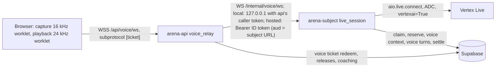

# S5: Backend architecture and lift dossier

Spec part S5 of the Investigative AI Training Arena build specification. **Version 2.3, 2026-10-08: Codex spec round 1 fixes.** Build window 2026-10-08 to 2026-11-02.

Governing inputs: `docs/spec/README.md` (baseline facts; they win over this part), `docs/research/synthesis/02-direction.md` v10.4 (sections 3, 4, 8, 9, 10, 11) with D-011 local-first, `docs/research/synthesis/03-ui-direction.md` v2.1 (section 2a), `docs/challenge/REQUIREMENTS.md` (IDs cited inline), `docs/handoff/DECISIONS.md` (D-001 to D-014; D-007 superseded by D-009; D-013 one global spend ceiling, cost tuning deferred; D-014 case families authored offline, no runtime generator), `docs/spec/S8-build-plan.md` sections 2 and 9 (OD-0 to OD-14, C-01 to C-48), `docs/spec/review-v2-crosscheck.md` (X-01 to X-17), `docs/handoff/PATTERNS.md`, `docs/research/synthesis/cost_model.py` (run 2026-10-08 with `HOSTING = "local"`; every dollar figure here names the function or formula that produced it, section 4). Data definitions (tables, privileged SQL functions, grants, pgTAP) belong to S4 (`docs/spec/sql/`); this part defines the services that call them and uses S4's function names throughout (S4 section 12).

Status markers: **OWNER DECISION PENDING** marks a choice the owner has not made; the design works for either answer. **PROBE** marks a fact this part depends on that must be measured on day 1 (section 12). **Hosted variant (deferred, WP-33, owner decision OD-10)** marks design kept for a later hosted deployment; the default run mode is local (section 10).

---

## 0. Summary

| Area | Decision | Requirements |
| --- | --- | --- |
| Shape | One Python repo (uv workspace), four roles selected by `ARENA_ROLE`: `arena-api`, `arena-subject`, `arena-referee` (services), `arena-tournament` (job). Default: four local processes on loopback, each with its own database credential (section 10). Hosted variant: one container image, four Cloud Run deployables, static web served same-origin by `arena-api` (section 9). | SCN-5, SCN-9, EVL-10, KPI-5 |
| Isolation | Credential per role (S4 roles `arena_public`, `arena_subject`, `arena_referee`); each process receives only its own DSN (local: one env file per credential; hosted: one secret per deployable); internal routes authorize the caller per route (local: per-run caller tokens; hosted: Google ID tokens); the two browser-facing local services check Host, refuse a foreign Origin and require a CSRF token on every state-changing request (D10); an AST import linter keeps public code from importing subject or referee modules. | SCN-5, SCN-9, SCN-12, BKO-9 |
| Agent port | Every model call goes through one typed port lifted from TechnoMile `bh_core.providers`: Vertex only, per-call-type limits, at most 4 attempts, reserve before (priced on the UTF-8 byte length of the largest request, D11), settle after, one span and one cost row per attempt. | D-001, AST-5, AST-7, BKO-5, EVL-5 |
| Spend guard | Transactional reservation ledger in Postgres at liability rates; caller never supplies an amount. One global ceiling (D-013): migrations seed the `global` bucket at $0 (fail-closed); the operator applies `cost_model.py --plan-json` with `scripts/budget_plan.py --apply` and a test asserts the applied ceiling equals it (D-012). Every model call reserves its worst case and every voice session its whole-session worst case (`VOICE_RESERVATION`) against `global`; kill switch read inside every reservation. | D-009, D-012, D-013, BKO-8, EVL-5 |
| Turns | One open turn per trial; one work item per step, found again by a request key, plus transcript versions make every step idempotent, recoverable after a crash and stale-safe; a replay trial copies its source one turn at a time; no work outlives a request. | SCN-4, SCN-10, BKO-6, BKO-7, KPI-4 |
| Streaming | Events written to Postgres; one server-authorized projection (`events/projections.py`) maps S4 event kinds to S6 wire names and feeds the REST snapshot, every SSE delta (each at most 16 KB), the tournament poll and trial replay; single-use-ticket SSE resumed by the trial's own sequence, with catch-up after the trial ends; the tournament view has its own cursor; assessment mode withholds coaching until the debrief. | SOL-6, KPI-4, SCN-10 |
| Voice | Browser to `arena-api` (ticketed WebSocket) relayed to `arena-subject` (local: loopback with a caller token; hosted: IAM-private), which holds the Vertex Live session. Only bounded audio frames and closed control types cross the relay. Redis primitives replaced by Postgres transactions. Voice sessions are unscored development practice (D7): their turns are displayed and coached, never scored; Live gets an updated context after every evidence release, with gates rendered LOCKED until their records are released. | D-006, SOL-1, PRB-4 |
| Observability | OpenInference plus manual spans; default-deny redaction before export; `ops.trace_mirror` commit is the durability barrier and keeps the exporter's hidden classification; local Phoenix is a viewer; hidden-tournament traces held until reveal. KPI-4 from a server-clock card acknowledgement, with a sample opened at every subject commit (S3 6.4, D4). | EVL-5, KPI-4, SCN-12 |
| Run modes | Local by default: loopback processes, local Phoenix, the owner's Supabase project, Vertex AI the only billed GCP service, GCP budget alerts at $25/$50/$65. Hosted variant (WP-33, OD-10): min-instances 0, low max-instances, request-based CPU, IAP on `arena-api`, billing-disable at $70, teardown 2026-11-09, scale-to-zero audit that fails on any violation. | D-003, D-008, D-009, D-011 |

---

## 1. Repository layout

Python 3.12, uv workspace (pattern: TechnoMile `pyproject.toml` lines 1-58, workspace members, `exclude-newer = "7 days"`, strict mypy at lines 103-118). Package names use the `arena_` prefix.

```
arena/
  pyproject.toml              uv workspace root; ruff, mypy strict, pytest, coverage config
  uv.lock
  Makefile                    `make check` (section 11), `make dev` (section 10), lifted from TechnoMile
  docker-compose.dev.yml      local Phoenix only (section 10)
  .env.local.example          shape of the shared settings file and the three per-credential files (section 10.2)
  Dockerfile                  hosted variant: the one image; web build stage + Python stage (section 9.1)
  ATTRIBUTIONS.md             every lift: source path, commit, sha256, what changed (section 2)
  contracts/                  generated: events.schema.json, openapi.json, Pydantic-exported S2 schemas (WP-02)
  packages/core/src/arena_core/
    config.py                 typed settings per role; boot checks (section 1.3)
    ids.py                    uuid, hashing helpers (sha256 of canonical JSON)
    policy.py                 Vertex-only boot checks, model allowlist per call type
    providers/                the agent port (section 3)
      port.py  vertex.py  structured.py  retry.py  telemetry.py  errors.py  types.py  fake.py
    spend/                    spend guard client (section 4)
      rates.py  limits.py  guard.py  voice.py
    agents/                   schemas and prompt builders shared by roles
      schemas.py              S2 output models: CoachingCard (card.v1), DeepUpdate, FinalFinding, Finding,
                              SubjectTurn, RefereeSubjectReport, RefereeAssistantReport (flat, bounded)
      manifests.py            candidate manifest model + sha256 (AST-5, BKO-5)
      fence.py                untrusted-data boundary (gokbase injection_defense lift)
      quotes.py               the one quote predicate (D6): normalize (dashes to "-", whitespace, quotes), then accept a quote
                              of at least 3 words, or the whole answer when it is shorter; S2's filtering, S3's scorer and the
                              browser (a generated TypeScript port, shared fixtures) all use it
    turns/                    orchestrator used by api and tournament (section 5)
      orchestrator.py  work_items.py  harness.py  replay.py
    events/                   envelope, the one projection, SSE framing (section 6)
      envelope.py  projections.py  sse.py
    voice/                    relay protocol types and validators shared by api and subject (section 7)
      protocol.py  tickets.py
    observability/            tracing, export policy, mirror, pump, read-back (section 8)
      tracing.py  export_policy.py  processors.py  spans.py  redaction.py  pii.py  phoenix.py  pump.py  anomaly.py
    identity.py               allowlist, email to user_id mapping, dev identity middleware (sections 9.3, 10.3)
    http_guard.py             Host allowlist, Origin check and CSRF double-submit for the browser-facing services (D10, 10.3)
    db/
      pool.py                 psycopg async pool per role; listener connection (section 6.4)
      calls.py                typed wrappers for S4 functions, S4 names (S4 section 12)
    safety/
      guard.py                deterministic subject-output detectors (S2/S3 own rules; this is the runner)
  services/
    api/src/arena_api/        ARENA_ROLE=api
      app.py  auth.py  kill.py  subject_client.py  referee_client.py  voice_relay.py
      routes/{me,cases,sessions,turns,evidence,findings,sse,voice,debrief,telemetry,tournaments,leaderboards,trust,static}.py
    subject/src/arena_subject/ ARENA_ROLE=subject
      app.py  answer.py  live_session.py  live_meter.py
    referee/src/arena_referee/ ARENA_ROLE=referee
      app.py  hidden_scan.py  routes/{me,config,label,score,debrief,adjudicate,reveal,review,admin}.py
    tournament/src/arena_tournament/ ARENA_ROLE=tournament
      main.py  roster.py  blocks.py  admission.py
  web/                        static front end (S6); served by arena-api, and by arena-referee for the admin and trainer consoles
  supabase/migrations/  supabase/tests/   owned by S4
  ops/billing_guard/          hosted variant: billing-disable function source (section 9.6)
  scripts/
    run_local.py              local launcher: one process per credential (section 10)
    budget_plan.py            applies and checks the cost_model.py --plan-json output (section 4.4)
    kill_switch.sh            database kill switch; `--ingress` only in the hosted variant (section 4.8)
    deploy.sh  teardown.sh  audit_gcp_cost.sh  audit_gcp_cost.py   hosted variant (section 9)
  tools/                      gates lifted from TechnoMile (section 11)
    check_no_rigging.py  check_silent_except.py  check_ratchet.py  check_push_clean.py
    check_deps_policy.py  check_licenses.py  check_scope.py  check_roles.py  check_cost_parity.py
    gates/ratchet.toml  gates/suppressions-allowlist.toml  gates/suppression-markers.toml
  .github/workflows/  .github/dependabot.yml  .github/PULL_REQUEST_TEMPLATE.md  .github/instructions/
  docs/                       research, spec, handoff (exists)
```

### 1.1 Module map and responsibilities

| Module | Runs in | Holds credential | Responsibility | Must never |
| --- | --- | --- | --- | --- |
| `arena_core.providers` | all roles | Vertex ADC (local: the operator's ADC impersonating the arena service account; hosted: the deployable's service account) | The only `google.genai` importer; one path for every model call | Read an API key; retry inside the SDK; ask for more output than the call type allows |
| `arena_core.spend` | all roles | role DSN | Reserve, dispatch, record usage, settle, voice reservation, kill-switch reads | Compute a reservation amount client-side for the database to trust |
| `arena_core.turns` | api, tournament | `arena_public` | Turn orchestration, work items, interviewer harness, replay scoring loop | Read subject or evaluator tiers; hold work past a request or job task |
| `arena_core.events` | api | `arena_public` | Event envelope, the one projection (section 6.2), SSE framing | Build a frame anywhere except `projections.py` |
| `arena_core.voice` | api, subject | none | Frame schemas, size limits, ticket shape | Carry provider handles, prompts or tool payloads |
| `arena_core.observability` | all roles | role DSN (mirror insert only) | Tracing install, redaction, mirror, Phoenix export and read-back | Export a span before redaction; export hidden spans before reveal |
| `arena_api` | `arena-api` | `arena_public` | Investigator REST, SSE, voice relay edge, coaching calls, static web | Import `arena_subject` or `arena_referee` |
| `arena_subject` | `arena-subject` | `arena_subject` | `answer()`, guard, `record_subject_turn()`, Live voice sessions | Accept browser traffic; import `arena_referee` |
| `arena_referee` | `arena-referee` | `arena_referee` | Loading authored case families through S1's loader (D-014: authored offline, no generation call), independent labels, scoring, R3 debriefs, adjudication, reveal, leaderboards; admin and trainer consoles on its own origin | Serve an investigator route; be reached from the `arena-api` origin |
| `arena_tournament` | `arena-tournament` job | `arena_public` | Frozen roster, block scheduling, harness trials, unit admission | Read subject or evaluator tiers |

### 1.2 Role boundaries enforced in code (SCN-5, SCN-9, EVL-10)

1. **Credentials.** Each process receives exactly one DSN: locally from its own env file through `scripts/run_local.py` (section 10.2), hosted from its own secret (section 9.4). The boot check (1.3) refuses to start when a DSN for another role, or the owner DSN, is present in the environment.
2. **Imports.** `tools/check_roles.py` (AST, pattern from TechnoMile `tools/check_adk_scope.py` lines 1-20) fails `make check` when: `arena_api` or `arena_tournament` imports `arena_subject`, `arena_referee` or `arena_core.agents.subject_prompts`/`referee_prompts`; `arena_subject` imports `arena_referee`; any module other than `arena_core.providers.vertex` imports `google.genai`; any module imports `google.adk` (the typed port replaces ADK, direction DM-1); any module other than `arena_core.events.projections` constructs an event frame model.
3. **Assistant context type.** The coach prompt builder accepts only `PublicTrialView` (a frozen Pydantic model built from S4 `arena.trial_context`). A type test asserts the builder's signature and that `PublicTrialView` has no field from the S4 private or evaluator column lists and no communication-style field (C-26).

### 1.3 Boot checks (every role)

| Check | Source | Failure |
| --- | --- | --- |
| No `GOOGLE_API_KEY` or `GEMINI_API_KEY` in env | TechnoMile `providers/policy.py` lines 91-96 (`refuse_gemini_api_keys`) | Exit 1 (D-001) |
| `ARENA_GCP_PROJECT` set explicitly and not `kbg-production` | PATTERNS.md permission walls | Exit 1 |
| Exactly one role DSN present, matching `ARENA_ROLE`; `ARENA_OWNER_DSN` absent | new | Exit 1 |
| `ARENA_ENV=local` features (dev identity, fake model, local caller tokens) refused when `K_SERVICE` is set (Cloud Run); with `ARENA_ENV=local` the server binds 127.0.0.1 only | new | Exit 1 |
| Tracing installed before any instrumented import | TechnoMile `observability/tracing.py` lines 141-160 | Exit 1 |

### 1.4 Acceptance criteria (layout)

- `uv sync --locked` from a clean clone creates one environment with all four service packages. Hosted variant: `docker build .` produces one image whose entrypoint runs the role in `ARENA_ROLE`.
- `make check` fails on a seeded file in `services/api` that imports `arena_subject.answer` (gateproof test).
- Starting `ARENA_ROLE=api` (as a process or from the image) with `ARENA_SUBJECT_DSN` set exits non-zero with a message naming the extra credential; the same with `ARENA_OWNER_DSN` set.
- Starting any role with `GEMINI_API_KEY` set exits non-zero.
- Starting any role with `ARENA_ENV=local` and a non-loopback bind address exits non-zero.

---

## 2. Lift dossier

Reference repos are read-only (D-002). Lifting means copying into this repo with attribution in `ATTRIBUTIONS.md` (source path, commit, sha256 of the source file at that commit, what changed), the practice TechnoMile already follows (`docs/ATTRIBUTIONS.md`). Commits read on 2026-10-08: TechnoMile `b5f1de3`; Pangea `adapi-av2` `c44f86ba`; gokbase backend `cc0b13a`, frontend `0371855`, recruiter-backend `b9a8f59`; cloudforce `542a0bb`.

Provenance and licence: TechnoMile, gokbase and cloudforce are the owner's own projects (cloudforce carries an MIT licence, copyright Satvik Balla; the others carry no licence file and are internal). Pangea `adapi-av2` is a PangeaChat repository (no licence file; employer code). **OWNER DECISION PENDING (D-P5, S8 OD-13):** whether Pangea code may be copied. Default until answered: lift Pangea patterns only through TechnoMile's rewrite (TechnoMile already rewrote `otel_tracing.py` into its own `tracing.py`/`processors.py`, per its `ATTRIBUTIONS.md`), and adapt Pangea's CI workflow structure (generic GitHub Actions configuration, rewritten for this repo). No Pangea source line is copied verbatim under the default.

Rows T25, T26, T27, P9 and E1 serve the hosted variant (section 9) and are lifted only in WP-33.

Verdicts: **Lift** = copy with renames only. **Adapt** = copy, then change as stated. **Pattern** = reimplement the mechanism.

### 2.1 TechnoMile (`/Users/balla/Desktop/satvik/2026 Fall/Challenge X/TechnoMile Agentic Black Hat`)

| # | Source (path:lines) | Target | Verdict | What changes |
| --- | --- | --- | --- | --- |
| T1 | `packages/core/src/bh_core/providers/policy.py:91-96` (`refuse_gemini_api_keys`), `:80-88` (data class) | `arena_core/policy.py` | Adapt | Drop OpenRouter/Jev/loopback rules (`:19-77`); keep API-key refusal; data classes become `public`, `subject_private`, `evaluator` (all Vertex-only, so the check becomes "model allowed for call type", section 3.3). |
| T2 | `providers/retry.py:1-21` | `providers/retry.py` | Lift | Default `max_attempts` becomes 3 transient attempts inside a 4-attempt total (section 3.4). |
| T3 | `providers/budget.py:1-74` (`RunBudget` reserve/check_admission/settle) | `spend/guard.py` | Adapt | In-memory per-run cap replaced by calls to S4's transactional SQL (`ops.reserve_model_call`, `ops.mark_dispatched`, `ops.record_usage`, `ops.settle_reservation`; section 4.6), because several processes share one ceiling. The method names and fail-closed semantics are kept; the in-memory class survives only as the test double. Day-1 probes reserve through the database guard like every other call (X-05). |
| T4 | `providers/telemetry.py:18-32` (`llm_span`) | `providers/telemetry.py` | Lift | Span name `llm.<call_type>`; attributes from section 8.2. |
| T5 | `providers/structured.py:47-135` (`lint_schema`, `vertex_schema`, `parse_output`) | `providers/structured.py` | Lift | Unchanged: flat bounded schemas, every field required, no repair of truncated JSON. |
| T6 | `providers/port.py:246-262` (`_structured` repair loop), `:462-567` (`_with_retries`, `_attempt_once`), `:686-727` (`_charge`, `_record`) | `providers/port.py` | Adapt | One route only (no failover ladder `:372-450`); repairs capped at 1 (TechnoMile default 2, `:81`); total attempts capped at 4 across repairs and transient retries (cost model `ATTEMPTS`); reservation once per logical call for 4 attempts, settled once, one `ops.model_calls` row per attempt through `ops.record_usage`; free-tier cooldowns (`:84-89`) removed. |
| T7 | `providers/adapters/vertex.py:109-192` | `providers/vertex.py` | Adapt | `max_output_tokens` set to the call type's output limit, not the model maximum (`:118-121` asks for 65,536, which would invalidate every reservation); `HttpRetryOptions(attempts=1)` so the SDK never retries on its own (google-genai defaults to 5 attempts, X3 section 6); `location` from config (`global` for text). `_parse` (`:161-192`) kept: thinking tokens billed as output, MAX_TOKENS and safety stops typed. |
| T8 | `providers/pricing.py:52-62` (`VERTEX_GLOBAL_PRICES`), `:127-138` (`cost`) | `spend/rates.py` | Adapt | Table replaced by the D-009 liability rates (section 4.2), parity-tested against S4 `ops.model_prices`; settlement uses liability rates, never promotional ones (TechnoMile settles 3.8 Flash at the promo, `:64-67`, `:105-117`). |
| T9 | `providers/ledger.py:11-34` (`CostRecord`) | `spend/guard.py` | Adapt | Adds `reservation_id`, `attempt`, `call_kind`, `purpose`, `bucket`; written to S4 `ops.model_calls` through `ops.record_usage`. |
| T10 | `services/run/src/bh_run/tail/a2a.py:221-240` (`typed_turn`) | `providers/port.py` | Pattern | Folded into the port's structured path (T6). |
| T11 | `observability/export_policy.py:1-491` (default-deny `Sanitizer`, `KNOWN`, cost-attribute rename `:45-52`) | `observability/export_policy.py` | Adapt | Allowlists rewritten for `arena.*` keys (section 8.2); `STAGES`, `_PHASE`, claim ids removed; Class C = `subject_private` and `evaluator` spans. |
| T12 | `observability/spans.py:76-174` (anchor, `node`, `agent`, `bridge`) | `observability/spans.py` | Adapt | Hierarchy session > trial > turn > agent > LLM (section 8.1); trial anchor ids stored on the trial row (pattern of `supabase/migrations/20260927001000_trace_mirror.sql:15-55`). |
| T13 | `observability/tracing.py:41-211` (`install`, `Tracing.flush`, SIGTERM flush `:280-292`) | `observability/tracing.py` | Adapt | ADK instrumentation replaced by OpenInference google-genai instrumentation (PROBE P7); `mode="api"` for services (synchronous export), `mode="job"` for the tournament (batch, flush at block boundaries and SIGTERM). |
| T14 | `observability/processors.py:240-284` (`Redactor`), `:331-568` (`SpanRow`, `PostgresMirrorSink`, `SpanMirror`), `:570-655` (`RecordingExporter`), `:656-664` (`EndedSpans`) | `observability/processors.py` | Adapt | The mirror stores the full sanitized OTLP span (bounded 32 KB), not TechnoMile's payload-free 4 KB row (`trace_mirror.sql:57-74`), because the direction re-exports from it (section 8.4). An `ExportGate` processor is added (section 8.5). |
| T15 | `observability/phoenix.py:1-174` (read-back of `GET /v1/projects/{project}/spans`), `observability/ack.py:116-147` (`confirm`) | `observability/phoenix.py` | Lift | Pin the same Phoenix image (`arizephoenix/phoenix:version-20.16.0`). |
| T16 | `observability/redaction.py:278-362` (`is_credential_name`, `hash_payload`, `Redaction`) | `observability/redaction.py` | Lift | Credential masking for every exported string. |
| T17 | `supabase/migrations/20260927001000_trace_mirror.sql:1-115` | S4 migration (`ops.trace_mirror`, `ops.trace_summaries`) | Adapt (S4) | Columns per section 8.4. |
| T18 | `supabase/migrations/20261001000100_api_live.sql:24-110` (`ops.sse_tickets`, `mint_sse_ticket`, `redeem_sse_ticket`) | S4 `training.access_tickets` (kind `sse` or `voice`), `training.issue_access_ticket`, `training.redeem_access_ticket` | Adapt (S4) | Ticket bound to (user, trial, split, mode); same 60 s life, sha256-only storage, single conditional UPDATE. |
| T19 | `services/api/src/bh_api/routes.py:734-810` (`mint`, `events`, `stream`), `services/api/src/bh_api/deps.py:27` (`stream_max_s`) | `arena_api/routes/sse.py`, `arena_core/events/sse.py` | Adapt | Replay `seq > after` through the projection, then wait on a wake-up (section 6.4). |
| T20 | `web/src/lib/sse/ticketed-stream.ts:1-206` (itself lifted from gokbase `frontend/src/lib/sse/ticketed-stream.ts:1-249` with the resume fix) | `web/src/lib/sse/ticketed-stream.ts` | Lift | Backoff for the coaching stream shortened per S6 5.1 (the donor's 2 s x attempt, capped 15 s, would by itself exceed KPI-4 on a reconnect; I7). |
| T21 | `Makefile:1-194` | `Makefile` | Adapt | Drop `verifier*` targets (`:196-223`), `adk-scope`, Chromium install; add `roles`, `cost-parity`, `db-test`, `dev`, `dev-check` (sections 10, 11). Thresholds unchanged (`:21-26`). |
| T22 | `tools/gates/ratchet.toml` (543 lines), `tools/check_ratchet.py:1-236` | `tools/` | Lift | Entries re-pointed to this repo's files; directions and values unchanged. |
| T23 | `tools/check_no_rigging.py:1-163`, `tools/check_silent_except.py:1-149`, `tools/check_push_clean.py:1-113`, `tools/check_deps_policy.py`, `tools/check_licenses.py`, `tools/check_scope.py`, `tools/check_codeql.py`, `tools/proc.py`, `tools/gates/*.toml` | `tools/` | Lift | Roots renamed (`SCANNED_ROOTS`, `PY_SOURCES`). Their tests under `tools/tests/` lifted too. |
| T24 | `tools/check_adk_scope.py:1-194` | `tools/check_roles.py` | Adapt | Same AST walker; rules replaced by section 1.2 item 2. |
| T25 | `scripts/audit_gcp_cost.py:1-385`, `scripts/audit_gcp_cost.sh:1-123`, `tools/tests/test_audit_gcp_cost.py` + fixtures | `scripts/audit_gcp_cost.{py,sh}` | Adapt (hosted variant) | Project guard set to the arena project and refuses `kbg-production`; `INTERNAL_ONLY` becomes `arena-subject`, `arena-referee` with invoker allowlists (section 9.7); new rules: `arena-api` and Phoenix must have IAP enabled; per-service max-instances ceilings; the billing guard function is allowed. |
| T26 | `scripts/demo/deploy_demo.sh:1-431`, `scripts/demo/teardown_demo.sh:1-95` | `scripts/deploy.sh`, `scripts/teardown.sh` | Adapt (hosted variant) | `--plan` dry-run mode kept; services per section 9.2; teardown ends with the cost audit (as donor). |
| T27 | `services/api/Dockerfile:1-28` (digest-pinned uv and python base, non-root uid 10001) | `Dockerfile` | Adapt (hosted variant) | No Chromium; one image for all roles; web build stage added. |

### 2.2 Pangea `adapi-av2` (`/Users/balla/PangeaChat/adapi-av2`); see D-P5 above

| # | Source (path:lines) | Target | Verdict | What changes |
| --- | --- | --- | --- | --- |
| P1 | `app/assistant/otel_tracing.py:123-201` (redacting `SpanProcessor` ahead of the exporter; `llm.token_count.*` rename), `:217-263` (dedicated provider, endpoint-gated no-op) | via TechnoMile T13/T14 | Pattern | Taken through TechnoMile's rewrite; not copied directly. |
| P2 | `app/assistant/service.py:435-480` (`_start_turn_span`, `_end_turn_span`), `:1075-1090` (attach as current context across retries), `:1643-1650` (end in `finally`) | `arena_core/turns/orchestrator.py` | Pattern | One `arena.turn` span made current around the turn's subject call, coaching call and every retry; cost stamped as a string from `ops.model_calls`. |
| P3 | `docker-compose.observability.yml:1-48` | `docker-compose.dev.yml` | Pattern | Pinned Phoenix tag, auth on, ports bound to 127.0.0.1, `PHOENIX_SECRET` required. |
| P4 | `.github/workflows/test.yaml:1-137` (ruff, format, mypy, pytest `--cov-fail-under=90`, PR diff-cover 90, Postgres service with health check) | `.github/workflows/ci.yml` | Adapt | Runs `make py-check db-test web-check`; mypy strict (Pangea's own config is non-strict, I4 contradiction 2); Postgres image with pgTAP. |
| P5 | `.github/workflows/bandit.yml:1-69` (two-pass `-ll -ii` then `-t B105,B106,B107`, `pipefail`) | `.github/workflows/security.yml` | Adapt | Same two passes over `packages services tools scripts`. |
| P6 | `.github/workflows/codeql.yml:1-91` (fail-closed on SARIF count, `upload: never`) | `.github/workflows/codeql.yml` | Adapt | Languages `python`, `javascript-typescript`. |
| P7 | `.github/workflows/secret-scan.yml:1-40` (TruffleHog verified, PR commit range) | `.github/workflows/security.yml` | Adapt | Plus gitleaks as in `make check`. |
| P8 | `.github/workflows/pr-title.yaml:1-65` | `.github/workflows/pr-title.yml` | Adapt | Conventional prefixes per PATTERNS.md. |
| P9 | `.github/workflows/deploy.yaml:150-166` (assert `run.invoker` is exactly the allowed service accounts after every deploy) | `scripts/deploy.sh` step | Pattern (hosted variant) | Applied to `arena-subject` and `arena-referee` (section 9.3). |

### 2.3 gokbase (`/Users/balla/Desktop/satvik/gokbase-org`)

| # | Source (path:lines) | Target | Verdict | What changes |
| --- | --- | --- | --- | --- |
| G1 | `backend/app/rag/live/session.py:1182-1344` (`LiveVoiceSession` construction), `:1345-1396` (`_build_config`), `:1847-1936` (`receive_loop`, `_consume`), `:2203-2244` (`safety_loop`), `:2470-2534` (`run`, `_mark_suspended`), `:2660-2735` (`_pump_client_audio`), `:2736-2766` (`close`: terminal flag set before any await) | `arena_subject/live_session.py` | Adapt | `_client()` (`:1397-1408`) becomes `genai.Client(vertexai=True, project, location)` with ADC; model from config (`gemini-3.8-live` primary, `gemini-live-2.5-flash-native-audio` fallback, PROBE P4); KB tools (`:569-768`) and TOC prompt removed; subject prompt built from the private packet (S2/S3); the pump reads relay frames from `arena-api` instead of a browser socket; Redis spend and resume replaced by Postgres (section 7.6); no `thinking_config` (`:1393` note: it kills audio); affective dialog and proactive audio set per model (X7 section 2). |
| G2 | `session.py:315-487` (`LiveCostMeter`: per-modality accumulation, never diffing cumulative counts, honesty states) | `arena_subject/live_meter.py` | Adapt | Each usage frame's per-modality token deltas go to `ops.record_usage` on the session reservation, which prices them at the Live liability rates and returns `shutoff` (section 4.7). |
| G3 | `session.py:231-259` (close codes and end causes) | `arena_core/voice/protocol.py` | Adapt | Adds 4400 (protocol violation), 4410 (exchange cap) and 4423 (kill switch); section 7.5. |
| G4 | `backend/app/api/api_v1/endpoints/voice.py:311-400` (ticket mint), `:412-440` (Origin check, subprotocol), `:596-899` (WS route: Origin before ticket consumption, subprotocol echo, single-use consume, eligibility re-check after consume, row inserted before connect) | `arena_api/routes/voice.py`, `arena_api/voice_relay.py` | Adapt | Profile-subdomain Origin allowlist becomes same-origin; `getdel` on Redis becomes `training.redeem_access_ticket(token, 'voice')`; eligibility = (user, trial, split = development, mode). |
| G5 | `backend/app/rag/live/events.py:117-260` (`insert_session`, `TurnWriter` per-fragment seq-ordered writes), `:261-336` (`finalize_session`) | `arena_subject/live_session.py` | Pattern | Fragments are ordered in memory per turn and committed as one turn (`record_voice_question`, `record_subject_turn`); no fragment table (D7: voice is unscored, the transcript is display only). |
| G6 | `backend/app/rag/live/audit.py:1-150` (turn reconstruction from fragment rows) | `arena_subject/live_session.py` | Adapt | The fragment-to-turn reconstruction, run over the in-memory fragments of the current turn; the KB groundedness judge is not lifted. |
| G7 | `backend/app/rag/live/quotas.py:245-316` (`check_and_reserve`, fail-closed pre-mint gate) | S4 quota check inside `training.issue_access_ticket` | Pattern | Day buckets in Postgres. |
| G8 | `backend/app/rag/v3/injection_defense.py:51-109` (`sanitize_untrusted_text`, `wrap_evidence` with per-call salt) | `arena_core/agents/fence.py` | Lift | Applied to every transcript span placed in a coach or referee prompt and to Live tool payloads (direction 6.1 safety). |
| G9 | `frontend/src/sections/knowledge-base/public/voice/voiceMachine.ts:1-234` (pure reducer, frame whitelist, close-code taxonomy) | `web/src/lib/voice/voiceMachine.ts` | Adapt | States per S6 6.2; frame whitelist per section 7.3 (including `exchange_count`); terminal code set per section 7.5. |
| G10 | `frontend/src/sections/knowledge-base/public/voice/useVoiceSession.ts:406-431` (resume backoff 500/1000/2000 ms, 3 attempts, `["voice-resume", token]` subprotocol) | `web/src/lib/voice/useVoiceSession.ts` | Adapt | Mint endpoint and ticket shape per section 7.2. |
| G11 | `frontend/src/sections/knowledge-base/public/voice/audioController.ts:1-338` (two AudioContexts at 16 kHz and 24 kHz, `flush()` at `:238`, amplitude taps) | `web/src/lib/voice/audioController.ts` | Lift | Playback progress drives only the UI (G13). |
| G12 | `frontend/public/worklets/capture-processor.js:1-56` | `web/public/worklets/capture-processor.js` | Adapt | `CHUNK_SIZE` 4000 (250 ms) becomes 1600 (100 ms), inside the 20-100 ms range the Live docs recommend (X7 section 2). |
| G13 | `frontend/public/worklets/playback-processor.js:1-77` | `web/public/worklets/playback-processor.js` | Adapt | Chunks carry an utterance number; the worklet reports played samples to the page for its own UI state (speaking indicator, barge-in flush). Nothing is sent to the server: voice is unscored and playback counts are not stored (D7). |
| G14 | `recruiter-backend/app/matching/rubrics.py:1-219` (blake2b rubric hash with lineage) | `arena_core/agents/manifests.py` | Pattern | sha256 of canonical manifest JSON; owned by the scoring part for rubrics. |

### 2.4 cloudforce (`/Users/balla/Desktop/satvik/Summer Internship/cloudforce/backend`, MIT)

| # | Source (path:lines) | Target | Verdict | What changes |
| --- | --- | --- | --- | --- |
| C1 | `observability/redaction.py:1-136` (`redact_headers`, `redact_text`, `redact_json`; bearer-before-email ordering; separator-requiring phone regex) | `arena_core/observability/pii.py` | Lift | Applied to investigator free text before it is logged or mirrored, and as a second pass inside the span Redactor. |
| C2 | `observability/anomaly_detectors.py:87-131` (`mad_z`, `severity_for`, 1.4826 scale, 3.5 / 2.5 thresholds) | `arena_core/observability/anomaly.py` | Lift | Detectors over per-candidate coaching latency and per-block cost (section 8.8); the product-specific detectors (`:132-585`) are not lifted. |

### 2.5 External (Apache-2.0 Google sample)

| # | Source | Target | Verdict | What changes |
| --- | --- | --- | --- | --- |
| E1 | Google Cloud "Disable billing usage with notifications" sample (`docs.cloud.google.com/billing/docs/how-to/disable-billing-with-notifications`, checked 2026-10-08) | `ops/billing_guard/main.py` | Adapt (hosted variant) | Rewritten in Python with `google-cloud-billing`; disables at `costAmount >= 70`, not at the budget amount; `DRY_RUN` env for the test (section 9.6). |

### 2.6 Acceptance criteria (lift)

- `ATTRIBUTIONS.md` has one entry per row above that was copied (Lift or Adapt), naming source path, commit and sha256.
- Every lifted Python file passes the same gates as new code (strict mypy, 90% branch coverage, bandit); no lifted file is excluded from any gate.
- Lifted tests come with their modules (TechnoMile `tools/tests/*`, the `test_audit_gcp_cost.py` fixtures) and pass in this repo.

---

## 3. Agent port

Direction section 6 and DM-1: agents are stateless, schema-bound calls through one typed port. Covers D-001, AST-5, AST-7, AST-8, BKO-5 (equal budgets), EVL-5 (cost, latency).

### 3.1 Interface

```python
class CallType(StrEnum):
    SUBJECT = "subject"; CARD = "card"; DEEP = "deep"; FINAL = "final"
    REFEREE = "referee"
    PORTRAIT = "portrait"

@dataclass(frozen=True, kw_only=True)
class CallContext:
    call_type: CallType
    purpose: Purpose                    # fixed label list, section 3.3; stored by ops.reserve_model_call
    bucket: Literal["global"]           # D-013: every reservation names the one global bucket, section 4.4
    work_item_id: UUID | None           # turn work (section 5); the reservation key derives from it (5.1)
    trial_id: UUID | None
    tournament_id: UUID | None          # span binding for requests without a trial (8.4)
    split: Literal["dev", "hidden", "none"]
    data_class: Literal["public", "subject_private", "evaluator"]
    candidate_manifest_sha: str | None  # tournament calls (AST-5)

@dataclass(frozen=True, kw_only=True)
class AgentCall[T: BaseModel]:
    model: VertexModel                  # enum of allowed ids
    thinking: ThinkingLevel             # minimal | low | medium | high
    system: str
    messages: tuple[Message, ...]       # text only
    schema: type[T]                     # flat, bounded (structured.lint_schema)
    context: CallContext

@dataclass(frozen=True)
class AgentResult[T]:
    value: T
    attempts: int                       # 1..4
    usage: Usage                        # summed input, output (incl. thinking), cached
    cost_usd: Decimal                   # settled, liability rates
    latency_ms: float                   # first attempt start to validated value
    trace_id: str; span_id: str

class AgentPort(Protocol):
    async def run[T: BaseModel](self, call: AgentCall[T]) -> AgentResult[T]: ...
```

Every failure ends in a typed error: `BudgetRefused`, `KillSwitchOn`, `PolicyRefused`, `InputTooLarge`, `StructuredOutputError`, `ProviderBlocked`, `ProviderFailed` (TechnoMile `errors.py:92-151` shape).

### 3.2 Pipeline (one logical call)

1. Policy: model in the call type's allowlist (3.3); data class allowed; manifest sha matches the frozen roster when `candidate_manifest_sha` is set.
2. Input bound (D11, SG3-10): the port serializes the complete request (system instruction, messages, response schema and tool declarations) and measures its UTF-8 byte length, then adds the repair allowance: S2 10's re-prompt appends the previous model text (truncated to 4,000 characters, so at most 16,000 bytes) and an error list (at most 10 items, at most 2,000 bytes). A token covers at least one byte, so this byte count bounds the input tokens of every attempt, the repair included, with no estimate. If it exceeds the call type's input limit (bytes), the call raises `InputTooLarge` before any reservation row exists. Prompt builders window the transcript to fit (S2 2 drop order); the port never truncates silently.
3. Reserve: `ops.reserve_model_call(key, 'global', model, call_kind, purpose, trial, actor, input_bytes)` (4.6) for the 4-attempt worst case at that byte length. The database computes the amount and reads the kill switch in the same transaction; a refusal is returned, and the port raises `BudgetRefused` or `KillSwitchOn`. The key is `<work_item_id>:<n>` (or, outside turn work, a key from the caller's own step identity), so a restarted process finds the reservation again (5.1).
4. Dispatch: `ops.mark_dispatched(reservation)` before the first Vertex request (kill switch read again).
5. Attempt loop (at most 4 attempts in total): one `llm.<call_type>` span per attempt; per-attempt timeout (3.3); `max_output_tokens` = output limit; SDK retries off; transient errors (429, 408, 5xx, timeout) retried with full-jitter backoff (T2) while attempts remain; a schema failure gets one repair re-prompt (T6) while attempts remain. Before every send the port asserts that the request's byte length is at most the reserved `input_bytes`; a longer request is never sent (`InputTooLarge`, settled as below). Each attempt's usage goes to `ops.record_usage(reservation, attempt, model, tokens...)`, one `ops.model_calls` row per attempt.
6. Settle: `ops.settle_reservation(reservation, outcome)` once: `committed` (sum of receipts), `usage_unknown` (an attempt that may have been billed reported no usage; the full reservation stays charged, T6 `_charge`), or `released` (never dispatched).
7. Return the validated value or raise.

### 3.3 Per-call-type limits and allowlist (D-009 lineup, `cost_model.py` `LIMITS`, `d009`)

| Call type | Input limit (UTF-8 bytes, D11) | Output limit incl. thinking (tokens) | Allowed models | Thinking | Per-attempt timeout ceiling | Used by |
| --- | --- | --- | --- | --- | --- | --- |
| `subject` | 6,000 | 1,600 | `gemini-3.1-flash-lite`, `gemini-3.5-flash-lite` | minimal | 15 s | `arena-subject` |
| `card` | 6,000 | 1,600 | `gemini-3.5-flash-lite`, `gemini-3.1-flash-lite` | minimal | 6 s | `arena-api`, tournament |
| `deep` | 7,000 | 3,000 | `gemini-3.5-flash-lite` | minimal | 15 s | A1 only |
| `final` | 7,000 | 3,000 | `gemini-3.5-flash-lite`, `gemini-3.1-flash-lite` | minimal | 20 s | coaches |
| `referee` | 12,000 | 4,000 | `gemini-3.1-flash-lite` (low), `gemini-3.5-flash-lite` (minimal) | per row | 60 s | `arena-referee` |
| `portrait` | 2,000 (prompt; initial value, tuned in the dev pilot) | 2,000 (one image's output tokens; initial value, tuned in the dev pilot) | Gemini image model on Vertex (UI direction 1.2 names it) | n/a | 60 s | `arena-api`; count-capped at 62 images (`PORTRAITS[0]`) |

The timeout column holds call-kind ceilings. S2 manifest values must be at or below them (S2 2 sets subject 8 s, card 6 s, deep 10 s, final 15 s, referee 30 s); a manifest value above its ceiling, or a limit above its call-type limit, is rejected when the roster freezes (C-31). The same limits apply to every candidate of a call type, which is the "equal budgets" reading in REQUIREMENTS section 12 item 3.

**Byte limits (D11, SG2-15).** The input column is `cost_model.LIMITS`, which the database seeds and the parity check compares (4.9). Under D11 these values bound the UTF-8 bytes of the largest request, and at today's values no card fits: S2's coach system prompt alone is about 8 KB, and a 12-turn session with 600-character questions and 900-character answers renders a card request of about 47 KB, a subject request of about 36 KB and a referee request of about 67 KB, repair allowance included (measured on S2's templates and F01-F03). The research owner raises `LIMITS` to byte-sized values from S2's rendered-context bound before the slice (proposed: subject and card 48,000, deep and final 56,000, referee 96,000) and the migration seeds follow by the same parity rule; until then every call over the seeded bytes is refused before reservation, which fails closed.

`purpose` labels (S4 8.3: a fixed list, never a case or family code). S2 section 2 owns the model-facing ones: `subject.answer`, `coach.card`, `coach.deep`, `coach.final`, and on call kind `referee` `referee_subject` (R1: J1, J2), `referee_assistant` (R2: J3, J4), `r3_subject` and `r3_investigator` (R3, the same two calls on a training session, S2 7.5; C-15, X-02). This part adds `portrait.image`, `experiment.latency`, `experiment.fidelity`, and `voice.session`, `voice.probe` for `ops.reserve_voice`. With one bucket (D-013), purpose and `trial_id` are how spend is grouped by activity.

Candidate manifests (AST-5, BKO-5) carry model, prompt sha, tools (`["record_request"]`: a card field, not function calling, S2 3.1; C-32), coaching policy, max input tokens, max output tokens, thinking level and timeout.

`cost_model.py` `LIMITS` has no `portrait` row. Its limits are the initial values above, held in `arena_core/spend/limits.py` and in S4's `ops.call_limits` (X-09); no cost line is added (D-013). A portrait call reserves only once its model has an `ops.model_prices` row from the day-1 price lookup (S8 5.2); before that the database refuses it (AR007). There is no retranscription call: voice is unscored (D7).

### 3.4 Attempt rule

`ATTEMPTS = 4` = first try + at most one schema repair + at most two transient retries (`cost_model.py` line 34). The port counts every request it sends, whatever the reason, and stops at 4. This is a hard bound the reservation depends on; TechnoMile's port permits up to 9 sends (3 transient attempts for each of 3 repair rounds, `port.py:81`, `retry.py:9`), and google-genai retries 5 times by default, so both are changed (T6, T7).

### 3.5 Untrusted-data boundary and safety (SUB-7, AST-7)

- Every subject utterance and investigator question placed in a coach, referee or harness prompt passes `sanitize_untrusted_text` and is wrapped with a per-call salt (G8). The system prompt states that wrapped text is data.
- The subject's output passes the deterministic guard (`arena_core/safety/guard.py`) before `record_subject_turn()`; S2/S3 define the detectors; a rejection is passed to the function as `guard_result` so it quarantines atomically (direction 4.2).
- Coaching never receives audio or acoustic features (PRB-4, direction 9 N03): `CallType.CARD|DEEP|FINAL` reject any non-text message part.

### 3.6 Acceptance criteria (agent port)

- A fake adapter that returns invalid JSON three times then valid JSON makes exactly 2 sends for a call (1 + 1 repair), then raises `StructuredOutputError`; a fake that returns 503 four times makes exactly 4 sends and raises; no test configuration produces a fifth send.
- The Vertex request built for every call type has `max_output_tokens` equal to the table's output limit and SDK retry attempts equal to 1 (asserted on the built `GenerateContentConfig`).
- A call whose request plus repair allowance exceeds its byte limit raises `InputTooLarge` before any reservation row exists; a fixture whose text is multibyte (every character 3 bytes) is measured in bytes, not characters; the reservation row's `input_bytes` equals the measured length; a repair re-prompt longer than the reserved bytes is never sent.
- Each attempt writes one `ops.model_calls` row (through `ops.record_usage`) and one `llm.<call_type>` span whose ids match the row; each logical call has exactly one `ops.mark_dispatched` and one `ops.settle_reservation`.
- A `card` call with a model outside its allowlist (for example `gemini-3.8-flash`) raises `PolicyRefused` before reservation.
- `ThinkingLevel` is sent as `thinking_level`, never `thinking_budget` (X3 section 1: combining both returns 400).
- Coach prompt builder rejects any input type other than `PublicTrialView` (mypy and a runtime test).
- A manifest with a referee timeout of 61 s, or a `card` output limit of 1,601, is refused at roster freeze.

---

## 4. Spend guard (D-009, D-012, D-013)

Direction 8.3: model and voice liabilities are reserved before they are incurred; non-model costs are minimized and backstopped, not hard-capped. S4 owns the DDL (`ops` schema). This section is the contract S5 code relies on. Every dollar figure below names the `cost_model.py` function or formula that produced it (run 2026-10-08, `HOSTING = "local"`); values shown are informative, and tests compare against the live script output, never against this text.

### 4.1 Envelope and plan source

| Line | Value | Produced by |
| --- | --- | --- |
| D-009 hard cap | $75.00 | `CAP` |
| Non-model allowance (local), set aside outside the ledger | $1.00 | `NON_MODEL_ALLOWANCE_LOCAL` (D-011: only Vertex bills GCP) |
| Global ledger ceiling (model and voice) | $74.00 | `budget_plan()`: `CAP - NON_MODEL_ALLOWANCE_LOCAL` |
| Plan size | 30 hidden cases (15 families) x 1 repeat plus a 10-case dev pilot; 34 hidden cases only if the dev pilot's measured costs track the expected column (OD-8) | `PLAN` |

**D-012, D-013.** The guard has one ceiling, `global`. The S4 migrations seed it at $0, so nothing can spend until the operator applies the plan (fail-closed). The plan is `cost_model.budget_plan()`, printed by `cost_model.py --plan-json` as `{"global": ...}`; `scripts/budget_plan.py --apply` applies it through `ops.set_bucket_ceiling` (4.4). No ceiling is typed into SQL or into code. Per-phase buckets and per-test cost lines are deferred until the pipeline runs end to end (D-013).

### 4.2 Liability rate table (per 1M tokens, verified 2026-10-08; `LIABILITY_PRICES`, Live from `VOICE`)

| Model | Input | Output (incl. thinking) | Notes |
| --- | --- | --- | --- |
| `gemini-3.1-flash-lite` | $0.25 | $1.50 | |
| `gemini-3.5-flash-lite` | $0.30 | $2.50 | |
| `gemini-3.8-flash` | $1.50 | $7.50 | Reference only; not in any allowlist; promotional $0.75/$3.75 never counted |
| Live (audio in / audio out / text in / text out) | $4.50 / $18.00 / $1.125 / $6.75 | | gokbase rate card x1.5 (`VOICE` rates x `k = 1.5`) until the Vertex 3.8 Live price is confirmed (PROBE P4) |

No batch discount, no cache discount (cost model docstring). Settlement uses these same rates (S4 `ops.model_prices`); a lower real bill is upside.

### 4.3 Per-call reservation (`ATTEMPTS x (input bytes x input rate + output limit x output rate) / 1e6`; at input bytes = the limit, `cost_model.liab_reservation`)

| Call type | Model | Reservation | Produced by |
| --- | --- | --- | --- |
| subject, card | `gemini-3.1-flash-lite` | $0.015600 | `liab_reservation` |
| subject, card | `gemini-3.5-flash-lite` | $0.023200 | `liab_reservation` |
| deep, final | `gemini-3.1-flash-lite` | $0.025000 | `liab_reservation` |
| deep, final | `gemini-3.5-flash-lite` | $0.038400 | `liab_reservation` |
| referee | `gemini-3.1-flash-lite` | $0.036000 | `liab_reservation` |
| referee | `gemini-3.5-flash-lite` | $0.054400 | `liab_reservation` |
| voice session (whole session, 4.7) | Live (the script's line also counts 12 cards and a retranscription, which no longer draw on it) | $1.635720 (shutoff $1.090480) | `VOICE_RESERVATION`, `VOICE_SHUTOFF` |
| voice probe (2 exchanges, 60 s) | Live | $0.132140 | `PROBE_RESERVATION` |
| portrait (one image per call) | Gemini image model | `ATTEMPTS x (input bytes x text_in + 2,000 x text_out) / 1e6`, from the image model's price row (its output rate is the image-output token rate) | the same formula on the initial-value limits (3.3); the price row comes from the day-1 lookup |

The rows above are the worst case at each call type's seeded limit. A real reservation prices the request's measured bytes (3.2), so it is at most the row's value; after `LIMITS` moves to byte-sized values (3.3) the worst cases grow (for example a card at 48,000 bytes on 3.5-flash-lite: $0.073600), and a typical 20 KB card reserves $0.040000 and settles at its token receipts.

### 4.4 One global ceiling and plan application (D-012, D-013)

| Bucket | Parent | Pays for | Formula in `budget_plan()` | 2026-10-08 |
| --- | --- | --- | --- | --- |
| `global` | none | every model call and voice session: day-1 experiments and probes, dev pilot, replay, interactive blocks, demo and team sessions, KPI-1 and calibration (R3), character portraits | `CAP - NON_MODEL_ALLOWANCE_LOCAL` | $74.00 |

Every reservation, voice reservation and unit admission names `global`; the port sets it, no request names a bucket, and a tournament's `budget_bucket` is `global` (S4 4.1). R3 runs on every scored text training session; voice sessions are unscored (section 7) and get no R3, matching `voice_session_cost`, which has no R3 line.

**`scripts/budget_plan.py`** (apply-only; it imports nothing from `cost_model.py` and computes no figure):

- `--apply --dsn-env ARENA_OWNER_DSN`: runs `python3 -I -B docs/research/synthesis/cost_model.py --plan-json`, parses stdout as JSON and applies each entry with `ops.set_bucket_ceiling(name, parent, ceiling, note)` (owner only, S4 6.3) in one transaction. S4 refuses a ceiling below current liability; the script then rolls back, applies nothing and exits 1. The owner DSN comes from the operator's shell for that command only (section 10.2).
- `--check --dsn-env <any role's DSN>`: reads `ops.v_budget_status` and exits 0 only if the bucket table equals the `--plan-json` output (names, parents, ceilings); 1 on any difference.

Plan size (OD-8): the ceiling does not depend on the case count, so 30 or 34 hidden cases run under the same applied `global` ceiling; a unit the guard cannot admit is recorded `budget_skipped` (4.5), and the guard never overshoots. If the research owner changes the cost model after the dev pilot, the operator re-applies its output. The hosted variant's ceiling comes from the same output once the research owner sets `HOSTING = "hosted"` in `cost_model.py` (section 9).

### 4.5 Unit admission (soft completeness, direction 8.3)

Before a unit (a block or a replay chunk) starts, the caller asks `ops.admit_unit('global', high_cost_usd)`; the database answers `admit` only if `global` has at least `ADMIT_FACTOR` (1.5) x the unit's high cost free, and holds nothing (S4 8.5). A refused unit's planned trials are recorded `budget_skipped`; a unit the per-call guard stops mid-way is `budget_truncated` (S4 execution states). The tournament job computes `high_cost_usd` with the same code `cost_model.py` uses (`arena_core/spend/limits.py` is parity-tested, 4.9): one interactive block is $1.61 high (`sum(liab_cost(c, True) for c in block_calls(d009, True)) x RETRY_FACTOR`) and needs $2.42 free (`ADMIT_FACTOR` x that).

### 4.6 SQL interface consumed from S4 (S4 names, S4 section 12; wrappers in `arena_core/db/calls.py`; C-30)

| Function | Granted to | Caller supplies | Database derives and enforces | Returns |
| --- | --- | --- | --- | --- |
| `ops.reserve_model_call(key, 'global', model, call_kind, purpose, trial, actor, input_bytes)` | all three runtime roles | identifiers, a purpose label and the measured request bytes (a size, never an amount) | Amount = 4 x (input_bytes x input rate + output limit x output rate) from `ops.call_limits` and `ops.model_prices`; `input_bytes` between 1 and the call kind's byte limit; kill switch off; locks the bucket; liability plus the amount stays at or under the ceiling; referee purposes are S2's four; actor daily cap (S4, OWNER DECISION PENDING); records the calling role; idempotent on `key` (a repeat reports state and whether it was dispatched) | reservation id, or a refusal outcome (returned, not raised) |
| `ops.mark_dispatched(reservation)` | all three; only the role that made it | id | Kill switch read again | ok or refusal |
| `ops.record_usage(reservation, attempt, model, tokens...)` | all three; only the role that made it | one attempt's token counts by kind (text, audio, cached, thinking) | Cost from the price row; one `ops.model_calls` row; idempotent on (reservation, seq); for voice reservations returns `spend_usd` and `shutoff` | row; `shutoff` flag for voice |
| `ops.settle_reservation(reservation, outcome)` | all three; only the role that made it; model calls only | `committed`, `usage_unknown` or `released` | `usage_unknown` keeps the full reservation; settles once | settled amount |
| `ops.reserve_voice(key, 'global', kind, purpose, trial, actor)` | `arena_subject` | `voice_session` or `voice_probe` | Amount from `ops.config` (`VOICE_RESERVATION`, `PROBE_RESERVATION`); bucket admission; open voice reservations at most `max_open_voice_sessions`, sessions at most `VOICE_SESSIONS` (8), probes at most `LIVE_PROBE[0]` (30); reaps a voice hold still open after 60 minutes (closed `expired`, settled `usage_unknown`) | reservation id or refusal |
| `ops.settle_voice_reservation(reservation, outcome)` | `arena_subject`, the role that made it | `committed`, `usage_unknown` or `released` | The voice session closed first (AR001 while open); `committed` = the Live receipts | settled amount |
| `subject.voice_context(voice_session)` | `arena_subject` | an open voice session id | Session open, trial running | packets, transcript, released evidence, disclosure state, reservation id, `spend_usd`, `shutoff_usd`, kill switch |
| `ops.admit_unit('global', high_cost)` | `arena_public` (job), `arena_referee` | estimate | 1.5 x rule on `global` | `admit` or `skip` |
| `ops.budget_status` | all three | | | per-bucket ceiling, liability, settled |
| `ops.set_bucket_ceiling(name, parent, ceiling, note)` | owner only (`scripts/budget_plan.py --apply`) | plan entry | Refuses a ceiling below current liability and a parent change (the tree rules stay for a later split) | |
| `ops.set_kill_switch(on, reason)` | owner only (`scripts/kill_switch.sh` or the SQL editor) | flag | Append-only history | |

All money is S4's `ops.usd` domain (`numeric(14,6)`), never float. A reservation is usable only by the role that made it (S4 8.3, SG3-11): a route bug in `arena-api` can neither settle `arena-subject`'s voice hold nor record usage on it.

### 4.7 Voice whole-session reservation

- Formula (`voice_session_reservation()`, cost model lines 427-435): enforced limits 12 exchanges and 480 s of audio (`VOICE_LIMITS`); every turn rebills the maximum possible context (480 s x 32 tokens/s); Live rates x1.5; plus 12 card reservations; plus retranscription of 480 s at $0.016/min x1.5. Result `VOICE_RESERVATION` $1.635720, reserved against `global`. Under D7 the cards reserve on their own and there is no retranscription, so the hold over-reserves (safe) until cost tuning resumes (D-013).
- Reserved by `arena-subject` with `ops.reserve_voice` inside the transaction that claims the ticket and opens the session (`training.claim_voice_ticket`, `ops.reserve_voice`, `training.open_voice_session`), before `live.connect()` runs. Refusal closes the relay with 4413.
- Coaching cards during a voice session reserve against `global` like any card (no parent reservation): `arena-api` needs no voice reservation id, and no session can draw on another's hold.
- `LiveCostMeter` (G2) sends each usage frame's per-modality token deltas to `ops.record_usage` on the session reservation; the database prices them and returns `shutoff` once the session's receipts reach `VOICE_SHUTOFF` ($1.090480, two thirds of the reservation) or the kill switch is on. The safety loop (2 s tick, G1) closes with 4413 on `shutoff`, so usage between ticks stays inside the hold (direction 8.3).
- When the session ends, `arena-subject` closes it (`training.close_voice_session`) after the last usage frame and then settles the hold with `ops.settle_voice_reservation(reservation, 'committed')`; a session whose final usage frame was lost settles `usage_unknown` (keeps the full hold). On start, `arena-subject` has no sessions of its own to recover: a hold left by a crashed process is reaped by the next `reserve_voice` after 60 minutes, keeping its full liability.
- Reference session (12 exchanges, 12 s in, 14 s out): $0.34 expected (`voice_session_cost(False)`), $0.69 conservative (`voice_session_cost(True)`), at most 468 s of the 480 s allowed (the cost model asserts these).

### 4.8 Kill switch

- Read inside every reservation, dispatch, voice usage report and unit admission (S4 8.6; no cache), so it stops every new model call and every live voice session within one 2 s tick. An overrun (receipts above a reservation) turns it on automatically (S4 8.3).
- `arena-api` middleware reads it at most every 5 s and returns 503 `{"code":"paused"}` to every `/api/*` route; static assets keep serving a maintenance notice; open streams get a `notice{kind:"paused"}` frame (section 6.2).
- `scripts/kill_switch.sh on|off` sets the database flag with the owner credential. Hosted variant only: `--ingress` also sets `arena-api` ingress to internal, a runbook the owner approves once at setup (global infra gate; Q9).

### 4.9 Parity with `cost_model.py`

`tools/check_cost_parity.py` (run by `make check`) imports `docs/research/synthesis/cost_model.py` with `python -I` and asserts: every `LIABILITY_PRICES` model except `gemini-3.1-pro-preview` (D-014) has an `ops.model_prices` seed row equal to it, and the Live rows equal the `VOICE` rates x 1.5; the five runtime `ops.call_limits` rows (`subject`, `card`, `deep`, `final`, `referee`) equal `LIMITS`, its `generate` and `validate` rows are not seeded (D-014), and `ATTEMPTS` equals `attempts_per_call`; the one row absent from `LIMITS` (`portrait`) equals `arena_core/spend/limits.py`'s initial values (3.3), and no other extra row exists (no `retranscribe`, D7); the voice amounts in `ops.config` equal `VOICE_RESERVATION` and `PROBE_RESERVATION` to 6 decimals, and two thirds of the session amount equals `VOICE_SHUTOFF`; `limits.py` produces the same per-call reservations and unit high costs as `liab_reservation` and `liab_cost`; the migrations seed only `global`, at $0 (no typed ceiling anywhere in `supabase/migrations`). `make db-test` adds the applied-plan check: after migrations and `scripts/budget_plan.py --apply` on the disposable database, `scripts/budget_plan.py --check` exits 0, so the applied ceiling equals the parsed output of `python3 -I -B docs/research/synthesis/cost_model.py --plan-json` (D-012). A change to the cost model without a matching migration or re-applied plan fails the build.

### 4.10 Acceptance criteria (spend guard)

- Fail-closed (D-012): on a freshly migrated database the one bucket, `global`, has ceiling $0, and a `card` reservation is refused with reason `cap`; a fake-mode practice turn on that database ends with `trial_ended{reason:"budget"}` and no `ops.model_calls` row.
- After `scripts/budget_plan.py --apply`, `--check` exits 0 and the bucket table equals `cost_model.py --plan-json`; a one-cent edit to the applied ceiling makes `--check` exit 1; `--apply` with a ceiling below current liability exits 1 and changes nothing.
- Every reservation row written by the services names `global` (fake-mode run over a practice session, a dev tournament block, a debrief and a voice session).
- Concurrency: 50 parallel `ops.reserve_model_call` calls against a ceiling with headroom for 10 admit exactly 10 (pgTAP plus a Python integration test against real Postgres).
- Ownership: `arena-api`'s credential calling `mark_dispatched`, `record_usage` or `settle_reservation` on a reservation `arena-subject` made is refused (AR040), and `ops.settle_voice_reservation` is not executable by `arena_public` (42501).
- Recovery: a process killed after `mark_dispatched` and restarted finds its reservation by key with `dispatched = true`, settles it `usage_unknown` (full hold kept) and reserves the retry under the next key; no dispatched reservation is ever released.
- With the kill switch on, `ops.reserve_model_call` refuses and no `ops.model_calls` row is written; a live voice session closes with 4423 within 4 s (two ticks).
- `ops.settle_reservation` with `usage_unknown` charges the full hold; a second settle of the same reservation is refused.
- A voice session fed synthetic usage frames worth more than `VOICE_SHUTOFF` is closed with 4413 by the next tick and its settled amount is at most `VOICE_RESERVATION`; settling it before `close_voice_session` is refused (AR001).
- Cap test: replaying the call sequence of `simulate_d009(PLAN["sealed"], PLAN["dev"], high=True)` through the real guard with the applied plan (fake Vertex settling at the modeled cost) never takes liability above the `global` ceiling; any unit the guard does not admit is recorded `budget_skipped` or `budget_truncated`. Per-phase completeness is not asserted (deferred, D-013).
- `check_cost_parity.py` fails on a seeded one-cent change to a seed rate (gateproof).

---

## 5. Turn orchestrator and routes

Direction 4.5 and 4.2. Covers SCN-4 and SCN-10 (versioned, timestamped releases; event never changes), BKO-7 (harness), BKO-6 (replay), KPI-4, EVL-5. Function names are S4's (S4 5.2, 5.3, 6.3).

### 5.1 Work items, request keys and recovery (D3)

- **Transcript version** `v`: `arena.trials.transcript_version`, changed only inside S4 functions: +1 when a question is recorded, +1 when evidence is released (only if something is released), +1 when a subject turn or a quarantine is recorded, +1 per replay copy, +1 at finalization. Coaching events do not change it. Callers never supply turn numbers or hashes.
- **One work item per step**: a server-created UUID (`arena.open_work_item(trial, kind, request_key)`, kinds `subject_answer`, `release`, `coaching`, `finalize`, `failure`, `replay_turn`) storing the version and turn number current at creation. A card and an A1 deep update are two steps with two items (SG3-04). A retry with the same work item returns the stored result; a different input on the same item is refused (AR003); a stale item is refused (AR002) and its result discarded. Asking needs no item: `arena.submit_question(trial, expected_version, text, idempotency_key)` creates the turn and is idempotent on its key. The browser never handles work items.
- **Request keys**: the orchestrator names each step `request_key = sha256(f"{trial_id}:{turn_no}:{kind}:{purpose}")`, where `turn_no` is the turn the step serves (from `submit_question`'s result; 0 for finalize and failure) and `purpose` is the step's label (`turn` for the turn's release, `subject.answer`, `coach.card`, `coach.deep`, `coach.final`, `investigator` for an investigator's finding, `replay` for a copy). `open_work_item` with a repeated key returns the existing item with its status and stored result, before any state check, so a retried request finds every finished step, including a finalization (S4 5.2). After a process restart, `arena.work_item_results(trial)` lists every step of a trial with its result; results carry no case content.
- **Uncertain provider dispatch**: a model call's reservation key is `f"{work_item_id}:{n}"`, starting at n = 1. On recovery the port reserves with key n; a reply of `exists` with `dispatched = true` and state `reserved` means a provider call may have been billed and its usage is unknown, so the port settles that reservation `usage_unknown` (the full hold stays charged) and reserves again under n + 1 before a new attempt. A dispatched reservation is never released.
- **One open turn per trial** (S4 5.3): from the answer until a `coach_card` or `coach_unavailable` event, `submit_question` and `release_evidence` return AR004, mapped to 409 `turn_in_progress`. A crashed request cannot block the trial: the hold expires 120 s after the answer (no abort call), and the next question closes the turn's KPI-4 sample as `unmeasured_timeout` (D4). Voice turns hold nothing (D7).
- **Turn identity** (C-16): the key is (`trial_id`, `turn_no`); model-facing ids `tNN` are derived from `turn_no`; the UI label `T{n}` is display only.

### 5.2 One interactive turn (practice or assessment, text)

```mermaid
sequenceDiagram
  participant B as Browser
  participant A as arena-api (arena_public)
  participant DB as Supabase
  participant S as arena-subject (arena_subject)
  participant V as Vertex
  B->>A: POST /api/trials/{id}/turns {question, release_ids[], expected_version, idem_key} (Origin, CSRF header)
  A->>A: preflight: the next card request with this question and a 900-character answer fits the card byte limit, else 422 context_full
  A->>DB: submit_question(trial, expected_version, question, idem_key) -> turn n, v+1, event question_recorded
  A->>DB: open_work_item(trial, 'release', key(n, release, turn)); release_evidence(trial, wi, release_ids) (always; empty list applies scheduled releases) -> v+1 if released
  A->>DB: open_work_item(trial, 'subject_answer', key(n, subject_answer, subject.answer)); commit
  A->>S: POST /internal/answer {trial, work_item} (caller token locally, ID token hosted; traceparent)
  S->>DB: subject.turn_context(trial, wi) (includes the committed disclosure state)
  S->>V: subject call (port)
  S->>S: guard
  S->>DB: record_subject_turn(trial, wi, utterance, tag, guard_result) -> turn_no, v+1, event subject_turn, KPI-4 sample pending
  S-->>A: {turn_no, version}
  A->>DB: open_work_item(trial, 'coaching', key(n, coaching, coach.card)); trial_context(trial, wi) -> PublicTrialView
  A->>V: card call (port)
  A->>DB: record_coaching_event(trial, wi, card, 'coach_card') -> event (visibility by mode), KPI-4 sample completed
  DB-->>B: SSE deltas through the projection (section 6.2)
  opt candidate A1 deep update due
    A->>DB: open_work_item(trial, 'coaching', key(n, coaching, coach.deep))
    A->>V: deep call; record_coaching_event(trial, wi_deep, update, 'coach_deep')
  end
  opt 12 exchanges in a tournament, or the investigator commits a finding (5.4)
    A->>DB: open_work_item(trial, 'finalize', key(0, finalize, ...)); finalize_trial(trial, wi, finding)
  end
  A-->>B: 200 {turn_no, version, last_seq}
```

Rules:
- All steps run inside the POST request ("no work outlives a request"; the same code runs in both modes, and on Cloud Run request-based CPU requires it). App-level deadline for the request: 60 s.
- The client renders from SSE; the POST response carries `last_seq` so a client that missed frames re-reads them (S6 5.1 catch-up check).
- A retried POST with the same `idem_key` resumes from the first step whose work item has no stored result: `submit_question` returns the same turn, and every `open_work_item` with the step's request key returns the finished item and its result (5.1).
- Questions are 1 to 600 characters (D11; S4 `arena.turns`). Before `submit_question`, `arena-api` renders the card request the turn will need with the new question and a maximal answer (900 characters) and refuses with 422 `context_full` if it would exceed the card's byte limit; the investigator then commits a finding (SG2-15). The harness applies the same check as a stop rule.
- Subject quarantine (`record_subject_turn` records a quarantine): the turn ends, event `trial_ended{reason:"subject_invalid"}` is emitted with no detail, the trial gets execution state `subject_quarantined` (S4).
- Coach card invalid after the repair, or timed out: `record_coaching_event(..., 'coach_unavailable')`; counts as a KPI-4 miss (direction 7.2); the practice trial continues.
- `BudgetRefused`: `record_execution_failure(trial, wi, 'budget_truncated', reason)`, which emits `trial_ended{reason:"budget"}`; tournament trials become `budget_truncated`.
- The A1 deep update (every third exchange and on each release) runs after `coach_card` is recorded, inside the same request, on its own work item bound to the same version, so it never delays the card (direction 4.5); if the next question or a release lands first, its item is stale (AR002) and the update is discarded.
- The card in storage is S2's stored card.v1 (with its code-filled fields). On the wire the projection emits the training card: the stored card without candidate identifiers (`candidate_sha256`, the candidate id); tournament frames after reveal carry them (SG4-05). `contracts/` exports the stored card and the two wire cards as separate schemas.

### 5.3 Harness and tournament reuse (BKO-7, BKO-6)

- `Orchestrator` takes an `Asker`: `HttpInvestigator` (the POST body) or `HarnessAsker` (fixed opening question; relays the assistant's follow-up only if it ends with "?", is at most 40 words, contains no instruction and passes the neutrality lexicon; else the fixed neutral fallback; stops at 12 exchanges or a committed finding; no model calls; direction 6.3). Every harness question is recorded with its origin (SG2-09): `submit_question(..., source, relay_outcome, proposal_seq)` with `harness_fixed`, `assistant_relay` (`relayed`, the seq of the previous turn's `coach_card`) or `harness_fallback` (`fallback_failed_test:<reason>` with the rejected card's seq, or `fallback_no_card`).
- In the tournament job the orchestrator runs in-process; the subject call is the same internal call to `arena-subject` (caller token locally, ID token hosted); trials run sequentially within a block in the recorded seeded order.
- Replay corpus: produced by the harness with `replay_script.v1` (S2 8.6), which requests each requestable record on the first exchange at or after its `requestable_after_exchanges` (C-23).
- Replay track (D2): a replay trial owns its transcript. `ReplayScorer` loops: `open_work_item(trial, 'replay_turn', key(n, replay_turn, replay))`, `arena.advance_replay(trial, wi)` (copies source turn n, the releases made before its answer, and the answer, with the same numbers), then the coach calls (card, and A1's deep update when due) on the replay trial's own `trial_context`, exactly as for an interactive turn; after the last copied turn, the final call and `finalize_trial`. The coach never sees a later answer or record, and work items, events, citations, the commitment and the scorer use the replay trial's own turn numbers; S3 maps labels through (`source_trial_id`, `turn_no`). No subject call.
- Scoring dispatch (C-42): after each block the job calls `arena-referee` `POST /internal/blocks/{id}/score` (block id only; R1 and R2 on the block's interactive trials). After each corpus transcript's execution record it calls `POST /internal/trials/{id}/score` (R1 on the corpus transcript), and after each replay trial's, the same route (R2 on the replay trial, once its source's R1 is stored). Each referee stage is idempotent by its judgment stage key (S4 `sealed.judgments.idempotency_key`) and by `(trial, turn, labeler)` for labels, so a retried call resumes; R1 on the corpus can run before or after the corpus seal, since labels are sealed rows independent of it.
- Hidden-text scan (D1): before `open_tournament` on a hidden tournament, the referee's admin action runs the scan S2 3.4 defines over every roster candidate's prompts and fixtures, reading the sealed tables as `arena_referee`: the corpus is case-specific hidden text only (fact statements, record titles, descriptions and contents, ledger text, uncertainty text, gate conditions, persona names, case ids, canaries), and platform text shared by every packet (the EX-4 ground rules, objective and behavior templates, style notes, the fixed agency name, limits) is excluded by S2's allowlist of field paths. It records one `arena.isolation_checks` row per candidate (`check_name` `hidden_text_scan`); any hit blocks the start.
- Infra retry: an `infra_failed` trial is retried twice with the same seed regardless of outcome (direction 7.1, `arena.retry_trial`); the runner records one execution record per planned trial (`record_execution_failure`).
- The job is resumable: on start it reads the frozen roster and skips planned trials that already have an execution record, and within a running trial it resumes through `arena.work_item_results` and the request keys (5.1). Job-level retries are 0 (hosted variant: Cloud Run job `max-retries 0`, since a platform retry could repeat spend).

### 5.4 Standalone evidence requests, findings and debriefs (C-18, C-15, C-27, D8)

- `POST /api/trials/{id}/evidence-requests {record_ids[], idem_key}`: between turns only (no open turn; 409 otherwise). `open_work_item('release', key from idem_key)`; `release_evidence(trial, wi, record_ids)`; v+1 if anything is released. One contract (SG1-15): an id that is not on the case's requestable list returns 422 (AR005) and changes nothing; otherwise 200 with `{released: [{record_id, kind, doc_kind}], already_released, denied, transcript_version}`, where `denied` lists known ids requested too early (no reason given) beside any scheduled record the same call released. Record content reaches the board through the `evidence.released` deltas and the snapshot. In a voice session the route also sends `context_changed` to `arena-subject` (7.4).
- `POST /api/trials/{id}/finding {finding, idem_key}`: the investigator's commit. The body is the one `Finding` object (S2 `$defs.Finding` with a rationale of 1 to 600 characters, plus `cited_turns`, `cited_records` and optional `alternative_explanations`; C-27, D5); any other field is 422. `open_work_item('finalize')`; `finalize_trial(trial, wi, finding)`; 409 during an open turn; 422 when a citation names a turn that is not an answered, non-partial turn of the trial, or a record that is not an initial document or released on it (SG3-17). At the 12-exchange cap a training trial waits for this commit (S6 `cap_reached`).
- `POST /api/sessions/{id}/debrief`: after the trial ends, the debrief page calls it. It runs inside that request: `arena-api` calls `arena-referee` `POST /internal/sessions/{id}/debrief` (session id only), which returns the published debrief if one exists, else runs R3 in resumable stages: `r3_subject` and `r3_investigator` (C-15, X-02), each skipped when its judgment rows with the stage key already exist; R3's investigator call receives the session's coach flags so the detection scorecard is computable (D8; S2 7.5 owns the prompt); the rubric score row (`training.rubric_scores`, unique per session and scorer); then `training.publish_debrief(session, payload)`, which stores the typed debrief.v1 (outcome and resolution after the session ends, rubric cards, three scorecards, provenance) and appends `debrief_ready` in the same transaction. A crash after any stage resumes at the next one on the repeated POST; the referee serializes one session's debrief in process. A voice session is unscored: its debrief is published with `scored: false`, outcome and resolution, and no R3. Idempotent per session: a second call returns the stored debrief without model calls. `GET /api/sessions/{id}/debrief` reads `training.v_my_debrief` (`scoring` until published). The development case's role and resolution appear only here, after the session ended: the explicit exception in S6's visibility matrix.
- Personal evidence pins are not stored (SG4-18): they live in the page's state for the session, so no pin route exists.

### 5.5 Route table (canonical, C-18)

These names are canonical. `contracts/openapi.json`, generated from the FastAPI apps (WP-02), is the route table S6 consumes in place of S6 5.5. Identity: `arena-api` and `arena-referee` routes require the authenticated session (local dev identity, section 10.3; hosted IAP-mapped user, 9.3) except the ticket-authorized SSE and WebSocket routes and `GET /api/health`. Every state-changing request (POST) on either service carries an allowed `Origin` and the `X-Arena-CSRF` header matching the session's SameSite=Strict cookie (D10, 10.3). No route takes `presented_record_ids` (C-19) or a client work item.

`arena-api` (investigator origin, credential `arena_public`):

| Method and path | Purpose | S4 calls or views |
| --- | --- | --- |
| `GET /api/me` | User id, display name, roles, quotas, `ex4_acknowledged` (time or null), KPI-1 study status (counterbalance, ended sessions per phase, the next allowed phase), and the CSRF token (it also sets the SameSite=Strict `arena_csrf` cookie, 10.3) | allowlist (10.3); `training.v_my_sessions`, `training.v_my_acknowledgements`, `training.v_my_study` |
| `POST /api/me/ack-ex4` | Record the EX-4 acknowledgement (idempotent; the first time is kept) | `training.acknowledge('ex4')` (X-15) |
| `GET /api/config` | Public flags: `voice_available`, `exhibition_enabled`, `phoenix_url` (local Phoenix UI, operators only; null when not configured), `question_max_chars` (600, D11), `paused` and the per-user quotas, `planned_n` (X-15). Voice is always unscored, so there is no `voice_scored` flag (D7) | process settings and `ops.v_public_config` (SG3-13) |
| `GET /api/cases` | For a participant with an unfinished test: the variants of the test set their next phase allows (pre-test set until both pre-tests ended; post-test set after three practice sessions), minus those already tested. Otherwise one development case per family by the C-37 draw over families with `kpi1_set` false | `arena.v_dev_cases`, `training.v_my_study` |
| `GET /api/cases/{id}` | Case brief (public packet); 404 unless `GET /api/cases` would list it | `arena.v_dev_cases`, `training.v_my_study` |
| `POST /api/sessions` | Start a session `{case_id, mode, voice, idem_key}`; the phase is never sent: the database derives it from committed state and returns it with the session (SG4-10); 429 on quota; 404 for an unassigned case; 422 when the protocol refuses it (a test in practice mode or in voice, a second session on a test case, practice before the pre-tests) | `training.start_session` |
| `GET /api/sessions/{id}` | Session and trial state | `training.v_my_sessions`, `arena.v_trials` |
| `GET /api/trials/{id}/snapshot` | The trial's absolute state through the projection (turns, released records with their whole content, requestable list, cards the mode allows, finding, status) and `last_seq`; REST, no size cap (D9, SG4-03) | `arena.v_transcripts`, `v_released_evidence`, `v_trial_events`, `v_findings`, `v_trials` |
| `POST /api/trials/{id}/turns` | One turn (5.2) | `submit_question`, `open_work_item`, `release_evidence`, `record_coaching_event` |
| `POST /api/trials/{id}/evidence-requests` | Release between turns (5.4) | `release_evidence` |
| `POST /api/trials/{id}/finding` | Commit the investigator's finding (5.4) | `finalize_trial` |
| `POST /api/trials/{id}/stream-tickets` | Mint an SSE ticket (6.3), also for an ended trial until its debrief is published | `training.issue_access_ticket('sse', trial)` |
| `GET /api/trials/{id}/events?ticket=&after=` | Trial SSE stream of deltas (ticket-authorized; `after` is the trial's own `seq`) | `training.redeem_access_ticket`, `arena.events_after` |
| `POST /api/sessions/{id}/debrief` | Run or return the debrief (5.4) | referee internal route |
| `GET /api/sessions/{id}/debrief` | Read the published debrief (`scoring` until published) | `training.v_my_debrief` |
| `GET /api/progress` | Score series and KPI-1 status | `training.v_my_scores`, `training.v_my_study` |
| `GET /api/tournaments` | Tournament list | `arena.v_tournaments` |
| `GET /api/tournaments/{id}` | Progress counts per track and block by execution state | `arena.v_tournaments`, `arena.v_tournament_progress` |
| `GET /api/tournaments/{id}/events?after=` | Tournament poll (6.2): `after` is the global ledger sequence; frames for dev and revealed tournaments; counts only for a hidden one before reveal | `ledger.v_events`, `arena.v_tournament_progress` |
| `GET /api/trials/{id}/replay?after=` | A visible tournament trial's frames for trial replay, paged by that trial's `seq` | `arena.v_trial_events` |
| `GET /api/leaderboards/{tournament_id}` | Leaderboards after reveal | `arena.v_leaderboards`, `v_scores` |
| `GET /api/trust/{section}` | Trust-center data | ledger views, `ops.v_budget_status`, isolation check results |
| `POST /api/voice/tickets` | Mint a voice ticket (7.2) | `training.issue_access_ticket('voice', trial)` |
| `GET /api/voice/ws` | Voice WebSocket (ticket in the subprotocol; Origin and Host checked first) | `training.redeem_access_ticket` |
| `POST /api/telemetry/kpi4 {trial_id, turn_no, client_valid}` | Card acknowledgement (8.7; C-28, X-11) | `ops.ack_card(trial, turn_no, client_valid)` |
| `POST /api/telemetry/contract-violation` | Client-side projection check failed (S6 5.4); writes a log line, never state | none |
| `GET /api/health` | Liveness only | none |
| `GET /` and assets | Static web with SPA fallback (S6 1.3) | none |

`arena-subject` (internal only; never reachable from a browser):

| Method and path | Allowed callers | Purpose |
| --- | --- | --- |
| `POST /internal/answer {trial, work_item}` | api, tournament | One subject turn (5.2) |
| `WSS /internal/voice/ws` | api | Voice relay leg (7.1) |

`arena-referee` (its own origin; locally 127.0.0.1:8082):

| Method and path | Allowed callers | Purpose |
| --- | --- | --- |
| `GET /api/me`, `GET /api/config` | users with role `admin` or `trainer` | Console bootstrap on the referee origin (SG4-11): identity, roles and the CSRF token (with its cookie); console flags (`phoenix_url`, `paused`) |
| `POST /internal/sessions/{id}/debrief` | api | R3 stages and the published debrief (5.4; C-42) |
| `POST /internal/blocks/{id}/score` | tournament | Online block scoring from the block id alone (C-42) |
| `POST /internal/trials/{id}/score` | tournament | R1 on a corpus transcript or R2 on a replay trial, from the trial id alone (5.3) |
| `GET /api/review/items`, `GET /api/review/items/{id}`, `POST /api/review/items/{id}` | users with role `trainer`, on items assigned to them | Blinded trainer review (S6 4.12, WP-14): the list, one item's task with only the fields its task kind allows (S3 7 calibration protocol), and the submission, which writes S4 rubric-score and calibration-judgment rows (only `arena_referee` may write them); idempotent per (item, rater) |
| `/admin` and `/api/admin/*` | users with role `admin` | Admin console (S6 4.13; C-39), table below |

Admin routes (every POST also needs Origin and CSRF, D10; each is idempotent and returns the current state when repeated):

| Method and path | Effect | S4 call |
| --- | --- | --- |
| `GET /api/admin/tournaments`, `GET /api/admin/tournaments/{id}` | Tournaments with status, roster hash, progress, review queue size | views |
| `POST /api/admin/tournaments {name, split, seed, max_exchanges}` | Create (idempotent by name) | `arena.create_tournament` |
| `POST /api/admin/tournaments/{id}/roster {rows}` | Add planned trials (draft only) | `arena.add_planned_trials` |
| `POST /api/admin/tournaments/{id}/freeze` | Freeze; a repeat on a frozen tournament returns its roster hash | `arena.freeze_tournament` |
| `POST /api/admin/tournaments/{id}/open` | Run the hidden-text scan for a hidden tournament (5.3, D1), then open | `arena.isolation_checks` insert; `arena.open_tournament` |
| `POST /api/admin/tournaments/{id}/close` | Seal the replay corpus if the roster has one, then close the run | `ledger.seal_replay_corpus`; `arena.close_tournament_run` |
| `POST /api/admin/tournaments/{id}/scoring` | Begin scoring | `arena.begin_scoring` |
| `GET /api/admin/reviews`; `POST /api/admin/reviews/{trial_id} {verdict, reason, evidence_ref, idem_key}` | Blinded validity review queue and verdict | `ledger.adjudicate_validity` |
| `POST /api/admin/tournaments/{id}/reveal` | Reveal (repeat returns manifest version 1) | `ledger.reveal` |
| `POST /api/admin/tournaments/{id}/corrections` | Seal a corrected manifest after a later adjudication | `ledger.seal_corrected_manifest` |
| `POST /api/admin/tournaments/{id}/publish {manifest_version}` | Compute and insert scores and the labeled leaderboards for that manifest (unique per manifest, metric and board) | `arena.scores`, `arena.leaderboards` inserts |
| `POST /api/admin/cases {bundle}`; `POST /api/admin/hidden-split/seal` | Ingest an authored family (the operator CLI calls the same); seal the hidden split | `sealed.ingest_case_family`; `sealed.seal_hidden_split` |
| `GET /api/admin/budget` | Budget view | `ops.v_budget_status` |
| `POST /api/admin/traces/export` | Export held spans after reveal (8.6) | `ops.v_exportable_spans`, `ops.set_export_state` |

Route-level capability rows (C-42; part of the S4 capability fixture and `make dev-check`): each internal route accepts exactly its allowed callers and refuses every other caller and every browser request; `/api/admin/*` and `/api/review/*` refuse investigator and judge identities and are absent from the `arena-api` origin. Callers send identifiers and receive public data only.

**One variant per family per user (C-37).** Sibling variants share a public packet, so after one debrief a user knows the other's role. The server assigns each user one variant per development family by a seeded draw: `variants_of(family)[int(sha256(f"{user_id}:{family_id}:{ARENA_CASE_DRAW_SEED}")) mod n]`, with variants sorted by id, over active families (a retired family is absent from `arena.v_dev_cases`, SG1-11). `GET /api/cases` lists only assigned variants, so a sibling is never offered; `GET /api/cases/{id}` and `POST /api/sessions` return 404 for an unassigned variant.

**KPI-1 case sets (X-08; S3 6.1).** Families that hold a KPI-1 case-set member (`kpi1_set` in `arena.v_dev_cases`, the 4 extra development families) are excluded from the draw for every user, so no one meets them in practice and no participant has seen them before a test; `start_session` refuses a practice session on them. Each set is assigned whole: a participant's `GET /api/cases` lists the two variants of their pre-test set (from `training.v_my_study`) until both pre-tests ended, then, after three ended practice sessions, the two of their post-test set. `POST /api/sessions` on a test variant starts phase `pre` or `post` in assessment mode, in text, once per variant; the database derives the phase and enforces the order (pre-tests, then practice, then post-tests).

### 5.6 Acceptance criteria (orchestrator and routes)

- Replaying the same POST (same `idem_key`) after a crash at each step boundary (after the question, the release, the answer commit, the card, the deep update, the finalization) produces exactly one question, one release result, one subject turn, one card, one deep update and one commitment; each replayed step returns its stored result (fault-injection test at each boundary, request keys of 5.1).
- A process killed after `mark_dispatched` and restarted settles that reservation `usage_unknown` and reserves the retry under the next key.
- A card computed at version v and recorded after a release moved the trial to v+1 is rejected (AR002) and not streamed; an A1 deep update on its own item after the card is recorded, and one overtaken by the next question is discarded.
- Two concurrent POSTs on one trial: one succeeds, the other gets 409; an evidence request or a finding during an open turn gets 409.
- A quarantine at turn 2 leaves no coach card for turn 2 and no later turns.
- Harness: a follow-up of 41 words, one without "?", and one containing "ignore previous instructions" each relay the fixed fallback (table test), and each turn stores its origin, relay outcome and card reference.
- Replay: at copied turn n the coach prompt captured by the fake adapter contains turns 1..n and only the records released before answer n; every replay event carries its own turn number; the replay commitment equals the corpus transcript and evidence hashes.
- Assistant-context type test (1.2 item 3) passes; a canary string seeded into a private packet never appears in any coach prompt captured by the fake adapter across a 12-turn trial.
- A finding body with a field outside `Finding`, a rationale over 600 characters, a cited turn 1.5 or a cited `doc-04` absent from the packet returns 422 and writes nothing.
- A question of 601 characters returns 422; a turn whose card request would not fit the card byte limit returns 422 `context_full` before anything is written.
- An evidence request for an unknown id returns 422; a known id requested too early, in the same call as a due scheduled record, returns 200 with the record in `released` and the early id in `denied`.
- A second `POST /api/sessions/{id}/debrief` makes no model call and returns the same debrief; a crash after the first R3 call resumes at the second; `GET` before publication returns `scoring`.
- C-37: a user who finished one variant of a family is never offered its sibling (`GET /api/cases` and direct `POST /api/sessions` with the sibling's id both refuse); two users with different ids can draw different variants of the same family.
- X-08, SG4-10: no user's `GET /api/cases` lists a variant of a case-set family outside their test sets; a participant runs both pre-tests, three practice sessions and both post-tests through `POST /api/sessions` with the frontend's request body, and every out-of-order request is refused.
- Route-level rows: the tournament's caller token on `/internal/sessions/{id}/debrief`, api's token on `/internal/blocks/{id}/score` and `/internal/trials/{id}/score`, and an investigator identity on `/api/admin/*` are each refused.
- D10: a POST from a foreign Origin, a POST without the CSRF header, and a request with a foreign Host (DNS rebinding) are refused on investigator and admin routes before any side effect (10.4).
- `contracts/openapi.json` regenerated from the apps equals the committed file (no drift between this table and the code).

---

## 6. Event store, projection and ticketed SSE

Covers SOL-6 (practice live coaching, assessment saves feedback for the debrief), SCN-10, KPI-4, SCN-5.

### 6.1 Event store

S4 table `arena.trial_events`: `(trial_id, seq)` primary key, `seq` assigned by `arena._emit` under the trial row lock (gap-free per trial), `kind`, `visibility` (`live` | `debrief` | `internal`), `version`, `payload jsonb` at most 14,336 bytes serialized, `created_at`. `arena._emit` also calls `pg_notify('arena_events', trial_id)`, delivered at commit. Append-only (S4 `tg_forbid_mutation`).

Persisted kinds and visibility (S4 5.4, plus `debrief_ready`, C-17):

| Kind | Practice | Assessment | Tournament |
| --- | --- | --- | --- |
| `question_recorded`, `subject_turn`, `evidence_released`, `clarification`, `finding_committed`, `trial_ended` | live | live | internal |
| `coach_card`, `coach_deep`, `coach_unavailable` | live | debrief | internal |
| `debrief_ready` (appended by `training.publish_debrief` in the transaction that stores the debrief, D8) | live | live | n/a |

`internal` events are never streamed to a browser; hidden-split trials have no investigator owner (direction 4.3). Tournament events are read through `arena.v_trial_events` (dev tournaments, or after reveal).

### 6.2 One projection for every surface (UI direction v2.1 section 2a)

**Rule.** One server-authorized event projection feeds every animation, caption, connector, highlight, pipeline detail and replay. `arena_core/events/projections.py` is the only code that turns event rows into frames. Every surface reads its output: the REST snapshot, the trial SSE deltas, the tournament poll, trial replay and the debrief's annotated transcript. It filters by viewer (user and roles), mode (practice or assessment), split (development or hidden) and reveal state before frames leave the server, including on reconnect and replay. Assessment sessions receive no coaching-derived frames (cards, flags, follow-ups, findings, contradiction connectors, coaching-tied evidence highlights, `coach.working`) until the assessment ends; unrevealed hidden runs expose no private-packet, referee or label detail. A backing event is necessary but not sufficient for a frame. S6 5.4 states what each mode withholds; this module enforces it, and S4 `arena.events_after` enforces visibility a second time in the database (actor owns the trial; `live`, or `debrief` after the trial ends; never `internal`; at most 200 rows per call).

**Snapshot and deltas (D9, SG4-03).** The absolute state comes from `GET /api/trials/{id}/snapshot` (REST, no SSE size limit), folded by the projection from the same frames, with `last_seq`. The SSE stream carries deltas only, opened with `after = last_seq`; every delta is at most 16 KB serialized (UTF-8 JSON, compact separators, non-ASCII unescaped), which S4's 14,336-byte payload limit guarantees with room for the envelope, so there is no oversize fallback and no `CUSTOM` frame.

**Persisted kind to wire type** (C-17; envelope and `data` shapes are S6 5.2-5.3 as generated into `contracts/events.schema.json`; the row `seq` is the SSE `id`):

| S4 kind | S6 wire type | Notes |
| --- | --- | --- |
| `question_recorded` | `question.accepted` | `{turn_no, text, source, channel}` |
| `subject_turn` | `subject.answer` | `{turn_no, text, channel, partial, committed_at}` |
| `evidence_released` | `evidence.released` | `{record_id, title, kind, doc_kind, content, released_at_turn, trigger}`; `content` is S1's whole Content object, body and table, never flattened (SG1-04); artifact kind `record` or `context_change` |
| `clarification` | `evidence.released` | `kind: "clarification"` |
| `coach_card` | `coach.card` | The training wire card: the stored card.v1 without candidate identifiers (SG4-05); tournament frames after reveal carry them |
| `coach_deep` | `coach.update` | |
| `coach_unavailable` | `coach.failed` | `{turn_no, reason}` |
| `finding_committed` | `finding.committed` | investigator's own in assessment |
| `trial_ended` | `trial.status` (terminal), plus `trial.finalized {commitment_hash}` when the reason is `completed` | status derived below. The row's `seq` (SSE `id`) goes on `trial.finalized` when the trial completed and on `trial.status` otherwise; the other frame carries no `id` (X-15) |
| `debrief_ready` | `debrief.ready` | |

**Synthesized frames** (never persisted; built by the projection from persisted rows and server state; sent without an SSE `id`, so the resume cursor advances only on persisted rows):

| Frame | When | Modes |
| --- | --- | --- |
| `subject.thinking {turn_no}` | Right after a `question_recorded` row whose turn has no `subject_turn` yet | all |
| `coach.working {turn_no}` | Right after a text `subject_turn` row whose turn has no coaching event yet | practice only |
| `trial.status` | In the snapshot (no `id`) and on `trial_ended` (with the row's `seq` when the trial did not complete, mapping table above) | all |
| `notice {kind, text}` | `paused` when the kill switch read turns on; `quota` when the actor's daily session quota is exhausted at stream open. The voice time warning travels on the voice socket as `warning` (7.3) | all |

**Status derivation** (C-45): S6's status comes from S4 trial status plus the terminal record: `running` stays `running`; `finalized` with `completed` is `completed`; `terminated` takes the terminal record's state (`subject_quarantined`, `assistant_failed`, `infra_failed`, `budget_skipped`, `budget_truncated`; `source_unavailable` occurs only on replay trials, which no browser owns). `finalizing` is client-side, between the finding submit and `trial_ended`.

**Tournament scope** (C-17, D9, SG3-15, SG4-04): no tournament SSE stream and no merged cursor. The arena view polls `GET /api/tournaments/{id}/events?after=N` (every 2 s while the tab is visible and the tournament is `running`; once for finished tournaments), where `N` is the global `ledger.v_events` sequence: for a dev or revealed tournament the projection derives S6's tournament frames from those rows (`trial_started`, `execution_recorded` including `budget_skipped`, `trial_finalized`, `replay_turn_copied`) and the roster's block numbers (`arena.v_planned_trials`); there is no block-start event and no `block.started` frame (X-15). For a hidden tournament before reveal the response carries `visibility: "counts"` and the per-track, per-block counts of `arena.v_tournament_progress` only, never an event, trial id, text, card, record or flag count; when the tournament is revealed the response switches to `visibility: "events"` and the client restarts at `after=0`. `trial_ref` is an opaque per-tournament ordinal. Trial replay of a visible tournament trial pages that trial's own frames by its own `seq` (`GET /api/trials/{id}/replay?after=`).

### 6.3 Tickets

- `POST /api/trials/{id}/stream-tickets` (authenticated session with Origin and CSRF checks: local dev identity or hosted IAP-mapped user; C-03, D10) calls `training.issue_access_ticket('sse', trial)`: a 32-byte random ticket; only its sha256 is stored (`training.access_tickets`, T18), bound to (user, trial, split, mode at mint), 60 s, single use. Tickets are issued while the trial runs and, for catch-up, after it ended until its debrief is published (D9, SG3-18); after publication the client reads the debrief over REST.
- `GET /api/trials/{id}/events?ticket=...&after=N`: `training.redeem_access_ticket(token, 'sse')` is one conditional UPDATE that re-checks ownership and mode; the stream then reads as that actor (`arena.actor_id` set per transaction, S4 2.3).
- Client: T20 (`openTicketedStream`); each reconnect mints a fresh ticket and passes the last received `seq` as `after`. On a terminal frame the client keeps the stream open until `debrief.ready` arrives or the debrief GET returns it.

### 6.4 Stream loop and wake-up

- The client first reads `GET /api/trials/{id}/snapshot`, then opens the stream with `after = last_seq`; the server replays `seq > after` in pages of 200 through the projection, then waits for a wake-up, re-polls at least every 1 s, sends `: ping` after 15 s of silence, ends at `stream_max_s = 600` (client reconnects). Pattern T19.
- Wake-up: an in-process `asyncio.Event` per trial set by the same process's writer, plus one `LISTEN arena_events` connection per `arena-api` process over a **session-mode** connection (the owner's Supabase project: Supavisor session mode; local `supabase start`: the database port directly). S4 uses transaction-mode pooling for request transactions, where LISTEN does not work (S4 2.2). If the listener is down, the 1 s re-poll still delivers. **PROBE P3** (LISTEN from the local machine through the session pooler).
- The client closes the stream when the tab has been hidden for 60 s (S6 5.1) and once the debrief is ready; `stream_max_s` bounds every response. Hosted variant: an open SSE response keeps an instance billable (X10 Q3), and `arena-api` runs with session affinity so a browser's stream and POSTs usually land on one instance (best effort; correctness does not depend on it).

### 6.5 Acceptance criteria (projection and SSE)

- Assessment mode: an end-to-end test of a 12-turn assessment session receives zero `coach.card`, `coach.working` or `coach.update` frames before the assessment closes, and all cards, in order, from the debrief read after it closes.
- Mapping: a fixture holding every S4 kind produces the wire type in the 6.2 table, and every frame validates against `contracts/events.schema.json`; the training card schema rejects a frame carrying `candidate_sha256`.
- Size: a maximal session (twelve 600-character questions, twelve 900-character answers, six maximal records, maximal cards) produces a snapshot over 16 KB through REST and no delta over 16 KB; F01's `rec-02` radio-log table arrives in `evidence.released` and the snapshot cell for cell.
- Synthesized frames carry no SSE `id`; a reconnect with `after=N` delivers exactly the persisted frames with `seq > N`, no duplicates, no gaps (property test over random disconnect points), including a disconnect just before `trial_ended` and one just before `debrief_ready` (catch-up tickets).
- One projection: for one fixture trial and each viewer (owner in practice, owner in assessment, another user, judge before and after reveal), the frames from the SSE stream, the snapshot, the tournament poll, trial replay and the debrief transcript each equal the projection output for that viewer; `check_roles.py` fails if a frame model is constructed outside `projections.py`.
- Tournament poll: a hidden tournament before reveal returns counts only and no trial id; after reveal it switches to events and a restart at `after=0` delivers every frame once.
- C-26: before reveal, no investigator route response and no `PublicTrialView` field contains a variant's communication style (route test over every route in 5.5 plus the type test in 1.2).
- C-45: a table test maps every (trial status, terminal record) pair to the S6 status.
- A ticket redeemed twice: the second redeem returns 401; an expired ticket returns 401; a ticket for trial A used on trial B returns 401; a ticket minted by user A is refused for user B's trial at mint (404, no existence oracle); a ticket for an ended trial is refused once its debrief is published.
- With the listener connection killed, a card committed by another process reaches the client within 1.2 s.
- Same-process path: p95 delay from `record_coaching_event` commit to frame write on the socket below 50 ms in a local benchmark (100 turns).
- Direct requests with an investigator account to every route, stream, poll and export for a hidden-split trial return 404 (capability matrix, direction 4.3).

---

## 7. Voice relay (D-006, development cases only)

Direction 9 and 4.3. Text stays the scored artifact (SOL-1). Voice sessions are unscored development practice (D-006, D7): their turns enter the trial's transcript with channel `voice` for display, coaching and the debrief transcript, labeled unscored; they never enter a score, a KPI or a leaderboard, so no playback grounding, retranscription or stored playback count exists.

### 7.1 Topology



`arena-subject` never accepts browser traffic. Locally it listens on 127.0.0.1 and accepts only the api and tournament caller tokens, per route (5.5). Hosted variant: it is IAM-only with `run.invoker` limited to the `arena-api` and `arena-tournament` service accounts (9.3). `arena-api` builds the internal request from scratch and never forwards inbound headers; in the hosted variant this matters because IAP passes an `X-Serverless-Authorization` header that must not reach another IAM-checked service (Cloud Run IAP docs, checked 2026-10-08).

### 7.2 Tickets and session claim (Redis replaced by Postgres)

1. `POST /api/voice/tickets {trial_id}` calls `training.issue_access_ticket('voice', trial)`, which requires trial split `dev`, mode `practice` or `assessment`, owner = actor, no open voice session for the trial, the per-user daily voice quota (`ops.config.voice_sessions_per_user_day`, proposed 2) and stores the sha256 of a 60 s single-use ticket bound to (user, trial, split, mode). The global caps (`VOICE_SESSIONS` 8, probes `LIVE_PROBE[0]` 30, open sessions) are enforced at reservation (4.6). Returns the ticket.
2. Browser opens `WSS /api/voice/ws` with subprotocol `[ticket]` (never in the URL; G4). `arena-api` checks Host and Origin (10.3) before consuming anything, echoes the subprotocol, redeems the ticket with `training.redeem_access_ticket(token, 'voice')` (one conditional UPDATE, re-checks all four bindings), and opens the internal relay socket.
3. First relay frame `{"type":"start","ticket_id":uuid,"user_id":uuid,"trial_id":uuid,"mode":str}`. `arena-subject` runs `training.claim_voice_ticket(ticket_id, user, trial, mode)` (re-checks the bindings and stamps `subject_checked_at`), `ops.reserve_voice(key, 'global', 'voice_session', ...)` (4.7) and `training.open_voice_session` in one transaction. Any failure closes 4401 (binding) or 4413 (budget).
4. Resume: `arena-subject` issues a rotating resume credential with `training.issue_voice_resume(voice_session, live_handle)` (sha256 stored in `training.voice_resumes`, single use; the handle stays server-side and the browser never sees it). The browser resumes with subprotocol `["voice-resume", token]`; `arena-api` redeems with `training.redeem_voice_resume(token)` and re-checks the four bindings; `arena-subject` takes the handle with `training.take_voice_handle(voice_session)`, reads `subject.voice_context(voice_session)` and checks `spend_usd` is below `shutoff_usd` and the kill switch is off before reopening (G1 resume backstop; SG3-05), and reconnects Live with the handle and the current context. A missing handle refuses the resume (4503). At most 3 resumes per session.

### 7.3 Application protocol (the only things that cross the relay)

Browser to `arena-api`, re-validated and forwarded unchanged to `arena-subject`:

| Frame | Shape | Limit |
| --- | --- | --- |
| Audio | Binary, PCM16 LE, 16 kHz mono | At most 3,200 bytes (100 ms) per frame; at most 15 frames per second averaged over 2 s |
| `start` | `{"type":"start","ticket_id":uuid,"user_id":uuid,"trial_id":uuid,"mode":str}` | First frame only (sent by `arena-api`, not the browser) |
| `stop` | `{"type":"stop"}` | Terminal hang-up (close 1000) |
| `interrupt` | `{"type":"interrupt"}` | Investigator barge-in via button; server flushes model audio |
| `context_changed` | `{"type":"context_changed"}` | Sent by `arena-api` only, never by the browser, after any `release_evidence` call on the voice session's trial released something (7.4); carries no content |

Every text frame is at most 512 bytes and is validated against a closed JSON schema (`arena_core/voice/protocol.py`); anything else closes 4400. There is no frame for prompts, tool calls, tool results, configuration or provider handles: Live setup, the private prompt, tool payloads and resumption handles stay inside `arena-subject` (direction 4.3, R3-02). Playback progress stays in the browser: the playback worklet's counts drive the speaking indicator and the barge-in flush, and no playback frame crosses the relay (D7, SG4-06).

`arena-subject` to `arena-api` to browser:

| Frame | Shape |
| --- | --- |
| Audio | Binary, PCM16 LE, 24 kHz mono, at most 9,600 bytes (200 ms) per frame, always inside an open utterance |
| `utterance_start`, `utterance_end` | `{"type":..., "utterance":int}` |
| `transcription` | `{"type":"transcription","role":"investigator"|"subject","text":str<=500,"partial":bool}`: live captions only |
| `interrupted` | `{"type":"interrupted","utterance":int}` |
| `turn_committed` | `{"type":"turn_committed","turn_no":int,"version":int}`: the committed turn text arrives on the SSE stream as `subject.answer`; `arena-api` applies due scheduled releases, then runs the coaching card (7.4), and the card arrives on SSE too (C-29) |
| `exchange_count` | `{"type":"exchange_count","used":int,"cap":12}`: after each committed turn (C-29) |
| `timer_tick`, `warning`, `ended` | as G9, no cost fields; `warning` carries the 60 s audio-cap notice S6 shows as `ending_soon` |
| `resume` | `{"type":"resume","token":str,"expires_in":int}` |

`arena-api` drops any subject frame outside this allowlist (defence in depth, G9 `frameToEvent` default branch).

### 7.4 Session lifecycle in `arena-subject`

- Live config (G1 `_build_config`, adapted): `response_modalities=["AUDIO"]`, input and output transcription on, automatic activity detection with `silence_duration_ms=700`, prebuilt voice per the public packet's `presentation.voice_id` (S1 v1.1), session resumption, no `thinking_config`, no tools (evidence release stays a REST action through `arena-api`, the same evidence board as text).
- Startup: `arena-subject` reads `subject.voice_context(voice_session)` (packets, transcript, released evidence, committed disclosure state, reservation and spend; no work item, SG3-05) and builds the initial instruction from it with S2 9.3's template. Gates follow the same rule as text (S1 6.4, SG1-03): a gate whose precondition records are not yet released renders LOCKED, and Live is told a LOCKED gate cannot open whatever the investigator says.
- Context refresh (SG3-07, D7): evidence changes reach Live only from the database. `arena-api` releases in a voice session at two points: on the investigator's evidence request (the REST route of 5.4), and at every turn boundary, when it receives `turn_committed`, with an empty list so due scheduled records (clarifications, context changes) apply before the next question. The boundary release runs before the coaching card, so the card reads the post-release version. After any call that released something, `arena-api` sends `context_changed` on the relay; `arena-subject` re-reads `subject.voice_context` and sends Live the updated evidence and gate block as client content (S2 9.3 owns the text) before the next answer.
- Loops: `receive_loop` (Live to relay; transcription fragments are ordered in memory per turn, G5, G6), `safety_loop` (2 s tick: 480 s audio cap, 12 exchanges, 90 s idle, meter shutoff, kill switch, guard rules G3-G5 on the current output turn, S2 9.4), relay pump (relay to Live). Terminal close sets the terminal flag before any await (G1 `close`), so a kill can never become a resumable suspend.
- Turn commit: the investigator's spoken question exists only as a Live input transcription inside `arena-subject`, so it is recorded with `training.record_voice_question(trial, voice_session, text, key)` (granted to `arena_subject`; the text cut at a word boundary to 600 characters), which returns the `subject_answer` work item for that turn. At `turn_complete` with both an input transcription and a subject utterance, `arena-subject` reconstructs the turn from the in-memory fragments (G6), runs the guard, and calls `record_subject_turn(trial, wi, utterance, null, guard_result, partial)` with `partial` true when Live reported the utterance interrupted (or when the text was cut at a word boundary to 900 characters). Voice turns enter the same transcript, versioning and projection as text turns, start no coaching hold and no KPI-4 sample, and are coached when the card arrives in time; a card overtaken by the next spoken question is stale and discarded.
- End: on a terminal close `arena-subject` records the last usage frame, closes the session (`training.close_voice_session`) and settles the hold (`ops.settle_voice_reservation`, 4.7).
- The 12th committed exchange closes the session with 4410 after the turn commits.

### 7.5 Close codes

| Code | Meaning | Terminal |
| --- | --- | --- |
| 1000 | Normal end (stop, 480 s audio cap) | yes |
| 4400 | Protocol violation (bad frame, oversize, rate) | yes |
| 4401 | Ticket or binding refused | yes |
| 4403 | Origin refused | yes |
| 4404 | Session not found | yes |
| 4408 | Idle 90 s | yes |
| 4409 | Subject guard hit: rule G3, G4 or G5 matched the live output (S2 9.4); the session is marked invalid and the matched rule recorded (S2 AT-VOICE-3; X-15) | yes |
| 4410 | Exchange cap reached (12 exchanges, BKO-8; C-29) | yes |
| 4413 | Cost shutoff, or reservation refused at open (S6's 4429 maps here; C-29) | yes |
| 4423 | Kill switch | yes |
| 4503 | Resume failed | yes |
| other (1006, 1011) | Transport drop | no: resume |

### 7.6 Redis primitives replaced

| gokbase Redis use | Arena replacement (S4 tables and functions, one transaction each) |
| --- | --- |
| `voice_ticket:{token}` with `getdel` | `training.access_tickets` (kind `voice`): sha256 key, `training.redeem_access_ticket` conditional UPDATE |
| `voice_resume:{token}` credential with carried cost and handle | `training.voice_resumes`: sha256 key, single use, `issue_voice_resume`, `redeem_voice_resume`, `take_voice_handle`; the handle is readable by `arena_subject` only |
| `voice_spend:{session}` shared counter (cross-leg cap) | The session reservation's receipts, updated by `ops.record_usage` under the reservation lock and returned as `spend_usd` (also by `subject.voice_context`); every leg reads the same rows |
| Day-bucket quotas | `count(*)` over the user's voice sessions per UTC day inside `training.issue_access_ticket` |

### 7.7 Voice transcripts (display only, unscored; D7)

- A voice session's transcript is the trial's `arena.turns` rows with channel `voice`, shown in the session view and the debrief, labeled unscored. The debrief of a voice session is published with `scored: false` and no R3 (5.4).
- Live's output transcription has no word timings, so an interrupted utterance's text can include words the investigator never heard; the turn is marked `partial` and the label says so. Nothing scores it, so no retranscription, played-sample count or playback acknowledgement is stored (F10 is out of scope while voice is unscored).
- The coaching card during the session reads the live transcription like any text turn and is labeled provisional in the UI.

### 7.8 Acceptance criteria (voice)

- Ticket tests (G4 suite pattern, `backend/tests/api/test_voice_ws.py`): replayed ticket 4401; expired 4401; foreign Origin 4403 with the ticket left unconsumed; foreign Host refused before the upgrade; hidden-split trial refused at mint; mode mismatch on resume 4401.
- Locally, a WebSocket to `arena-subject` without a valid caller token, or with the tournament's token, is refused, and the subject process listens on 127.0.0.1 only. Hosted variant: a direct WebSocket from the internet to `arena-subject` without an ID token is rejected by Cloud Run (403) (deployed check, 9.9).
- A browser text frame of 513 bytes, a binary frame of 3,201 bytes, an unknown `type`, a `played` frame, or a `context_changed` frame from the browser closes 4400; nothing is forwarded to `arena-subject`.
- Cost kill: synthetic usage frames crossing `VOICE_SHUTOFF` close 4413 within one tick and invalidate the resume credential; a resume attempt afterwards gets 4503 (G1 "kill wins over suspend" test pattern); the hold settles only after the close.
- Exchange cap: the 12th committed exchange is followed by `exchange_count {used: 12, cap: 12}` and close 4410; no 13th question is recorded.
- `turn_committed` carries no text; the matching `subject.answer` frame arrives on the SSE stream with the same `turn_no` and channel `voice`.
- Reconnect: a forced 1006 mid-utterance resumes within 3 attempts, the resume reads `subject.voice_context`, and the session's spend continues from the stored receipts (no reset).
- Gates (SG1-03): with a fake Live stream, a question that states a gate's condition while its precondition record is unreleased gets an instruction showing the gate LOCKED; after the record is released through the evidence board, the refreshed context shows it CLOSED.
- Releases (SG3-07): in one voice session, a scheduled record due after exchange k is released at the boundary after turn k (before question k+1 is recorded), a record requested through `POST /api/trials/{id}/evidence-requests` between turns is released, and each release is followed by one `context_changed` frame and one context update to Live before the next answer.
- The coach prompt for a voice turn contains text only (PRB-4); matched-content fixtures with two different voices produce identical coach inputs (direction 9 N03).
- Unscored: a voice session produces no KPI-4 sample, no rubric score and no R3 call; its debrief has `scored: false`.
- Minimal slice gate (2026-10-18): ticket auth, reconnect, turn commit and the cost-cap test above pass against real Vertex Live on a development case (direction 3.1).

---

## 8. Observability

Direction section 10. Covers EVL-5 (latency, cost), KPI-4, SCN-12 (hidden material locked until reveal), SCN-5.

### 8.1 Span hierarchy

| Span | Kind | Process | Parent | Data class |
| --- | --- | --- | --- | --- |
| `arena.request` | CHAIN | every service, one per HTTP request or job task | trial anchor when the request belongs to a trial | public |
| `arena.trial` (anchor; ids stored on the trial row, set once) | CHAIN | api or job | none | public |
| `arena.turn` (one per turn, current across all retries, P2) | CHAIN | api or job | `arena.trial` | public |
| `arena.agent.subject` | AGENT | subject (parented via W3C `traceparent` on the internal call) | `arena.turn` | subject_private |
| `arena.guard` | GUARDRAIL | subject | `arena.agent.subject` | subject_private |
| `arena.agent.coach` | AGENT | api or job | `arena.turn` | public |
| `arena.harness` | CHAIN | job | `arena.turn` | public |
| `llm.<call_type>` (one per attempt, T4) | LLM | caller | its agent span | inherits |
| `arena.finalize` | CHAIN | api or job | `arena.trial` | public |
| `arena.referee.<task>` | EVALUATOR | referee | `arena.request` | evaluator |
| `arena.voice.session`, `arena.voice.utterance` | CHAIN | subject (session), api (relay) | `arena.trial` | subject_private |

Role labels never appear on any span (direction 10).

### 8.2 Attribute allowlist (export_policy `METADATA` validators; every other key is hashed, T11)

| Key | Validator |
| --- | --- |
| `arena.trial.id`, `arena.work_item.id`, `arena.session.id`, `arena.tournament.id`, `arena.block.id` | UUID |
| `arena.turn.no`, `arena.version`, `arena.attempt` | int 0-100 |
| `arena.split` | `dev`, `hidden`, `none` |
| `arena.mode` | `practice`, `assessment`, `tournament`, `replay` |
| `arena.call_type` | enum 3.1 |
| `arena.purpose` | the fixed list in 3.3 |
| `arena.model` | registered model ids |
| `arena.thinking` | enum |
| `arena.candidate.id`, `arena.candidate.manifest_sha` | `A1`..`A3`, `S1`..`S3`; 64 hex |
| `arena.cost_usd` | decimal string (from `ops.model_calls`) |
| `arena.latency_ms`, `arena.kpi4.server_ms` | number |
| `arena.data_class` | `public`, `subject_private`, `evaluator` |
| `arena.outcome` | `ok`, `repair`, `timeout`, `blocked`, `budget`, `quarantined` |
| `bh.observed.*` style counts renamed to `arena.observed.token_count.*` | number (Phoenix cost engine disabled, T11 `:45-52`) |

`ops.model_calls` is the only cost source (direction 10); Phoenix shows `arena.cost_usd` as a plain attribute.

### 8.3 Processor chain (redact before export)

`SensitivityPropagator` (a `subject_private` or `evaluator` span taints its ancestors at start) -> OpenInference processor -> `Redactor` (T11 sanitizer + T16 credential masking + C1 PII pass) -> `ExportGate` (8.5) -> `SpanMirror` (8.4) -> `EndedSpans` -> exporter (`SimpleSpanProcessor` in services, `BatchSpanProcessor` in the job). The mirror receives the already-sanitized span, so nothing unsanitized is ever stored or exported. Subject and referee payloads (LLM inputs and outputs) are hashed by the Class C rule; coach payloads are public-tier text and export in clear for development and revealed work.

### 8.4 Trace mirror as the durability barrier (F11)

- S4 `ops.trace_mirror`: `(trace_id, span_id)` key, `parent_span_id`, `service`, `name`, `kind`, `status`, `started_at`, `ended_at`, `split`, `tournament_id`, `trial_id`, `otlp jsonb` (the sanitized span as OTLP JSON, at most 32 KB; larger attribute values are cut by the Redactor first), `export_state` (`pending`, `held`, `exported`, `verified`), `exported_at`, `verified_at`. Producers insert through `ops.mirror_spans` (idempotent on trace and span), passing each span's `split` as ExportGate classified it and its `trial_id` or `tournament_id` binding (8.5); state changes only through `ops.set_export_state`.
- Barrier: request middleware (and the job between trials) ends its spans, then calls `Tracing.flush(2_000 ms)`; the mirror write is synchronous within that budget (T14 bounded writer) and must commit before the response completes. The rule is the same in both modes; in the hosted variant it is also required because Cloud Run throttles CPU after the response. The outcome goes to `ops.record_trace_summary` (spans expected, spans mirrored, export failures) with `telemetry_incomplete` derived (T17 pattern). A failed mirror write never fails the user's request; it marks the summary incomplete.
- Phoenix is a viewer, not the store: its ingest queue is in memory (direction 10). Export is retried from the mirror (8.6); read-back (T15) marks rows `verified`. KPI-4, cost and every leaderboard number come from Postgres, so they hold if Phoenix loses spans.
- Size control: rows `verified` and not hidden are pruned after 7 days by `ops.prune_trace_mirror` (referee admin task); hidden rows are kept until they are exported and verified after reveal. Sizing, initial estimate (no script produces it; X-17): sessions = 18 x `PLAN["sealed"]`/2 interactive trials (216) + 18 x `PLAN["dev"]`/2 dev-pilot trials (90) + 3 assistants x `PLAN["sealed"]` replay scorings (72) + `PLAN["sealed"]` corpus transcripts (24) + `TEXT_SESSIONS` + `VOICE_SESSIONS` (48) + `TRAINING` sessions (70) = 520; spans = 520 x 12 turns x 6 spans per turn (initial value, measured in the dev pilot) = about 37,000; at an average under 4 KB (initial value), about 150 MB. WP-07 and the dev pilot record the measured spans per turn and mirror bytes against the 500 MB Free plan limit (Q2).

### 8.5 Hidden-tournament gating (R3-03, SCN-12, SG3-12)

- Every request or job task bound to a tournament carries the binding on its root span: `arena.tournament.id` (and `arena.block.id` for block scoring) or `arena.trial.id`. A request bound to a hidden tournament that is not revealed (the tournament job, `POST /internal/blocks/{id}/score` and `/internal/trials/{id}/score` on its trials, the admin actions on it) is marked hidden at its root, and `SensitivityPropagator` taints every span of the trace; the whole trace goes to the mirror and never to the live exporter. The tournament job also runs with `ARENA_TRACE_EXPORT=mirror_only`.
- `ExportGate` passes its classification to the mirror (`split`) with the binding, and the database never lowers it (S4 11): a span marked hidden stays `held`, a hidden span with no resolvable tournament stays held for good (fail closed), and no span of a trace is exportable while any span of it is held.
- After `ledger.reveal()` succeeds, the referee's export task exports the `held` rows of that tournament's traces and verifies them. Before reveal, no hidden span, and no other span of a hidden trace, is reachable from any judge-visible Phoenix.

### 8.6 Export paths

| Mode | Phoenix | Producers export | Retry and post-reveal |
| --- | --- | --- | --- |
| Local (default) | Docker on 127.0.0.1:6006, auth on (P3), SQLite volume | Directly over OTLP/HTTP (`PHOENIX_OTLP_ENDPOINT`) | `make traces-push` runs the pump locally; post-reveal export by the referee admin task `POST /api/admin/traces/export` |
| Hosted variant (deferred, WP-33, OD-10) | Cloud Run service `arena-phoenix`, image `arizephoenix/phoenix:version-20.16.0`, IAP on, `PHOENIX_ENABLE_AUTH=true`, Postgres in a separate `phoenix` schema via the session pooler (`PHOENIX_SQL_DATABASE_URL`, `PHOENIX_SQL_DATABASE_SCHEMA`; transaction-mode pooling breaks Phoenix, I2), min 0, max 1, request-based CPU | Directly, if a service account can pass IAP with an ID token (**PROBE P6**); otherwise mirror only | Pump: the referee admin task, operator-invoked and called by the tournament job after each block for non-hidden rows |

**OWNER DECISION PENDING (D-P3, S8 OD-10):** hosted Phoenix or local only. CPU allocated for the Phoenix service's lifetime is not requested; it would need its own sign-off (D-003, direction DM-5). With local only, the demo shows local Phoenix by screen share, the trust center shows the in-app trace timeline from the mirror, and the repo shows Phoenix screenshots.

### 8.7 KPI-4 measurement (S3 6.4 canonical; C-28)

- Start: the `subject_turn` commit time (`clock_timestamp()` inside `record_subject_turn`). The sample row is created then, `pending`, for every text turn of a trial with an assistant (D4); the turn's `coach_card` or `coach_unavailable` completes it, and one still pending when the next question is recorded or the trial ends becomes `unmeasured_timeout`, so a turn whose coaching died with its process stays in the population.
- End: the client posts an acknowledgement immediately after receiving the complete card and validating it against the shared schema: `POST /api/telemetry/kpi4 {trial_id, turn_no, client_valid}`, `client_valid` true or false (X-11). `arena-api` calls `ops.ack_card(trial, turn_no, client_valid)`, which stamps `clock_timestamp()` as `client_ack_at`, or records `client_invalid` when `client_valid` is false; the first acknowledgement per turn wins, later ones are ignored.
- KPI-4 sample = `client_ack_at` minus the subject commit time. Both come from the Postgres clock, so no client-server skew enters; the sample includes one uplink transit, so it overstates latency (conservative). No client-clock or round-trip arithmetic (S6 drops it).
- Diagnostic: the server segment (`subject_turn` commit to `coach_card` commit) stays in `ops.latency_samples.server_ms`.
- `ops.latency_samples` carries `client_ack_at`, `card_outcome` (`delivered`, `timeout`, `repair_failed`, `client_invalid`), `population` and `instance_cold` (S4 8.8, S3 6.4). Population: `practice_client` (primary), `harness` (tournament; end = card validated server-side, in process), `assessment` (server segment only, excluded from KPI-4). The writer of `instance_cold` is `arena-api` (and the tournament job for harness turns): in the transaction of the first coaching call after its process started (hosted: after its instance started) it runs `set_config('arena.instance_cold', 'true', true)` before `record_coaching_event`, which copies the setting into the sample (S4 2.3; X-11).
- `coach_unavailable` carries `{turn_no, reason}` with `reason` `timeout` (deadline passed) or `repair_failed` (invalid after the one repair); S4 records the same value as `card_outcome` (X-11).
- Misses: timeouts, failed repairs, `coach_unavailable`, `client_invalid` and `unmeasured_timeout`. Unmeasured: `unmeasured_timeout` (also a miss), and a delivered practice card with no acknowledgement (tab closed), excluded and counted (S3 marks the result provisional above 5%). Voice turns and replay trials have no sample (D7, D2).
- S3 computes the share within 3 s, the nearest-rank p95 and the session-cluster bootstrap from `ops.latency_samples`.

### 8.8 Anomaly panel

`arena_core/observability/anomaly.py` (C2) runs MAD-z over: per-candidate card latency per block, per-block settled cost versus the cost model's expected unit cost, Live spend per session. Findings use templated text (no model call) and appear in the admin console; HIGH severity (z >= 3.5) on cost pauses the next unit admission until the operator acknowledges.

### 8.9 Acceptance criteria (observability)

- Redaction: a span whose input contains a canary from a private packet, a bearer token, an email and a phone number exports with all four absent and the input hashed (InMemorySpanExporter test); the same span's mirror row contains the same sanitized content.
- A role label string never appears in any exported span or mirror row across a full fake 12-turn trial (search test).
- Durability: killing the exporter mid-request still leaves every span of the request in `ops.trace_mirror` when the response completes; the pump later exports them and read-back marks them `verified`.
- Hidden gating: with a hidden-split fake tournament, the fake Phoenix receives zero spans before `reveal()` and all held spans after the post-reveal export; the full trace of a hidden block-scoring request (its root `arena.request` span without a trial, the referee spans and a database span) is held in the mirror through both the direct exporter and the pump until reveal.
- One `arena.turn` span per turn even when the card needed a repair and a transient retry (nesting test, P2 pattern).
- Cross-service trace: a turn's `arena.agent.subject` span (subject process) has the turn span as parent (traceparent propagation test with two in-process apps).
- Phoenix cost engine: no exported span carries `llm.token_count.*` or `gen_ai.usage.*` keys.
- KPI-4: a second acknowledgement for a turn does not change `client_ack_at`; a `client_invalid` acknowledgement is a miss; a turn with no acknowledgement is counted unmeasured; a process killed after the subject commit leaves the turn `unmeasured_timeout` at the next question (a miss and unmeasured), never missing from the population.
- Local `make dev` shows a complete trial trace in local Phoenix (manual check in the slice, recorded with a screenshot).

---

## 9. Deployment

The default run mode is local (section 10): there is no Cloud Run, IAP, Secret Manager, Artifact Registry, Pub/Sub topic or billing-disable function, and only Vertex AI bills the GCP project (D-011). Everything below is the hosted variant, kept so it can be built if the owner approves hosting.

### Hosted variant (deferred, WP-33, owner decision OD-10)

All values in this subsection are infrastructure configuration. Per the global owner-approval gate, the first deploy and every later change to them is proposed to the owner as a one-line table and applied only after approval; none is bundled into a feature PR.

**OWNER DECISION PENDING (D-P1, S8 OD-1):** GCP project id and region (direction 13.2 item 2; never `kbg-production`). The design assumes one region for Cloud Run and Live (PROBE P4 picks among documented US regions) and the `global` endpoint for text models (cost model prices are global; regional endpoints are 10% higher, TechnoMile `pricing.py:1-7`).

**Budget for hosting.** The hosted plan is `budget_plan(hosting="hosted")`, one global ceiling of `CAP - NON_MODEL_ALLOWANCE` ($60.00). The research owner sets `HOSTING = "hosted"` in `cost_model.py`, and the operator applies the new `--plan-json` output with `scripts/budget_plan.py --apply` (4.4). `set_bucket_ceiling` refuses a ceiling below current liability, so the switch succeeds only if committed liability is at or below $60.00; the work that still fits under it then runs, and units the guard cannot admit are `budget_skipped`.

#### 9.1 Image

- Multi-stage `Dockerfile` (T27): stage 1 builds `web/dist` (pinned Node image by digest); stage 2 `uv sync --locked --no-dev --no-editable` for all four service packages (pinned `uv` and `python:3.12-slim-bookworm` by digest); final stage non-root uid 10001, `web/dist` at `/app/web`, entrypoint `arena-serve` which runs uvicorn for `api|subject|referee` or the job main for `tournament`.
- No model weights, no browser, no ML frameworks in the image; target size below 400 MB so cold starts stay short (PROBE P8).
- One build per commit, pushed by digest; every deployable references the digest, never a tag.

#### 9.2 Cloud Run deployables

| Deployable | Type | Ingress and auth | min / max instances | CPU / memory | Concurrency | Timeout | CPU allocation | Other |
| --- | --- | --- | --- | --- | --- | --- | --- | --- |
| `arena-api` | service | ingress all, `--iap`, `--no-allow-unauthenticated`; IAP service agent gets `run.invoker` | 0 / 2 | 1 vCPU / 1 GiB | 20 | 3600 s (voice WS); HTTP handlers have app deadlines | request-based, `--cpu-boost` | session affinity on; serves `/` static and `/api/*` |
| `arena-subject` | service | ingress all, IAM only; invokers exactly `arena-api-sa`, `arena-tournament-sa` | 0 / 2 | 1 vCPU / 1 GiB | 10 | 3600 s | request-based, `--cpu-boost` | |
| `arena-referee` | service | ingress all, IAM only; invokers exactly `arena-tournament-sa`, `arena-api-sa` (C-42), operator group | 0 / 1 | 1 vCPU / 1 GiB | 4 | 3600 s | request-based | admin and trainer consoles; their hosted access path is decided in WP-33 (C-39) |
| `arena-tournament` | job | n/a | 1 task, parallelism 1, max retries 0 | 2 vCPU / 4 GiB | n/a | 6 h task timeout | job (billed while running) | resumable by roster (5.3) |
| `arena-phoenix` (only if hosted, D-P3) | service | `--iap`, IAP agent `run.invoker` | 0 / 1 | 1 vCPU / 2 GiB | 20 | 300 s | request-based (lifetime allocation needs separate sign-off) | |
| `arena-billing-guard` | Cloud Run function (Pub/Sub trigger) | Eventarc only | 0 / 1 | 0.167 vCPU / 256 MiB | 1 | 60 s | request-based | section 9.6 |

Never `--no-cpu-throttling`, never min-instances >= 1, never traffic tags (global scale-to-zero gate; X11 Q4 warns that Google's CX Agent Studio sample sets `--no-cpu-throttling`).

#### 9.3 Service accounts, IAM and identity

| Service account | Roles | Secrets readable |
| --- | --- | --- |
| `arena-api-sa` | `roles/aiplatform.user`; `run.invoker` on `arena-subject` and `arena-referee` | `arena-public-dsn` |
| `arena-subject-sa` | `roles/aiplatform.user` | `arena-subject-dsn` |
| `arena-referee-sa` | `roles/aiplatform.user` | `arena-referee-dsn`, `arena-phoenix-api-key` (hosted Phoenix) |
| `arena-tournament-sa` | `roles/aiplatform.user`; `run.invoker` on `arena-subject`, `arena-referee` | `arena-public-dsn` |
| `arena-phoenix-sa` (hosted Phoenix) | none | `arena-phoenix-secret`, `arena-phoenix-db-url` |
| `arena-billing-guard-sa` | billing permission to unlink the project's billing account (**OWNER DECISION PENDING D-P6**: Google's sample grants Billing Account Administrator on the billing account; the narrower project-level role is to be verified by PROBE P9) | none |
| `arena-deployer` (operator or CI) | Cloud Run Admin, Artifact Registry Writer, Service Account User on the runtime SAs, IAP Policy Admin | none |

`scripts/deploy.sh` asserts after every deploy that each IAM-only service's `run.invoker` members equal its allowlist exactly (P9 pattern) and that `arena-api` reports IAP enabled. Judges' Google accounts get `roles/iap.httpsResourceAccessor` on `arena-api` (and `arena-phoenix` if hosted). In a project without an organization, the first IAP enablement must be done in the console (Cloud Run IAP docs, checked 2026-10-08); the owner does that step.

Application identity (C-03): `arena-api` verifies the IAP JWT assertion (`X-Goog-IAP-JWT-Assertion`, audience per IAP docs) on every request and maps its email to an allowlisted app user with the same allowlist and `uuid5` mapping as the local dev identity (10.3); an email outside the allowlist gets 403. There is no Supabase Auth in the browser and no Supabase JWT (one credential fewer). `arena.actor_id` is set from the mapped user per transaction (S4 2.3). Tickets carry identity into SSE and WebSocket (6.3, 7.2). `arena-subject` and `arena-referee` verify the caller's Google ID token email against the per-route allowlist in 5.5 (Cloud Run IAM authorizes the service; the app authorizes the route).

#### 9.4 Secrets

Secret Manager, at most 12 active versions (non-model allowance item). Values are the owner's: creating or rotating any secret is an owner-authorized secret write; scripts only check existence and wire by reference. Environment-variable secrets are pinned to a version, never `latest` (X10 Q3).

| Secret | Mounted on |
| --- | --- |
| `arena-public-dsn` | `arena-api`, `arena-tournament` |
| `arena-subject-dsn` | `arena-subject` |
| `arena-referee-dsn` | `arena-referee` |
| `arena-phoenix-secret`, `arena-phoenix-db-url`, `arena-phoenix-api-key` | hosted Phoenix only |

Vertex needs no secret (ADC through the service account). No service-role key is ever stored (direction 4.1). The user allowlist and `ARENA_CASE_DRAW_SEED` are configuration, not secrets.

#### 9.5 Artifact Registry and logging

- One Docker repository `arena` in the deploy region with a cleanup policy: keep the 3 most recent versions, delete untagged images older than 1 day, so storage stays at or under 3 GB (`NON_MODEL_CAPS` line).
- Logging: exclusion filters for successful health checks, static asset requests and SSE pings; application logs at INFO with investigator text passed through C1 first; default 30-day retention. Ingestion stays at or under 3 GiB (`NON_MODEL_CAPS` line).

#### 9.6 Billing-disable backstop

- The project budget and alerts at $25, $50 and $65 exist in both modes (section 10.4). The hosted variant adds a Pub/Sub topic `arena-billing` on that budget.
- `arena-billing-guard` (E1) subscribes to the topic; on any notification with `costAmount >= 70` it unlinks the project's billing account (which stops every service, including itself). `DRY_RUN=true` logs the decision without acting, for the test with a synthetic Pub/Sub message. Notifications lag by hours (Google docs), which is why the trigger sits $5 under the cap and the hosted non-model allowance (`NON_MODEL_ALLOWANCE` $15.00) has margin.
- Disabling billing can delete resources and needs manual re-enablement (Google docs); it is a last resort behind the in-app guard.

#### 9.7 Scale-to-zero audit

`scripts/audit_gcp_cost.sh` collects read-only listings and `scripts/audit_gcp_cost.py` evaluates them (T25). Exit 0 clean, 1 violation, 2 incomplete; both non-zero codes fail. Violations: any service, template or revision with min-instances >= 1 or CPU always allocated; any traffic tag; any service without max-instances or above its table ceiling (9.2); `arena-subject` or `arena-referee` with an `allUsers`/`allAuthenticatedUsers` binding or any invoker outside its allowlist; `arena-api` or `arena-phoenix` without IAP; any VPC connector, worker pool, NAT, VM, disk, external IP, forwarding rule, reservation, DNS zone, or swept idle-billing type (Cloud SQL, Memorystore, GKE and the rest of the donor's list). The project guard refuses `kbg-production`. It runs at the end of every deploy and teardown and in the pre-push bar whenever infrastructure exists.

#### 9.8 Deploy and teardown scripts

- `scripts/deploy.sh [--plan]` (T26): `--plan` prints every mutating command and checks references (secrets exist, service accounts exist, image digest exists, the user allowlist file is present) without changing anything. Apply: build if this commit's image is missing, deploy in order subject, referee, api (so the api never points at a missing service), job, then the IAM assertions (9.3), then post-deploy checks (unauthenticated request to `arena-subject` returns 403; unauthenticated request to `arena-api` is redirected to Google sign-in; `/api/health` through IAP returns 200), then the audit.
- `scripts/teardown.sh` (date 2026-11-09, direction 8.3): deletes the services, job, function, Pub/Sub topic, Artifact Registry repository, service accounts' grants and accounts; keeps the owner's secrets and the budget; any failed listing is a failure, never "absent"; ends with the audit.
- `scripts/kill_switch.sh on|off --ingress` sets the database flag and sets `arena-api` ingress to internal (4.8).

#### 9.9 Acceptance criteria (hosted variant)

- `audit_gcp_cost.py` fixture tests: a revision with min 1, a tagged revision, `arena-subject` with an extra invoker, `arena-api` without IAP, and a missing max-instances each exit 1; a clean fixture exits 0; a missing listing exits 2.
- `deploy.sh --plan` against the project changes nothing (no mutating gcloud call recorded by a shim in the test).
- After a real deploy: all deployables at min 0; audit exit 0; unauthenticated calls to `arena-subject` and `arena-referee` return 403; `arena-api` without IAP sign-in never reaches the container; an IAP-authenticated email outside the allowlist gets 403.
- Billing guard: a synthetic message with `costAmount: 69.99` does nothing; `70.00` in `DRY_RUN` logs "would disable"; unit tests cover malformed messages (no action, error logged).
- Teardown leaves the audit clean and lists no `arena-*` resource.

---

## 10. Local process layout (default run mode, D-011; C-02)

The arena builds and runs on the operator's machine: separate local processes per credential, local Phoenix, the owner's Supabase project (`supabase start` allowed for development), Vertex AI for models only.

### 10.1 Processes and ports

| Process | `ARENA_ROLE` | Bind | Port | Database credential | Started by |
| --- | --- | --- | --- | --- | --- |
| `arena-api` | `api` | 127.0.0.1 | 8080 | `ARENA_PUBLIC_DSN` (`arena_public`) | `make dev` |
| `arena-subject` | `subject` | 127.0.0.1 | 8081 | `ARENA_SUBJECT_DSN` (`arena_subject`) | `make dev` |
| `arena-referee` (also serves the admin and trainer consoles, C-39) | `referee` | 127.0.0.1 | 8082 | `ARENA_REFEREE_DSN` (`arena_referee`) | `make dev` |
| `arena-tournament` | `tournament` | none (outbound only) | none | `ARENA_PUBLIC_DSN` | `scripts/run_local.py tournament --tournament <id>` |
| Web dev server (Vite) | none | 127.0.0.1 | Vite's dev port | none; proxies `/api` (with `ws: true`) to 8080, so the browser sees one origin (S6 1.3) | `make dev` |
| Phoenix | none | 127.0.0.1 | 6006 (UI and OTLP/HTTP) | none | `docker-compose.dev.yml` |
| Supabase (optional) | none | loopback | the ports `supabase status` prints | | `supabase start` |

The investigator app is reached through the web dev server (or `arena-api` on 8080 serving `web/dist`); the admin and trainer consoles at `http://127.0.0.1:8082/admin` and `/review`, served by the referee process from the same static bundle (C-39).

### 10.2 How the three credentials stay separate locally

1. **One env file per credential.** `.env.local.public`, `.env.local.subject` and `.env.local.referee` (gitignored, mode 0600) each hold exactly one DSN. Shared settings live in `.env.local` (gitignored): `ARENA_GCP_PROJECT`, `VERTEX_IMPERSONATE_SERVICE_ACCOUNT`, `ARENA_MODEL_MODE`, `ARENA_DEV_USER`, `ARENA_USERS_FILE`, `ARENA_CASE_DRAW_SEED`, `PHOENIX_OTLP_ENDPOINT`, `PHOENIX_API_KEY`. `run_local.py` refuses to start if `.env.local` contains any `*_DSN` key.
2. **Clean child environments.** `scripts/run_local.py` builds each child's environment from scratch: an allowlisted base (`PATH`, `HOME`, `LANG`, `TZ`), plus `.env.local`, plus exactly that role's file. It never passes its own environment through, so a DSN exported in the operator's shell reaches no child. `arena-api` and `arena-tournament` get the public file; `arena-subject` the subject file; `arena-referee` the referee file.
3. **Boot check.** A process holding a second role DSN, or `ARENA_OWNER_DSN`, exits 1 (1.3).
4. **Internal calls.** For each run, `run_local.py` mints one random 32-byte caller token for `api` and one for `tournament` and gives each caller only its own (`ARENA_LOCAL_CALLER_TOKEN`). Callees receive the sha256 of each allowed caller's token (`ARENA_LOCAL_CALLERS`) and authorize per route with the table in 5.5. Tokens die with the run; this is the local stand-in for the hosted ID-token check (C-42).
5. **Owner credential.** The `postgres` DSN (`ARENA_OWNER_DSN`) is used only by operator commands (migrations, `scripts/budget_plan.py --apply`, `scripts/kill_switch.sh`) from the operator's shell, for that command only. It is never written to any `.env.local*` file.
6. **Vertex.** Every process uses the operator's ADC with impersonation of one arena service account holding `roles/aiplatform.user` (`VERTEX_IMPERSONATE_SERVICE_ACCOUNT`, T7 docstring). The Vertex identity is not a data boundary; the database credential is. API keys are refused (1.3).
7. **Limits.** All files belong to one OS user, so local isolation rests on which process holds which credential, the import linter (1.2) and the database grants (S4 9.3). That covers the direction's threat model (models, candidates and route bugs, direction 4.4), not a hostile local OS user.

### 10.3 Identity locally (C-03)

- `ARENA_ENV=local` enables the dev identity middleware on `arena-api` and `arena-referee`. The acting user is `ARENA_DEV_USER`, an email that must appear in the allowlist (`ARENA_USERS_FILE`, a gitignored TOML file: email, display name, roles from `investigator`, `judge`, `trainer`, `admin`). `user_id = uuid5(<fixed arena namespace>, lowercased email)`, the mapping the hosted variant applies to the IAP email (9.3). `arena-api` sets `arena.actor_id` from it per transaction (S4 2.3).
- One acting user per run; switching users restarts the processes. KPI-1 participants therefore run sessions one at a time at the operator's machine unless OD-10 approves hosting.
- The boot check refuses dev identity, fake model mode and caller tokens when `K_SERVICE` is set.
- **Local HTTP boundary (D10, SG4-01).** Binding to loopback and sending no CORS headers do not stop a page on another site from posting to `127.0.0.1` with the acting user's identity, so `arena_core/http_guard.py` runs first on `arena-api` and `arena-referee`:
  1. Host: the `Host` header must be `127.0.0.1:<port>` or `localhost:<port>` for the service's configured port (the Vite dev proxy forwards to 8080 with `changeOrigin`, so the target's Host arrives); anything else gets 421 before routing (DNS rebinding).
  2. Origin: every state-changing request (POST, PUT, PATCH, DELETE) must carry an `Origin` equal to one of the service's configured browser origins (`ARENA_BROWSER_ORIGINS`: its own origin, plus the Vite dev origin for `arena-api`); a missing or foreign `Origin`, or `Sec-Fetch-Site: cross-site`, gets 403 before any side effect. WebSocket upgrades check Origin the same way (7.2).
  3. CSRF: `GET /api/me` sets an `arena_csrf` cookie (32 random bytes, `SameSite=Strict`, `HttpOnly`, `Path=/`, one per service origin) and returns the same token in its body; every POST must carry `X-Arena-CSRF` equal to the cookie (constant-time comparison), else 403. The custom header also makes every POST a non-simple request, which a foreign page cannot send without a CORS preflight the services never answer. No CORS headers anywhere.
  The hosted variant keeps all three behind IAP (9.3).

### 10.4 Commands and run rules

- `make bootstrap` (uv envs, pinned security binaries, pnpm, git hooks; T21). `make dev` starts local Phoenix (`docker-compose.dev.yml`, P3), then `scripts/run_local.py` launches `arena-api`, `arena-subject`, `arena-referee` and the web dev server.
- Database: the owner's Supabase project (OD-2; each role connects through the Supavisor shared pooler in transaction mode, S4 2.2; LISTEN uses session mode, 6.4) or `supabase start` for development. A freshly migrated database has the `global` bucket at $0, so the operator runs `scripts/budget_plan.py --apply` before any model call, fake or real (D-012, 4.4); `make db-reset` on a local database applies the migrations and then the plan.
- Zero-spend mode: `ARENA_MODEL_MODE=fake` (local only) routes the port to `providers/fake.py`, which returns schema-valid canned outputs. Reservation, dispatch and settlement still run through the guard (settling $0), so the guard path is exercised and an unapplied plan fails closed in fake mode too.
- `make dev-check` runs the capability-matrix route tests against the local stack, including the route-level rows (5.5; C-42).
- GCP budget alerts at $25, $50 and $65 on the arena project (D-009, S8 OD-1) apply in this mode as the secondary alarm behind the in-app guard; they are the only GCP configuration besides Vertex access.

Acceptance:
- From a clean clone with the four env files filled, `make dev` brings up all processes, and a scripted fake-mode practice session of 3 turns produces SSE frames and a local Phoenix trace within 2 minutes; the same script with `K_SERVICE=x` set fails at boot.
- With `ARENA_REFEREE_DSN` exported in the parent shell, no child's environment contains it (environment dump test), and `run_local.py` refuses a `.env.local` that contains a DSN.
- `/internal/answer` with no token returns 401; the tournament's token on `/internal/voice/ws` and api's token on `/internal/blocks/{id}/score` are refused.
- Every process listens on 127.0.0.1 only (socket check).
- `ARENA_DEV_USER` set to an email outside the allowlist makes `arena-api` refuse every `/api/*` request with 403.
- D10: from a test page served on another origin, a simple form POST and a `fetch` POST to `/api/trials/{id}/turns`, `/api/sessions` and `127.0.0.1:8082/api/admin/tournaments/{id}/reveal` are refused (403) with no row written; a same-origin POST without `X-Arena-CSRF`, or with a token that differs from the cookie, gets 403; a request with `Host: evil.example` gets 421; the same requests with the right Origin, Host and token succeed.

---

## 11. CI gates

The global pre-push quality bar and the never-rig rule apply in full; this section names the gates. Thresholds enter at their final values and are recorded in `tools/gates/ratchet.toml`; they only get stricter.

### 11.1 `make check` (lifted from TechnoMile `Makefile`, T21)

| Group | Targets |
| --- | --- |
| deps-sync | `uv sync --locked`, pnpm frozen lockfile, pinned binaries |
| py-check | `ruff check`, `ruff format --check` (line length 120), `mypy` strict, `no-rigging`, `silent-except`, `roles` (new), `cost-parity` (new), `ratchet`, `deps-policy`, `push-clean`, `pytest -W error --cov --cov-fail-under=90` (branch), `scope-coverage`, `diff-cover --fail-under=90` |
| db-test (new) | Apply `supabase/migrations` to a disposable Postgres with pgTAP, run `supabase/tests` (S4), apply the budget plan and run `scripts/budget_plan.py --check` (4.9), then the capability-matrix route tests including the route-level rows (5.5) |
| web-check | lint, typecheck, Vitest with the scope check, build |
| sec-check | bandit `-ll -ii` and `-t B105,B106,B107`, semgrep, CodeQL (fail-closed), gitleaks, trufflehog, pip-audit `--require-hashes`, pnpm audit, osv-scanner, licence gate (deny AGPL/SSPL/undeclared) |

`make audit-gcp` (needs gcloud; not in `make check`) is part of the pre-push bar once hosted infrastructure exists (9.7). Gateproof tests (TechnoMile `gateproof` marker) seed a violation per gate (role import, cost drift, a typed bucket ceiling in a migration, silent except, rigging marker, unbounded schema, a frame built outside `projections.py`) and assert the gate fails.

### 11.2 GitHub Actions (adapted from Pangea, P4-P8; actions pinned by commit SHA)

| Workflow | Trigger | Jobs |
| --- | --- | --- |
| `ci.yml` | PR, push to main | `make py-check db-test web-check` with a Postgres service (pinned image with pgTAP, health check); PR-only diff-cover against the merge base |
| `security.yml` | PR, push to main, weekly | bandit two-pass, gitleaks, TruffleHog verified on the PR range, pip-audit, osv-scanner |
| `codeql.yml` | PR, push, weekly | Python and JavaScript/TypeScript; fails on any SARIF result |
| `pr-title.yml` | PR | conventional prefixes |
| `dependabot.yml` | weekly | uv, npm, github-actions |

No deploy workflow until the owner chooses the repo destination and approves Workload Identity Federation for CI (**OWNER DECISION PENDING D-P4, S8 OD-3**); until then the hosted variant deploys from `scripts/deploy.sh` by the operator. The standard scaffolding (`.github/instructions/`, `PULL_REQUEST_TEMPLATE.md`, `CLAUDE.md`) ships with the first commit (pre-push bar item 2).

### 11.3 Acceptance criteria (CI)

- A PR that lowers `COVERAGE_MIN`, adds `# type: ignore` without an allowlist entry, or adds `continue-on-error: true` to a workflow fails `ratchet` or `no-rigging`.
- A PR that adds an import of `arena_referee` in `services/api` fails `roles` locally and in CI.
- CI and `make check` run the same commands (the CI job calls make targets; no separately softened CI path).
- The Postgres service in CI runs every pgTAP file; a guard fails collection if any DB-gated test would skip (Pangea `pg_suite_guard.py` pattern, `test.yaml:51-56`).

---

## 12. Day-1 probes owned by this part (model and Live probes reserve through the database guard against `global`, X-05; non-model probes cost nothing on GCP)

Local probes (default run mode):

| ID | Probe | Pass condition | If it fails |
| --- | --- | --- | --- |
| P3 | `LISTEN/NOTIFY` from the local machine through the Supavisor session-mode port of the owner's project | Notification received within 100 ms | Rely on the 1 s re-poll (KPI-4 impact measured) |
| P4 | Vertex Live matrix (shared with direction 13.1 item 2) | `live.connect` with ADC on `gemini-3.8-live` or the 2.5 native-audio model in a documented region; transcription on; resumption handle issued | Owner decision point 2026-10-15 (direction 3.2, S8 OD-6) |
| P5 | Live usage metadata on Vertex reports per-modality token counts | `LiveCostMeter` reaches `verified` | Meter stays `degraded`; reservation still bounds spend; owner informed |
| P7 | OpenInference instrumentation for google-genai: package name, pinned version, span shape | LLM spans with token counts emitted for `generate_content` | Manual `llm.<call_type>` spans only (T4 already emits them) |

Hosted variant probes (deferred, WP-33, OD-10):

| ID | Probe | Pass condition | If it fails |
| --- | --- | --- | --- |
| P1 | WebSocket through IAP on Cloud Run (direct `--iap`), browser with IAP cookie | Upgrade succeeds, frames flow 10 min | Serve the voice WS from the same origin path but authenticate with the voice ticket only, with `arena-api` ingress restricted by IAP for HTTP; owner decides (Q5) |
| P2 | SSE through IAP | Stream stays open 600 s, frames arrive within 100 ms of commit (same instance) | Shorten `stream_max_s`; investigate buffering headers |
| P6 | Service account ID token accepted by IAP-direct Cloud Run (Phoenix ingest) | OTLP POST with `Authorization` ID token returns 2xx | Mirror-only hosted mode; operator-run pump (Q3) |
| P8 | Cold start of `arena-api` and `arena-subject` to first card | Measured, recorded in the probe report (counts toward KPI-4) | `--cpu-boost` tuning, smaller image |
| P9 | Billing guard in `DRY_RUN` with a synthetic notification; least-privilege role to unlink billing | Function logs "would disable" | Use the role in Google's sample after owner approval (D-P6) |

---

## 13. Open questions and flaws found (each with a proposed fix)

| ID | Finding | Proposed fix |
| --- | --- | --- |
| Q1 | The direction's capability matrix (4.3) had no path from `arena-tournament` to `arena-referee` (online block scoring) or from `arena-api` to `arena-referee` (debriefs). | Resolved in v2 by S8 C-42: two internal routes (5.5) where the caller sends identifiers only and receives public data; route-level rows in the capability tests. |
| Q2 | TechnoMile's mirror is payload-free and 4 KB per row; re-exporting to Phoenix (direction 10) needs the sanitized span, so the mirror grows to about 150 MB for the planned n (8.4 formula). The Supabase free plan has a 500 MB database. | Mirror rows capped at 32 KB, pruning of verified non-hidden rows after 7 days, Phoenix data retention 14 days. If hosted Phoenix is chosen, recommend Supabase Pro (also removes the pause risk, X10 Q2). Ties to OD-2 and OD-10. |
| Q3 | Hosted variant: Phoenix behind IAP needs programmatic ingest; whether a service-account ID token passes IAP-direct Cloud Run is not documented in what was read. | PROBE P6. Fallback: hosted Phoenix fed only by an operator-run pump using the operator's own credentials; the judge view is unchanged. |
| Q4 | Lift hazard, not a direction flaw: TechnoMile's Vertex adapter requests the model's full 65,536 output tokens, its port can send up to 9 attempts, and google-genai retries 5 times by default. Each breaks the reservation bound. | Fixed in T6, T7 and section 3.4; acceptance tests in 3.6. |
| Q5 | Hosted variant: IAP adds latency per request and its WebSocket support on Cloud Run direct is unverified; IAP also passes `X-Serverless-Authorization`, which must not be forwarded to IAM-checked services. | PROBE P1/P2; the internal client never forwards inbound headers (7.1). KPI-4 starts at the subject's commit, so the POST's IAP latency is outside the metric; the SSE stream pays IAP latency only at connect. |
| Q6 | EventSource and WebSocket cannot send an Authorization header. | Resolved in v2 by S8 C-03: one identity layer (local dev identity, hosted IAP-mapped user; no Supabase Auth in the browser); tickets minted over an authenticated POST carry identity into SSE and WS (6.3, 7.2). |
| Q7 | `cost_model.py` prices retranscription at $0.016/min (Chirp 3's rate); D-001 requires Gemini, and `LIABILITY_PRICES` has no Gemini audio-input rate. | Resolved by D7: voice is unscored, so there is no retranscription call and no `retranscribe` row; `VOICE_RESERVATION` still includes the line, which over-reserves (safe) until cost tuning resumes (D-013). |
| Q12 | A token estimate (`ceil(chars / 3)`) is not an upper bound, and the seeded token limits cannot hold a 12-turn card request (SG3-10, SG2-15). | Resolved by D11: the port measures the UTF-8 bytes of the largest request, repair included, and reserves on them; `LIMITS` must become byte-sized from S2's rendered-context bound before the slice (3.3, reported to the research owner); the preflight of 5.2 refuses a question whose turn would not fit. |
| Q8 | Direction 4.2 listed no function to record the investigator's question (text) or the voice question. | Resolved by S4: `arena.submit_question` (`arena_public`) and `training.record_voice_question` (`arena_subject`); used in 5.2 and 7.4. |
| Q9 | Hosted variant: "kill switch also turns off public ingress" (direction 8.3) cannot be done by the application without an infrastructure change. | App-level 503 is automatic in both modes (4.8); the ingress change is an owner-approved runbook (`kill_switch.sh --ingress`). Locally there is no public ingress. |
| Q10 | Promotional credits (3.8 Flash) can make billing reports show net spend below gross; alerts on net spend would fire late. | Budget configured with credits excluded (10.4). |
| Q11 | Hosted variant: open SSE and WebSocket connections keep `arena-api` instances billable; a forgotten tab would bill for hours. | `stream_max_s = 600`, client closes after 60 s hidden (S6 5.1), voice idle close at 90 s (6.4, 7.4). |

---

## 14. Owner decisions pending (this part)

| ID | S8 | Decision | Default the design assumes | Works either way because |
| --- | --- | --- | --- | --- |
| D-P1 | OD-1 | GCP project id and region | Dedicated project; region chosen by PROBE P4 | All scripts take the project and region as required parameters |
| D-P2 | OD-2 | Supabase plan | Either; Pro recommended if hosted Phoenix | Pruning keeps the mirror small; no code depends on the plan |
| D-P3 | OD-10 | Phoenix hosting (local only, or hosted behind IAP) | Local | Mirror is the store in both modes; hosted adds one service and a pump target |
| D-P4 | OD-3 | Repo destination and CI deploys via Workload Identity Federation | Local commits; CI runs checks only | Deploy steps are the same script in both cases |
| D-P5 | OD-13 | Whether PangeaChat code may be copied | Patterns only, via TechnoMile's rewrite | No Pangea line is needed verbatim |
| D-P6 | OD-10 | Billing role for the billing-disable function | Least-privilege role verified by P9; Google's sample role only with approval | `DRY_RUN` lets the function be tested before either grant |
| D-P7 | OD-10 (infra values); both modes (quotas) | Approval of the hosted infrastructure values in 9.2 (instances, concurrency, timeouts, session affinity), the per-user quotas (2 voice sessions/day, 5 text sessions/day) and the kill-switch ingress runbook | Values as tabled | Global owner-approval gate: nothing is deployed before approval |
| D-P8 | OD-10 | Judge Google accounts for the IAP allowlist | Invite-only list from the owner | IAP grant plus an allowlist entry per account; no code change |

Direction-level decisions this part reads but does not decide: plan size (OD-8; 30 baseline, 34 pilot-gated), voice exception rule (OD-6, direction 3.2), A2A exhibition track (OD-11; if approved, its client runs inside `arena-api` under `arena_public` with the direction's endpoint rules; nothing here changes), attrition rules (OD-14, C-36: OWNER DECISION PENDING, default the direction's literal rule; the runner records execution records either way).

---

## 15. Changes in v2

| C-ID | What changed in S5 |
| --- | --- |
| C-01 (with D-012) | Section 4 rewritten: the bucket tree is `budget_plan()` (global, demo, art, training, build with five leaves), migrations seed $0 and `scripts/budget_plan.py` prints, checks and applies it; typed $60.00 / $12.43 / $47.57, the $15 local allowance and the 20-case plan are gone; plan is 24 baseline, 30 pilot-gated (OD-8); every figure names its function. |
| C-02 | Local process layout is the default (section 10: ports, env files, clean child environments, caller tokens, owner DSN rules); Cloud Run, IAP, secrets, billing guard, audit and hosted probes moved under "Hosted variant (deferred, WP-33, owner decision OD-10)". |
| C-03 | One identity layer: local dev identity middleware; hosted IAP JWT mapped to an allowlisted app user; Supabase Auth and the JWKS secret removed; Q6 resolved. |
| C-04 | S2 card.v1 is the wire and storage shape; `schemas.py` uses S2 model names. |
| C-15 | R3 runs as the two referee calls on each scored text training session inside `POST /api/sessions/{id}/debrief`, charged to `demo` or `training`. |
| C-16 | Turn identity is (`trial_id`, `turn_no`) in routes, frames, voice `turn_committed` and span attributes. |
| C-17 | `events/projections.py` maps S4 kinds to S6 wire names; `snapshot`, `notice`, `subject.thinking` and `coach.working` (practice) synthesized without SSE ids; persisted `debrief_ready`; tournament view polls a GET derived from trial events and `ledger.v_events`. |
| C-18 | Canonical route table (5.5) with the added evidence-requests, finding, me, ack-ex4, config and cases routes; `contracts/openapi.json` replaces S6 5.5. |
| C-19 | No route takes `presented_record_ids`. |
| C-21 | The Live voice comes from the public packet's `presentation.voice_id` (S1 v1.1), shared by both variants. |
| C-23 | Replay corpus production uses the deterministic record-request rule. |
| C-26 | Route and type test: no investigator route or `PublicTrialView` field exposes style before reveal. |
| C-27 | `POST /api/trials/{id}/finding` takes the one `Finding` object. |
| C-28 | KPI-4 is the server-clock acknowledgement (`ops.ack_card`) minus subject commit; server segment kept as a diagnostic; new `ops.latency_samples` columns; no client RTT arithmetic. |
| C-29 | Voice protocol adds close 4410 and the `exchange_count` frame; S6's 4429 maps to 4413; `played` is the playback control; turn text arrives on SSE. |
| C-30 | S4 function and table names everywhere (`ops.reserve_model_call`, `mark_dispatched`, `record_usage`, `settle_reservation`, `reserve_voice`, `training.access_tickets`, `voice_resumes`, `voice_fragments`, `submit_question`, `record_coaching_event`, `open_work_item`). |
| C-31 | Timeout column is call-kind ceilings that S2 manifests stay under; S2's referee names are `purpose` labels; parity requires `retranscribe` and `portrait` rows on both sides. |
| C-32 | Manifest tools are `["record_request"]`, a card field. |
| C-37 | One variant per family per user by seeded draw; siblings never offered; KPI-1 sets from unseen families. |
| C-39 | Admin and trainer consoles served by the referee process on 127.0.0.1:8082; hosted path decided in WP-33. |
| C-42 | Job-to-referee and api-to-referee routes accepted, with route-level capability rows enforced by caller tokens locally and ID tokens hosted. |
| C-43 | The `generation` leaf includes the four KPI-1 development families (21 families). |
| C-45 | The projection derives S6 trial status from trial status and terminal record; `finalizing` is client-side. |
| C-46 | Portrait cap is 62 images in the `art` bucket. |

---

## 16. Changes in v2.1

| ID | What changed in S5 |
| --- | --- |
| D-013 | Section 4 has one global ceiling: bucket selection and the per-phase leaf table are removed; `CallContext.bucket` is `global`; `reserve_model_call`, `reserve_voice` and `admit_unit` name `global`; the simulation acceptance asserts only that liability never exceeds `global` (per-phase completeness deferred). |
| X-02 | 3.3's purpose list takes S2 section 2's labels, including `r3_subject` and `r3_investigator`; 5.4 runs R3 with them. |
| X-03, X-04 | Deferred (D-013): no per-leaf headroom and no evaluation cost lines. |
| X-05 | The in-process probe ledger is deleted (lift row T3); day-1 probes reserve through the database guard (section 12; S8 runs WP-05 and the plan application first). |
| X-08 | 5.5: KPI-1 case-set families are excluded from the C-37 draw and assigned whole to participants as pre and post sets; acceptance added. |
| X-09 | 3.3 and 4.3: `retranscribe` and `portrait` limits are initial values, tuned in the dev pilot, held in `limits.py` and S4; reservations use the model's price row (audio input for retranscription); no cost line; parity (4.9) checks them against this part. |
| X-11 | 5.5 and 8.7: `POST /api/telemetry/kpi4 {trial_id, turn_no, client_valid}` calls `ops.ack_card(trial, turn_no, client_valid)`; population `assessment`; `coach_unavailable` reasons `timeout` and `repair_failed`; `arena-api` writes `arena.instance_cold` as a transaction setting. |
| X-13 | `scripts/budget_plan.py` only applies and checks `--plan-json` (4.4); `--sealed`, `--hosting` and `--reservations` are gone; OD-8 wording matches S8 (the ceiling does not depend on the case count). |
| X-15 | `POST /api/me/ack-ex4` stores through `training.acknowledge('ex4')`; `GET /api/me` reads `training.v_my_acknowledgements`; `GET /api/config` adds `voice_scored`, `phoenix_url` and `question_max_chars`; `block.started` is dropped (no ledger block event exists; progress comes from `trial_started`); `trial_ended`'s seq rides on `trial.finalized` when completed and on `trial.status` otherwise; `played.samples` is cumulative; close code 4409 for a subject guard hit. |
| D-014 | No runtime generator: `CallType` drops `generate` and `validate`; 3.3, 4.2 and 4.3 drop their rows and `gemini-3.1-pro-preview`; `arena-referee` loads authored families through S1's loader instead of a `generate` route; units are blocks and replay chunks only; parity (4.9) checks the five runtime `LIMITS` rows; plan size 30 or 34 (1, 3, 4, 13). |
| X-17 | Trace-mirror sizing is labeled an initial estimate, measured in the dev pilot (8.4); `VOICE_SHUTOFF` $1.090480 is what S4 computes. |

---

## 17. Changes in v2.3

Codex spec round 1 fixes (`docs/spec/review-codex-r1.md`), implemented with the shared decisions D1-D11; S4 owns the SQL, and every SQL behaviour named here is green on PostgreSQL 17.11 (S4 TESTS 0.1).

| ID | What changed in S5 |
| --- | --- |
| SG3-02, SG2-17, D2 | 5.3: `ReplayScorer` copies one source turn per step with `arena.advance_replay` and coaches on the replay trial's own context, turn numbers and commitment; 5.6 replay acceptance. |
| SG3-03, D3 | 5.1: one work item per step named by a request key; repeated keys return finished steps; `arena.work_item_results` after a restart; uncertain dispatches settle `usage_unknown` under key n before key n + 1; 5.2 and 5.6 crash tests at every boundary. |
| SG3-04, SG2-11 | 5.1, 5.2: the A1 deep update has its own work item; an overtaken update is discarded. |
| SG3-05, SG3-06, SG3-07, SG1-03, SG4-06, D7 | 7: voice is unscored practice; `retranscribe.py`, the `played` frame and the playback-grounded pipeline are deleted; `subject.voice_context` serves startup, refresh and resume; arena-api releases due records at each voice turn boundary and on evidence requests and sends `context_changed`; gates render LOCKED until their records are released; 3.1 drops `RETRANSCRIBE` and the parent reservation; 4.7 cards reserve on their own and the subject settles its hold after close; 7.8 gate and release tests. |
| SG3-10, SG2-15, D11 | 3.2: the port bounds the request by its UTF-8 bytes, repair allowance included, reserves on them and never sends a longer request; 3.3: input limits are bytes and `LIMITS` must move to byte-sized values (reported); 5.2: questions at most 600 characters and a `context_full` preflight; Q12. |
| SG3-11 | 4.6: reservations are usable only by the role that made them; voice holds settle through `ops.settle_voice_reservation` after close. |
| SG3-12 | 8.4, 8.5: spans carry ExportGate's classification and the tournament binding; hidden requests export nothing live; whole traces stay held until reveal; acceptance over a hidden block-scoring trace. |
| SG3-13, SG4-10 | 5.5: `POST /api/sessions` sends no phase (the database derives it); `GET /api/me`, `/api/cases`, `/api/progress` read `training.v_my_study` and `kpi1_set`; `GET /api/config` reads `ops.v_public_config`; the protocol order is enforced. |
| SG3-14, SG4-07, SG4-08, D8 | 5.4: resumable R3 stages, R3's investigator call receives the coach flags, `training.publish_debrief` stores the typed debrief with `debrief_ready`; GET reads `training.v_my_debrief`; role and resolution only after the session ends. |
| SG3-15, SG4-04, D9 | 6.2: the tournament poll has its own ledger cursor and counts only for hidden tournaments before reveal; trial replay pages by the trial's own `seq`; no merged cursor. |
| SG3-16, SG2-12, D4 | 8.7: the KPI-4 sample opens at the subject commit; `unmeasured_timeout` at the next question or the trial's end. |
| SG3-17 | 5.4: citations of non-integer, partial or absent turns and absent documents return 422. |
| SG3-18, SG4-03, D9 | 6.2-6.4: REST snapshot plus SSE deltas of at most 16 KB, no `CUSTOM` frame; catch-up tickets for an ended trial until its debrief is published. |
| SG3-19 | 10.2 already names the three per-role DSN files; S4 13 now matches. |
| SG4-01, D10 | 10.3: Host allowlist, Origin check and CSRF double-submit on `arena-api` and `arena-referee`; 5.5 and 10.4 tests. |
| SG4-05 | 5.2, 6.2: stored card and training wire card are separate schemas; training frames carry no candidate identifiers. |
| SG4-11 | 5.5: referee-origin `GET /api/me`, `GET /api/config` and `GET /api/review/items/{id}`. |
| SG4-18 | 5.4: personal pins are page state; no pin route. |
| SG1-04 | 6.2: `evidence.released` carries S1's whole Content object, tables included. |
| SG1-15 | 5.4: one release contract: unknown ids 422, early ids `denied` beside the same call's releases. |
| SG2-09 | 5.3: harness questions record their origin, relay outcome and card. |
| D1 | 5.3, 5.5: the hidden-text scan runs in the referee before a hidden tournament opens and records `arena.isolation_checks`; S2 3.4 defines the corpus and the platform-text allowlist. |
| D5, D6 | 5.4: the finding's rationale is 1 to 600 characters; 1: `arena_core/agents/quotes.py` holds the one quote predicate. |
| g3 missing routes | 5.5: concrete admin routes with methods, payloads and idempotency; `POST /internal/trials/{id}/score` for corpus R1 and replay R2 (5.3). |
