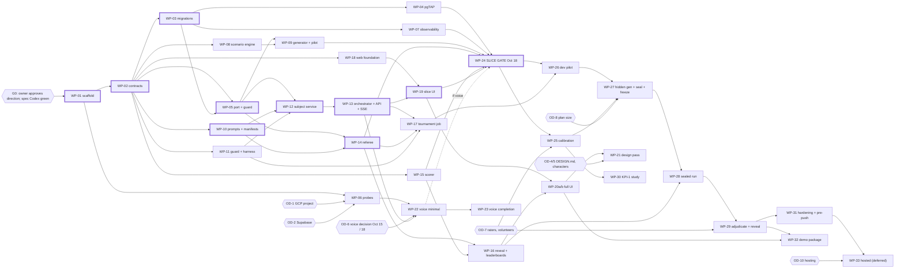
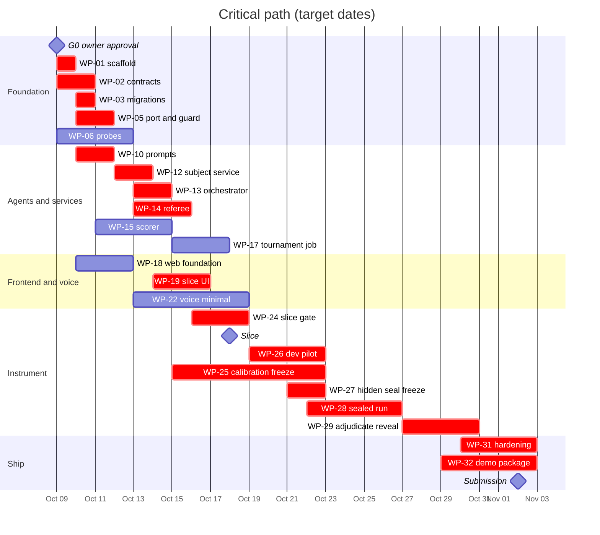

# S8: Build plan

Spec part S8 of the build-ready specification for the Investigative AI Training Arena (GMU Challenge X, sponsor Unissant). **Version 2, 2026-10-08: reconciled to direction v10.3, UI direction v2.1, D-012 and S8 C-01..C-48.** Build window 2026-10-08 to 2026-11-02.

Governing inputs: `docs/spec/README.md` (baseline facts; it wins over any part), `docs/research/synthesis/02-direction.md` v10.3 (cited as "direction"; section 3.2 sets the windows used here), `docs/challenge/REQUIREMENTS.md` (requirement IDs), `docs/handoff/DECISIONS.md` (D-001 to D-012; D-007 superseded by D-009; D-011 local-first; D-012 generated and applied budget ceilings), `docs/handoff/PATTERNS.md`, `docs/handoff/LESSONS.md`, `docs/research/synthesis/03-ui-direction.md` v2.1, and spec parts S1 to S7 with their `schemas/`, `seed-families/` and `sql/` folders. Every dollar figure below is printed by `docs/research/synthesis/cost_model.py` (run 2026-10-08, `HOSTING = "local"`, `PLAN = {"sealed": 24, "dev": 10}`), either directly or by calling its functions with no arithmetic beyond grouping; each figure names the function. Statistical bounds come from `stats_contracts.py`.

Markers: **OWNER DECISION PENDING** marks a choice only the owner makes; each work package (WP) is written so either answer works. **C-nn** refers to a consistency finding in section 9.

---

## 0. Summary

| # | Decision | Why | Requirements |
| --- | --- | --- | --- |
| 1 | 34 work packages in seven streams (foundation, scenario, agents and services, frontend, voice, instrument runs, ship). Each is sized S (up to 1.5 h of agent time), M (1.5-3 h) or L (3-5 h, Opus only). | PATTERNS subagent sizing: Sonnet up to ~3 h mechanical, Opus up to ~5 h architecture; larger work is split. | all |
| 2 | Nothing is built until gate G0 passes: owner approval of the direction (D-010 is "pending owner review") and a green Codex review of the spec package (S1-S8). | SUBAGENTS.md gate; global pre-push bar item 6. | all |
| 3 | WP-02 (contract reconciliation) runs before any service code. Spec v2 already carries the spec-level resolutions in section 9 (column "Spec v2"); WP-02 checks each against the parts, completes the build-time ones and generates the shared contracts (Pydantic models exported to JSON Schema). | The parts disagree on the coaching card, the finding, label vocabulary, event names, routes and the KPI-4 formula; code written against two shapes is rework. | AST-7, EVL-8, KPI-4, SCN-7 |
| 4 | Local-first (D-011) is the build default: separate local processes per credential (`arena-api` and the tournament job on `arena_public`, `arena-subject` on `arena_subject`, `arena-referee` on `arena_referee`), local Phoenix, the owner's Supabase project (local `supabase start` for development), Vertex for models. Cloud Run, IAP, the billing guard and the hosted judge link are one deferred package (WP-33; section 1.4). | D-011; D-008's hosted-link format is then an owner call (section 2, OD-10). | D-003, D-008, D-011 |
| 5 | Budget plan for the local 24-case baseline (`budget_plan()`, applied by the owner per D-012; the migrations seed $0 ceilings): global $74.00; demo $10.55, art $6.20, training $6.19, build $51.06 split into phase leaves. `simulate_d009(24, 10, high)`: $46.91 expected, $71.23 conservative, both complete in its single-pool simulation (per-leaf caveat in section 10 item 8). 30 cases if the dev pilot tracks the expected column (OD-8). | `cost_model.py` local mode; direction v10.3 TL;DR 6 and 8.2; D-012. | D-009, BKO-8 |
| 6 | Day-1 experiments start the morning the owner provides the GCP project. Before the database spend guard exists and its plan is applied, probes reserve their worst case in an in-process ledger seeded from `cost_model.py` (single process, so the in-memory ledger is sound), capped at `budget_plan()["experiments"]` ($6.96). | D-009: every call reserves its worst case before running; probes cannot wait for WP-05. | D-009, KPI-4 |
| 7 | Critical path to the 2026-10-18 slice: G0, WP-01, WP-02, WP-03, WP-05, WP-10, WP-12, WP-13, WP-14, WP-19, WP-24. Slack about one day. Critical path to 2026-11-02: slice, dev pilot, calibration freeze, hidden generation and seal, sealed run, adjudication and reveal, demo recording. Slack about one day, held in the Oct 31-Nov 2 window. | Direction 3.1, 3.2. | BKO-2, BKO-9 |
| 8 | Every code WP passes `make check`, the double Codex gate and, for major chunks, an Opus deep review before merge. Gates are never softened. | Global hard gates; PATTERNS verification gates. | P9 |

---

## 1. Planning assumptions

### 1.1 Calendar

| Date | Day | Event |
| --- | --- | --- |
| Thu 2026-10-08 | Day 0 | Spec package v1 written and reconciled to v2; Codex review of S1-S8 v2 |
| Fri 2026-10-09 | Day 1 | Owner inputs (G0); repo scaffold; day-1 probes if the GCP project exists |
| Mon 2026-10-12 | Day 4 | Window 1 exit: probe report, `make check` green |
| Thu 2026-10-15 | Day 7 | Owner decision point 1: Vertex Live model access (direction 3.2) |
| Sun 2026-10-18 | Day 10 | Vertical slice gate; owner decision point 2: voice integration |
| Thu 2026-10-22 | Day 14 | Dev pilot report; plan size decided; hidden split sealed; roster frozen |
| Mon 2026-10-26 | Day 18 | Sealed run complete (one execution record per planned trial) |
| Fri 2026-10-30 | Day 22 | Reveal; leaderboards bound to the inclusion manifest |
| Mon 2026-11-02 | Day 25 | Submission and demo |

### 1.2 Capacity rules

- At most 8 concurrent agents across all workflows (LESSONS 2026-09-25). The day plans in section 5 never exceed 6, leaving room for gate agents.
- Agent hours are not calendar hours: a WP's calendar time is agent time plus two Codex gates plus orchestrator review, about 1.5x to 2x the agent time.
- Humans are needed for: owner decisions, calibration raters (2 minimum, 3 preferred), subject validity reviewers, KPI-1 volunteers, demo rehearsal. The team roster is **OWNER DECISION PENDING**; every human step works with one person and records the reviewer ID (S3 4.2).
- Commits land on local feature branches and merge to local `main` after gates. No push until the owner names the repo destination and authorizes each push to `main` (global rules).

### 1.3 Budget plan (local 24-case baseline, D-012)

The migrations seed the spend-guard bucket tree with $0 ceilings, so nothing spends until the plan is applied (fail-closed). The owner applies `cost_model.budget_plan()`, printed by `python3 -I -B docs/research/synthesis/cost_model.py --plan-json`, through `ops.set_bucket_ceiling`; a test asserts the applied ceilings equal that output (WP-05). No ceiling is typed into SQL, code or tests.

Ceiling column: `--plan-json`, run 2026-10-08. Expected and conservative columns: `simulate_d009(24, 10, high)["phase_spend"]` for the build leaves, `demo_bucket(high)` for demo and art, `training_bucket(high)` for training. Each build leaf is its conservative phase spend rounded up to the cent; `interactive` takes the remainder of `build`.

| Bucket | Parent | Holds | Expected | Conservative | Ceiling |
| --- | --- | --- | --- | --- | --- |
| `global` | none | D-009 $75 cap (`CAP`) minus `NON_MODEL_ALLOWANCE_LOCAL` $1.00 | | | $74.00 |
| `demo` | global | 40 text sessions with R3 (`TEXT_SESSIONS`), 8 voice sessions (`VOICE_SESSIONS`), plus one in-flight voice reservation of $1.64 (`VOICE_RESERVATION`) | $5.18 | $8.91 | $10.55 (`demo_ceiling()` minus the art conservative cost) |
| `art` | global | 62 character images (`PORTRAITS`) | $4.34 | $6.20 | $6.20 |
| `training` | global | KPI-1, 10 volunteers x 7 sessions with R3, and 20 calibration transcripts with R3 (`TRAINING`, `r3()`) | $4.48 | $6.18 | $6.19 |
| `build` | global | phase leaves below | | | $51.06 (global minus demo, art, training) |
| `experiments` | build | latency benchmark, case-generation and fidelity pilots (`experiment_calls`), 30 Live probes reserving $0.13 each (`PROBE_RESERVATION`) | $3.63 | $6.95 | $6.96 |
| `generation` | build | 21 families: 5 dev-pilot, 4 KPI-1 dev (`KPI1_EXTRA_DEV_FAMILIES`), 12 hidden | $6.82 | $9.92 | $9.92 |
| `dev_pilot` | build | 5 dev blocks, 10 cases | $5.66 | $8.07 | $8.07 |
| `replay` | build | corpus $0.65 / $0.91, scoring 24 transcripts $2.57 / $3.73 | $3.22 | $4.64 | $4.64 |
| `interactive` | build | 12 blocks | $13.58 | $19.36 | $21.47 (remainder) |

Spend routing: KPI-1 and calibration sessions reserve in `training`; demo, judge and team sessions in `demo`; character images in `art` (C-46).

Whole-project simulation (`simulate_d009(n, 10, high)`): 24 cases $46.91 expected, $71.23 conservative (model $32.91 / $48.94; demo, art and training $13.99 / $21.29; allowance $0.00 / $1.00), every unit complete. 30 cases $52.08 expected, complete; $72.19 conservative, 11 of 15 interactive blocks. One interactive block is $1.61 conservative (`block_calls` at `liab_cost` x `RETRY_FACTOR`); admission needs $2.42 free (`ADMIT_FACTOR` 1.5).

**Plan size (OD-8).** Moving to 30 cases keeps the applied ceilings: the D-012 test pins them to `--plan-json`, and `budget_plan(30)` raises because 30 cases do not complete at conservative usage. At expected usage each 30-case phase fits its 24-case leaf (`simulate_d009(30, 10, False)["phase_spend"]` against `budget_plan()`: generation $7.79 of $9.92, dev_pilot $5.66 of $8.07, replay $4.03 of $4.64, interactive $16.98 of $21.47). Any unit a leaf cannot admit is recorded `budget_skipped`; the guard never overshoots.

**Leaf headroom (section 10 item 8).** `simulate_d009` runs all build work against one pool; the guard enforces each leaf (S4 8, S5 4.5). The leaves hold only rounding headroom above their conservative spend, so at conservative usage the last units of `generation`, `dev_pilot` and `replay` fail the 1.5x admission rule or cannot reserve their worst case (a family's generate call reserves $2.02, `liab_reservation`). Until `budget_plan()` adds that headroom, the conservative column is a single-pool figure, not a per-leaf guarantee; expected usage completes inside every leaf.

### 1.4 Hosted variant (deferred, WP-33, owner decision OD-10)

Kept so the build can switch without redesign; none of it is on the default path.

- **Budget.** Hosting from day 1 does not fit the baseline: `budget_plan(hosting="hosted")` raises for 24 cases (and for 20) under a $60.00 global (`CAP - NON_MODEL_ALLOWANCE`; allowance $15.00, itemized non-model estimate $2.88 expected and $9.67 high, summed from `NON_MODEL`). Switching later requires that committed liability leaves the remaining work under $60.00, checked by re-applying the hosted plan, which `ops.set_bucket_ceiling` refuses below current liability (spec README). The direction's hosted table (20 baseline, 26 pilot-gated, $12.43 demo; direction 8.2) predates the v10.3 art and training set-asides and is no longer reproduced by the script.
- **Scope (WP-33).** Cloud Run deployables at min-instances 0 with no CPU always allocated and no traffic tags; static web served same-origin by `arena-api` behind IAP, with the IAP identity mapped to an allowlisted app user (C-03); IAM-private `arena-subject` and `arena-referee`; billing guard with budget alerts at $25/$50/$65 and a billing-disable function at $70; the hosted judge link and walkthrough (S7 2.3); hosted Phoenix only with its own sign-off; the hosted probes (section 5.2, last row); teardown on 2026-11-09.
- **Gate.** Every infrastructure value is approved by the owner before apply (global infra gate); the scale-to-zero audit exits 0.

---

## 2. Owner decisions and what they block

| ID | Decision | Blocks | Needed by | Default if unanswered (design works either way) |
| --- | --- | --- | --- | --- |
| OD-0 | Approve direction v10.3 and the spec package v2 (D-010 pending owner review) | Every WP (gate G0) | 2026-10-09 | No build starts |
| OD-1 | Dedicated GCP project with billing and a budget alert at $25/$50/$65; never `kbg-production` (direction 13.2 item 2) | WP-06, WP-09, WP-12 live evals, WP-22, WP-24 onward | 2026-10-09 | Build continues in fake-model mode (`ARENA_MODEL_MODE=fake`, S5 10); day-1 probes slip day for day and the slice moves with them |
| OD-2 | Supabase project and plan; LOGIN and passwords for the three roles (secret writes, S4-D4) | WP-03 smoke on the owner's project, WP-06 isolation smoke, WP-12 onward on the real database | 2026-10-10 | Local `supabase start` for development (S5 10); the isolation smoke and keep-alive wait |
| OD-3 | Repo destination (private GitHub) and CI deploy identity (S5 D-P4) | Pushes and GitHub Actions in WP-01, WP-31 | 2026-10-12 | Local commits only; CI workflows written and run locally through `make check` |
| OD-4 | DESIGN.md and its format (Stitch design-md or impeccable; UI direction 7.2) | WP-21 | 2026-10-20 | Unstyled placeholder theme, never shipped (S6 11) |
| OD-5 | Character direction, pet name, plugin installs (UI direction 7.1, 7.3, 7.4) | WP-21 | 2026-10-20 | Status words and coach activity line instead of art (cut-order fallback) |
| OD-6 | Voice exception rule at the Oct 15 and Oct 18 decision points: keep Live in a parallel lane, push-to-talk (D-006 exception), Developer API (D-001 exception), or drop (direction 3.2) | WP-22, WP-23 | 2026-10-15 and 2026-10-18 | Voice dropped from the slice gate; text path unaffected (S2 9.5, S6 3.3) |
| OD-7 | Team roster: calibration raters and validity reviewers; KPI-1 volunteers (6-10) | WP-25, WP-29, WP-30 | 2026-10-14 (raters), 2026-10-20 (volunteers) | One rater: calibration reported as single-rater, instruments marked provisional (S3 7.5); KPI-1 shown as a dev-pilot measurement (S7 1.10) |
| OD-8 | Plan size: 24 hidden cases (12 families), or 30 (15 families) if the dev pilot's measured costs track the expected column; ceilings stay as applied from `budget_plan()` either way (section 1.3) | WP-27 | 2026-10-22 | 24 |
| OD-9 | `second_language` style level in the hidden split (S1 OD-1) | WP-27 | 2026-10-21 | Language fixed to `native`; four axes balanced |
| OD-10 | Hosted judge link at all (D-008 lists it; D-011 defers hosting), and if so Phoenix hosting (direction 13.2 item 6), infra values and quotas (S5 D-P7, S4-D3), billing-guard role (S5 D-P6), judge accounts (S5 D-P8); switching requires committed liability to leave the remaining work under $60.00 (section 1.4) | WP-33 | 2026-10-27 | Local only: the demo runs from the local stack by screen share; judges get video, deck and repo (S7 2.2, C-02) |
| OD-11 | A2A exhibition track (direction 13.2 item 8) | WP-34 | 2026-10-22 | No |
| OD-12 | Hidden-case steward allowed to inspect hidden families (S1 OD-2) | WP-27 | 2026-10-21 | No: validator output is codes, IDs and counts only |
| OD-13 | Pangea code copy (S5 D-P5) | WP-01, WP-07 | 2026-10-09 | Patterns only, through TechnoMile's rewrite |
| OD-14 | Attrition imputation of never-started blocks and the block infra rule (S3 OQ-2, OQ-3; C-36) | WP-27 (predeclared in the tournament manifest) | 2026-10-22 | Direction 7.1 literally: impute every exclusion; one infra failure invalidates an 18-trial block |

---

## 3. Work packages

### 3.1 Index

Window = target dates (direction 3.2). Model: S = Sonnet, O = Opus. "Owner" lists the decisions in section 2 that block the WP or part of it.

| WP | Title | Stream | Size | Model | Depends on | Owner | Window |
| --- | --- | --- | --- | --- | --- | --- | --- |
| WP-01 | Repo scaffold and lifted gates | Foundation | M | S | G0 | OD-0, OD-3, OD-13 | Oct 9 |
| WP-02 | Contract reconciliation and shared contracts | Foundation | L | O | WP-01 | OD-0 | Oct 9-10 |
| WP-03 | Database migrations, harness, capability fixture | Foundation | M | S | WP-01, WP-02 | OD-2 (smoke only) | Oct 10 |
| WP-04 | pgTAP suite (two halves) | Foundation | 2 x M | S | WP-03 | none | Oct 10-12 |
| WP-05 | Agent port and spend-guard client | Foundation | L | O | WP-01, WP-02, WP-03 | OD-1 (live smoke) | Oct 10-11 |
| WP-06 | Day-1 probe kit and probe report | Foundation | M | S | WP-01 | OD-1, OD-2 | Oct 9-12 |
| WP-07 | Observability: tracing, redaction, mirror, local Phoenix | Foundation | M | S | WP-01, WP-03 | OD-13 | Oct 11-12 |
| WP-08 | Scenario engine (deterministic) | Scenario | L | O | WP-01, WP-02 | OD-9 (factorial input) | Oct 10-11 |
| WP-09 | Generator, model validators, case-generation pilot | Scenario | M | O | WP-05, WP-08, WP-03 | OD-1 | Oct 12 |
| WP-10 | Prompts, output models, manifests | Agents | L | S | WP-02 | none | Oct 11 |
| WP-11 | Guard, harness relay, lexicons, replay script, fixtures | Agents | M | S | WP-02 | none | Oct 11-12 |
| WP-12 | `arena-subject` service and fidelity pilot | Agents | M | S | WP-03, WP-05, WP-10, WP-11 | OD-1 (pilot) | Oct 12-13 |
| WP-13 | Turn orchestrator, `arena-api` text routes, SSE | Agents | L | O | WP-03, WP-05, WP-10, WP-12 | none | Oct 13-14 |
| WP-14 | Referee calls, label pipeline, adjudication queue | Agents | L | S | WP-03, WP-05, WP-10 | OD-1 (evals) | Oct 13-15 |
| WP-15 | Scorer library (pure) | Agents | L | O | WP-02 | none | Oct 11-14 |
| WP-16 | Reveal, leaderboards, isolation-gate runner, calibration statistics | Agents | M | S | WP-03, WP-14, WP-15 | none | Oct 15-17 |
| WP-17 | Tournament job: roster, admission, harness, replay | Agents | L | S | WP-11, WP-13, WP-14 | none | Oct 15-17 |
| WP-18 | Web foundation: scaffold, contracts, SSE, pure state machines | Frontend | L | S | WP-01, WP-02 | none | Oct 10-12 |
| WP-19 | Slice UI (unstyled) | Frontend | L | S | WP-18, WP-13 | none | Oct 14-16 |
| WP-20a | Debrief, progress, trainer console, admin console | Frontend | L | S | WP-19, WP-14, WP-16 | none | Oct 19-24 |
| WP-20b | Arena (pipeline rail), trial replay, leaderboards, trust center | Frontend | L | S | WP-19, WP-16, WP-17 | none | Oct 21-28 |
| WP-21 | Design pass, characters, portraits, signature motion, accessibility | Frontend | L | O | WP-20a, WP-20b | OD-4, OD-5 | Oct 24-30 |
| WP-22 | Minimal voice session | Voice | L | O | WP-12, WP-13, WP-18, WP-06 (Live verdict) | OD-1, OD-6 | Oct 13-18 |
| WP-23 | Voice completion: retranscription, scoring gate, voice fairness fixtures | Voice | M | S | WP-22 | OD-6 | Oct 27-30 |
| WP-24 | Vertical slice integration and gate | Runs | M | O | WP-04, WP-07, WP-09, WP-13, WP-14, WP-15, WP-19; WP-22 if voice | OD-1, OD-2 | Oct 16-18 |
| WP-25 | Calibration: tooling, human rating, freeze | Runs | M | S + humans | WP-14, WP-15, WP-24 | OD-7 | Oct 15-22 |
| WP-26 | Dev pilot (10 cases) and plan-size recommendation | Runs | M | O | WP-17, WP-24 | OD-1 | Oct 19-22 |
| WP-27 | Hidden generation, seal, roster freeze | Runs | M | S (operator) | WP-09, WP-25, WP-26 | OD-8, OD-9, OD-12, OD-14 | Oct 21-22 |
| WP-28 | Sealed run | Runs | M | S (operator) | WP-27, WP-16, WP-17 | none | Oct 22-26 |
| WP-29 | Adjudication, reveal, publication | Runs | M | S + reviewer | WP-28 | OD-7 | Oct 27-30 |
| WP-30 | KPI-1 study operations | Runs | M | S + volunteers | WP-19, WP-14, WP-15, WP-25 | OD-7 | Oct 22-30 |
| WP-31 | Release hardening and pre-push bar | Ship | M | O | all shipped WPs | OD-3 | Oct 30-Nov 2 |
| WP-32 | Demo package: script, video, deck, Q&A, rehearsal | Ship | M | S + team | WP-29, WP-20b | OD-10 | Oct 29-Nov 2 |
| WP-33 | Hosted deployment (deferred) | Ship | L | O | WP-31 subset, WP-07 | OD-1, OD-10 | Oct 27-31 only if approved |
| WP-34 | A2A exhibition track (cut first) | Ship | M | S | WP-13 | OD-11 | only if approved |

### 3.2 Work package details

Acceptance tests cite the owning spec's IDs; a WP is done only when all of them pass and its gates (section 6) are green.

#### WP-01 Repo scaffold and lifted gates
- **Scope:** uv workspace with the four service packages and `arena_core` (S5 1); lifted `Makefile`, `tools/` gates, `ratchet.toml`, suppression allowlists and their tests (S5 T21-T24); `check_roles.py`; `check_cost_parity.py` stub; Dockerfile skeleton (T27); `.github/workflows` (ci, security, codeql, pr-title), `dependabot.yml`, `PULL_REQUEST_TEMPLATE.md`, `.github/instructions/`, project `CLAUDE.md`; `ATTRIBUTIONS.md`; boot checks (S5 1.3) including the `kbg-production` refusal.
- **Inputs:** S5 1, 2.1 (T21-T27), 2.2 (P4-P8, patterns only by default), 11; PATTERNS.
- **Outputs:** a clean clone where `make check` is green on empty packages; gateproof tests.
- **Acceptance:** S5 1.4 (all four), 2.6, 11.3 (all four).
- **Agent:** Sonnet, M.

#### WP-02 Contract reconciliation and shared contracts
- **Scope:** check that every section 9 resolution marked "applied" is present in S1-S7 v2 as written (each part lists its C-IDs under "Changes in v2"); fix any part that drifted; write `arena_core/contracts/` Pydantic models: `Finding` (C-27), `CoachingCard` card.v1 plus code-filled fields, `DeepUpdate`, `FinalFinding`, `SubjectTurn`, `RefereeSubjectReport` ref_subj.v2 (C-11), `RefereeAssistantReport`, event envelope and wire types (C-17), REST route table (C-18); export to `contracts/*.schema.json` deterministically; the S2-to-S3 scorer adapter (C-04, C-05) with unit tests; S1 schema v1.1 (C-21, C-22) and re-hashed seeds F01-F03.
- **Inputs:** section 9 of this part; S1 4, 13, 14; S2 1, 4, 6.8, 7, 13; S3 1.3, 3.8, 13; S4 4, 12; S5 5, 6, 7, 13; S6 5, 15, 16.
- **Outputs:** updated spec files; contracts package and exported schemas; mapping tests.
- **Acceptance:** every C-item is resolved in the spec text or listed as owner-pending; `lint_schema` (TechnoMile `structured.py:73-80`) passes on every model-facing schema; exporting twice gives byte-identical files; S6 event fixtures validate with ajv against the exported schema; the adapter maps the S3 2.10.4 trial fixture to the same flag outcomes S3 tables (1 TP, F3 duplicate FP, F4 demeanor FP); F01-F03 validate against schema v1.1 and AC-S1-01..26 still pass.
- **Agent:** Opus, L (about 4 h). Deep review required (it fixes every later interface).

#### WP-03 Database migrations, harness, capability fixture
- **Scope:** S4 WI-S4-01, 02, 04, 08 with the deltas from section 9: the bucket tree (global; demo, art, training, build; build leaves experiments, generation, dev_pilot, replay, interactive) seeded with $0 ceilings, fail-closed, no dollar figure in any migration (D-012, C-01), `debrief_ready` event kind and its referee function (C-17), `doc_kind` on artifacts (C-24), `variant_code` check (C-25), finding columns (C-27), `ops.ack_card` and latency columns (C-28), `retranscribe` and `portrait` limits (C-31), `decided_by` on adjudications (C-33), rater-keyed human labels (C-34), candidate kinds and manifest keys (C-47).
- **Inputs:** S4 (all), `sql/0001-0006`, `sql/TESTS.md` section 0; section 9.
- **Outputs:** `supabase/migrations/*.sql`, `supabase/config.toml` with no arena schema exposed, `run_pgtap.sh`, capability fixture CSV regenerated for the deltas, `make db-test`.
- **Acceptance:** S4 WI-S4-01, 02, 04, 08 criteria; `supabase db reset` applies cleanly on local Supabase and on plain Postgres 16 with pgTAP; with only the seeds applied, every reservation is refused (fail-closed, D-012); capability fixture exact-equality test green; CM-13 gate-proof fails as designed.
- **Agent:** Sonnet, M. **Owner:** OD-2 only for the hosted smoke (moved to WP-06).

#### WP-04 pgTAP suite
- **Scope:** WP-04a files 001-009, WP-04b files 010-018 of `sql/TESTS.md`, plus tests for the WP-03 deltas.
- **Acceptance:** S4 WI-S4-03: every listed test present with its `plan(n)`, all green, no skips (a skipped DB test fails collection, S5 11.3).
- **Agent:** Sonnet, 2 x M, in parallel after WP-03.

#### WP-05 Agent port and spend-guard client
- **Scope:** `arena_core.providers` (port, Vertex adapter with `max_output_tokens` = call-type limit and SDK retries 1, structured parse with one repair, retry with 4-attempt total, telemetry span per attempt, fake adapter) and `arena_core.spend` (database reservation client against S4 names, voice reservation client, in-memory `RunBudget` test double that also serves the day-1 probes, the plan-apply step `scripts/budget_plan.py` (S5 4.4: reads `cost_model.py --plan-json` and applies each row with `ops.set_bucket_ceiling` under the owner credential; it computes and stores no figure), `limits.py` parity with `cost_model.py`).
- **Inputs:** S5 2.1 T1-T10, 3, 4; S2 1, 2, 10; S4 8; `cost_model.py`; D-012.
- **Outputs:** port and guard packages; parity check and ceiling-parity test wired into `make check`.
- **Acceptance:** S5 3.6 (all seven), 4.10 (all; the simulation test replays `simulate_d009(24, 10, high)`'s call sequence, the `PLAN` baseline, through the real guard with the applied `budget_plan()` ceilings: the expected sequence completes every unit, and the conservative sequence never exceeds any leaf, `build` or `global` ceiling, with every unit it does not complete recorded `budget_skipped` or `budget_truncated`; with 30 sealed cases the same holds), ceiling-parity test (applied ceilings equal `python3 -I -B docs/research/synthesis/cost_model.py --plan-json`, D-012) and its gateproof (a one-cent change to an applied ceiling fails), S2 AT-PORT-1..4; `check_cost_parity.py` gateproof.
- **Agent:** Opus, L. Deep review required.

#### WP-06 Day-1 probe kit and probe report
- **Scope:** `scripts/probes/` with an in-process reservation ledger (worst case from `cost_model.liab_reservation`, cap = `budget_plan()["experiments"]`; see section 10 item 5 for the hand-over to the database guard): latency benchmark (direction 13.1 item 1; S2 EV-COACH-5), Vertex Live matrix with usage-metadata check (S5 P4, P5; direction 13.1 item 2), Supabase isolation smoke (S4 WI-S4-05, 06), LISTEN through the session pooler from the workstation (S5 P3, local variant), OpenInference google-genai instrumentation check (S5 P7), Gemini audio-input price and image-model ID lookups (S5 Q7; UI direction 1.2) through the Google Developer Knowledge MCP. Probe report at `docs/probes/2026-10-probe-report.md`.
- **Inputs:** direction 13.1; S5 12; S2 2, 5.2 (card prompt text, usable verbatim before WP-10); S4 13.
- **Outputs:** probe scripts with tests (fake mode), the report, the card-model recommendation, the Live verdict for OD-6.
- **Acceptance:** every probe in section 5.2 has a recorded pass or classified failure (IAM, region, SDK, feature, allowlist); total settled spend at or below the experiments ceiling, read from the probe ledger; no call ran without a reservation; every command passes the arena project explicitly.
- **Agent:** Sonnet, M (scripts); the orchestrator runs the probes. **Owner:** OD-1, OD-2.

#### WP-07 Observability
- **Scope:** S5 8.1-8.6 and 8.8 in local mode: tracing install, span hierarchy, export policy and redaction chain (T11-T16, C1), `ExportGate`, mirror writer, `make traces-push` pump, local Phoenix compose (pinned image, auth on, 127.0.0.1), anomaly detectors (C2).
- **Acceptance:** S5 8.9 (all eight; the last as the slice screenshot).
- **Agent:** Sonnet, M.

#### WP-08 Scenario engine (deterministic)
- **Scope:** S1 schemas v1.1 (from WP-02), `seed.py` sampler with the style factorial (7.5, takes n and the OD-9 answer), `assemble.py`, validators V1, V2, V3a, V4a, V4b, V4c, V5, the 21-defect mutation suite, `load.py` to the S4 ingest bundle, the few-shot brief renderer (dev-only, L5).
- **Inputs:** S1 3-11; `case-family.schema.json` and packet schemas; F01-F03.
- **Acceptance:** AC-S1-01..03, 05..07, 09, 12..20, 25, 26; mutation suite 21 of 21.
- **Agent:** Opus, L (the reference implementation from the spec session lived in a scratchpad and may be gone; budget for a rewrite).

#### WP-09 Generator, model validators, case-generation pilot
- **Scope:** `prompts/scenario/generator.system.v1.txt`, `FamilySource` model, generation job (dev mode writes files; hidden mode ingests only, L6), V3b and V3c calls; the day-3/4 case-generation pilot: V3b and V3c on F01-F03, two new dev families F04 and F05 through every validator, one model-based role-guesser demonstration on a public packet (V4a note).
- **Acceptance:** AC-S1-04, 21 (dev part), 24; F04 and F05 pass V1-V5 and ingest; pilot rejection rate recorded for `cost_model.py` (S1 open question 6).
- **Agent:** Opus, M. **Owner:** OD-1.

#### WP-10 Prompts, output models, manifests
- **Scope:** every prompt file and user template in S2 3-7 (coach common, A1-A3 strategy, deep, final; subject base, role, policy, style, turn; referee subject and assistant; Live instruction text), with the WP-02 edits (J1 decision order C-10, ref_subj.v2 C-11, LOCKED gates C-20, rule 9 likelihood sentence C-08, R2 trigger pairs C-12); prompt builders typed on `PublicTrialView` and `SubjectPacket`; manifest model, hash rule, freeze checks.
- **Acceptance:** S2 AT-MAN-1..6, AT-COACH-1..8 (fake model), AT-SUBJ-1..4, AT-REF-1 (as amended by C-12), AT-VOICE-1, 2, 4.
- **Agent:** Sonnet, L.

#### WP-11 Guard, harness relay, lexicons, replay script, fixtures
- **Scope:** `subject_guard.v1` (G1-G7), `relay_test.v1`, `neutrality_lexicon.v1`, `demeanor_lexicon.v1`, `fallbacks.v1`, `replay_script.v1` with the C-23 request rule, and fixtures `FX-GUARD-CLEAN`, `FX-RELAY-NEUTRAL`, `FX-RELAY-BAD`, `FX-DEM-NEUTRAL`, `FX-INJ` scripts, `FX-STYLE-PAIRS` transform, `FX-EX`, `FX-COOP`.
- **Acceptance:** S2 AT-SUBJ-5, 6, 8; AT-HAR-1..6; AC-S1-13 guard scan on F01-F05.
- **Agent:** Sonnet, M.

#### WP-12 `arena-subject` service and fidelity pilot
- **Scope:** `answer()` route (IAM token hosted, local service token locally), `subject.turn_context`, ledger render, one structured call, guard, `record_subject_turn`, failure paths (S2 6.10); then the fidelity pilot (direction 13.1 item 4): 3 subjects x 2 roles x 2 dev cases x 12 turns plus `FX-SUBJ-ATTACK`.
- **Acceptance:** S2 AT-SUBJ-7; S5 5.4 quarantine item; S2 EV-SUBJ-1..7 reported (a miss is a prompt defect fixed on dev data, never a lowered threshold).
- **Agent:** Sonnet, M. **Owner:** OD-1 for the pilot.

#### WP-13 Turn orchestrator, `arena-api` text routes, SSE
- **Scope:** S5 5 and 6 on S4 functions: one open turn, work items, the POST-turn sequence, standalone evidence requests and finding commit (C-18), coaching calls with A1 deep update, `finalize_trial`, ticketed SSE with projections and synthesized wire events (C-17), KPI-4 acknowledgement route (C-28), dev identity middleware and kill-switch middleware, one-variant-per-family case listing (C-37), route-level capability tests including the job-to-referee and api-to-referee routes (C-42).
- **Acceptance:** S5 5.4 (all seven), 6.5 (all six; IAP items run against the dev identity locally), S4 RE/ST/FC tests exercised through the service; C-37 test: a user who finished one variant of a family is never offered its sibling.
- **Agent:** Opus, L (about 5 h). Deep review required.

#### WP-14 Referee calls, label pipeline, adjudication queue
- **Scope:** `referee_subject` (J1, J2) then `referee_assistant` (J3, J4) per trial with code checks and derived values (S2 7.2, 7.3), storage in `sealed.independent_labels` and `sealed.judgments`, automatic validity proposal (S3 4.2), blinded review-queue API, development debrief projection and `debrief_ready` event, training-session scoring (R3 as the two referee calls, `cost_model.r3()`, C-15; reserved in `training` for KPI-1 and calibration sessions and in `demo` otherwise, section 1.3).
- **Acceptance:** S2 AT-REF-1, 7, 8 (fake and dev), AT-REF-2..6 run in WP-25; S3 AC-S3-4.4; R2 never runs before R1 for a trial (ordering test).
- **Agent:** Sonnet, L.

#### WP-15 Scorer library (pure)
- **Scope:** S3 1.4-1.5, 2.8-2.9, 3.7, 4.3-4.4, 5, 6, 8 as pure functions with exact rationals: rubric mapping, PFQ routing, citation existence, flag status, evasion matching (strict and broad), role metrics, cluster bootstrap, zero-event bound, eligibility and attrition (port of `stats_contracts.py`), ranking with rank intervals, inclusion-manifest text and hash, KPI-1, KPI-4, fairness tests; every fixture in S3 10.
- **Acceptance:** AC-S3-1.1..1.3, 2.1..2.7, 3.1, 3.3, 3.4, 4.1, 4.2 (Python half), 5.1..5.5, 6.1, 6.2, 8.1..8.4, 9.1, 9.2; `source_unavailable` handled (C-35).
- **Agent:** Opus, L (about 5 h). Deep review required.

#### WP-16 Reveal, leaderboards, isolation-gate runner, calibration statistics
- **Scope:** referee operations around S4 `reveal`, `seal_corrected_manifest`, leaderboard writer (original and corrected), IG-1..IG-6 runner writing `arena.isolation_checks`, canary audit, 8-gram prompt scan (S2 3.4), AC1/AC2/QWK implementations and calibration report.
- **Acceptance:** AC-S3-4.2 (SQL and Python parity), 4.3, 7.1..7.4; S4 RV tests via the referee; FX-I01, FX-I02.
- **Agent:** Sonnet, M.

#### WP-17 Tournament job
- **Scope:** roster builder (blocks of one family x nine pairings x one repeat, seeded order, equal-budget checks, negative controls refused), unit admission, `HarnessAsker`, replay-corpus producer and seal, `ReplayScorer`, resumable runner, infra retries, budget states, block-boundary scoring call to the referee.
- **Acceptance:** S5 5.3 behaviors as tests; S2 AT-HAR-4; S4 EF-05..EF-11 through the job; a killed job restarted mid-block produces no duplicate execution record.
- **Agent:** Sonnet, L.

#### WP-18 Web foundation
- **Scope:** S6 1 (re-verify pins at scaffold), contracts types from WP-02 schemas, ajv runtime validation, lifted `ticketed-stream.ts` with the trial backoff, `trialReducer`, voice machine (S5 frame and close-code names, C-29), companion FSM (C-38d), avatar FSM, arena fold for the pipeline rail; lint rules (no `fetch` outside `src/lib/api`, no Supabase import, forbidden PRB-4 identifiers, no raw tokens).
- **Acceptance:** S6 FE-TECH-1, 3, 4; FE-SSE-1, 2, 4, 6; FE-VOICE-1..4; FE-PET-1, 2; FE-AV-1, 2; FE-AW-1, 3; Vitest 90% on `src/lib/**`.
- **Agent:** Sonnet, L.

#### WP-19 Slice UI (unstyled)
- **Scope:** onboarding with EX-4, case library (one variant per family), case brief, room (text, practice and assessment), evidence board with "Present" inserting the record title and a selected excerpt into the question (C-19), coach card with citation chips, finding commit producing the shared `Finding` (C-27), plain leaderboard reading a dev tournament.
- **Acceptance:** S6 FE-ONB-1, 2; FE-LIB-1, 2; FE-ROOM-1..5; FE-EVD-1..3; FE-COACH-1..6; FE-FIND-1..3; FE-SSE-3, 5; E2E-1, 2, 3.
- **Agent:** Sonnet, L.

#### WP-20a and WP-20b Full UI
- **WP-20a scope:** debrief (five cards, three scorecards, annotated transcript, export), progress, trainer console, admin console on the referee process. **Acceptance:** FE-DEB-1..4, FE-PRG-1, 2, FE-REV-1..3, FE-ADM-1, 2, FE-KPI4-1, E2E-8.
- **WP-20b scope:** arena with the pipeline rail first (C-38c), trial replay, leaderboards in full, trust center (isolation, commitments with in-browser verification, fairness, methodology, budget). **Acceptance:** FE-ARENA-1..3, FE-LB-1..5, FE-TRUST-1..3, FE-AW-2, 4, 5, FE-EX4-1, 2, E2E-5, 6, 7, 9.
- **Agent:** Sonnet, L each.

#### WP-21 Design pass, characters, portraits, signature motion, accessibility
- **Scope:** DESIGN.md tokens through Stitch and `impeccable`; companion art and wiring; 62 portraits (C-46, `PORTRAITS`) through the port and the `art` bucket; Motion for state-driven UI and a GSAP spike only for the evidence-released sequence (UI direction 2); voice pill bar; anti-slop checklist; WCAG 2.2 AA pass; REL-1 frame pacing.
- **Acceptance:** FE-A11Y-1..4, FE-PET-3..5, FE-AV-3, 4, FE-TOK-1, E2E-10, REL-1 recorded; portrait spend read from `ops.model_calls` at or below the `art` ceiling (`budget_plan()["art"]`).
- **Agent:** Opus, L. **Owner:** OD-4, OD-5.

#### WP-22 Minimal voice session
- **Scope:** S5 7 locally: voice tickets, `arena-api` relay to `arena-subject` with the local service token, Vertex Live session (model and region from the probe), whole-session reservation and meter, safety loop with G3-G5, resume with stored handle, `played` acknowledgements, fragment persistence and turn reconstruction, `record_voice_question` and `record_subject_turn(partial)`, coaching over SSE; S6 voice UI with consent and the pill bar placeholder.
- **Acceptance:** S5 7.8 ticket, protocol, cost-kill, reconnect items and the minimal slice gate item; S2 AT-VOICE-3; E2E-4 against the fake Live backend; one real development-case session on Vertex with its spend read from `ops.model_calls`.
- **Agent:** Opus, L (about 5 h). **Owner:** OD-1, OD-6 (stop at the Oct 15 decision if neither Live model connects).

#### WP-23 Voice completion
- **Scope:** retranscription of played audio (S5 7.7; needs the `retranscribe` limit row, C-31), the four scoring-gate tests (delayed transcription, buffered unplayed audio, reconnect, mid-word interruption), matched-content voice fixtures (direction 9 N03).
- **Acceptance:** S5 7.8 remaining items; voice sessions stay `scored = false` until all pass.
- **Agent:** Sonnet, M. Cut before any never-cut item.

#### WP-24 Vertical slice integration and gate (2026-10-18)
- **Scope:** wire the services; ingest F01-F05; run real text practice trials and a two-block dev tournament through every S4 5.3 step; referee scoring; plain leaderboard on dev data; Phoenix trace of a full trial; voice verdict; rubric anchors calibrated on slice transcripts (first WP-25 round).
- **Acceptance (direction 3.1 exit):** one domain, four or more dev families, generator and validators, text subject through `arena-subject`, one single-call assistant, harness, `finalize_trial`, referee scoring, plain leaderboard, Phoenix trace all demonstrated on the real stack; KPI-4 samples recorded; if voice is in, ticket auth, reconnect, transcript finalization and cost-cap tests pass on real Live; spend to date read from the ledger.
- **Agent:** Opus, M plus orchestrator. Deep review and double Codex gate on the integration branch.

#### WP-25 Calibration
- **Scope:** samplers C-RUB, C-QQ, C-LAB and flags (S3 7.2; strata never from R1 or R2 outputs), R3 on the calibration transcripts (`TRAINING["calibration_transcripts"]`, reserved in `training`), rater UI via the trainer console or a sheet export, statistics (WP-16), at most two revision rounds on development data, freeze of referee prompts, rubric hash and lexicons before roster freeze.
- **Acceptance:** S3 7.6; S2 AT-REF-2..6 and AC-S3-3.2 (R1 at least 17 of 20 on E1-E20); calibration report hash recorded for the tournament manifest. A missed threshold ships as "provisional", never as a lowered threshold.
- **Agent:** Sonnet, M plus raters. **Owner:** OD-7.

#### WP-26 Dev pilot
- **Scope:** generate dev families to 5 for the pilot plus 4 for KPI-1 (`KPI1_EXTRA_DEV_FAMILIES`, already in `budget_plan()["generation"]`; WP-09 job); run 5 dev blocks with the full lineup; measure settled cost per call type, card latency, subject fidelity, request maxima, referee output sizes (S2 O-1, S3 OQ-5), difficulty bands (S1 V6); tighten manifest limits from maxima; hand the measured inputs to the research owner, who updates `cost_model.py` and reruns it; recommend 24 or 30 (OD-8). If the rerun changes `--plan-json`, the owner re-applies it (D-012).
- **Acceptance:** dev pilot report with per-phase spend from `ops.model_calls` against the expected and conservative columns of section 1.3, KPI-4 screening p95, EV-SUBJ-1 on pilot data, V6 band check, rerun cost-model output pasted from the script; manifests re-hashed and frozen-ready.
- **Agent:** Opus, M. **Owner:** OD-8 decided from the report.

#### WP-27 Hidden generation, seal, roster freeze
- **Scope:** seed sampler for n = 12 or 15 hidden families (OD-8: 24 or 30 cases) with the factorial (OD-9), generate, validate, ingest, `seal_hidden_split`, commit the seal hash to the repo, register frozen candidates, referee 8-gram scan and canary placement, predeclare OD-14 rules in the tournament manifest, `add_planned_trials`, `freeze_tournament`.
- **Acceptance:** AC-S1-16, 18, 21, 22; S4 CS-07..CS-10; roster hash recorded; ledger event order shows seal before freeze.
- **Agent:** Sonnet, M (operator-driven). **Owner:** OD-8, OD-9, OD-12, OD-14.

#### WP-28 Sealed run
- **Scope:** BKO-2 order: replay corpus, corpus adjudication, corpus seal, replay scoring, interactive blocks with the referee scoring each block online; monitoring of spend and anomalies; budget states recorded.
- **Acceptance:** one execution record per planned trial (S4 `ledger.planned_execution`); corpus sealed before any replay trial (EF-09..EF-11); spend at or below bucket ceilings; no hidden span exported (S5 8.9 hidden gating).
- **Agent:** Sonnet, M (mostly supervising runs that take hours).

#### WP-29 Adjudication, reveal, publication
- **Scope:** blinded human review of proposed `subject_invalid` and a seeded 10% of `valid` (S3 4.2), `close_tournament_run`, `begin_scoring`, `reveal`, original leaderboards, isolation-gate evidence, post-reveal human audit of 20 trials (S3 7.5 item 5), held-span export.
- **Acceptance:** S4 RV-01..RV-20 preconditions met on the real tournament; leaderboards name the manifest hash; FE-LB and FE-TRUST checks pass on real data.
- **Agent:** Sonnet, M plus reviewer. **Owner:** OD-7.

#### WP-30 KPI-1 study operations
- **Scope:** participants and consent (up to 10 volunteers x 7 sessions, `TRAINING`; spend reserved in `training`), case sets A and B from families each participant has not seen (C-37), counterbalancing, assessment-mode pre and post tests, practice sessions, blinded export, proxy and human scoring, report.
- **Acceptance:** AC-S3-6.1, 6.3, 6.4; S4 TT tests; report states "demonstration of the instrument, not a causal claim".
- **Agent:** Sonnet, M plus volunteers. **Owner:** OD-7.

#### WP-31 Release hardening and pre-push bar
- **Scope:** full gate run, docs accuracy (README, runbooks, local run guide, teardown note), secrets and push-clean scan, accessibility re-check, Codex push-readiness review, scale-to-zero audit if any infrastructure exists.
- **Acceptance:** every item of the global pre-push quality bar confirmed in writing; Codex GREEN.
- **Agent:** Opus, M.

#### WP-32 Demo package
- **Scope:** S7 v2 carries the local script and OD-8 sizes (C-40); WP-32 switches to S7 2.3 only if OD-10 approves hosting, then produces the six-minute script, recorded fallback, 3-4 minute video with captions on every disclaimer, 12-slide deck, Q&A with final numbers reprinted from the scripts and the revealed leaderboard at recording time, the judge package (S7 2.2), rehearsal.
- **Acceptance:** every number in video, deck and Q&A traced to a leaderboard row, `ops.model_calls` or a script output; EX-4, EVL-10 and EVL-12 text present; editorial-voice review.
- **Agent:** Sonnet, M plus team.

#### WP-33 Hosted deployment (deferred, D-011; section 1.4)
- **Scope:** S5 9 and the hosted probes (P1, P2, P6, P8, P9, direction 13.1 item 6), `deploy.sh --plan` then apply, IAP, IAM assertions, audit, billing guard in `DRY_RUN`, teardown on 2026-11-09; hosted Phoenix only with its own sign-off; the hosted budget switch (section 1.4) checked before any deploy.
- **Acceptance:** S5 9.9 (all five); every infrastructure value approved by the owner before apply (global infra gate); min-instances 0 everywhere, no CPU always allocated, no traffic tags.
- **Agent:** Opus, L. **Owner:** OD-1, OD-10. Not on the critical path.

#### WP-34 A2A exhibition track
- **Scope:** direction 5 exhibition rules (pinned SDK, conformance fixture, address and redirect checks, caps, labeled results) inside `arena-api` under `arena_public`.
- **Owner:** OD-11. First to cut.

---

## 4. Dependency graph and critical path

### 4.1 Graph

Thick borders mark the critical path to the slice; owner decisions are hexagons.

### 4.2 Critical path to the 2026-10-18 slice

| Step | WP | Agent time | Calendar (with gates) | Target finish |
| --- | --- | --- | --- | --- |
| 1 | G0 owner approval + spec Codex green | n/a | owner | Oct 9 morning |
| 2 | WP-01 scaffold | ~2.5 h | 0.5 day | Oct 9 |
| 3 | WP-02 contracts | ~4 h | 1 day | Oct 10 |
| 4 | WP-03 migrations | ~2.5 h | 0.5 day | Oct 10 |
| 5 | WP-05 port + guard | ~5 h | 1 day | Oct 11 |
| 6 | WP-10 prompts (parallel from Oct 10; joins here) | ~3 h | 1 day | Oct 11 |
| 7 | WP-12 subject service (fidelity pilot runs alongside step 8) | ~2.5 h | 1 day | Oct 13 |
| 8 | WP-13 orchestrator + API + SSE | ~5 h | 1.5 days | Oct 14 |
| 9 | WP-14 referee (starts Oct 13 in parallel; joins here) | ~3 h | 1 day | Oct 15 |
| 10 | WP-19 slice UI (starts on the fake port Oct 14) | ~3 h | 1.5 days | Oct 16 |
| 11 | WP-24 slice integration and gate | ~3 h + runs | 2 days | Oct 18 |

Slack: about one day, from running WP-14 and WP-19 against the fake port while WP-13 finishes. If G0 or OD-1 slips by more than one day, the slice gate slips with it (section 8, R-01). Applying the budget plan (D-012) sits between WP-05 and the first live database-guarded call (WP-09, Oct 12); it is a short owner action, not a WP, and moves no date.

### 4.3 Critical path to 2026-11-02 (direction 3.2)

| Window (direction 3.2) | Critical work | Exit gate |
| --- | --- | --- |
| Oct 8-12 | WP-01..WP-08, WP-10, WP-11, WP-15, WP-18 start; WP-06 probes | Probe report; `make check` green |
| Oct 13-18 | WP-12, WP-13, WP-14, WP-19, WP-22, WP-24 | Slice passes; anchors calibrated on dev data; voice verdict |
| Oct 19-22 | WP-26 dev pilot; WP-25 calibration freeze; WP-27 hidden generation, seal, freeze (sealed list starts Oct 21 once V6 bands hold) | Pilot report; sealed split hash; frozen roster |
| Oct 22-26 | WP-28 sealed run (12 interactive blocks at the 24-case baseline, 15 at 30); WP-20a/b in parallel | One execution record per planned trial |
| Oct 22-29 | WP-30 KPI-1 sessions | Counterbalanced sessions scored blind |
| Oct 27-30 | WP-29 adjudication and reveal; WP-20b trust center and leaderboards on real data; WP-21; WP-23 | Commitments and snapshot verified before reveal |
| Oct 31-Nov 2 | WP-31 hardening; WP-32 recording and rehearsal; WP-33 only if approved | Pre-push quality bar green |

---

## 5. First seven days

### 5.1 Day by day

| Day | Date | Dispatch (max 6 concurrent agents) | Orchestrator and owner | Exit |
| --- | --- | --- | --- | --- |
| 0 | Thu Oct 8 | none (spec package only) | Reconcile S1-S8 to v2; Codex review of v2 in the foreground until green x green; send the owner the G0 list (OD-0..OD-3, OD-13, budget alert) | Spec package GREEN, or findings applied |
| 1 | Fri Oct 9 | WP-01 (S); WP-06 probe scripts (S); WP-02 starts after WP-01's skeleton lands (O) | Owner: approve direction, create GCP project with budget alert, Supabase project, repo destination. Run the Live probe matrix and the latency benchmark as soon as ADC works on the arena project | WP-01 merged; Live verdict draft; latency numbers for 3 configurations |
| 2 | Sat Oct 10 | WP-02 (O, cont.); WP-03 (S) after WP-02's SQL deltas; WP-08 (O); WP-18 (S); WP-10 (S) on the WP-02 draft models | Owner sets LOGIN and passwords for the three roles (secret write, explicit authorization); run Supabase isolation smoke and LISTEN probe | WP-02 merged; migrations apply locally and on the owner's project; isolation smoke 001 and 003 green |
| 3 | Sun Oct 11 | WP-04a, WP-04b (S); WP-05 (O); WP-11 (S); WP-15 (O); WP-10 (cont.) | Probe report v1 written; card-model recommendation (lineup unchanged unless a configuration misses badly; Priority tier measured on the best) | WP-05, WP-10, WP-11 merged or in gate |
| 4 | Mon Oct 12 | WP-07 (S); WP-09 (O) case-generation pilot; WP-12 (S); WP-15 (cont.); WP-18 (cont.) | Owner applies `budget_plan()` through `ops.set_bucket_ceiling` once WP-05's apply step and ceiling-parity test are green, before WP-09's first live call (D-012: the $0 seeds refuse every reservation until then); probe-ledger spend handed over per section 10 item 5. Window-1 exit review: probe report final, `make check` green on `main` | Probe report; `make check` green; plan applied and ceiling-parity test green on the owner's project; F04, F05 generated and validated |
| 5 | Tue Oct 13 | WP-13 (O); WP-14 (S); WP-22 (O) if Live connected; WP-12 fidelity pilot run | Read fidelity pilot; revise subject prompts on dev data if EV-SUBJ-1 < 95% | Fidelity pilot report; first text turn through `arena-subject` |
| 6 | Wed Oct 14 | WP-13 (cont.); WP-19 (S) on the fake port; WP-25 calibration kit (S); WP-16 (S) | Recruit raters and volunteers (OD-7) | First full practice trial in fake mode end to end |
| 7 | Thu Oct 15 | WP-14 (cont.); WP-17 (S); WP-22 (cont.); WP-19 (cont.) | **Owner decision point 1:** if neither Live model is usable, owner picks a voice branch (OD-6). First real-model dev trial through the full stack | Decision recorded in DECISIONS.md; one real dev trial finalized with a commitment |

### 5.2 Day-1 experiments and probes that need the owner's projects

Costs are the cost model's experiment line: day-1 experiments including the Live probe, $3.63 expected and $6.95 conservative (`simulate_d009(24, 10, high)["phase_spend"]["experiments"]`), inside the $6.96 experiments ceiling (`budget_plan()["experiments"]`); each Live probe reserves $0.13 (`PROBE_RESERVATION`), at most 30 (`LIVE_PROBE`).

| Probe | Needs | Pass condition | If it fails |
| --- | --- | --- | --- |
| Latency benchmark: complete card on `gemini-3.5-flash-lite` single, `gemini-3.1-flash-lite` single, `gemini-3.5-flash-lite` two-stage card; MINIMAL thinking; early and late contexts; 100 calls each; Priority tier on the best (direction 13.1 item 1; S2 EV-COACH-5) | OD-1 | p95 measured and recorded per configuration from the workstation | KPI-4 risk path (section 8 R-03): compact prompts, Priority tier, disclosed definition; lineup change only by owner decision |
| Vertex Live matrix: `gemini-3.8-live`, `gemini-live-2.5-flash-native-audio` x documented US regions and `global` x client (`aio.live.connect` with ADC, raw WebSocket) x config (audio base, transcription, resumption); usage metadata per modality (S5 P4, P5) | OD-1 | One model connects with transcription and a resumption handle; per-modality token counts present | Classify each failure (IAM, region, SDK, feature, allowlist); feeds OD-6 on Oct 15 |
| Supabase isolation smoke: migrations on the owner's project, pgTAP 001 and 003, Data API cannot reach any arena schema (S4 WI-S4-05, 06, Q9) | OD-2 | Green | Fix migrations; never expose a schema to pass |
| LISTEN/NOTIFY through the Supavisor session-mode port (S5 P3, local variant) | OD-2 | Notification within 100 ms | Rely on the 1 s re-poll (S5 6.4) |
| OpenInference google-genai instrumentation: package, pinned version, span shape (S5 P7) | OD-1 (one real call, shared with the benchmark) | LLM spans with token counts | Manual `llm.<call_type>` spans only |
| Case-generation pilot: V3b and V3c on F01-F03; two new families through every validator (direction 13.1 item 3) | OD-1 | All pass; rejection rate recorded | Fix the seed or prompt on dev data; never relax a check |
| Fidelity pilot: 3 subjects x 2 roles x 2 cases x 12 turns plus attack scripts (direction 13.1 item 4; S2 11.4) | OD-1 | EV-SUBJ-1..7 | Revise subject prompts on dev data |
| Gemini audio-input price for retranscription and the Vertex image model for portraits (S5 Q7; UI direction 1.2) | none (documentation lookup through Google Developer Knowledge MCP) | Prices recorded as new rows for `ops.model_prices` | Keep the cost model's lines as reservations |
| Deferred to WP-33 (hosted only): IAP with SSE and WebSocket, service-account ID token through IAP, cold start on Cloud Run, billing guard dry run (direction 13.1 item 6; S5 P1, P2, P6, P8, P9) | OD-10 | n/a until hosting is approved | n/a |

---

## 6. Gates per work package

### 6.1 Gate definitions

| Gate | What it is | Pass |
| --- | --- | --- |
| `make check` | S5 11.1: deps-sync, py-check (ruff, format, strict mypy, no-rigging, silent-except, roles, cost-parity, ratchet, deps-policy, push-clean, pytest 90% branch coverage, diff-cover 90%), db-test, web-check, sec-check | All green, no gate softened |
| db-test | All pgTAP files on Postgres 16 with pgTAP, no skips | All green |
| Double Codex gate | The implementing agent's own Codex review, then the orchestrator's independent cold Codex review (`subagent-dispatch-protocol`); every finding goes through `red-to-root-cause` before a fix | GREEN x GREEN |
| Deep review | `superpowers:code-reviewer` on Opus after a major chunk | GREEN |
| Live eval | The WP's EV-* or AT-* evaluations with real calls on development data only, spend read from `ops.model_calls` | Thresholds met as written, or the instrument ships "provisional" (S3 7.5); thresholds never lowered |
| Owner gate | Explicit owner approval for infra values, secret writes, pushes to `main`, destructive database operations | Approval recorded in DECISIONS.md before the action |
| Milestone gate | Slice (direction 3.1), pilot report, seal-before-freeze, reveal preconditions, pre-push bar | As stated in the WP |

### 6.2 Gate matrix

| WP | `make check` | db-test | Double Codex | Deep review | Live eval | Owner gate | Milestone |
| --- | --- | --- | --- | --- | --- | --- | --- |
| WP-01 | yes | n/a | yes | no | no | push (OD-3) | |
| WP-02 | yes | yes (SQL deltas parse) | yes | yes | no | | |
| WP-03, WP-04 | yes | yes | yes | yes (WP-03 + WP-04 together) | no | secret writes (OD-2) | |
| WP-05 | yes | yes | yes | yes | smoke only | | |
| WP-06 | yes | n/a | yes | no | probes | project use (OD-1, OD-2) | Window-1 exit |
| WP-07 | yes | yes | yes | no | no | | |
| WP-08 | yes | n/a | yes | yes | no | | |
| WP-09 | yes | yes | yes | no | case-gen pilot | | |
| WP-10, WP-11 | yes | n/a | yes | no (WP-12 review covers them) | no | | |
| WP-12 | yes | yes | yes | yes (with WP-10, WP-11) | fidelity pilot | | |
| WP-13 | yes | yes | yes | yes | no | | |
| WP-14 | yes | yes | yes | yes | AT-REF on dev | | |
| WP-15 | yes | n/a | yes | yes | no | | |
| WP-16, WP-17 | yes | yes | yes | yes | no | | |
| WP-18, WP-19, WP-20a, WP-20b | yes | n/a | yes | WP-19 and WP-20b | no | | |
| WP-21 | yes | n/a | yes | no | portraits | DESIGN.md (OD-4, OD-5) | |
| WP-22, WP-23 | yes | yes | yes | yes (WP-22) | one real session | voice branch (OD-6) | |
| WP-24 | yes | yes | yes | yes | yes | | Slice |
| WP-25 | yes | n/a | yes | no | calibration | raters (OD-7) | Freeze before roster |
| WP-26 | yes | yes | yes | no | dev pilot | plan size (OD-8) | Pilot report |
| WP-27 | yes | yes | yes | no | generation | OD-8, OD-9, OD-12, OD-14 | Seal before freeze |
| WP-28, WP-29 | n/a (operations) | n/a | report review | no | sealed run | reviewers (OD-7) | Reveal preconditions |
| WP-30 | yes | yes | yes | no | sessions | volunteers (OD-7) | |
| WP-31 | yes | yes | Codex push-readiness | yes | no | every push | Pre-push bar |
| WP-32 | n/a | n/a | Codex review of numbers | no | no | | |
| WP-33 | yes | yes | yes | yes | hosted probes | infra values, secrets (OD-10) | Audit exit 0 |

Handoff discipline (global gate): the orchestrator rewrites `docs/handoff/STATE.md`, updates `SUBAGENTS.md` on each dispatch and completion, appends `HISTORY.md` per commit, and commits `docs(handoff): ...` in the same turn. WP agents write only their own files.

---

## 7. Cut order

Cut in this order when a window is at risk; each cut keeps every never-cut item intact.

| Order | Cut | What ships instead | Saves |
| --- | --- | --- | --- |
| 1 | WP-34 A2A exhibition | Nothing (not on the official leaderboard anyway) | M |
| 2 | WP-33 hosted deployment | Local stack by screen share; video, deck, repo for judges | L plus probes |
| 3 | Agents-at-work theater toggle and extra motion (WP-20b, WP-21) | Pipeline rail with the reduced-motion rendering (S6 6.5) | M |
| 4 | Companion and portrait art (WP-21) | Status words and the coach activity line (S6 14) | M; the `art` bucket, $4.34 expected (`demo_bucket(False)["portraits"]`), $6.20 ceiling |
| 5 | WP-23 voice completion | Voice stays practice-only and unscored | M |
| 6 | Extra domains beyond facility access | One domain | n/a (never planned) |
| 7 | WP-22 voice (owner decision OD-6) | Text only | L |
| 8 | 30-case plan | 24 cases | $5.17 expected (`simulate_d009(30, 10, False)["total"]` minus `simulate_d009(24, 10, False)["total"]`) |
| 9 | KPI-1 volunteer count below 6 | Dev-pilot-labeled instrument demonstration (S7 1.10) | humans |

Never cut (direction 3.3): the 9N metrics, the isolation gate, the fairness audit, the EX-4 statements, assessment-mode projections; also the gate-before-rank leaderboard, citation chips, commit-before-reveal and the trust center's isolation and fairness sections (S6 14).

---

## 8. Risks that would move the plan

| ID | Risk | L | I | Trigger | Plan move |
| --- | --- | --- | --- | --- | --- |
| R-01 | Owner inputs (G0, OD-1, OD-2) arrive late | M | H | Not received by Oct 10 | Build continues in fake mode and on local Supabase; every day of OD-1 delay moves the slice gate one day; at more than 3 days, cut WP-22 from the slice and compress the dev pilot to 3 blocks |
| R-02 | Neither Vertex Live model connects | M | M | Probe matrix by Oct 12 | OD-6 on Oct 15; WP-22 stops; text path unaffected |
| R-03 | Complete-card p95 above 3 s on every configuration | M | H | Latency benchmark (Oct 9-11), dev pilot | Compact prompts, Priority tier, input windowing; disclose; KPI-4 reported as missed, never redefined |
| R-04 | Spec contract drift reappears during build | M | H | Any Codex finding on an interface mismatch | WP-02 contracts are the only source; a mismatch is fixed in `arena_core/contracts` and re-exported, never patched locally |
| R-05 | Calibration misses thresholds after two rounds | M | H | WP-25 by Oct 21 | Ship "provisional" per S3 7.5; leaderboard order decided by QQ is marked provisional |
| R-06 | Subject fidelity below 95% on the all-turn denominator | M | H | Fidelity pilot Oct 13, dev pilot | Revise subject prompts on dev data before freeze; publish the measured value |
| R-07 | Dev pilot costs above the expected column | L | M | WP-26 report | Stay at 24 cases (OD-8); the guard prevents overshoot; blocks beyond the cap become `budget_skipped` |
| R-08 | Hidden generation rejection rate high | M | M | WP-09 pilot rate, WP-27 | Start WP-27 on Oct 21 morning; seeds that fail twice are discarded (S1 8.5); regenerations draw only on the `generation` leaf's headroom at expected usage ($9.92 ceiling minus $6.82 expected, section 1.3), less the $2.02 generate-call reservation each family holds in flight (`liab_reservation`); never on another bucket |
| R-09 | Sealed run slips past Oct 26 | M | H | Block throughput in the first day of WP-28 | Run interactive blocks in parallel pairings within the 8-agent and Vertex quota limits; reveal no later than Oct 30; if it slips further, S7 open question 1 fallback (dev-pilot numbers clearly labeled) |
| R-10 | DESIGN.md late | M | M | Not received by Oct 20 | Ship the unstyled theme plus status words; WP-21 shrinks to accessibility and REL-1 |
| R-11 | Supabase Free plan pauses near the demo | M | H | Plan answer (OD-2) | Keep-alive job (S4 2.4) or Pro |
| R-12 | Model or price change before Nov 2 | M | M | Weekly re-verification | New price rows (append-only); manifests pin exact model IDs |
| R-13 | Agent concurrency hang or long Codex loops | M | M | Any agent idle beyond its expected window | Never more than 8 agents; split L packages; when a finding class recurs, delete the mechanism that produces it (LESSONS) |
| R-14 | Raters or reviewers unavailable | M | M | OD-7 by Oct 14 | Single-rater mode with "provisional" labels; validity review by one reviewer with recorded ID |

---

## 9. Consistency check across S1-S7

Every conflict or gap found between the parts, with the resolution and the WP that implements it. "Canonical" names the version that wins. Column "Spec v2": **applied** means the resolved contract is written into the owning parts' v2 text (and their SQL, schemas or seeds where the resolution names them), and each owning part lists the C-ID under "Changes in v2"; the WPs build it as written and WP-02 checks it. **build-time** means the resolution can only be completed during the build (an owner decision or a run); the spec states the rule and the default.

| ID | Parts | Conflict or gap | Resolution | Applied in | Spec v2 |
| --- | --- | --- | --- | --- | --- |
| C-01 | S1 10.1, S3 5.2, S4 8.1, S5 4.1 and 4.4, S6 4.11, S7 1.7 and Q&A 5, 6, 8 | Plan size and envelope predate D-011 and v10.3: 10 or 13 hidden families, 20 or 26 cases, $60.00 global, $12.43 demo, $47.57 build, $15 non-model allowance. Direction v10.3 local: 24 cases baseline (12 families), 30 pilot-gated (15), $1 allowance, bucket tree global, demo, art, training and build from `budget_plan()`. | Local numbers in section 1.3, printed by `budget_plan()`. The S4 migrations seed the bucket tree with $0 ceilings (fail-closed); the owner applies `budget_plan()` (`cost_model.py --plan-json`) through `ops.set_bucket_ceiling`, and a test asserts the applied ceilings equal that output (D-012, which replaces v1's generated migration). S3 denominators stated for n families (24 cases, 12 families: 36 truthful and 36 deceptive interactive trials per assistant, 3 x families each, and 12 each in replay; zero-event bound 22.1% at 12 families, 18.1% at 15, `zero_event_upper_bound`); texts say "planned n" and print the current value | WP-02, WP-03, WP-05, WP-32 | applied |
| C-02 | S4 2.1, S5 9 and 12, S6 1.3, S7 2 | Hosted assumptions (IAP identity, Cloud Run deployables, IAP probes, demo cold-opens on the hosted app) versus D-011 local-first | Local is the default; IAP, Cloud Run, billing guard and hosted probes move to WP-33; S7 demo runs from the local stack unless OD-10 approves hosting | WP-02, WP-32, WP-33 | applied |
| C-03 | S4 2.1, S5 9.3 and Q6, S6 1.3 and OQ-2 | Identity: S4 and S5 require both IAP and a Supabase JWT; S6 drops Supabase Auth in the browser | Locally: S5 10 dev identity middleware only. Hosted: IAP JWT mapped to an allowlisted app user, no Supabase Auth in the browser (one credential fewer); `arena.actor_id` set from the mapped user. Decided in WP-33 | WP-13, WP-33 | applied |
| C-04 | S2 4.1, S3 1.3, S6 5.3 | Three shapes of the coaching card: S2 card.v1 (`question`, `flags[].kind` with five values, `quote`, `conflict_*`, `follow_up.question`, `finding.likelihood`); S3 (`flag_id`, `category`, `citations[]`, `statement_a/b`, `basis`; `likelihood_term`, `analytic_confidence`, `corroboration_to_seek`); S6 (`question_assessment`, `flags.kind` gap or contradiction, `follow_up.text`, `running_finding.value`, `icd203_phrase`) | Canonical: S2 card.v1 on the wire and in storage. S3 reads through an adapter: `flag_id` = `flag_ref`; S3 `kind` gap = {gap, non_responsive, possible_evasion}, contradiction = {contradiction, evidence_conflict}; S3 `category` = S2 `kind` where it is an AST-8 value; `citations` = (`turn_id`, `quote`) plus (`conflict_turn_id`, `conflict_quote`) or (`conflict_record_id`, `conflict_record_quote`); `basis` = `missing_fact`; finding fields renamed one to one. S6 renders S2 field names; ICD phrase rendered client-side from S2 4.5 templates | WP-02 | applied |
| C-05 | S2 4.4, S3 1.3 and FX-E04 | S3 assumes a flag carried forward keeps its ID and is counted once; S2 never carries flags forward and treats a re-emitted flag as a duplicate | Direction 7.2 governs: duplicates are false positives. Earlier flags are referenced through `basis_flag_refs`, never re-emitted; FX-E04 is rewritten as "same kind, turn and normalized quote in later cards: first TP, the rest duplicates" | WP-02, WP-15 | applied |
| C-06 | S2 O-4, S3 S3-D5 | Which flag kinds count as evasion flags | S3 decides (S2 defers): strict `possible_evasion` primary, broad adds `non_responsive` as secondary | WP-02 | applied |
| C-07 | S2 4.2, S3 1.3 | ICD 203 proposition: "the subject is concealing involvement in the matter under review" (S2) versus "the subject concealed the assigned violation" (S3) | Canonical: S2 wording; it is role-neutral and does not presume a violation exists (truthful variants have none) | WP-02 | applied |
| C-08 | S2 4.2, S3 2.7 (5d) | S2 allows any likelihood with `insufficient_evidence`; S3's ceiling allows only unlikely, roughly even chance, likely | Keep S2's schema permissive (validity); S3 5d scores it; add one sentence to `common.v1` rule 9 telling the coach to use those three terms for insufficient evidence (before any prompt is frozen) | WP-02, WP-10 | applied |
| C-09 | S2 7.2, S4 4.2, S3 3.2 | Label vocabulary: words (`evasion`, `genuine_uncertainty`, ...) in S2 and S4 versus codes (EVA, UNC, ...) in S3 | Words in schemas and storage; codes are display abbreviations only | WP-02 | applied |
| C-10 | S2 7.2 Part 1, S3 3.3 | J1 decision order: S2 asks "responsive" first, then "poorly framed"; S3's tree tests PFQ first, then UNC, RSP, LND, EVA, and argues the order matters | S3 owns the definitions (S2 7.4): J1's Part 1 is rewritten in S3's order | WP-02, WP-10 | applied |
| C-11 | S2 7.2, S3 3.8 | R1 output fields: S3 needs `eva_subtype`, `pfq_reason`, `asked_fact_status`, `uncertainty_expressed`, `innocent_explanation_offered`, contradiction pairs and F1-F6; S2's ref_subj.v1 has none of the first five and different compliance fields | ref_subj.v2 = S2 fields plus `eva_subtype`, `pfq_reason`, `asked_fact_status`, `uncertainty_expressed`, `innocent_explanation_offered`. F-mapping: F1 = `no_contradiction` and `no_invention`; F2 and F4 = `disclosure_policy_respected`; F3 = `uncertainty_respected`; F5 = not `platform_attack`; F6 = `in_character`. Contradiction pairs from `trajectory.inconsistent_turn_ids` and turns with `no_contradiction = false`. Larger output is measured in the dev pilot (S2 O-1, S3 OQ-5) | WP-02, WP-10, WP-26 | applied |
| C-12 | S2 7.1 and AT-REF-1, S3 1.5 | Blinding: S2 says `referee_assistant` never sees independent labels; S3's checks 2a, 2b, 3e, 4b need R1 triggers, so R2 sees label-derived trigger turns | Adopt S3 (partial blinding, disclosed, S3 OQ-7): code passes trigger turn pairs, not labels; R1 must finish before R2 for each trial; AT-REF-1 amended | WP-02, WP-10, WP-14 | applied |
| C-13 | S2 7.4, S3 2.3-2.7 | Rubric sub-check IDs `D1.a` (S2 placeholder) versus `1a` (S3) | Canonical: S3 IDs | WP-02 | applied |
| C-14 | S2 7.3, S3 2.8-2.9 | Dimension rounding in float and QQ as "mean of defined d_k" (S2) versus exact rationals and QQ = (D1+D2+D3+D4)/16 (S3) | Canonical: S3 | WP-02, WP-15 | applied |
| C-15 | S3 1.2 (R3), S2 7.4, S5 3.3, S4 8.2, `cost_model.py` | R3 (investigator rubric) exists in S3 only; no call type, limit or cost line | R3 is the two referee calls run on a training session (S2 7.4 already describes J4 in investigator mode). Resolved in `cost_model.py`: `r3()` prices the two `REFEREE_D009` calls, `session_text()` includes R3 for every demo text session, `training_bucket()` covers KPI-1 (10 volunteers x 7 sessions) and 20 calibration transcripts, and `budget_plan()` carries it as the `training` bucket | WP-02, WP-14, WP-26 | applied |
| C-16 | S2 1, S3 1.3 and 2.10, S4 4.1, S6 5.3 | Turn and record identifiers: `t07` (S2), uuid and `T1` and record `R2` (S3), `turn_no` (S4), `turn_id`, `turn_index`, `T4` (S6) | Database key (`trial_id`, `turn_no`); model-facing `tNN` derived from `turn_no`; UI label `T{n}` display only; records `rec-NN` and documents `doc-NN` everywhere; S3 examples re-keyed | WP-02 | applied |
| C-17 | S4 4.1 and 5.4, S5 6.1, S6 5.3 | Event names: S4 persists nine underscore kinds; S6 expects dotted wire types plus `snapshot`, `subject.thinking`, `coach.working`, `trial.status`, `debrief.ready`, `notice` and a tournament stream with block and budget events | S4 kinds persist; `events/projections.py` maps them to S6 wire names; `snapshot`, `notice`, `subject.thinking` (after `question_recorded`) and `coach.working` (after `subject_turn`, practice only) are synthesized by the projection; add one persisted kind `debrief_ready` emitted by a referee-granted function; the tournament view polls `GET` in the slice and later derives its frames from trial events and `ledger.v_events` (no new tables) | WP-02, WP-03, WP-13 | applied |
| C-18 | S5 5.2 and 6.3 and 8.7, S6 5.5 | Routes differ: `POST /api/trials/{id}/turns`, `/stream-tickets`, `/api/voice/tickets`, `/api/telemetry/kpi4` (S5) versus `/questions`, `/api/streams/ticket`, `/api/voice/ticket`, `/latency` (S6); S5 lacks standalone evidence requests and finding commit | Canonical: S5 names; S5 adds `POST /api/trials/{id}/evidence-requests` (release between turns, S4 allows it with no open question), `POST /api/trials/{id}/finding`, `GET /api/me`, `POST /api/me/ack-ex4`, `GET /api/config`, `GET /api/cases`; S6 5.5 replaced by the generated route table | WP-02, WP-13 | applied |
| C-19 | S6 4.4 and 5.5 | `presented_record_ids` is sent with a question, but no S2, S4 or S5 consumer exists; gates open from what the question text presents (S2 6.4) | Drop the field. "Present" inserts the record title and an excerpt the investigator selects into the question text, which the investigator can edit; the subject and J2 judge gate conditions from that text | WP-02, WP-19 | applied |
| C-20 | S1 6.4 and OQ-1, S2 6.7-6.8 | S1 makes a gate openable only after a precondition record is released; S2 renders gates as CLOSED or OPEN and lets any matching question open them | S2 renders a gate with no released precondition record as LOCKED; validator V2 rejects `gates_opened` for a LOCKED gate; `subject.turn_context` already returns released evidence | WP-02, WP-10 | applied |
| C-21 | S2 8.1, 8.6 and O-5, S6 6.4, S1 4.1 and `public-packet.schema.json` | Public packet lacks `opening_question`, the three replay `topics`, a record `date` (S2) and `presentation` (S6); the schema has `additionalProperties: false` | S1 schema v1.1 adds `opening_question` (relay-test-validated), `replay_topics` (exactly 3), `presentation {persona_id, display_name, voice_id}` shared by both variants, and optional `date` on requestable records; seeds F01-F03 updated and re-hashed; AT-HAR-5 runs on every dev case | WP-02, WP-08 | applied |
| C-22 | S6 6.4, S6 4.2, S1 4.1 | `presentation.baseline_demeanor` would show a style-like attribute before the interview, which S6 4.2 and S1 forbid (PRB-4) | Omit `baseline_demeanor`; the avatar is neutral; style stays out of every pre-interview surface | WP-02 | applied |
| C-23 | S2 8.6, S1 OQ-2, S1 L2 | The replay script uses scheduled releases only; with identical scheduled records across variants (L2), replay transcripts would hold no discriminating evidence (BKO-6) | The script requests each requestable record on the first exchange at or after its `requestable_after_exchanges` (no assistant input, deterministic); the evidence-slot rule covers every release | WP-02, WP-11, WP-17 | applied |
| C-24 | S1 4.4 and OQ-3, S4 4.2 | `sealed.evidence_artifacts.kind` has four values, so the evidence board loses S1's document kind | Add nullable `doc_kind` with S1's `artifactKind` enum; the loader fills it | WP-03, WP-08 | applied |
| C-25 | S1 OQ-4, S4 4.1 | `variant_code` is public tier; a loader bug could write the role there | Add `check (variant_code ~ '^C-[0-9A-HJKMNP-TV-Z]{8}$')` | WP-03 | applied |
| C-26 | S1 OQ-5, S4 4.1, S6 4.2, direction 4.1 | Style is subject-private in the direction but stored in public-tier `arena.case_variants` | Keep it there (the fairness audit needs it; both variants share it, so it cannot leak role); add a route test that no investigator or assistant route returns style before reveal | WP-13 | applied |
| C-27 | S2 4.7, S3 1.3 and OQ-6, S4 4.1 (`final_findings`), S6 4.6 | Four finding shapes: S4 `classification`, free-text `confidence` (1-40 chars), `cited_turns`; S2 `FinalFinding`; S3 contract; S6 dialog | One `Finding` object for assistants and investigators: S2 `$defs.Finding` plus derived `cited_turns`, `cited_records` and optional `alternative_explanations`. S4: `classification` = `label`, new `likelihood` column, `confidence` constrained to low, moderate, high | WP-02, WP-03, WP-19 | applied |
| C-28 | S3 6.4, S4 8.8, S5 8.7, S6 5.6 | Four KPI-4 formulas | Canonical: S3. The client posts an acknowledgement immediately after validating the card; `ops.ack_card(trial, turn_no)` stamps `clock_timestamp()`; KPI-4 = acknowledgement time minus subject-turn commit time, both server clock, conservative; the server segment stays as a diagnostic. `ops.latency_samples` gains `client_ack_at`, `card_outcome`, `population`, `instance_cold`; S6 drops its RTT arithmetic | WP-02, WP-03, WP-13, WP-18 | applied |
| C-29 | S5 7.3 and 7.5, S6 6.2 | Voice protocol: S6 adds close codes 4410 and 4429, a `playback_ack` control, `exchange_count` and a richer `turn_committed` | Canonical: S5. Add 4410 (exchange cap) and the `exchange_count` frame to S5; 4429 becomes S5's 4413; the control is S5's `played {utterance, samples}`; turn text arrives on SSE | WP-02, WP-18, WP-22 | applied |
| C-30 | S5 4.6, 6.3, 7.2, 7.6; S4 12 | S5 still uses its proposed names (`ops.reserve_spend`, `ops.voice_tickets`, `ops.voice_resume`, `ops.meter_voice`) | S4 12's mapping governs; S5's text and `db/calls.py` wrappers use S4 names | WP-02 | applied |
| C-31 | S2 2, S5 3.3, S4 8.2 | Call types and timeouts: S2 has `referee_subject` and `referee_assistant` with per-attempt timeouts 8, 6, 10, 15, 30 s; S5 has one `referee` type and 15, 6, 15, 20, 60 s; S4 `ops.call_limits` lacks `retranscribe` and `portrait` | S5's table holds call-kind ceilings and S2 manifest values must be at or below them (S5 3.3 already rejects higher values); S2's two referee names become `purpose` labels on call kind `referee`; S4 and `cost_model.py` add `retranscribe` and `portrait` rows (S4 Q7) | WP-02, WP-03 | applied |
| C-32 | S2 3.1, S5 3.3 | Assistant tools: `["record_request"]` (S2) versus "tools (none)" (S5) | Canonical: S2; it is a card field, not function calling, so both describe the same behavior | WP-02 | applied |
| C-33 | S3 1.3 and 4.2, S4 4.3 | Adjudications need `decided_by` (`auto_rule` or reviewer) for S3; S4 lacks it | Add `decided_by`; S3's `reason_code` maps to S4 `reason` | WP-03 | applied |
| C-34 | S3 7.1-7.3, S4 4.2 | `sealed.independent_labels` keys on (`trial`, `turn`, `labeler` model or human) with one `compliant` boolean: no room for 2-3 raters or F1-F6 detail | R1's full output goes to `sealed.judgments` (kind `fidelity_detail`); each human rating to `sealed.judgments` (kind `calibration`, with rater ID); `independent_labels` holds the model label and the human consensus | WP-03, WP-14, WP-25 | applied |
| C-35 | S4 7.3 and Q2, S3 4.3 | S4 adds execution state `source_unavailable`; S3's inclusion function has no case for it | Add it to S3's `Exec` enum: excluded for the replay assistant, listed in the manifest | WP-02, WP-15 | applied |
| C-36 | S3 OQ-2, OQ-3, direction 7.1 | Imputing never-started blocks makes every eligibility provisional; one infra failure discards an 18-trial block | OWNER DECISION PENDING (OD-14); default is the direction's literal rule; whichever is chosen is predeclared in the tournament manifest before freeze | WP-27 | build-time |
| C-37 | S6 4.2 and 4.7, S1 L1, S3 6.1 | New gap: dev debriefs reveal ground truth, and sibling variants have identical public packets except `case_id`, so after one debrief a user knows the other variant's role. This breaks practice integrity and KPI-1's "unseen cases" | The server assigns each user one variant per family by seeded draw and lists one case per family; once a family's debrief is shown, its sibling is never offered to that user; KPI-1 case sets come only from families the participant has not seen | WP-02, WP-13, WP-30 | applied |
| C-38 | S6 1.2, 6.3, 6.4, 6.5, 8, 14; UI direction v2.1 sections 0, 1, 2, 4 | (a) S6: no animation library; UI direction: Motion, GSAP only after a spike. (b) S6: Live Avatar is a stretch; UI direction: out of scope. (c) S6: 3x3 office floor; UI direction: pipeline rail first, office only as a theater toggle. (d) UI direction pet states `encouraging` (question scores well) and `celebrating` (supported finding) versus S6 FE-PET-2 (no input from finding or question score). (e) UI direction rewords EX-4; S6 FE-ONB-2 requires the sponsor's exact text. (f) "Interrogation room" in S6 versus "interview room" in judge-facing copy (S7 6.2) | (a) UI direction v2 (later and critique-reviewed) for signature moments; S6 performance rules still apply. (b) Out of scope. (c) Rail first; theater toggle is cut item 3. (d) `encouraging` allowed only in practice mode and only from the coach card's question block (no neutrality issues, open or probing type), never from findings, flags or role; no `celebrating` on findings (the session-ready one-shot stays). (e) The sponsor's exact EX-4 text everywhere; no paraphrase. (f) "Interview room" in all judge-facing copy | WP-02, WP-18, WP-21 | applied |
| C-39 | S6 4.13 | The admin console is reached through `gcloud run services proxy` | Locally it is served by the referee process on its own local port; the hosted path is decided in WP-33 | WP-20a | applied |
| C-40 | S7 1.7, 2, 5 | Demo assumes a hosted app, a reveal before Oct 31, and 20-case numbers; Q&A answers 5, 6 and 8 cite the $15 allowance and 20 cases | S7 v2: the demo runs from the local stack by screen share unless OD-10 approves hosting (hosted kept in S7 2.3); OD-8 sizes, 24 or 30 cases; Q&A 5, 6 and 8 rewritten with the local plan and the $1 allowance; final numbers reprinted from the scripts and the revealed leaderboard at recording time; the S7 open-question-1 fallback stays | WP-32 | applied |
| C-41 | `cost_model.py` `__main__` | In local mode the summary line printed "allowance set aside $15.00" although `simulate_d009` uses $1.00 | Resolved in `cost_model.py` (research owner): the D-009 summary prints the active allowance ("allowance set aside $1.00 (local; hosted allowance $15.00)") | WP-02 | applied |
| C-42 | S5 Q1, direction 4.3, S4 10 | Job-to-referee (block scoring) and api-to-referee (debrief) routes are not in the direction's capability matrix | Accept S5 Q1: callers send identifiers only and receive public data; add route-level rows to the capability tests | WP-13, WP-14 | applied |
| C-43 | S1 OQ-9, `cost_model.py` | KPI-1 needs about 9 dev families; the cost model generated 5 | Resolved in `cost_model.py`: `KPI1_EXTRA_DEV_FAMILIES = 4` is in `simulate_d009`'s generation and so in `budget_plan()["generation"]`; WP-26 generates the 4 families | WP-26 | applied |
| C-44 | S3 1.3, S4 4.4 | Session phase `free` (S3) is not in S4's `practice, pre, post` | Map `free` to `practice` | WP-02 | applied |
| C-45 | S6 5.3, S4 5.1 | S6 trial statuses include `finalizing` and the six execution states; S4 trial statuses are `planned, running, finalized, terminated` plus terminal records | The projection derives S6's status from trial status and the terminal record; `finalizing` is client-side between finding submit and `trial_ended` | WP-13 | applied |
| C-46 | S5 3.3, UI direction 1.2, `cost_model.py` `PORTRAITS` | Portrait count capped at 30 (S5) versus 62 (UI direction, cost model) | Canonical: 62, as the cost model budgets | WP-02 | applied |
| C-47 | S4 `0002_cases.sql` (`arena.candidates`), S2 3.1 | `candidates.kind` allows only assistant and subject, and the commented required keys are flat (`model`, `prompt_sha256`, `timeout_s`); S2's manifest.v1 is nested and also has kinds `referee` and `negative_control` | Widen `kind` to S2's four values; `register_candidate` checks manifest.v1 keys; `add_planned_trials` keeps refusing kinds other than assistant and subject in slots | WP-03 | applied |
| C-48 | S2 AT-REF-2 and EV-SUBJ-7, S3 7.4 and AC-S3-3.2 | J1 and fidelity acceptance thresholds differ (kappa >= 0.60 alone; 90% agreement) from S3's (kappa >= 0.60 and AC1 >= 0.70; 17 of 20 on E1-E20) | S3 governs freeze decisions; S2's values remain additional reported checks | WP-02, WP-25 | applied |

---

## 10. Open questions (flaws found, each with a proposed fix)

| # | Finding | Proposed fix |
| --- | --- | --- |
| 1 | Spec v1 was written against direction v10 (hosted, 20 cases) and predated D-011, v10.3 (local, 24 cases baseline, 30 pilot-gated, $1 allowance, art and training set-asides) and D-012. | Resolved in spec v2: every part is reconciled (C-01, C-02, C-40; section 9 column "Spec v2"); the migrations seed $0 ceilings and the owner applies `budget_plan()`, so no ceiling is typed anywhere (D-012). WP-02 checks the parts against section 9. |
| 2 | Coaching card, finding, labels, events, routes and KPI-4 each have two to four incompatible shapes across S2, S3, S4, S5 and S6. | One contracts package generated from Pydantic (WP-02) is the only source; S3 reads through an adapter (C-04 to C-18, C-27, C-28). |
| 3 | Dev debriefs plus identical sibling public packets let a user deduce the other variant's role, which also breaks KPI-1's unseen-case rule (not raised in any part). | One variant per family per user; siblings hidden after a debrief; KPI-1 sets from unseen families (C-37). |
| 4 | D-008 (hosted link judges use themselves) and D-011 (hosting deferred) conflict for the judging package. | OD-10 by Oct 27; default local demo by screen share plus video, deck and repo; WP-33 if approved. |
| 5 | The day-1 benchmark is due before the database spend guard exists and before its plan is applied (D-012 seeds $0, so the database refuses every reservation until Oct 12), yet D-009 requires a reservation before every call. The probe ledger's spend is not in `ops.model_calls`, so once the plan is applied the `experiments` leaf would grant its whole $6.96 again. | Probes reserve in an in-process ledger seeded from `cost_model.liab_reservation`, capped at `budget_plan()["experiments"]` (section 0 item 6, WP-06). Proposed: immediately after the plan is applied and before any other guarded call, the probe ledger's records are replayed into the `experiments` leaf through the guard's existing reserve and settle functions with their recorded usage, so the leaf and `global` count them once. |
| 6 | The S1 reference implementation of the assembler and validators lived in a session scratchpad and may be gone. | WP-08 is sized as an Opus rewrite against S1's tables and mutation list. |
| 7 | `cost_model.py` printed a stale $15 allowance in local mode. | Resolved in `cost_model.py` by the research owner (C-41): the summary prints the active allowance. |
| 8 | `budget_plan()` sizes each build leaf at its conservative phase spend rounded up to the cent, from `simulate_d009`, which checks admission and reservations against one pool. The guard checks them per leaf (S4 8, S5 4.5), so at conservative usage the last units of a leaf cannot pass the 1.5x admission rule or reserve their worst case: a family's generate call reserves $2.02 (`liab_reservation`) against a leaf that keeps only rounding headroom. Replaying the 24-case conservative sequence against the applied leaves stops generation at 17 of 21 families, the dev pilot at 4 of 5 blocks and replay scoring at 23 of 24 transcripts (scratch check with `cost_model` functions only). Expected usage completes in every leaf. | Research owner: `budget_plan()` adds per-leaf headroom of at least the larger of the phase's largest worst-case reservation and (`ADMIT_FACTOR` - 1) x its largest unit's conservative cost, and its completeness check replays the sequence against the leaves, not one pool. The interactive remainder shrinks accordingly; if 24 cases then no longer complete at conservative usage, the direction's baseline claim is restated from the new output. Until then the spec treats the conservative column as a single-pool figure (section 1.3). |

---

## 11. Sources

- Direction: `docs/research/synthesis/02-direction.md` v10.3 sections 0, 3.1-3.3, 4, 7, 8, 9, 12, 13; spec baseline facts in `docs/spec/README.md`.
- UI direction: `docs/research/synthesis/03-ui-direction.md` v2.1 sections 0-7.
- Requirements: `docs/challenge/REQUIREMENTS.md` (all IDs cited above).
- Decisions and habits: `docs/handoff/DECISIONS.md` D-001 to D-012; `PATTERNS.md`; `LESSONS.md`; `SUBAGENTS.md` (G0 gate).
- Spec parts: `S1-scenario-engine.md` (sections 4, 6, 7, 10-15), `S2-agents-and-prompts.md` (sections 1-13), `S3-scoring-rubrics-metrics.md` (sections 1-13), `S4-data-layer.md` (sections 2-16), `S5-backend-and-lift.md` (sections 1-14), `S6-frontend-ux.md` (sections 1-16), `S7-demo-and-judging.md` (sections 1-6, open questions); `schemas/public-packet.schema.json` (properties and `additionalProperties: false` checked), `schemas/private-packet.schema.json`, `schemas/evaluator-packet.schema.json`; `sql/0002_cases.sql` lines 81 and 110-122, `sql/0003_tournament_ledger.sql` lines 171, 285, 318-326, 336-344, 385-398, `sql/0004_privileged_functions.sql` lines 401-452, `sql/0006_ops_budget_traces.sql` lines 19-20, 75, 91-93; `sql/TESTS.md` file list.
- Numbers: `python3 -I -B docs/research/synthesis/cost_model.py` and `--plan-json`, run on 2026-10-08 with `HOSTING = "local"` and `PLAN = {"sealed": 24, "dev": 10}`; per-bucket columns read from `simulate_d009(n, 10, high)["phase_spend"]` (n = 24, 30), `demo_bucket(high)`, `training_bucket(high)`, `demo_ceiling()`, `budget_plan()` (local, and `hosting="hosted"` for section 1.4), `VOICE_RESERVATION`, `PROBE_RESERVATION`, `liab_reservation`, `block_calls`; the leaf replay in section 10 item 8 and the 30-in-24-leaves comparison in section 1.3 come from a session scratch script that calls these functions only. Bounds: `stats_contracts.zero_event_upper_bound`, `families_needed`.
- No GCP, Vertex or paid API calls were made. No reference repository was opened for this part; lift sources are cited through S1-S7, which give the exact paths and line ranges.

---

## Changes in v2

| C-ID | What changed |
| --- | --- |
| C-01 | Section 1.3 replaced with `budget_plan()` output (`--plan-json`) and the v10.3 plan, 24 cases baseline and 30 pilot-gated; v1's generated migration (`--emit-sql`) replaced by D-012 in WP-03 (seed $0, fail-closed) and WP-05 (apply step, ceiling-parity test, simulation test at 24 and 30); OD-8 is 24 or 30; WP-26, WP-27, R-07, R-08 and cut item 8 use the new sizes; C-01 row restated with 24-case denominators. |
| C-02 | Hosted budget, scope and gate moved to section 1.4, Hosted variant (deferred, WP-33, OD-10); summary row 4 names the local processes per credential; OD-10 states the $60.00 switch condition. |
| C-15 | Recorded as resolved in `cost_model.py` (`r3()`, `session_text()`, `training_bucket()`, `training` bucket); WP-14, WP-25 and WP-30 reserve R3 and KPI-1 spend in `training` or `demo`. |
| C-40 | WP-32 scope reflects S7 v2: local script by default, S7 2.3 only under OD-10, final numbers reprinted at recording time. |
| C-41 | Recorded as resolved in `cost_model.py`; section 10 item 7 closed. |
| C-43 | Recorded as resolved in `cost_model.py` (`KPI1_EXTRA_DEV_FAMILIES` in `budget_plan()["generation"]`); WP-26 generates the four families. |
| C-46 | WP-21 draws the 62 portraits from the `art` bucket and checks spend against its ceiling. |
| Section 9 (all) | Section 9 gains the column "Spec v2": 47 rows applied in spec v2, C-36 build-time (OD-14 pending, the direction's literal rule as default); WP-02 now checks the applied rows instead of writing them. Section 10 items 1, 5 and 7 updated and item 8 added (leaf headroom); day 4 adds the owner's plan application before the first guarded call. |
